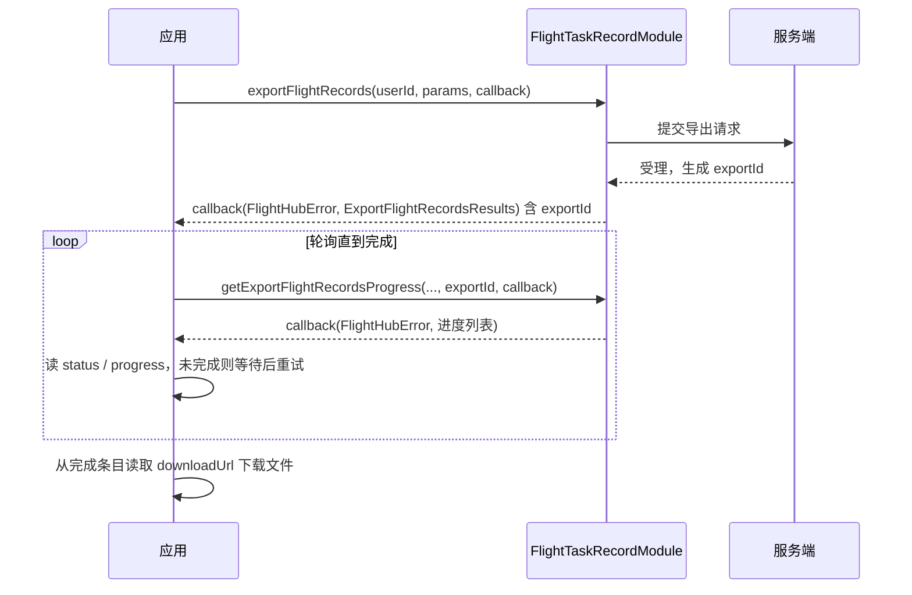

# 飞行记录导出（FlightTaskRecordModule）

## 1 功能概述

### 1.1 功能简介

`FlightTaskRecordModule` 是**工作空间级**的飞行记录导出模块，作用域为当前工作空间下已完成的航线任务。它把选定任务的飞行记录导出为文件（如 Excel）：发起一次导出请求拿到导出任务 ID（`exportId`），再按 `exportId` 分页查询导出进度，进度完成后从进度条目里取下载地址。

本模块只负责**记录的离线导出**，不负责任务本身的编排与实时监控。任务的创建与查询见 [航线任务管理](./wayline-task-manage.md)，运行中的暂停/恢复见 [航线任务控制](./wayline-task-control.md)。导出所用的 `flightTaskIds` 即航线任务的 `uuid`。

**获取方式：**

```java
Workspace workspace = FlightHubSDK.getWorkspaceInstance();
FlightTaskRecordModule flightTaskRecordModule = workspace.getFlightTaskRecordModule();
```

### 1.2 核心概念

| 概念 | 说明 |
| --- | --- |
| 导出是异步任务 | `exportFlightRecords()` 只负责**发起**导出并返回导出任务 ID（`exportId`），文件生成在服务端异步进行，需再用 `getExportFlightRecordsProgress()` 轮询进度。 |
| 导出任务 ID（`exportId`） | 一次导出的唯一标识，用于关联进度查询。 |
| 导出类型（`contentType`） | javadoc 标注枚举：`"summary"` = 摘要、`"details"` = 详情。必填。 |
| 文件类型（`fileType`） | 导出文件格式列表，如 `["Excel"]`。必填。 |
| 用户 ID（`userId`） | 发起导出的用户标识，作为独立入参传入（不在参数对象里）。 |
| 指标（`metrics`） | 导出内容中要包含的指标列表，可选。 |
| 进度条目（`FlightRecordExportProgressItemData`） | 进度查询返回的单条记录，含导出状态 `status`、进度 `progress`、失败原因码 `failedReasonCode`、文件名 `fileName`、对象存储 Key `objectKey` 与下载地址 `downloadUrl`。 |

### 1.3 能力清单

| 能力 | 对应接口 | 接口类型 | 说明 |
| --- | --- | --- | --- |
| 导出飞行记录（参数对象） | `exportFlightRecords(userId, params, cb)` | 异步回调 | 入参 `ExportFlightRecordsRequestParams`，回调返回 `ExportFlightRecordsResults`（含 `exportId`） |
| 导出飞行记录（便捷重载） | `exportFlightRecords(userId, contentType, fileName, timeZone, locale, fileType, flightTaskIds, metrics, cb)` | 异步回调 | 所有参数展开传入，等价于上一条 |
| 查询导出进度 | `getExportFlightRecordsProgress(contentType, status, sort, page, pageSize, exportId, cb)` | 异步回调 | 分页查询导出进度，回调返回 `GetExportFlightRecordsProgressResults` |

---

## 2 前提条件

- 已完成上云 API 2 底座部署，并获取到服务地址与鉴权 Token。详见 [部署指南](../../../02.deployment/00.index.md)、[鉴权接入指南](../../../08.auth.md)。
- 已完成 SDK 初始化且 `FlightHubSDK.isInitialized()` 返回 `true`。详见 [SDK初始化](../init/sdk-init.md)。
- 已通过 `FlightHubSDK.getWorkspaceInstance()` 获取工作空间实例，并调用其 `getFlightTaskRecordModule()` 拿到本模块实例。
- 已有可导出的航线任务：`flightTaskIds` 来自 [航线任务管理](./wayline-task-manage.md) 中任务的 `uuid`，且任务已产生飞行记录。
- 发起导出时必须提供 `userId`，以及必填参数 `contentType`、`fileType`、`fileName`、`flightTaskIds`；缺少任一必填字段将返回错误。

---

## 3 快速上手

### 3.1 获取模块实例

```java
// 前置：已完成 FlightHubSDK.initialize(config)
Workspace workspace = FlightHubSDK.getWorkspaceInstance();
FlightTaskRecordModule module = workspace.getFlightTaskRecordModule();
```

### 3.2 使用流程

1. **获取模块实例** —— 从工作空间实例调用 `getFlightTaskRecordModule()`。
2. **准备任务 ID** —— 从 [航线任务管理](./wayline-task-manage.md) 拿到要导出的 `flightTaskIds`（任务 `uuid` 列表）。
3. **发起导出** —— 组装 `ExportFlightRecordsRequestParams`（必填：`contentType` / `fileType` / `fileName` / `flightTaskIds`），调用 `exportFlightRecords(userId, params, cb)`，保存返回的 `exportId`。
4. **轮询进度** —— 用 `getExportFlightRecordsProgress()` 按 `exportId` 分页查询，直到进度条目的 `status` 表示完成。
5. **取下载地址** —— 从完成的进度条目读取 `downloadUrl`（或 `objectKey`），供用户下载。

### 3.3 调用时序图



---

## 4 示例代码

### 4.1 完整示例

```java
/**
 * 飞行记录导出：发起导出 -> 轮询进度 -> 取下载地址。
 * 注意：导出为异步任务，exportFlightRecords 只返回 exportId，文件在服务端异步生成。
 */
public class FlightRecordExporter {

    private final String userId;

    public FlightRecordExporter(String userId) {
        this.userId = userId;
    }

    // ============ 1. 发起导出（参数对象方式） ============
    public void export(List<String> flightTaskIds) {
        FlightTaskRecordModule module =
                FlightHubSDK.getWorkspaceInstance().getFlightTaskRecordModule();

        ExportFlightRecordsRequestParams params = new ExportFlightRecordsRequestParams();
        params.setContentType("details");                       // [必填] summary=摘要, details=详情
        params.setFileType(java.util.Collections.singletonList("Excel"));  // [必填] 文件类型
        params.setFileName("flight_records_" + System.currentTimeMillis()); // [必填] 文件名
        params.setFlightTaskIds(flightTaskIds);                 // [必填] 任务 uuid 列表
        params.setTimeZone("Asia/Shanghai");                    // 可选
        params.setLocale("zh");                                 // 可选
        // params.setMetrics(Arrays.asList(...));               // 可选，指标列表

        module.exportFlightRecords(userId, params, new FlightHubCallback.ExportFlightRecordsCallback() {
            @Override
            public void onResult(FlightHubError error, ExportFlightRecordsResults results) {
                if (error != null && !error.isSuccess()) {
                    System.err.println("发起导出失败: " + error
                            + " serverCode=" + error.getServerCode()
                            + " msg=" + error.getServerMessage());
                    return;
                }
                if (results == null) return;
                String exportId = results.getExportId();
                System.out.println("导出已受理: exportId=" + exportId);
                // 拿到 exportId 后开始轮询进度
                queryProgress("details", exportId);
            }
        });
    }

    // ============ 2. 查询导出进度 ============
    public void queryProgress(String contentType, String exportId) {
        FlightTaskRecordModule module =
                FlightHubSDK.getWorkspaceInstance().getFlightTaskRecordModule();

        // 参数：contentType, status, sort, page, pageSize, exportId
        module.getExportFlightRecordsProgress(contentType, 0, "desc", 1, 20, exportId,
                new FlightHubCallback.GetExportFlightRecordsProgressCallback() {
                    @Override
                    public void onResult(FlightHubError error, GetExportFlightRecordsProgressResults results) {
                        if (error != null && !error.isSuccess()) {
                            System.err.println("查询导出进度失败: " + error);
                            return;
                        }
                        if (results == null || results.getList() == null) return;

                        for (FlightRecordExportProgressItemData item : results.getList()) {
                            System.out.println("导出项: exportId=" + item.getExportId()
                                    + " 文件名=" + item.getFileName()
                                    + " status=" + item.getStatus()
                                    + " progress=" + item.getProgress()
                                    + " 失败码=" + item.getFailedReasonCode());
                            // progress 达到 100 且有下载地址时即可下载
                            if (item.getProgress() >= 100 && item.getDownloadUrl() != null
                                    && !item.getDownloadUrl().isEmpty()) {
                                System.out.println("  下载地址: " + item.getDownloadUrl()
                                        + " objectKey=" + item.getObjectKey());
                            }
                        }
                        // 注意：未完成时应在业务侧延时后重试本方法，避免高频轮询
                    }
                });
    }
}
```

### 4.2 场景化片段

**便捷重载：一行发起导出（参数展开传入）**

```java
// 前置：SDK 已初始化。等价于参数对象方式，适合参数固定的场景
FlightHubSDK.getWorkspaceInstance().getFlightTaskRecordModule().exportFlightRecords(
        "15478287234981xxxxx",                       // userId
        "summary",                                   // contentType：摘要
        "records_summary",                           // fileName
        "Asia/Shanghai",                             // timeZone
        "zh",                                        // locale
        java.util.Collections.singletonList("Excel"),// fileType
        flightTaskIds,                               // flightTaskIds（必填）
        null,                                        // metrics（可选，可传 null）
        (error, results) -> {
            if (error != null && !error.isSuccess()) {
                System.err.println("导出失败: " + error);
                return;
            }
            System.out.println("exportId=" + (results != null ? results.getExportId() : "-"));
        });
```

---

## 5 相关文档

- [SDK初始化](../init/sdk-init.md) —— 获取工作空间实例与调用本模块前必须完成的初始化步骤
- [航线任务管理](./wayline-task-manage.md) —— 导出所需 `flightTaskIds`（任务 `uuid`）的来源
- [航线任务控制](./wayline-task-control.md) —— 任务执行过程中的暂停、恢复与控制权状态
- [航线资产管理](./wayline-asset-manage.md) —— 任务所执行航线的管理
- [部署指南](../../../02.deployment/00.index.md) —— 上云 API 2 底座部署与服务地址获取
- [鉴权接入指南](../../../08.auth.md) —— 获取鉴权 Token 的接入流程
- [使用 API 文档查阅接口详情](../../03.api-docs-guide.md) —— 查阅 `FlightTaskRecordModule` 完整方法签名与字段定义
