# 航线资产管理（WaylineManageModule）

## 1 功能概述

### 1.1 功能简介

`WaylineManageModule` 是**工作空间级**的航线资产管理模块，作用域为当前工作空间下的航线库。它负责航线文件（KMZ）在云端的全生命周期管理：查询航线列表与详情、上传本地 KMZ 并触发导入、重命名航线、创建副本、航线复制与拼接、批量下载、批量删除，以及订阅航线导入事件的实时结果。

本模块只负责**航线资产本身**的增删改查与导入，不负责把航线下发给设备执行。航线执行属于「航线任务」：任务的创建与查询见 [航线任务管理](./wayline-task-manage.md)，任务运行中的暂停/恢复见 [航线任务控制](./wayline-task-control.md)。本模块产出的 `waylineUuid` 是航线任务创建时绑定航线的入参。

**获取方式：**

```java
Workspace workspace = FlightHubSDK.getWorkspaceInstance();
WaylineManageModule waylineManageModule = workspace.getWaylineManageModule();
```

### 1.2 核心概念

| 概念 | 说明 |
| --- | --- |
| 航线（Wayline） | 一条以 KMZ 文件承载的飞行航线，云端以 `waylineUuid` 唯一标识。航线任务创建时通过该 UUID 绑定要执行的航线。 |
| KMZ 文件 | 大疆航线文件格式（`.kmz` 后缀）。`importKmz()` 只接受 `.kmz` 后缀的本地文件。 |
| 对象存储 Key（`kmzObjectKey`） | KMZ 文件在对象存储中的路径。导入成功后返回，格式形如 `wayline/import/xxx.kmz`。 |
| 导入事件（`ImportWaylineEventResult`） | 航线导入是异步过程：文件上传对象存储后由服务端解析导入，解析结果通过 `listenImportWaylineEvent()` 的事件回调推送，含 `asyncRequestId`、`waylineUuid`、结果码 `code` 与消息 `message`。 |
| STS 临时凭证 | `getWaylineEditorSts()` 返回的对象存储临时上传凭证，用于航线编辑器场景下由前端直传 KMZ 到对象存储，再用 `submitWaylineInfo()` 提交文件信息入库。 |
| 副本 / 复制 / 拼接 | `duplicateWayline()` 在当前工作空间创建航线副本；`copyWayline()` 为去组织化复制（不需要 `workspace_id`）；`concatWayline()` 将多条子航线拼接为一条新航线。 |
| 监听 ID（`listenId`） | `listenImportWaylineEvent()` 返回的整型句柄。取消订阅时必须回传同一个 `listenId`，否则订阅不会被释放。 |

### 1.3 能力清单

| 能力 | 对应接口 | 接口类型 | 说明 |
| --- | --- | --- | --- |
| 查询航线列表 | `getWaylineList(param, cb)` | 异步回调 | 分页查询，支持按飞行器类型/载荷类型/航线类型/UUID/时间范围过滤，回调返回列表与分页信息 |
| 查询航线详情 | `getWaylineDetail(waylineUuid, cb)` | 异步回调 | 返回单条航线的下载 URL、MD5、KMZ 解析数据、编辑态/执行态告警等 |
| 上传并导入 KMZ | `importKmz(filePaths, cb)` | 异步回调 | 上传一个或多个本地 `.kmz` 文件，系统自动上传对象存储并触发导入 |
| 提交航线文件信息 | `submitWaylineInfo(param, cb)` | 异步回调 | 前端经 STS 直传 KMZ 后，提交文件信息入库，回调仅返回错误信息 |
| 获取编辑器 STS 凭证 | `getWaylineEditorSts(params, cb)` | 异步回调 | 获取对象存储 STS 临时上传凭证（`objectKeyPrefix` 必填） |
| 重命名航线 | `updateWayline(waylineUuid, waylineName, cb)` | 异步回调 | 更新航线名称 |
| 创建航线副本 | `duplicateWayline(param, cb)` | 异步回调 | 在当前工作空间创建副本 |
| 复制航线（去组织化） | `copyWayline(param, cb)` | 异步回调 | 不需要 `workspace_id`，入参为原始航线 UUID + 目标航线名称 |
| 拼接航线（去组织化） | `concatWayline(param, cb)` | 异步回调 | 不需要 `workspace_id`，入参为目标名称 + `kmzObjectKey` + 子航线 UUID 列表 |
| 批量下载航线 | `batchDownloadWaylines(param, cb)` | 异步回调 | 回调返回每条航线的下载结果列表 |
| 批量删除航线 | `batchDeleteWaylines(waylineUuids, cb)` | 异步回调 | 传入航线 UUID 列表，回调返回删除结果与错误信息 |
| 订阅航线导入事件 | `listenImportWaylineEvent(cb)` / `cancelListenImportWaylineEvent(listenId)` | 事件订阅 | 订阅导入解析结果的实时推送，事件回调仅返回结果 |

---

## 2 前提条件

- 已完成上云 API 2 底座部署，并获取到服务地址与鉴权 Token。详见 [部署指南](../../../02.deployment/00.index.md)、[鉴权接入指南](../../../08.auth.md)。
- 已完成 SDK 初始化且 `FlightHubSDK.isInitialized()` 返回 `true`。详见 [SDK初始化](../init/sdk-init.md)。
- 已通过 `FlightHubSDK.getWorkspaceInstance()` 获取工作空间实例，并调用其 `getWaylineManageModule()` 拿到本模块实例。
- 使用 `importKmz()` 时，传入的必须是本地可读的 `.kmz` 文件路径；非 `.kmz` 后缀不被接受。
- 若需使用 `listenImportWaylineEvent()` 订阅导入事件，SDK 配置中的 `notificationServerAddress`（WebSocket 通知地址）必须正确且连接可用，否则接口能返回 `listenId`，但事件回调不会被触发。详见 [SDK配置](../init/sdk-config.md)。

---

## 3 快速上手

### 3.1 获取模块实例

```java
// 前置：已完成 FlightHubSDK.initialize(config)
Workspace workspace = FlightHubSDK.getWorkspaceInstance();
WaylineManageModule waylineManageModule = workspace.getWaylineManageModule();
```

### 3.2 使用流程

1. **获取模块实例** —— 从工作空间实例调用 `getWaylineManageModule()`。
2. **订阅导入事件（导入前）** —— 若通过 `importKmz()` 导入，先调用 `listenImportWaylineEvent()` 并保存 `listenId`，以便接收异步导入结果。
3. **导入航线** —— 调用 `importKmz(filePaths)` 上传本地 KMZ；回调返回同步导入结果，异步解析结果由步骤 2 的事件回调推送。
4. **查询列表** —— 调用 `getWaylineList()` 分页拉取航线，注意处理分页（`pagination.getTotal()`）。
5. **查询详情** —— 对某条航线调用 `getWaylineDetail(waylineUuid)` 获取下载 URL、MD5、KMZ 解析数据等。
6. **维护航线** —— 按需 `updateWayline()` 重命名、`duplicateWayline()` 建副本、`batchDownloadWaylines()` 下载、`batchDeleteWaylines()` 删除。
7. **退出时取消订阅** —— 用步骤 2 保存的 `listenId` 调用 `cancelListenImportWaylineEvent()`。

### 3.3 调用时序图

```mermaid
sequenceDiagram
    participant 应用
    participant WaylineManageModule
    participant 服务端

    应用->>WaylineManageModule: listenImportWaylineEvent(callback)
    WaylineManageModule-->>应用: int listenId

    应用->>WaylineManageModule: importKmz(filePaths, callback)
    WaylineManageModule->>服务端: 上传对象存储并触发导入
    WaylineManageModule-->>应用: callback(FlightHubError, ImportKmzResult)
    服务端-->>WaylineManageModule: 异步导入解析完成
    WaylineManageModule-->>应用: callback(ImportWaylineEventResult) 事件推送

    应用->>WaylineManageModule: getWaylineList(param, callback)
    WaylineManageModule-->>应用: callback(FlightHubError, GetWaylineListResult)
    应用->>WaylineManageModule: getWaylineDetail(waylineUuid, callback)
    WaylineManageModule-->>应用: callback(FlightHubError, GetWaylineDetailResult)

    应用->>WaylineManageModule: updateWayline(uuid, name, callback)
    WaylineManageModule-->>应用: callback(FlightHubError, UpdateWaylineResult)
    应用->>WaylineManageModule: batchDeleteWaylines(uuids, callback)
    WaylineManageModule-->>应用: callback(FlightHubError, BatchDeleteWaylinesResult)

    应用->>WaylineManageModule: cancelListenImportWaylineEvent(listenId)
```



---

## 4 示例代码

### 4.1 完整示例

```java
/**
 * 航线资产管理：订阅导入事件 -> 上传 KMZ -> 分页查列表 -> 查详情 -> 重命名 -> 删除 -> 退订。
 */
public class WaylineAssetManager {

    private int importListenId = -1;

    public void run(List<String> kmzFilePaths) {
        Workspace workspace = FlightHubSDK.getWorkspaceInstance();
        WaylineManageModule module = workspace.getWaylineManageModule();

        // ============ 1. 先订阅导入事件（事件回调仅返回 result，无 error 参数） ============
        importListenId = module.listenImportWaylineEvent(new FlightHubCallback.ImportWaylineEventCallback() {
            @Override
            public void onResult(ImportWaylineEventResult result) {
                if (result == null) return;   // 注意：订阅回调无 error 参数，需对 result 判空
                // code=0 通常表示导入成功，非 0 表示解析失败，具体以服务端返回为准
                System.out.println("[导入事件] asyncRequestId=" + result.getAsyncRequestId()
                        + " waylineUuid=" + result.getWaylineUuid()
                        + " code=" + result.getCode()
                        + " msg=" + result.getMessage()
                        + " kmzObjectKey=" + result.getKmzObjectKey());
            }
        });

        // ============ 2. 上传本地 KMZ 并触发导入（回调为 error + result） ============
        // 注意：仅接受 .kmz 后缀的本地文件路径
        module.importKmz(kmzFilePaths, new FlightHubCallback.ImportKmzCallback() {
            @Override
            public void onResult(FlightHubError error, ImportKmzResult result) {
                if (error != null && !error.isSuccess()) {
                    System.err.println("导入 KMZ 失败: " + error
                            + " serverCode=" + error.getServerCode()
                            + " msg=" + error.getServerMessage());
                    return;
                }
                if (result == null || result.getList() == null) return;
                System.out.println("同步导入成功数量: " + result.getTotal());
                for (ImportKmzItem item : result.getList()) {
                    // 注意：waylineUuid 在异步解析完成后由 listenImportWaylineEvent 事件带出，
                    // 这里拿到的是文件对象 Key 与 asyncRequestId，用于关联异步结果
                    System.out.println("  文件已上传: " + item.getKmzObjectKey()
                            + " 名称=" + item.getWaylineName()
                            + " asyncRequestId=" + item.getAsyncRequestId());
                }
            }
        });

        // ============ 3. 分页查询航线列表 ============
        queryPage(module, 1, 20);
    }

    private void queryPage(WaylineManageModule module, int page, int pageSize) {
        GetWaylineListParam param = new GetWaylineListParam();
        param.setPage(page);              // 注意：页码与每页数量为必填
        param.setPageSize(pageSize);
        // 可选过滤：param.setDroneTypes(...); param.setWaylineTypes(...);
        // 注意：startTimestamp 与 endTimestamp 为秒级时间戳，且需成对传入

        module.getWaylineList(param, new FlightHubCallback.GetWaylineListCallback() {
            @Override
            public void onResult(FlightHubError error, GetWaylineListResult result) {
                if (error != null && !error.isSuccess()) {
                    System.err.println("查询航线列表失败: " + error);
                    return;
                }
                if (result == null || result.getItems() == null) return;

                for (WaylineListItemResult item : result.getItems()) {
                    System.out.println("航线 uuid=" + item.getWaylineUuid()
                            + " 名称=" + item.getWaylineName()
                            + " 机型=" + item.getDroneType()
                            + " 大小=" + item.getSize()
                            + " 携带喊话器=" + item.isWithMegaphone()
                            + " 携带探照灯=" + item.isWithSearchLight()
                            + " AI航线=" + item.isAiWayline());
                    // 拉取首条航线的详情
                    queryDetail(module, item.getWaylineUuid());
                }

                // 注意：必须处理分页，只取第一页会漏数据
                WaylineListPaginationResult pg = result.getPagination();
                if (pg != null && pg.getPage() * pg.getPageSize() < pg.getTotal()) {
                    queryPage(module, pg.getPage() + 1, pg.getPageSize());
                }
            }
        });
    }

    // ============ 4. 查询航线详情 ============
    private void queryDetail(WaylineManageModule module, String waylineUuid) {
        module.getWaylineDetail(waylineUuid, new FlightHubCallback.GetWaylineDetailCallback() {
            @Override
            public void onResult(FlightHubError error, GetWaylineDetailResult result) {
                if (error != null && !error.isSuccess()) {
                    System.err.println("查询航线详情失败: " + error);
                    return;
                }
                if (result == null) return;
                System.out.println("详情: 名称=" + result.getWaylineName()
                        + " md5=" + result.getMd5()
                        + " 下载URL=" + result.getUrl()
                        + " kmzObjectKey=" + result.getKmzObjectKey()
                        + " 更新时间=" + result.getUpdatedAt());
                // 编辑态/执行态告警可用于提示航线是否存在参数问题
                if (result.getExecuteWarnings() != null && !result.getExecuteWarnings().isEmpty()) {
                    System.out.println("  执行态告警: " + result.getExecuteWarnings());
                }
            }
        });
    }

    // ============ 5. 重命名航线 ============
    public void rename(String waylineUuid, String newName) {
        FlightHubSDK.getWorkspaceInstance().getWaylineManageModule()
                .updateWayline(waylineUuid, newName, new FlightHubCallback.UpdateWaylineCallback() {
                    @Override
                    public void onResult(FlightHubError error, UpdateWaylineResult result) {
                        boolean ok = error != null && error.isSuccess();
                        System.out.println("重命名: " + (ok ? "成功" : "失败 " + error));
                    }
                });
    }

    // ============ 6. 批量删除航线 ============
    public void delete(List<String> waylineUuids) {
        FlightHubSDK.getWorkspaceInstance().getWaylineManageModule()
                .batchDeleteWaylines(waylineUuids, new FlightHubCallback.BatchDeleteWaylinesCallback() {
                    @Override
                    public void onResult(FlightHubError error, BatchDeleteWaylinesResult result) {
                        if (error != null && !error.isSuccess()) {
                            System.err.println("批量删除失败: " + error);
                            return;
                        }
                        System.out.println("批量删除完成: serverCode="
                                + (result != null ? result.getServerCode() : "-"));
                    }
                });
    }

    // ============ 7. 退出前取消订阅（必须执行，否则订阅泄漏） ============
    public void shutdown() {
        if (importListenId != -1) {
            FlightHubSDK.getWorkspaceInstance().getWaylineManageModule()
                    .cancelListenImportWaylineEvent(importListenId);
            importListenId = -1;
        }
    }
}
```

### 4.2 场景化片段

**批量下载航线文件到本地归档**

```java
// 前置：SDK 已初始化；waylineUuids 为待下载的航线 UUID 列表
BatchDownloadWaylinesParam param = new BatchDownloadWaylinesParam();
param.setWaylineUuids(waylineUuids);   // 字段以 javadoc BatchDownloadWaylinesParam 为准

FlightHubSDK.getWorkspaceInstance().getWaylineManageModule()
        .batchDownloadWaylines(param, new FlightHubCallback.BatchDownloadWaylinesCallback() {
            @Override
            public void onResult(FlightHubError error, List<BatchDownloadWaylinesItemResult> items) {
                if (error != null && !error.isSuccess()) {
                    System.err.println("批量下载失败: " + error);
                    return;
                }
                if (items == null) return;
                // 注意：回调返回的是每条航线的下载结果列表，需逐条处理成功/失败
                for (BatchDownloadWaylinesItemResult item : items) {
                    System.out.println("下载项: " + item);
                }
            }
        });
```

**创建航线副本用于二次编辑**

```java
// 前置：SDK 已初始化。duplicateWayline 在当前工作空间创建副本，
// 具体入参字段以 javadoc DuplicateWaylineParam 为准
DuplicateWaylineParam param = new DuplicateWaylineParam();
// param.setWaylineUuid(sourceUuid); ...

FlightHubSDK.getWorkspaceInstance().getWaylineManageModule()
        .duplicateWayline(param, (error, result) -> {
            if (error != null && !error.isSuccess()) {
                System.err.println("创建副本失败: " + error);
                return;
            }
            System.out.println("副本已创建: " + result);
        });
```

---

## 5 相关文档

- [SDK初始化](../init/sdk-init.md) —— 获取工作空间实例与调用本模块前必须完成的初始化步骤
- [SDK配置](../init/sdk-config.md) —— WebSocket 通知地址等配置项，影响导入事件订阅能否收到推送
- [航线任务管理](./wayline-task-manage.md) —— 用本模块产出的 `waylineUuid` 创建并管理航线任务
- [航线任务控制](./wayline-task-control.md) —— 航线任务执行过程中的暂停、恢复与控制权状态
- [飞行记录导出](./flight-record-export.md) —— 航线任务执行后的飞行记录导出
- [部署指南](../../../02.deployment/00.index.md) —— 上云 API 2 底座部署与服务地址获取
- [鉴权接入指南](../../../08.auth.md) —— 获取鉴权 Token 的接入流程
- [使用 API 文档查阅接口详情](../../03.api-docs-guide.md) —— 查阅 `WaylineManageModule` 完整方法签名与字段定义
