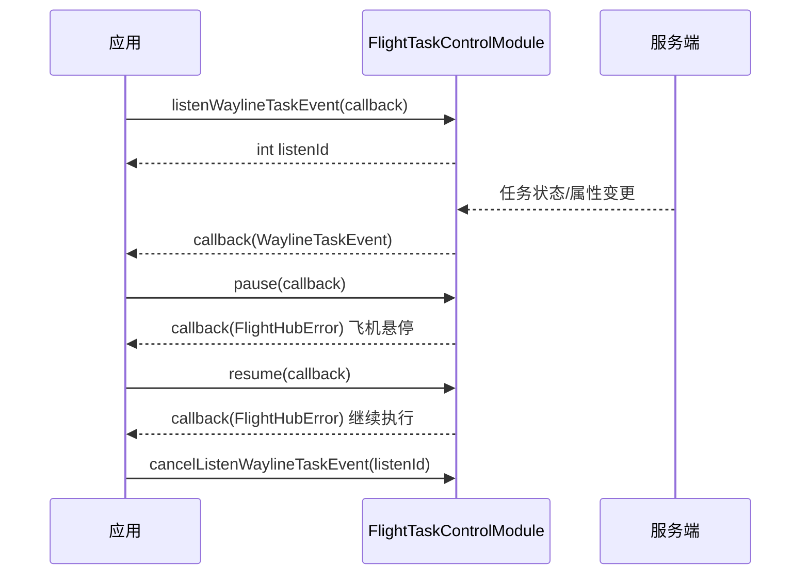

# 航线任务控制（FlightTaskControlModule）

## 1 功能概述

### 1.1 功能简介

`FlightTaskControlModule` 是**飞机级**的航线任务控制模块，作用域为一架正在执行航线任务的飞机。它解决的是「任务已经在飞，如何实时干预」这一件事：暂停当前航线任务、恢复被暂停的任务，以及订阅该飞机航线任务事件（创建、属性更新、删除、障碍物变更、执行输出）的实时推送。

本模块只做**运行中任务的实时控制**，不负责任务的创建、查询、删除与状态编排——那些属于工作空间级的 [航线任务管理](./wayline-task-manage.md)。二者配合使用：任务由 `FlightTaskModule` 创建下发，运行过程中的暂停/恢复由本模块完成。

**获取方式：**

```java
Drone drone = FlightHubSDK.getDroneInstance("your_drone_sn");
FlightTaskControlModule flightTaskControlModule = drone.getFlightTaskControlModule();
```

### 1.2 核心概念

| 概念 | 说明 |
| --- | --- |
| 飞机级作用域 | 本模块实例已绑定获取它的飞机（`getDroneInstance(sn)`），`pause()` / `resume()` 作用于这架飞机当前正在执行的航线任务。 |
| 暂停 / 恢复 | `pause()` 让飞机在当前位置悬停等待；`resume()` 从暂停点继续执行航线。两者均为异步回调，仅返回错误信息。 |
| 航线任务事件（`WaylineTaskEvent`） | 通过 `listenWaylineTaskEvent()` 推送的事件，含 `eventId`、`action`、任务 `uuid`、毫秒时间戳 `timestamp` 与任务详情 `taskData`。 |
| 事件动作（`action`） | javadoc 标注枚举：`wayline_task_created` 任务创建、`wayline_task_attr_updated` 任务属性更新、`wayline_task_deleted` 任务删除、`wayline_task_obstracle_changed` 障碍物变更、`wayline_task_execute_output` 任务执行输出。 |
| 任务数据（`WaylineTaskData`） | 事件携带的任务快照，含任务状态、当前/总航点数、返航高度、断点信息等，可用于驱动作业面板实时刷新。 |
| 监听 ID（`listenId`） | `listenWaylineTaskEvent()` 返回的整型句柄，取消订阅时必须回传同一个值。 |

### 1.3 能力清单

| 能力 | 对应接口 | 接口类型 | 说明 |
| --- | --- | --- | --- |
| 暂停当前航线任务 | `pause(cb)` | 异步回调 | 让飞机在当前位置悬停等待，回调仅返回错误信息 |
| 恢复当前航线任务 | `resume(cb)` | 异步回调 | 从暂停点继续执行航线，回调仅返回错误信息 |
| 订阅航线任务事件 | `listenWaylineTaskEvent(cb)` | 事件订阅 | 返回 `int listenId`，事件回调仅返回 `WaylineTaskEvent` |
| 取消订阅航线任务事件 | `cancelListenWaylineTaskEvent(listenId)` | 同步返回 | 传入订阅时返回的 `listenId` |

---

## 2 前提条件

- 已完成上云 API 2 底座部署，并获取到服务地址与鉴权 Token。详见 [部署指南](../../../02.deployment/00.index.md)、[鉴权接入指南](../../../08.auth.md)。
- 已完成 SDK 初始化且 `FlightHubSDK.isInitialized()` 返回 `true`。详见 [SDK初始化](../init/sdk-init.md)。
- 已通过 `FlightHubSDK.getDroneInstance(sn)` 获取目标飞机实例，并调用其 `getFlightTaskControlModule()` 拿到本模块实例。
- `pause()` / `resume()` 生效的前提是该飞机确实存在一个正在执行（或已暂停）的航线任务；任务的创建与下发见 [航线任务管理](./wayline-task-manage.md)。
- 若需使用 `listenWaylineTaskEvent()` 订阅任务事件，SDK 配置中的 `notificationServerAddress` 必须正确且连接可用，否则接口能返回 `listenId`，但事件回调不会被触发。详见 [SDK配置](../init/sdk-config.md)。

---

## 3 快速上手

### 3.1 获取模块实例

```java
// 前置：已完成 FlightHubSDK.initialize(config)
Drone drone = FlightHubSDK.getDroneInstance("your_drone_sn");
FlightTaskControlModule module = drone.getFlightTaskControlModule();
```

### 3.2 使用流程

1. **获取模块实例** —— 从目标飞机实例调用 `getFlightTaskControlModule()`。
2. **订阅任务事件** —— 调用 `listenWaylineTaskEvent()` 并保存 `listenId`，用于实时驱动作业面板。
3. **暂停任务** —— 需要临时中断时调用 `pause()`，飞机原地悬停等待。
4. **恢复任务** —— 处理完毕后调用 `resume()`，从暂停点继续。
5. **根据事件刷新状态** —— 在事件回调中读取 `action` 与 `taskData`，同步任务进度与航点。
6. **退出时取消订阅** —— 用步骤 2 保存的 `listenId` 调用 `cancelListenWaylineTaskEvent()`。

### 3.3 调用时序图



---

## 4 示例代码

### 4.1 完整示例

```java
/**
 * 航线任务实时控制：订阅任务事件 -> 暂停 -> 恢复 -> 退订。
 */
public class WaylineTaskController {

    private int listenId = -1;
    private final String droneSn;

    public WaylineTaskController(String droneSn) {
        this.droneSn = droneSn;
    }

    // ============ 1. 订阅航线任务事件（事件回调仅返回 event，无 error 参数） ============
    public void start() {
        FlightTaskControlModule module =
                FlightHubSDK.getDroneInstance(droneSn).getFlightTaskControlModule();

        listenId = module.listenWaylineTaskEvent(new FlightHubCallback.WaylineTaskEventCallback() {
            @Override
            public void onResult(WaylineTaskEvent event) {
                if (event == null) return;   // 注意：订阅回调无 error 参数，需对 event 判空
                System.out.println("[任务事件] action=" + event.getAction()
                        + " uuid=" + event.getUuid()
                        + " ts=" + event.getTimestamp());

                WaylineTaskData data = event.getTaskData();
                if (data != null) {
                    System.out.println("  状态=" + statusText(data.getStatus())
                            + " 航点=" + data.getCurrentWaypointIndex() + "/" + data.getTotalWaypoints()
                            + " 机场=" + data.getSn());
                }
            }
        });
    }

    // ============ 2. 暂停当前航线任务（飞机原地悬停） ============
    public void pause() {
        FlightHubSDK.getDroneInstance(droneSn).getFlightTaskControlModule()
                .pause(new FlightHubCallback.ResultCallbackWithError() {
                    @Override
                    public void onResult(FlightHubError error) {
                        boolean ok = error != null && error.isSuccess();
                        // 注意：无正在执行的任务时暂停会失败，需读取 error 判断原因
                        System.out.println("暂停任务: " + (ok ? "成功" : "失败 " + error));
                    }
                });
    }

    // ============ 3. 恢复当前航线任务（从暂停点继续） ============
    public void resume() {
        FlightHubSDK.getDroneInstance(droneSn).getFlightTaskControlModule()
                .resume(error -> {
                    boolean ok = error != null && error.isSuccess();
                    System.out.println("恢复任务: " + (ok ? "成功" : "失败 " + error));
                });
    }

    // ============ 4. 退出前取消订阅（必须执行，否则订阅泄漏） ============
    public void stop() {
        if (listenId != -1) {
            FlightHubSDK.getDroneInstance(droneSn).getFlightTaskControlModule()
                    .cancelListenWaylineTaskEvent(listenId);
            listenId = -1;
        }
    }

    /** javadoc 标注枚举 */
    private static String statusText(int s) {
        switch (s) {
            case 0:  return "待开始";
            case 1:  return "启动失败";
            case 2:  return "执行中";
            case 3:  return "已暂停";
            case 4:  return "已终止";
            case 5:  return "成功";
            case 6:  return "挂起";
            case 7:  return "超时";
            case 8:  return "部分执行";
            case 9:  return "准备中";
            case 10: return "起飞排队中";
            default: return "未知(" + s + ")";
        }
    }
}
```

### 4.2 场景化片段

**根据任务事件动作分发处理**

```java
// 前置：在 listenWaylineTaskEvent 的回调中拿到 event
switch (event.getAction()) {
    case "wayline_task_created":          // 任务创建
        System.out.println("新任务下发: " + event.getUuid());
        break;
    case "wayline_task_attr_updated":     // 任务属性更新（含状态、航点进度）
        // 用 event.getTaskData() 刷新作业面板
        break;
    case "wayline_task_obstracle_changed":// 障碍物变更（注意：这是 javadoc 中的原始拼写）
        System.out.println("障碍物变更，建议关注避障");
        break;
    case "wayline_task_execute_output":   // 任务执行输出
        break;
    case "wayline_task_deleted":          // 任务删除
        break;
    default:
        break;
}
```

---

## 5 相关文档

- [SDK初始化](../init/sdk-init.md) —— 获取飞机实例与调用本模块前必须完成的初始化步骤
- [SDK配置](../init/sdk-config.md) —— WebSocket 通知地址等配置项，影响任务事件订阅能否收到推送
- [航线任务管理](./wayline-task-manage.md) —— 任务的创建、查询、删除与状态编排（工作空间级）
- [航线资产管理](./wayline-asset-manage.md) —— 任务所执行航线的来源
- [飞行记录导出](./flight-record-export.md) —— 任务完成后的飞行记录导出
- [部署指南](../../../02.deployment/00.index.md) —— 上云 API 2 底座部署与服务地址获取
- [鉴权接入指南](../../../08.auth.md) —— 获取鉴权 Token 的接入流程
- [使用 API 文档查阅接口详情](../../03.api-docs-guide.md) —— 查阅 `FlightTaskControlModule` 完整方法签名与字段定义
