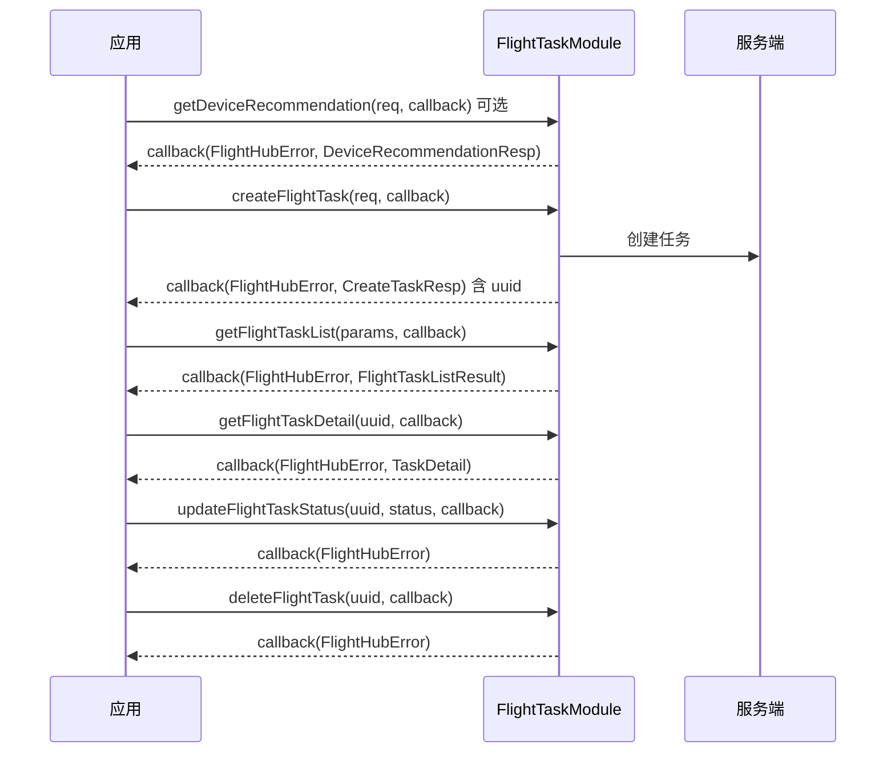

# 航线任务管理（FlightTaskModule）

## 1 功能概述

### 1.1 功能简介

`FlightTaskModule` 是**工作空间级**的航线任务管理模块，作用域为当前工作空间下的全部航线任务。它把「航线」下发给机场设备执行：创建/编辑/删除任务、分页查询任务列表与详情、查询任务轨迹、更新任务状态（含批量），并提供设备推荐、TCAS（防撞）配置、漫游调度等进阶能力。

本模块负责任务的**编排与生命周期**，不负责航线文件本身的管理，也不负责任务运行中的实时暂停/恢复。航线资产（`waylineUuid` 的来源）见 [航线资产管理](./wayline-asset-manage.md)；任务执行过程中的暂停/恢复见 [航线任务控制](./wayline-task-control.md)；任务完成后的记录导出见 [飞行记录导出](./flight-record-export.md)。

**获取方式：**

```java
Workspace workspace = FlightHubSDK.getWorkspaceInstance();
FlightTaskModule flightTaskModule = workspace.getFlightTaskModule();
```

### 1.2 核心概念

| 概念 | 说明 |
| --- | --- |
| 航线任务 | 一次「用某条航线、在某台机场、按某种触发方式执行」的作业，云端以 `taskUuid`（`uuid`）唯一标识。 |
| 任务类型（`taskType`） | `1` = 立即任务；`2` = 条件任务（须设置执行窗口 `beginAt` / `endAt`，且 `endAt > beginAt`）。 |
| 任务状态（`status`） | javadoc 标注枚举：`0` 待开始、`1` 启动失败、`2` 执行中、`3` 已暂停、`4` 已终止、`5` 成功、`6` 挂起、`7` 超时、`8` 部分执行、`9` 准备中、`10` 起飞排队中。 |
| 失控动作（`outOfControlActionInFlight`） | 飞行中失去链路时的动作：`1` = 返航、`2` = 继续执行。创建任务时必填。 |
| 返航高度与模式 | `rthAltitude`（米，必填）配合 `rthMode`（`0` 智能高度 / `1` 设定高度，`-1` 未设置）。 |
| 起飞 / 降落机场 | `sn` 为起飞机场序列号（必填）；`landingDockSn` 为降落机场，留空表示与起飞机场一致。 |
| 设备推荐 | `getDeviceRecommendation()` 依据航线坐标与策略，从候选 SN 列表推荐最优执行设备。 |
| 漫游调度 | 一架飞机跨多台基站/机场作业时的信号增强与拓扑管理：`startRoaming()` 发起，`getInFlightTaskTopos()` 查拓扑，`listenTaskTopoChanged()` 订阅拓扑变更。 |
| 监听 ID（`listenId`） | `listenTaskTopoChanged()` 返回的整型句柄，**失败时返回 `-1`**；取消订阅时必须回传同一个值。 |

### 1.3 能力清单

| 能力 | 对应接口 | 接口类型 | 说明 |
| --- | --- | --- | --- |
| 创建任务 | `createFlightTask(req, cb)` | 异步回调 | 入参 `CreateTaskReq`，回调返回 `CreateTaskResp`（含 `uuid` 与航线有效性校验码） |
| 编辑任务 | `editFlightTask(taskUuid, req, cb)` | 异步回调 | 入参 `EditTaskReq`，回调复用 `CreateFlightTaskCallback` |
| 删除任务 | `deleteFlightTask(taskUuid, cb)` | 异步回调 | 回调仅返回错误信息 |
| 更新任务状态 | `updateFlightTaskStatus(taskUuid, status, cb)` | 异步回调 | 传入目标状态值，回调仅返回错误信息 |
| 批量更新任务状态 | `batchUpdateFlightTaskStatus(req, cb)` | 异步回调 | 入参含任务 UUID 列表 + 目标状态 |
| 查询任务列表 | `getFlightTaskList(params, cb)` | 异步回调 | 分页查询，支持按 SN/状态/类型/名称/时间过滤 |
| 查询任务详情 | `getFlightTaskDetail(taskUuid, cb)` | 异步回调 | 回调返回 `TaskDetail` |
| 查询任务轨迹 | `getFlightTaskTrack(params, cb)` | 异步回调 | 回调返回轨迹结果 |
| 查询指令任务列表 | `getCommandTaskList(params, cb)` | 异步回调 | 回调返回指令任务列表 |
| 获取设备推荐 | `getDeviceRecommendation(req, cb)` | 异步回调 | 依据航线与策略推荐最优设备 |
| 查询设备 TCAS | `getDeviceTcas(centerSn, cb)` | 异步回调 | 入参中心设备 SN 列表 |
| 更新设备 TCAS | `updateDeviceTcas(centerSn, cb)` | 异步回调 | 回调仅返回错误信息 |
| 开始漫游调度 | `startRoaming(params, cb)` | 异步回调 | 入参含无人机 SN、架次 UUID、来源任务类型（1=航线，2=一键起飞） |
| 设置漫游基站白名单 | `setRoamingStationSn(params, cb)` | 异步回调 | 设置飞机级漫游基站白名单 |
| 查询飞行中任务拓扑 | `getInFlightTaskTopos(droneSns, cb)` | 异步回调 | `droneSns` 数量范围 1–10 |
| 订阅拓扑变更 | `listenTaskTopoChanged(cb)` / `cancelListenTaskTopoChanged(listenId)` | 事件订阅 | 订阅漫游任务拓扑变更推送，事件回调仅返回 `event` |

---

## 2 前提条件

- 已完成上云 API 2 底座部署，并获取到服务地址与鉴权 Token。详见 [部署指南](../../../02.deployment/00.index.md)、[鉴权接入指南](../../../08.auth.md)。
- 已完成 SDK 初始化且 `FlightHubSDK.isInitialized()` 返回 `true`。详见 [SDK初始化](../init/sdk-init.md)。
- 已通过 `FlightHubSDK.getWorkspaceInstance()` 获取工作空间实例，并调用其 `getFlightTaskModule()` 拿到本模块实例。
- 创建任务前，已有可用的航线：`waylineUuid` 来自 [航线资产管理](./wayline-asset-manage.md)。
- 起飞机场（`sn`）已完成上云、已绑定至当前工作空间且在线，否则任务无法下发执行。详见 [设备上云](../../../04.device-onboarding/00.index.md)。
- 若需使用 `listenTaskTopoChanged()` 订阅拓扑变更，SDK 配置中的 `notificationServerAddress` 必须正确且连接可用，否则接口返回的 `listenId` 有效但事件回调不会被触发。详见 [SDK配置](../init/sdk-config.md)。

---

## 3 快速上手

### 3.1 获取模块实例

```java
// 前置：已完成 FlightHubSDK.initialize(config)
Workspace workspace = FlightHubSDK.getWorkspaceInstance();
FlightTaskModule flightTaskModule = workspace.getFlightTaskModule();
```

### 3.2 使用流程

1. **获取模块实例** —— 从工作空间实例调用 `getFlightTaskModule()`。
2. **准备航线** —— 从 [航线资产管理](./wayline-asset-manage.md) 拿到要执行的 `waylineUuid`。
3. **（可选）设备推荐** —— 用 `getDeviceRecommendation()` 依据航线与策略挑选最优机场 SN。
4. **创建任务** —— 组装 `CreateTaskReq`（必填：`name` / `sn` / `taskType` / `timeZone` / `waylineUuid` / `outOfControlActionInFlight` / `rthAltitude`），调用 `createFlightTask()`，保存返回的 `uuid`。
5. **查询与监控** —— 用 `getFlightTaskList()` / `getFlightTaskDetail()` 查看任务与状态；用 `getFlightTaskTrack()` 查轨迹。
6. **状态干预** —— 需要终止或改变状态时调用 `updateFlightTaskStatus()`；任务运行中的暂停/恢复请用 [航线任务控制](./wayline-task-control.md)。
7. **清理** —— 不再需要的任务用 `deleteFlightTask()` 删除；若订阅了拓扑变更，退出前 `cancelListenTaskTopoChanged()`。

### 3.3 调用时序图



---

## 4 示例代码

### 4.1 完整示例

```java
/**
 * 航线任务全流程：创建立即任务 -> 分页查列表 -> 查详情看状态 -> 按需终止 -> 删除。
 */
public class FlightTaskManager {

    /** 创建一个立即执行的航线任务，返回任务 uuid（异步，通过回调带出） */
    public void createImmediateTask(String dockSn, String waylineUuid,
                                    java.util.function.Consumer<String> onCreated) {
        FlightTaskModule module = FlightHubSDK.getWorkspaceInstance().getFlightTaskModule();

        CreateTaskReq req = new CreateTaskReq();
        req.setName("巡检任务-" + System.currentTimeMillis());
        req.setSn(dockSn);                          // 起飞机场 SN（必填）
        req.setTaskType(1);                         // 1=立即任务（必填）
        req.setTimeZone("Asia/Shanghai");           // 时区（必填）
        req.setWaylineUuid(waylineUuid);            // 航线 UUID（必填）
        req.setOutOfControlActionInFlight(1);       // 1=返航, 2=继续执行（必填）
        req.setRthAltitude(100.0);                  // 返航高度，单位：米（必填）
        // 注意：taskType=2（条件任务）时，还必须 setBeginAt/​setEndAt（秒级时间戳，且 endAt > beginAt）

        module.createFlightTask(req, new FlightHubCallback.CreateFlightTaskCallback() {
            @Override
            public void onResult(FlightHubError error, CreateTaskResp result) {
                if (error != null && !error.isSuccess()) {
                    System.err.println("创建任务失败: " + error
                            + " serverCode=" + error.getServerCode()
                            + " msg=" + error.getServerMessage());
                    return;
                }
                if (result == null) return;
                // 注意：航线有效性校验码非空时代表航线存在告警，建议展示给用户确认
                System.out.println("任务已创建: uuid=" + result.getUuid()
                        + " 航线校验码=" + result.getWaylineValidityCheckCodes());
                if (onCreated != null) onCreated.accept(result.getUuid());
            }
        });
    }

    /** 分页查询任务列表 */
    public void listTasks(String dockSn, int page, int pageSize) {
        FlightTaskModule module = FlightHubSDK.getWorkspaceInstance().getFlightTaskModule();

        FlightTaskListParams params = new FlightTaskListParams();
        params.setPage(page);                       // 页码从 1 开始
        params.setPageSize(pageSize);
        params.setSn(java.util.Collections.singletonList(dockSn));
        // 可选：params.setStatus(Arrays.asList(2)); // 只看执行中

        module.getFlightTaskList(params, new FlightHubCallback.GetFlightTaskListCallback() {
            @Override
            public void onResult(FlightHubError error, FlightTaskListResult result) {
                if (error != null && !error.isSuccess()) {
                    System.err.println("查询任务列表失败: " + error);
                    return;
                }
                if (result == null || result.getList() == null) return;

                for (TaskDetail t : result.getList()) {
                    System.out.println("任务 uuid=" + t.getUuid()
                            + " 名称=" + t.getName()
                            + " 状态=" + statusText(t.getStatus())
                            + " 机场=" + t.getSn()
                            + " 计划开始=" + t.getBeginAt());
                }

                // 注意：必须处理分页，只取第一页会漏数据
                PaginationInfo pg = result.getPagination();
                if (pg != null && pg.getPage() * pg.getPageSize() < pg.getTotal()) {
                    listTasks(dockSn, pg.getPage() + 1, pg.getPageSize());
                }
            }
        });
    }

    /** 查询任务详情 */
    public void showDetail(String taskUuid) {
        FlightHubSDK.getWorkspaceInstance().getFlightTaskModule()
                .getFlightTaskDetail(taskUuid, new FlightHubCallback.GetFlightTaskDetailCallback() {
                    @Override
                    public void onResult(FlightHubError error, TaskDetail result) {
                        if (error != null && !error.isSuccess()) {
                            System.err.println("查询任务详情失败: " + error);
                            return;
                        }
                        if (result == null) return;
                        System.out.println("详情: 状态=" + statusText(result.getStatus())
                                + " 当前航点=" + result.getCurrentWaypointIndex()
                                + "/" + result.getTotalWaypoints()
                                + " 实际执行时间=" + result.getRunAt()
                                + " 完成时间=" + result.getCompletedAt());
                    }
                });
    }

    /** 终止任务：把状态更新为 4=已终止（目标状态值以业务约定为准） */
    public void terminate(String taskUuid) {
        FlightHubSDK.getWorkspaceInstance().getFlightTaskModule()
                .updateFlightTaskStatus(taskUuid, 4, new FlightHubCallback.ResultCallbackWithError() {
                    @Override
                    public void onResult(FlightHubError error) {
                        boolean ok = error != null && error.isSuccess();
                        System.out.println("终止任务: " + (ok ? "成功" : "失败 " + error));
                    }
                });
    }

    /** 删除任务 */
    public void delete(String taskUuid) {
        FlightHubSDK.getWorkspaceInstance().getFlightTaskModule()
                .deleteFlightTask(taskUuid, error -> {
                    boolean ok = error != null && error.isSuccess();
                    System.out.println("删除任务: " + (ok ? "成功" : "失败 " + error));
                });
    }

    /** javadoc 标注枚举 */
    private static String statusText(int s) {
        switch (s) {
            case 0:  return "待开始";
            case 1:  return "启动失败";
            case 2:  return "执行中";
            case 3:  return "已暂停";
            case 4:  return "已终止";
            case 5:  return "成功";
            case 6:  return "挂起";
            case 7:  return "超时";
            case 8:  return "部分执行";
            case 9:  return "准备中";
            case 10: return "起飞排队中";
            default: return "未知(" + s + ")";
        }
    }
}
```

### 4.2 场景化片段

**下发任务前用设备推荐挑选最优机场**

```java
// 前置：SDK 已初始化。根据航线坐标与策略，从候选机场中推荐最优设备
// 具体入参字段以 javadoc DeviceRecommendationReq 为准（SN 列表、航线坐标、策略 ID 等）
DeviceRecommendationReq req = new DeviceRecommendationReq();
// req.setSnList(candidateSns); req.setStrategyId(...); ...

FlightHubSDK.getWorkspaceInstance().getFlightTaskModule()
        .getDeviceRecommendation(req, (error, result) -> {
            if (error != null && !error.isSuccess()) {
                System.err.println("设备推荐失败: " + error);
                return;
            }
            System.out.println("推荐结果: " + result);   // DeviceRecommendationResp
        });
```

**订阅漫游任务拓扑变更（事件回调仅返回 event，无 error 参数）**

```java
// 前置：SDK 已初始化，且 notificationServerAddress 配置正确
FlightTaskModule module = FlightHubSDK.getWorkspaceInstance().getFlightTaskModule();

int listenId = module.listenTaskTopoChanged(new FlightHubCallback.TaskTopoChangedCallback() {
    @Override
    public void onResult(TaskTopoChangedEvent event) {
        if (event == null) return;   // 注意：订阅回调无 error 参数，需对 event 判空
        System.out.println("拓扑变更: droneSn=" + event.getDroneSn()
                + " flightId=" + event.getFlightId()
                + " takeoffSn=" + event.getTakeoffSn());
    }
});
// 注意：listenId == -1 表示订阅失败，此时无需（也不应）调用 cancel
if (listenId == -1) {
    System.err.println("订阅拓扑变更失败");
} else {
    // 退出前取消订阅
    module.cancelListenTaskTopoChanged(listenId);
}
```

---

## 5 相关文档

- [SDK初始化](../init/sdk-init.md) —— 获取工作空间实例与调用本模块前必须完成的初始化步骤
- [SDK配置](../init/sdk-config.md) —— WebSocket 通知地址等配置项，影响拓扑变更订阅能否收到推送
- [航线资产管理](./wayline-asset-manage.md) —— 创建任务所需 `waylineUuid` 的来源
- [航线任务控制](./wayline-task-control.md) —— 任务执行过程中的暂停、恢复与控制权状态
- [飞行记录导出](./flight-record-export.md) —— 任务完成后的飞行记录导出
- [设备上云](../../../04.device-onboarding/00.index.md) —— 起飞机场绑定到工作空间的前置流程
- [部署指南](../../../02.deployment/00.index.md) —— 上云 API 2 底座部署与服务地址获取
- [鉴权接入指南](../../../08.auth.md) —— 获取鉴权 Token 的接入流程
- [使用 API 文档查阅接口详情](../../03.api-docs-guide.md) —— 查阅 `FlightTaskModule` 完整方法签名与字段定义
