# 无人机管理平台使用说明

上云 API 2 无人机管理平台是基于上云 API 2 SDK 构建的端到端无人机管理系统。平台提供设备管理、实时操控、航线规划、任务调度、媒体管理、空域管控、模型重建等完整能力，支持您快速搭建出无人机管理应用。

:::warning
上云 API 2 无人机管理平台是为帮助开发者快速理解并上手上云 API 2 而提供的 Demo 应用，不能直接作为生产级系统使用。
:::

### 主要功能模块

| 模块 | 功能概述 |
|------|----------|
| 数据看板 | 运营数据总览，资产统计、任务分布、飞行数据可视化 |
| 直播大屏 | 多路实时视频流监控，支持多种布局 |
| 设备管理 | 机场/飞行器列表、在线状态、固件管理 |
| 驾驶舱 | 实时飞行监控、遥控操作、视频画面 |
| 航线编辑器 | 航线库管理、可视化航线创建与编辑 |
| 任务管理 | 飞行任务创建、执行、回放 |
| 媒体管理 | 照片/视频浏览、下载 |
| 空域管理 | 电子围栏、禁飞区、作业区可视化管理 |
| 模型库 | 模型重建任务管理与模型浏览 |
| AI 助手 | 自然语言交互 |

### 顶部导航栏

平台顶部为统一导航栏，包含所有功能模块入口：

**数据看板** | **直播大屏** | **设备管理** | **驾驶舱** | **航线编辑器** | **任务管理** | **媒体管理** | **空域管理** | **模型库**

右上角提供 **AI 助手** 入口和 **用户菜单**。

---

## 1. 登录与账号管理

### 1.1 登录

访问平台地址后，进入登录页面。

**操作步骤**：
1. 输入用户名
2. 输入密码
3. 点击红色「登录」按钮

如尚未注册，点击下方「创建新账号」进入注册页面。

### 1.2 注册账号

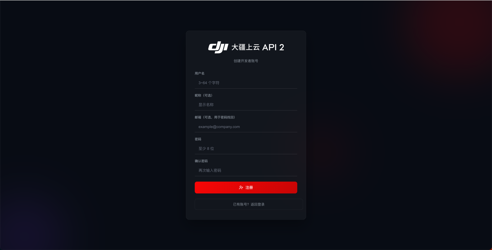

**注册字段说明**：

| 字段 | 是否必填 | 说明 |
|------|----------|------|
| 用户名 | 必填 | 3~64 个字符 |
| 昵称 | 可选 | 显示名称 |
| 邮箱 | 可选 | 用于密码找回 |
| 密码 | 必填 | 至少 8 位 |
| 确认密码 | 必填 | 需与密码一致 |

> **提示**：系统中第一个注册的用户将自动成为管理员（admin）角色。

### 1.3 用户管理

管理员登录后，点击右上角用户头像，在下拉菜单中选择「用户管理」进入管理页面。

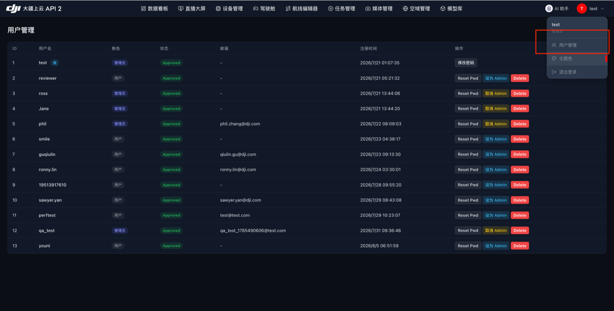

**用户菜单选项**：
- 用户管理（仅管理员可见）
- 主题色切换
- 退出登录

### 1.4 用户管理页面

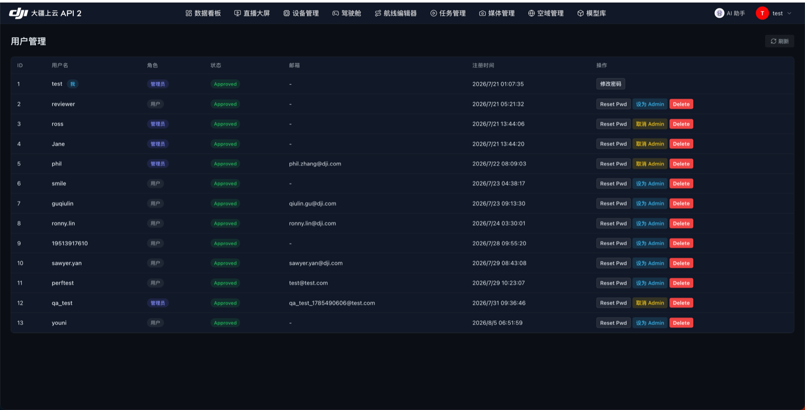

管理员可在此页面对所有用户进行管理：

| 操作 | 说明 |
|------|------|
| Reset Pwd | 重置指定用户密码 |
| 设为 Admin | 将普通用户提升为管理员 |
| 取消 Admin | 撤销管理员权限 |
| Delete | 删除用户（不可恢复） |
| 修改密码 | 修改自己的密码（仅当前用户行） |

**角色说明**：
- **管理员**（深色标签）：拥有用户管理权限
- **用户**（浅色标签）：普通用户权限

---

## 2. 数据看板

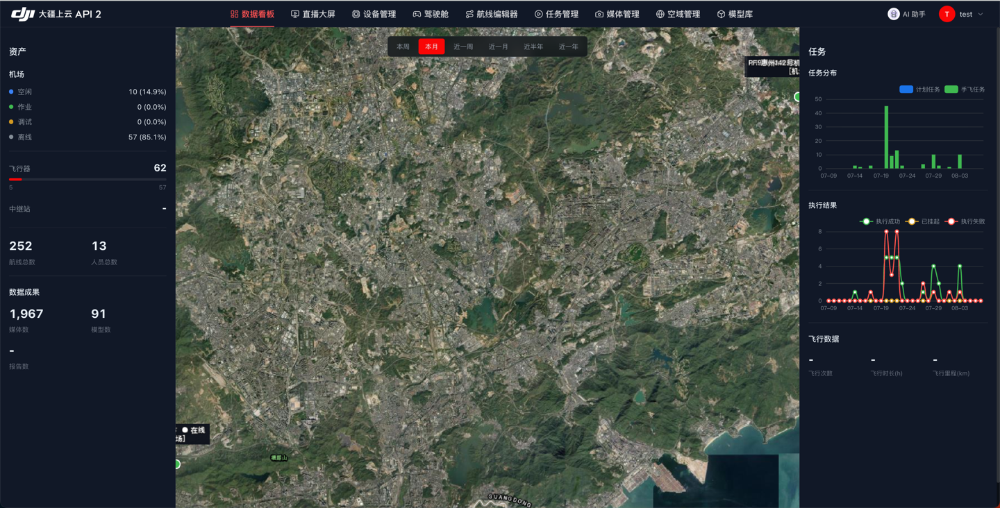

数据看板为系统首页，提供运营数据全局概览。

### 2.1 左侧 — 资产统计

| 数据项 | 说明 |
|--------|------|
| 机场状态 | 空闲/作业/调试/离线数量及占比 |
| 飞行器 | 在线/离线飞行器数量 |
| 中继站 | 中继站数量 |
| 航线总数 | 已创建的航线条数 |
| 人员总数 | 平台注册用户数 |
| 数据成果 | 媒体数、模型数、报告数 |

### 2.2 中央 — 地图视图

卫星影像地图展示所有设备（机场、飞行器）的地理分布位置，设备标记实时更新在线状态。

### 2.3 右侧 — 任务与飞行数据

- **任务分布**：柱状图展示计划任务和手飞任务的时间分布
- **执行结果**：折线图展示任务执行成功/挂起/失败的趋势
- **飞行数据**：统计飞行次数、飞行时长、飞行里程

### 2.4 时间筛选

支持按时间范围切换数据展示：**本周** | **近一周** | **近一月** | **近半年** | **近一年**

---

## 3. 直播大屏

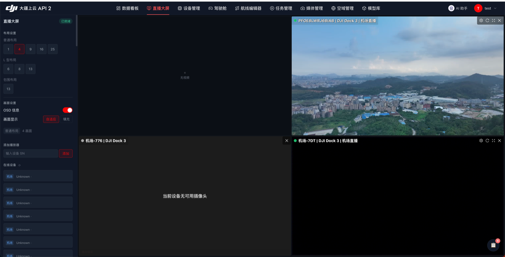

直播大屏用于实时查看多台设备的视频流画面。

### 3.1 布局设置

支持多种画面布局模式：

| 布局类型 | 可选数量 |
|----------|----------|
| 普通布局 | 1 / 4 / 9 / 16 / 25 |
| L 型布局 | 6 / 8 / 13 |
| 包围布局 | 13 |

### 3.2 画面设置

- **OSD 信息**：开关切换，在视频画面上叠加飞行参数
- **画面显示**：自适应 / 填充模式

### 3.3 添加播放器

在左侧面板底部：
1. 输入设备 SN 并点击「添加」
2. 或从「在线设备」列表中选择设备直接查看

### 3.4 视频画面操作

每个视频窗口支持：
- 设置（画质/码流切换）
- 刷新
- 全屏
- 关闭

---

## 4. 设备管理

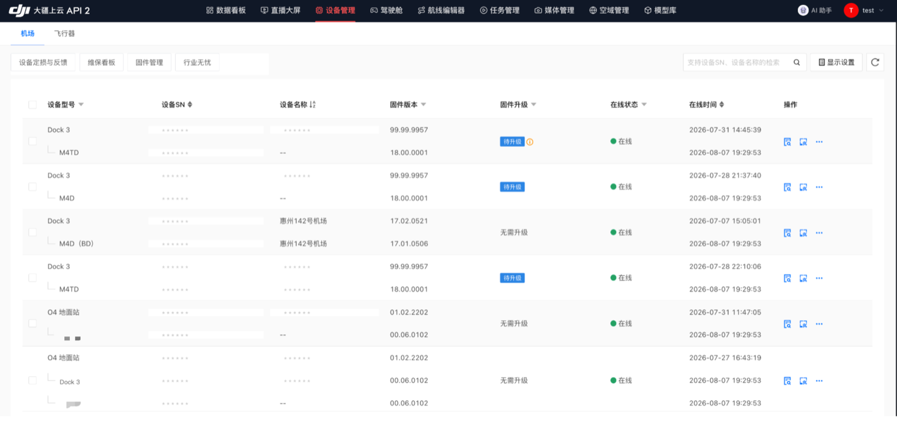

设备管理页面展示平台下所有已接入的机场和飞行器信息。

### 4.1 设备分类

顶部 Tab 切换：
- **机场**：DJI Dock 3、O4 地面站等网关设备
- **飞行器**：M4TD、M4D 等无人机

### 4.2 设备列表字段

| 字段 | 说明 |
|------|------|
| 设备型号 | Dock 3、O4 地面站等 |
| 设备 SN | 设备唯一序列号 |
| 设备名称 | 自定义名称或 SN |
| 固件版本 | 当前固件版本号 |
| 固件升级 | 待升级/无需升级状态 |
| 在线状态 | 绿色圆点=在线 |
| 在线时间 | 最近一次上线时间 |
| 操作 | 详情、驾驶舱入口等 |

### 4.3 功能入口

页面上方提供快捷功能入口：
- **设备定损与反馈**
- **维保看板**
- **固件管理**
- **行业无忧**

### 4.4 搜索与显示

- 支持按设备 SN 或设备名称搜索
- 「显示设置」可自定义列表显示字段
- 分页浏览，默认 50 条/页

---

## 5. 驾驶舱

### 5.1 选择设备

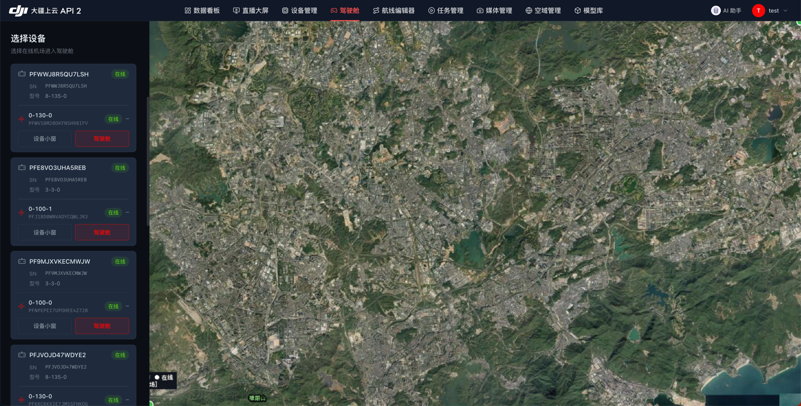

进入驾驶舱前需先选择一台在线机场设备：
- 左侧列出所有在线机场及其关联飞行器
- 显示设备 SN、型号、在线状态
- 点击「驾驶舱」按钮进入该设备的实时控制界面
- 点击「设备小窗」可快速查看设备监控画面

### 5.2 飞行监控

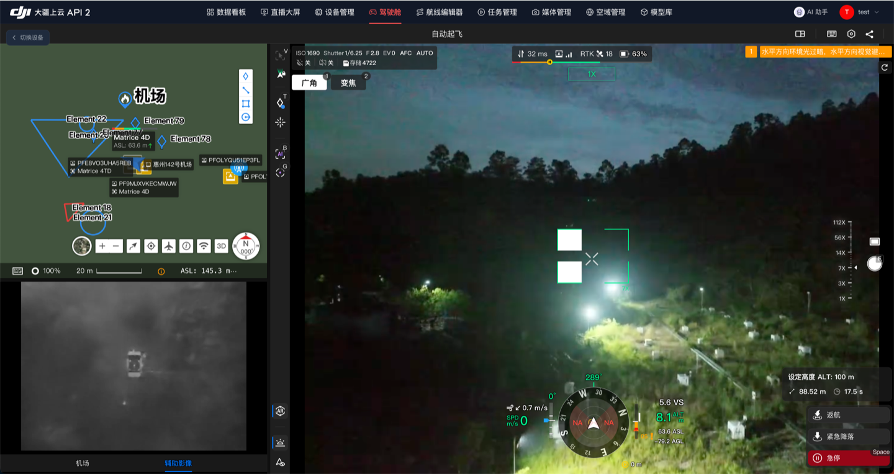

驾驶舱是平台核心功能页面，提供完整的实时飞行监控与操控能力：

**左上 — 地图视图**：
- 卫星地图展示设备位置和飞行轨迹
- 支持 2D/3D 视角切换
- 显示机场、飞行器、航点等标记

**左下 — 辅助影像**：
- 机场摄像头画面（红外/可见光）

**右侧 — 主画面**：
- 飞行器实时视频画面
- 广角/变焦镜头切换
- 相机参数显示（ISO、快门、光圈等）

**底部 — 飞行仪表**：
- 罗盘与航向指示
- 速度（SPD）、高度（ALT/ASL/AGL）
- 飞行距离、飞行时间
- RTK 信号状态、电池电量

**右下 — 操控按钮**：
- 返航
- 紧急降落
- 急停（Space）

---

## 6. 航线编辑器

### 6.1 航线库

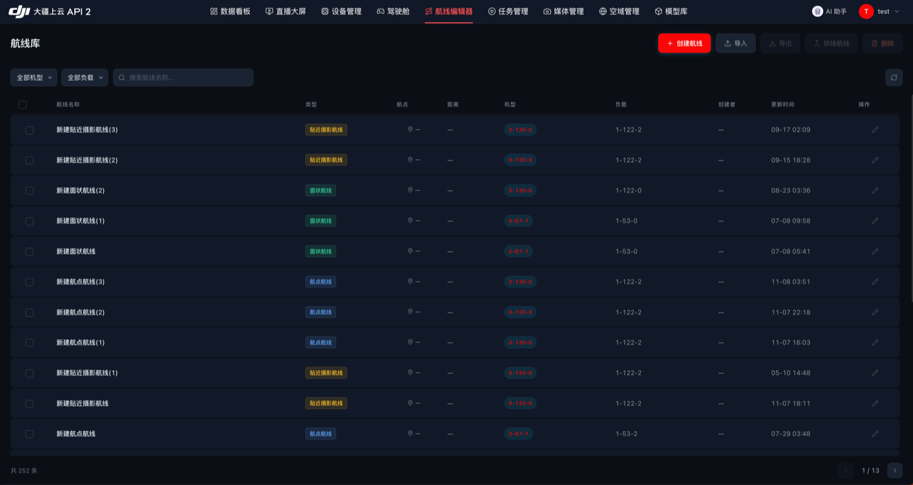

航线库页面管理所有已创建的航线文件。

**列表字段**：航线名称、类型、航点数、距离、机型、负载、创建者、更新时间

**航线类型**（彩色标签）：
- 贴近摄影航线
- 面状航线
- 航点航线

**操作按钮**：
- **+ 创建航线**：新建航线
- **导入**：导入 KMZ 航线文件
- **导出**：导出选中航线
- **拼接航线**：合并多条航线
- **删除**：批量删除

支持按机型、负载筛选，按名称搜索。

### 6.2 创建新航线

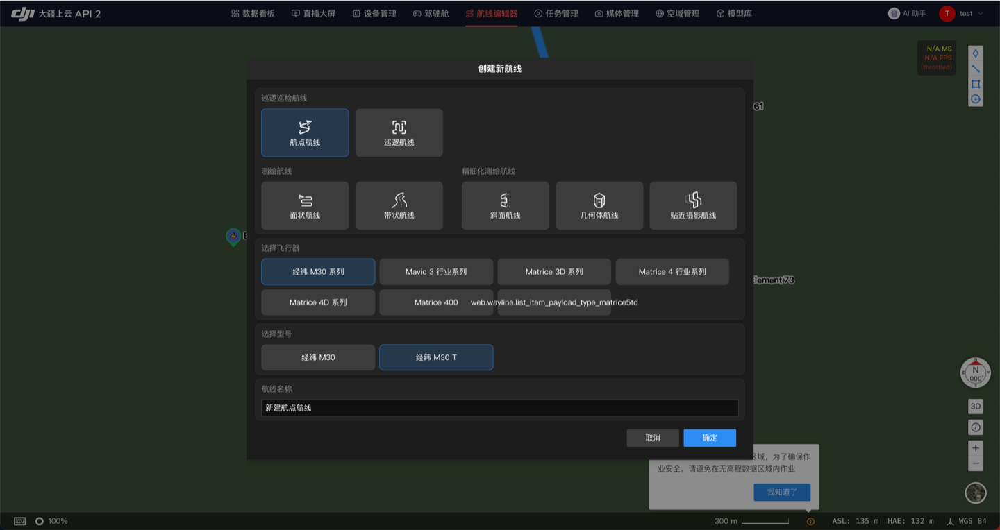

点击「+ 创建航线」后弹出配置对话框：

**第 1 步 — 选择航线类型**：

| 分类 | 航线类型 |
|------|----------|
| 巡逻巡检航线 | 航点航线、巡逻航线 |
| 测绘航线 | 面状航线、带状航线 |
| 精细化测绘航线 | 斜面航线、几何体航线、贴近摄影航线 |

**第 2 步 — 选择飞行器**：
- 经纬 M30 系列
- Mavic 3 行业系列
- Matrice 3D 系列
- Matrice 4 行业系列
- Matrice 4D 系列
- Matrice 400

**第 3 步 — 选择型号**（如：经纬 M30 / 经纬 M30 T）

**第 4 步 — 输入航线名称**，点击「确定」进入编辑器

### 6.3 航线编辑

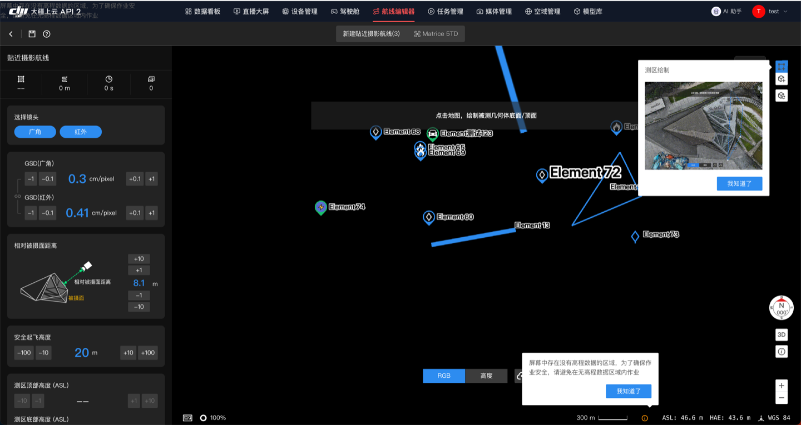

进入航线编辑器后，可在 3D 地图上进行航线规划：

**左侧参数面板**：
- 选择镜头（广角/红外）
- GSD 分辨率设置（cm/pixel）
- 相对被摄面距离
- 安全起飞高度
- 测区顶部/底部高度（ASL）

**地图区域**：
- 在地图上绘制航线区域
- 蓝色线条显示规划航线路径
- 航点标记

**右上 — 测区绘制工具**

### 6.4 贴近摄影流程

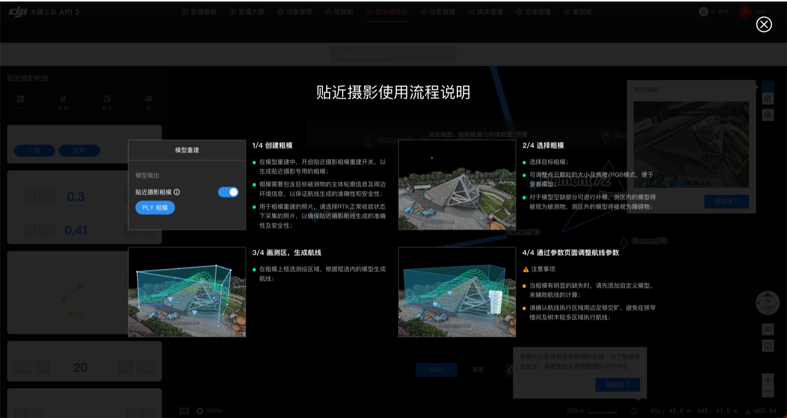

贴近摄影航线遵循 4 步流程：
1. **创建粗模** — 开启贴近摄影粗模重建开关，生成粗模
2. **选择粗模** — 选择目标粗模，调整点云粒度查看
3. **画测区，生成航线** — 在粗模上框选测绘区域
4. **通过参数页面调整航线参数**

---

## 7. 任务管理

### 7.1 任务列表

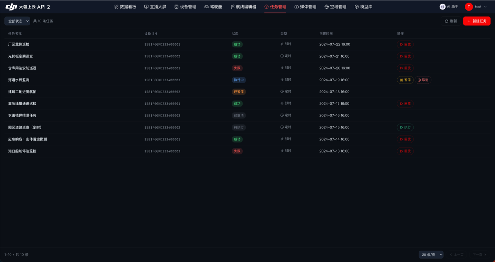

任务管理页面展示所有飞行任务及其执行状态。

**列表字段**：

| 字段 | 说明 |
|------|------|
| 任务名称 | 自定义任务名称 |
| 设备 SN | 执行任务的设备序列号 |
| 状态 | 成功（绿）/失败（红）/执行中（蓝）/已暂停（橙）/待执行/已取消 |
| 类型 | 即时 / 定时 |
| 创建时间 | 任务创建时间 |
| 操作 | 回放/暂停/取消/执行 |

**状态操作对应**：
- 成功/失败 → 回放
- 执行中 → 暂停 / 取消
- 待执行 → 执行

支持按状态筛选，点击「+ 新建任务」创建任务。

### 7.2 新建任务

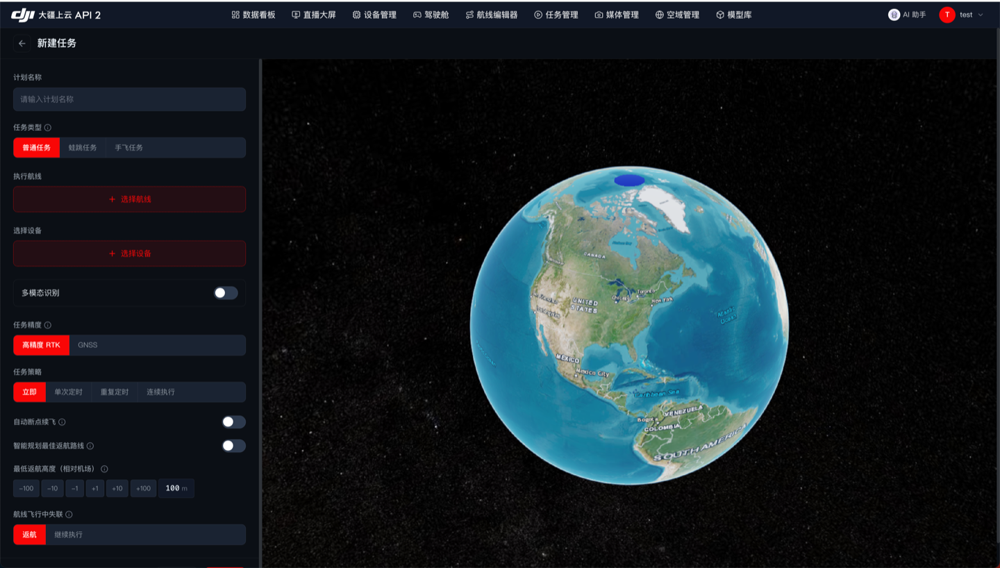

**配置项**：

| 配置 | 选项 |
|------|------|
| 计划名称 | 自定义输入 |
| 任务类型 | 普通任务 / 蛙跳任务 / 手飞任务 |
| 执行航线 | 从航线库选择 |
| 选择设备 | 从在线设备选择 |
| 多模态识别 | 开/关 |
| 任务精度 | 高精度 RTK / GNSS |
| 任务策略 | 立即 / 单次定时 / 重复定时 / 连续执行 |
| 自动断点续飞 | 开/关 |
| 智能规划最佳返航路线 | 开/关 |
| 最低返航高度 | 相对机场，默认 100m |
| 航线飞行中失联 | 返航 / 继续执行 |

### 7.3 任务回放

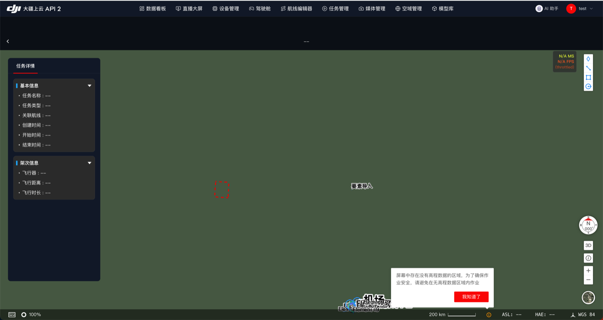

任务执行完成后可查看回放：

**左侧 — 任务详情**：
- 基本信息：任务名称、类型、关联航线、创建/开始/结束时间
- 架次信息：飞行器、飞行距离、飞行时长

**地图区域**：
- 在 3D 地图上回放飞行轨迹
- 标注航点位置

---

## 8. 媒体管理

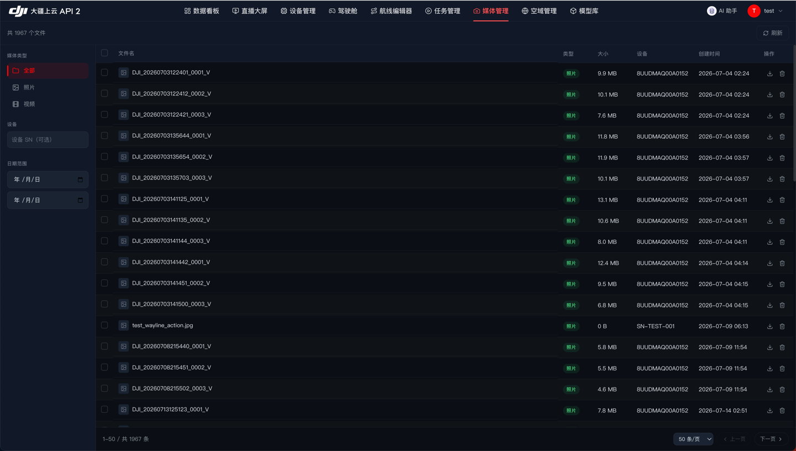

媒体管理页面用于浏览和管理无人机拍摄的照片与视频文件。

### 8.1 筛选条件

**左侧筛选面板**：
- **媒体类型**：全部 / 照片 / 视频
- **设备**：输入设备 SN 筛选
- **日期范围**：设置起止日期

### 8.2 文件列表

| 字段 | 说明 |
|------|------|
| 文件名 | DJI 标准命名格式（如 `DJI_20260703122401_0001_V`） |
| 类型 | 照片 / 视频 |
| 大小 | 文件大小 |
| 设备 | 拍摄设备 SN |
| 创建时间 | 拍摄时间 |
| 操作 | 下载 / 删除 |

### 8.3 分页

- 默认每页 50 条
- 显示总文件数（如「共 1967 个文件」）
- 支持翻页浏览

---

## 9. 空域管理

### 9.1 空域列表

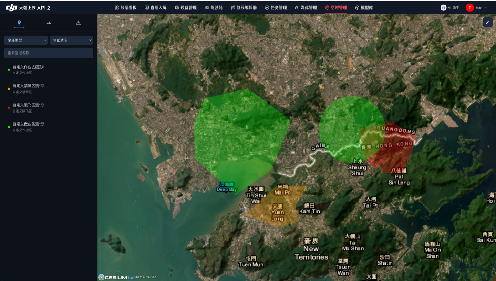

空域管理在 Cesium 3D 地图上可视化展示和管理飞行区域限制。

**左侧面板**：
- 类型筛选 / 状态筛选
- 区域名称搜索
- 已创建的区域列表（带颜色指示）

**地图视图**：
- 绿色区域 = 作业区（允许飞行）
- 红色区域 = 限飞区（禁止飞行）
- 橙色区域 = 禁降区（禁止降落）

### 9.2 创建空域

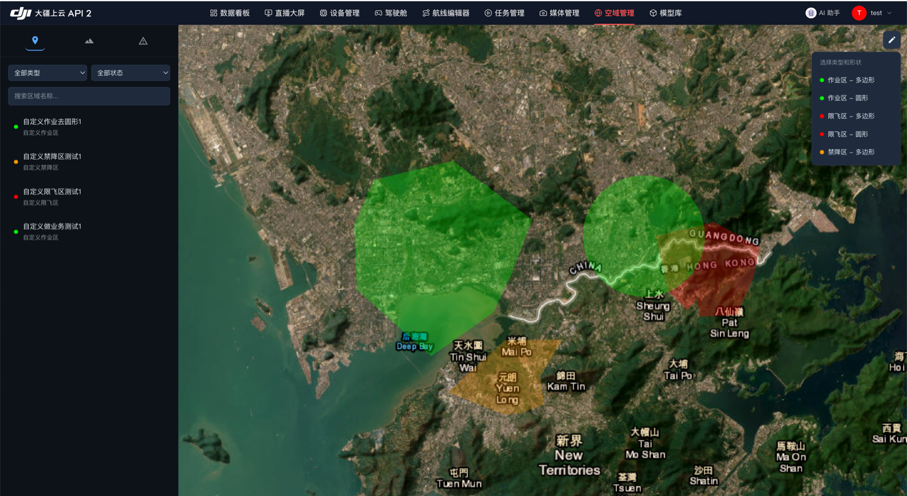

点击右上角编辑按钮后，可选择创建的区域类型和形状：

| 区域类型 | 形状选项 | 颜色标识 |
|----------|----------|----------|
| 作业区 | 多边形 / 圆形 | 绿色 |
| 限飞区 | 多边形 / 圆形 | 红色 |
| 禁降区 | 多边形 | 橙色 |

**操作步骤**：
1. 选择区域类型和形状
2. 在地图上点击绘制区域边界
3. 设置区域名称和参数
4. 保存并同步到设备

---

## 10. 模型库

### 10.1 模型列表

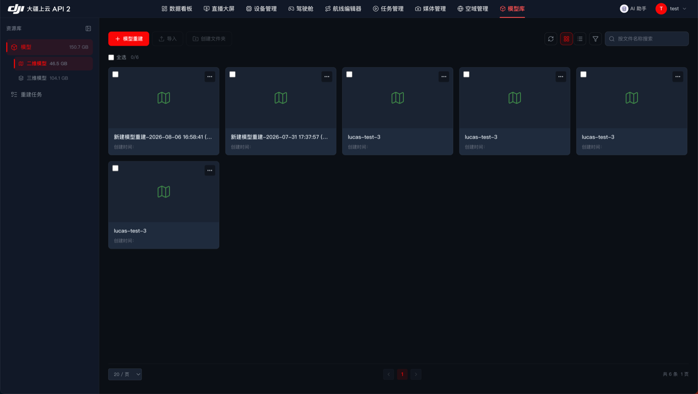

模型库管理二维、三维重建的成果文件。

**左侧导航**：
- **资源库**
  - 模型（总容量）
  - 二维模型（正射影像）
  - 三维模型（Mesh/点云）
- **重建任务**

**模型卡片**：
- 网格视图 / 列表视图切换
- 显示模型名称和创建时间
- 支持导入、创建文件夹
- 按名称搜索、筛选

### 10.2 新建模型重建

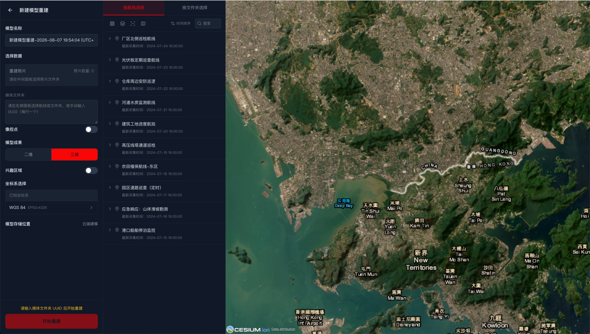

**配置步骤**：

1. **模型名称**：自动生成时间戳命名，可修改
2. **选择数据**：
   - 按航线选择：从已执行的航线任务中选择
   - 按文件夹选择：手动输入媒体文件夹 UUID
3. **像控点**：开/关
4. **模型成果**：二维（正射）/ 三维（Mesh）
5. **兴趣区域**：开/关
6. **坐标系选择**：WGS 84 EPSG:4326 等
7. **模型存储位置**：云端建模

点击「开始重建」提交任务。

---

## 11. AI 助手（Copilot）

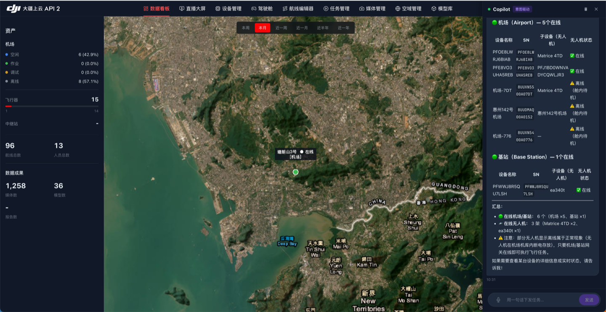

平台内置 AI 助手（Copilot），提供自然语言交互能力。

### 11.1 入口

点击顶部导航栏右侧「AI 助手」按钮，打开右侧 Copilot 面板。

### 11.2 功能特性

- **意图驱动**：自然语言描述需求，AI 自动执行操作
- **设备查询**：询问设备在线状态、型号信息
- **数据汇总**：自动聚合设备、航线、任务等运营数据

更多 AI 功能在规划中，敬请期待。

### 11.3 使用示例

在对话框中输入自然语言指令，如：
- "查看当前在线设备"
- "帮我查看惠州 142 号机场的状态"

AI 助手会以结构化表格返回结果，并提供操作建议。

### 11.4 启用条件

AI 助手需要后端配置以下环境变量：
- `FH_CHAT_ENABLED=true`
- `SPRING_AI_OPENAI_API_KEY`（或 Anthropic Key）
- `FH_CHAT_MCP_URL`（MCP Server 地址）

---

## 附录：快捷键与操作提示

| 操作 | 说明 |
|------|------|
| 地图缩放 | 鼠标滚轮 |
| 地图旋转 | 按住右键拖拽 |
| 急停 | Space 键（驾驶舱内） |
| 刷新数据 | 各页面右上角刷新按钮 |

## 上一步

- [部署指南](./00.index.md) — 上云 API 2 无人机管理平台部署指南
