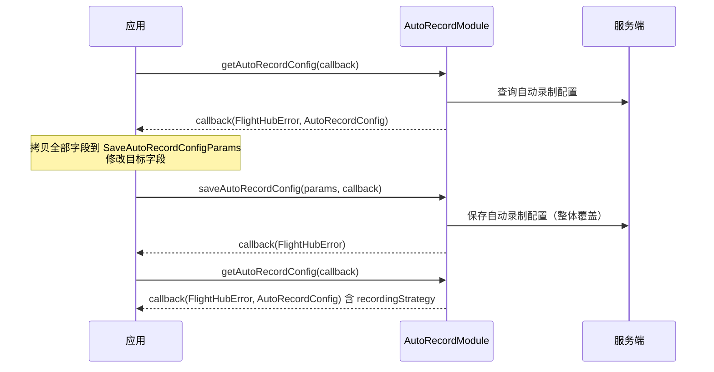

```mermaid
sequenceDiagram
    participant 应用
    participant LiveDeviceModule
    participant LiveRecordModule
    participant 服务端

    应用->>LiveDeviceModule: listenLiveAvailableRange(callback)
    LiveDeviceModule-->>应用: callback(List&#60;LiveInfo&#62;) 每 5 秒一轮

    Note over 应用: 按自己的设备 SN 过滤，<br/>挑出目标那一路 LiveInfo

    应用->>应用: drone.getLiveRecord(liveInfo)

    应用->>LiveRecordModule: listenRecordState(callback)
    LiveRecordModule-->>应用: 返回 listenId（负值表示失败）

    应用->>LiveRecordModule: startLiveRecord(timeZone, callback)
    LiveRecordModule->>服务端: 开始录制
    LiveRecordModule-->>应用: callback(FlightHubError)
    服务端-->>LiveRecordModule: 推送录制状态
    LiveRecordModule-->>应用: callback(LiveRecordStateInfo)

    应用->>LiveRecordModule: stopLiveRecord(callback)
    LiveRecordModule-->>应用: callback(FlightHubError)

    应用->>LiveRecordModule: getDeviceLiveRecords(deviceSn, callback)
    LiveRecordModule-->>应用: callback(FlightHubError, List&#60;LiveRecordItem&#62;)

    应用->>LiveRecordModule: cancelListenRecordState(listenId)
```

# 直播云端录制（AutoRecordModule / LiveRecordModule）

<!--
本文全部内容均可溯源，不含未经核实的产品论述（本注释不渲染）

核验基准：
  - 接口签名、字段、取值约束：paas-sdk release/u2 (f27294a)，并与
    release-u2-open-source (e57481a) 逐文件 blob 比对：
    AutoRecordModule.java / LiveRecordModule.java / Workspace.java /
    AutoRecordConfig.java / SaveAutoRecordConfigParams.java / AutoRecordItem.java /
    auto_record_module.h / live_record_module.h / workspace.h / auto_record_module_impl.cpp
    均一致；message.h、FlightHubCallback.java 存在差异，但差异仅为 WPMZ 相关定义，
    自动录制相关结构体与回调接口逐行一致
  - 取值区间 [7, 90]：message.h SaveAutoRecordConfigParams 注释
    + new_sdk_demo/src/main/resources/demo_params.json auto_record 节
  - 「disable_* 保存时整体覆盖」：demo_params.json auto_record._comment_2
  - 「失败时 config 为全零值对象而非 null」：auto_record_module_impl.cpp（失败时 callback(err, {})）
    + FlightHubSdkConvert.toAutoRecordConfig（入参为 null 时返回新建空对象）
  - LiveRecordModule 的开放状态：按已实现、可调用处理，依据为
    (1) platform/java/new_sdk_demo .../LiveRecordDemo.java 覆盖全部 5 个接口，
        并在 DemoEntry.java 注册为「直播录制」、new_sdk_demo/README.md 列为正式 demo；
    (2) src/bll/module/live_record_module/live_record_module_impl.cpp 为完整实现，
        含 kBeaconReportEvent_LIVE_RECORD_START 等生产数据埋点，非桩实现；
    (3) 研发于 2026-11-04 确认该组接口的后端协议链路。
    注：源码 javadoc 仍保留「@deprecated: 注意，本接口暂未开放使用」，与上述三项证据冲突，
    已反馈研发核实并清理；该标记若保留，对外 javadoc 会把接口显示为 deprecated。
    本文初稿曾据该标记把 5 个接口标为「暂未支持」，现已全部移除——
    项目既有文档的同类徽标（ai-alert.md 的 deleteAiAlertRecord 等）并非源自源码标记，
    「javadoc 有 @deprecated」推不出「产品未开放」，该推论不成立。
  - LiveRecordModule 接口签名与数据结构：core/LiveRecordModule.java、bean/LiveRecordItem.java、
    bean/LiveRecordStateInfo.java、value/RecordState.java、bean/LiveInfo.java；
    实例获取与缓存粒度见 core/Dock.java getLiveRecord / core/Drone.java getLiveRecord
    + core/LiveCacheKey.java（缓存键为 payloadIndex + ":" + videoId）
  - LiveInfo 的获取方式：LiveRecordDemo.discoverLiveInfo 经
    LiveDeviceModule.listenLiveAvailableRange 取得并按本机 SN 过滤，不手工构造；
    轮询周期 5 秒见 docs/cn/09.sdk/features/live/live-device.md
  - 「listenId 负值表示失败」：LiveRecordModule.listenRecordState 异常分支返回 -1；
    listenLiveAvailableRange 返回 -1 的判定见 LiveRecordDemo.discoverLiveInfo
  - 「两种状态字段类型不同」：LiveRecordStateInfo.state 为 RecordState 枚举，
    LiveRecordItem.state 为 int（二者 javadoc 均指向 value.h 的 RecordState）
  - notifyRecordState 未写入正文：live_record_module.h 注明为「内部方法，供 DockImpl/DroneImpl 调用」，
    SWIG 生成的 generated/ILiveRecordModule.java 与 Java 封装层均未暴露，Java 开发者无法调用
  - 错误码：docs/cn/14.error-codes.md（228720）
  - 对外口径：按 flight_hub_sdk_docs/README.md，不含 @implNote 中的
    HTTP path / WebSocket topic 等对内链路信息。研发于 2026-11-04 提供的录制接口协议映射
    （GET /gateway/pf-live/api/v1/record/device/{sn} 等、WS topic_live_record_info）
    属同类对内信息，故未写入正文；另该组路径前缀与源码 @implNote 中的
    /pf-live/api/v1/... 不一致（少一段 /gateway），待研发确认后更新源码注释

已按「源码为准、最小可用」原则删除的内容（PRD 草稿 pageId=828213430 为唯一来源，
源码无从佐证；如需写入，请在产品侧定稿后补回并标注依据）：
  - 录制画质选择（超清 / 流畅 / 自动）与画面拉伸：SDK 无对应参数
  - 录制文件自动进入媒体库「直播录制回放」分类、默认 MP4 格式、按设备名称归档
  - 录制文件的删除 / 重命名 / 移动 / 下载 / 分享：录制相关模块无对应接口；
    MediaServiceModule 的通用删除与下载接口与录制文件的关系，源码未说明
  - 存储路径的查询与更换、存储扩容：SDK 无对应接口
  - 设备覆盖范围「有摄像头的机器都可以」
  - 手动录制在驾驶舱 / 设备小窗 / 直播大屏等前端入口的交互
  - disable_* 来源开关与 recording_items 录制目标之间的优先关系：源码未说明
  - recording_strategy 两种策略（任务录制 / 持续录制）的具体录制行为：源码仅给出取值
  - 自动清理的执行时机，以及 auto_cleaning_time 越界时的具体错误码：源码仅标注校验区间
-->

## 1 功能概述

### 1.1 功能简介

直播云端录制由两个模块承担，作用域与获取方式都不同：

| 模块 | 作用域 | 职责 |
| --- | --- | --- |
| `AutoRecordModule` | 工作空间级 | 自动录制配置的读取与保存 |
| `LiveRecordModule` | 单路直播流级 | 手动启停录制、录制记录查询、录制状态订阅 |

`AutoRecordModule` 不绑定设备或会话上下文，解决的是「为哪些设备、哪些相机开启自动录制，以及录像保留多久」这一件事。一份配置包括按录制来源（机场、无人机、基站、RTMP 推流）划分的禁用开关、录制目标（设备 + 相机）列表，以及录像自动清理的保留天数。

`LiveRecordModule` 绑定到某台设备的某一路直播流，解决的是「把当前正在直播的这一路画面录下来」这一件事，并提供录制记录查询与录制状态的实时订阅。

直播拉流与播放见 [直播视频流](./live-stream.md)；直播流向第三方平台的转发见 [直播转发](./live-sync.md)。

**获取方式：**

```java
// 自动录制配置模块：工作空间级
Workspace workspace = FlightHubSDK.getWorkspaceInstance();
AutoRecordModule autoRecordModule = workspace.getAutoRecordModule();

// 直播录制模块：先取得目标直播源的 LiveInfo，再据此获取模块实例
// LiveInfo 来自 LiveDeviceModule 上报的可用直播源列表，不要手工构造
LiveRecordModule liveRecordModule = drone.getLiveRecord(liveInfo);
```

### 1.2 核心概念

**自动录制配置（`AutoRecordModule`）**

| 概念 | 说明 |
| --- | --- |
| 工作空间级配置 | 自动录制配置为工作空间级配置，读写均无需传入设备或会话参数。 |
| 录制来源开关（`disable*`） | 四个布尔开关，分别表示是否禁用机场录制 `disableDockRecording`、无人机录制 `disableDroneRecording`、基站录制 `disableBaseStationRecording`、RTMP 推流录制 `disableRtmpRecording`。`true` 为禁用。开启无人机自动录制需将 `disableDroneRecording` 置为 `false`。 |
| 录制目标（`AutoRecordItem`） | 一条录制目标对应一台设备的一路相机：`sn` 为设备 SN，**必填**；相机由 `cameraIndex`（负载相机索引，形如 `39-0-7`）或 `cameraSn`（第三方外接相机 SN）指定，**二者必须且只能填一个**。 |
| 录制策略（`recordingStrategy`） | **只读**，由服务端按设备类型计算后在查询结果中返回：`0` 任务录制、`1` 持续录制。保存配置时不提交该字段。 |
| 自动清理（`autoCleaningTime`） | 录像自动清理的保留天数，保存时服务端校验取值区间为 **7–90**。查询结果中的 `disabledAutoClean` 表示是否已禁用自动清理，为只读字段，保存入参中没有该字段。 |
| 未配置时的返回值 | 工作空间尚未保存过配置时，`getAutoRecordConfig()` 返回**成功**，配置对象各字段均为零值（`id` 为 `0`、`autoCleaningTime` 为 `0`、`disable*` 均为 `false`、`recordingItems` 为空列表），不作为错误返回。 |

**直播录制（`LiveRecordModule`）**

| 概念 | 说明 |
| --- | --- |
| 模块实例的粒度 | 模块实例对应**一路直播流**，由 `LiveInfo` 的 `payloadIndex` + `videoId` 共同确定，而非一台设备。同一台设备的不同镜头（如 `normal-0` 与 `zoom-0`）要分别获取实例。相同 `payloadIndex` + `videoId` 重复获取时返回同一个缓存实例。 |
| 直播源信息（`LiveInfo`） | **由 `LiveDeviceModule.listenLiveAvailableRange()` 上报，不要手工构造**。该订阅每 5 秒轮询一次设备直播能力，回调返回 `List<LiveInfo>`，其中可能包含其它设备的直播源，需按自己的设备 SN 过滤后再使用。详见 [直播设备管理](./live-device.md)。 |
| 获取入口 | `Dock.getLiveRecord(liveInfo)` 与 `Drone.getLiveRecord(liveInfo)`。传入 `liveInfo` 为 `null`、或底层模块创建失败时，**返回 `null`**，调用前需判空。 |
| 录制任务标识（`bid`） | 一次录制任务的业务标识，录制记录 `LiveRecordItem` 与状态推送 `LiveRecordStateInfo` 都以它标识同一次录制。 |
| 录制状态（`RecordState`） | 枚举，取值：`RECORD_SUCCESS`（`0`，录制成功）、`RECORDING`（`1`，录制中）、`RECORD_INITIALIZING`（`2`，初始化中）、`RECORD_FAILED`（`3`，录制失败）、`RECORD_UNKNOWN`（`65535`，未知）。 |
| 两种状态字段的类型差异 | **状态推送 `LiveRecordStateInfo.getState()` 返回 `RecordState` 枚举，而录制记录 `LiveRecordItem.getState()` 返回 `int`**（数值语义与上述枚举一致）。两者不可直接比较，需用 `RecordState.fromValue()` 转换后再判断。 |
| 录制时长的类型差异 | `LiveRecordItem.getDuration()` 返回 `long`，`LiveRecordStateInfo.getDuration()` 返回 `int`，单位均为秒。 |
| 监听 ID（`listenId`） | `listenRecordState()` 的返回值。**返回负值表示订阅失败**，成功时需保存该值，退出前传给 `cancelListenRecordState()` 取消订阅。 |

### 1.3 能力清单

**自动录制配置（`AutoRecordModule`，工作空间级）**

| 能力 | 对应接口 | 接口类型 | 说明 |
| --- | --- | --- | --- |
| 获取自动录制配置 | `getAutoRecordConfig(cb)` | 异步回调 | 回调类型 `AutoRecordConfigCallback`，返回 `FlightHubError` 与 `AutoRecordConfig`。**失败时配置对象同样非 `null`，而是一个全零值对象**，与「未配置」的返回值无法区分，必须先判断 `error.isSuccess()` 再读取配置。 |
| 保存自动录制配置 | `saveAutoRecordConfig(params, cb)` | 异步回调 | 入参 `SaveAutoRecordConfigParams`，回调仅返回错误信息。**`disable*` 开关保存时整体覆盖**，未显式设置的开关按默认值 `false`（即不禁用）提交；`recordingItems` 传空列表表示关闭全部录制场景。建议先调用 `getAutoRecordConfig()` 取回当前配置，修改目标字段后整体提交。 |

**直播录制（`LiveRecordModule`，单路直播流级）**

| 能力 | 对应接口 | 接口类型 | 说明 |
| --- | --- | --- | --- |
| 开始录制 | `startLiveRecord(timeZone, cb)` | 异步回调 | 开始录制当前直播流。`timeZone` 为可选时区标识，合法取值如 `Asia/Shanghai`、`America/Sao_Paulo`、`Africa/Johannesburg`；传 `null` 时按空字符串提交。回调类型 `ResultCallbackWithError`，仅返回错误信息。 |
| 停止录制 | `stopLiveRecord(cb)` | 异步回调 | 停止录制当前直播流。回调类型 `ResultCallbackWithError`，仅返回错误信息。 |
| 查询录制记录 | `getDeviceLiveRecords(deviceSn, cb)` | 异步回调 | 按设备 SN 查询录制记录列表。**设备 SN 由该参数显式传入**，不取模块实例绑定的设备。回调类型 `GetDeviceLiveRecordsCallback`，返回 `FlightHubError` 与 `List<LiveRecordItem>`；单条记录含 `bid`、`sn`、`state`、`camera`、`createdBy`、`duration`。 |
| 订阅录制状态 | `listenRecordState(cb)` | 订阅/回调 | 订阅录制状态推送，回调类型 `LiveRecordStateCallback`，回调参数为 `LiveRecordStateInfo`（含 `bid`、`sn`、`camera`、`video`、`state`、`createdBy`、`duration`、`createTime`）。返回 `listenId`，**负值表示订阅失败**。 |
| 取消订阅录制状态 | `cancelListenRecordState(listenId)` | 同步 | 传入 `listenRecordState()` 返回的监听 ID 取消订阅。 |

---

## 2 前提条件

**通用**

- 已完成上云 API 2 底座部署，并获取到服务地址与鉴权 Token。详见 [部署指南](../../../03.deployment/00.index.md)、[鉴权接入指南](../../../10.auth.md)。
- 已完成 SDK 初始化且 `FlightHubSDK.isInitialized()` 返回 `true`。详见 [SDK初始化](../init/sdk-init.md)。

**自动录制配置（`AutoRecordModule`）**

- 已通过 `FlightHubSDK.getWorkspaceInstance()` 获取工作空间实例，并调用其 `getAutoRecordModule()` 拿到模块实例。该方法获取失败时返回 `null`，调用前需判空。
- 已确定录制目标的设备 SN，以及该设备相机的 `cameraIndex`（负载相机）或 `cameraSn`（第三方外接相机）。

**直播录制（`LiveRecordModule`）**

- 已拿到目标设备的机场实例或飞机实例。
- **目标设备正在直播，且已通过 `LiveDeviceModule.listenLiveAvailableRange()` 拿到该路直播源的 `LiveInfo`**。该订阅每 5 秒轮询一次，回调列表可能含其它设备的直播源，需按自己的设备 SN 过滤。详见 [直播设备管理](./live-device.md)。
- 以该 `LiveInfo` 调用 `getLiveRecord(liveInfo)`。该方法在 `liveInfo` 为 `null` 或底层模块创建失败时返回 `null`，调用前需判空。
- 若需订阅录制状态，SDK 配置中的 `notificationServerAddress` 必须正确且连接可用。详见 [SDK配置](../init/sdk-config.md)。

---

## 3 快速上手

### 3.1 获取模块实例

```java
// 前置：已完成 FlightHubSDK.initialize(config)

// 自动录制配置模块：工作空间级
Workspace workspace = FlightHubSDK.getWorkspaceInstance();
AutoRecordModule autoRecordModule = workspace.getAutoRecordModule();
if (autoRecordModule == null) {
    // 模块获取失败，终止后续调用
}

// 直播录制模块：先从可用直播源列表中挑出本机那一路的 LiveInfo
LiveDeviceModule liveDeviceModule = drone.getLiveDeviceModule();
int rangeListenId = liveDeviceModule.listenLiveAvailableRange(liveInfos -> {
    if (liveInfos == null || liveInfos.isEmpty()) return;
    for (LiveInfo info : liveInfos) {
        // 注意：上报的直播源可能来自其它设备，必须按自己的 SN 过滤
        if (!droneSn.equals(info.getDeviceSn())) continue;
        LiveRecordModule liveRecordModule = drone.getLiveRecord(info);
        if (liveRecordModule == null) {
            // liveInfo 为 null 或底层模块创建失败，终止后续调用
            return;
        }
        // 拿到实例后即可启停录制、查询记录、订阅状态
    }
});
// 注意：返回 -1 表示订阅失败；用完记得 cancelListenLiveAvailableRange(rangeListenId)
```

### 3.2 使用流程

**自动录制配置**

1. **获取模块实例** —— 从工作空间实例调用 `getAutoRecordModule()` 并判空。
2. **读取当前配置** —— 调用 `getAutoRecordConfig()`；先判断 `error.isSuccess()`，再读取 `AutoRecordConfig`。工作空间尚未保存过配置时，返回的是各字段为零值的配置对象。
3. **组装保存入参** —— 将当前配置的 `autoCleaningTime`、四个 `disable*` 开关与 `recordingItems` 完整拷贝到 `SaveAutoRecordConfigParams`，再修改目标字段。录制目标逐条确认 `sn` 非空，且 `cameraIndex` 与 `cameraSn` 只填其一；`autoCleaningTime` 确认落在 7–90 之间。
4. **保存配置** —— 调用 `saveAutoRecordConfig()`，根据回调的 `FlightHubError` 判断是否成功。
5. **回读确认** —— 再次调用 `getAutoRecordConfig()`，核对保存结果；查询结果中的 `recordingStrategy` 为服务端按设备类型计算的录制策略。

**手动录制**

1. **发现直播源** —— 从机场或飞机实例取 `getLiveDeviceModule()`，调用 `listenLiveAvailableRange()` 并保存 `listenId`（返回 `-1` 表示订阅失败）；从回调的 `List<LiveInfo>` 中按自己的设备 SN 挑出目标那一路。
2. **获取录制模块** —— 以该 `LiveInfo` 调用 `getLiveRecord(liveInfo)` 并判空。
3. **订阅录制状态** —— 调用 `listenRecordState()` 并保存 `listenId`（负值表示订阅失败）。先订阅再开始录制，可避免漏掉初始化阶段的状态。
4. **启停录制** —— `startLiveRecord(timeZone, cb)` 开始，`stopLiveRecord(cb)` 停止；两者均只回调错误信息，录制进展通过状态订阅观察。
5. **查询记录** —— 用 `getDeviceLiveRecords(deviceSn, cb)` 查历史录制记录，设备 SN 由参数显式传入。
6. **清理订阅** —— 退出前用保存的 `listenId` 分别调用 `cancelListenRecordState()` 与 `cancelListenLiveAvailableRange()`。

### 3.3 调用时序图

**自动录制配置**



**手动录制**



---

## 4 示例代码

### 4.1 完整示例

```java
import com.dji.flighthubsdk.FlightHubCallback;
import com.dji.flighthubsdk.FlightHubSDK;
import com.dji.flighthubsdk.bean.AutoRecordConfig;
import com.dji.flighthubsdk.bean.AutoRecordItem;
import com.dji.flighthubsdk.bean.FlightHubError;
import com.dji.flighthubsdk.bean.SaveAutoRecordConfigParams;
import com.dji.flighthubsdk.core.AutoRecordModule;

import java.util.ArrayList;
import java.util.List;

/**
 * 自动录制配置：读取当前配置 -> 追加一路录制目标 -> 整体保存 -> 回读确认。
 */
public class AutoRecordManager {

    private AutoRecordModule module() {
        return FlightHubSDK.getWorkspaceInstance().getAutoRecordModule();
    }

    // ============ 1. 为无人机的一路负载相机开启自动录制 ============
    public void enableDroneRecording(String droneSn, String cameraIndex) {
        AutoRecordModule module = module();
        if (module == null) {
            System.err.println("获取 AutoRecordModule 失败");
            return;
        }

        module.getAutoRecordConfig(new FlightHubCallback.AutoRecordConfigCallback() {
            @Override
            public void onResult(FlightHubError error, AutoRecordConfig current) {
                // 注意：失败时 current 也不是 null，而是全零值对象，必须先判断 error
                if (error == null || !error.isSuccess()) {
                    System.err.println("获取自动录制配置失败: " + error);
                    return;
                }

                // 注意：disable* 开关保存时整体覆盖，必须把当前值完整带上，
                // 否则未设置的开关会按默认值 false 提交
                SaveAutoRecordConfigParams params = new SaveAutoRecordConfigParams();
                params.setDisableDockRecording(current.isDisableDockRecording());
                params.setDisableBaseStationRecording(current.isDisableBaseStationRecording());
                params.setDisableRtmpRecording(current.isDisableRtmpRecording());
                params.setDisableDroneRecording(false);   // 开启无人机自动录制

                // 注意：未配置过时读回的 autoCleaningTime 为 0，不在 [7, 90] 区间内，需显式赋值
                int days = current.getAutoCleaningTime();
                params.setAutoCleaningTime(days >= 7 && days <= 90 ? days : 30);

                // 保留已有录制目标，再追加新目标（recordingStrategy 为只读字段，不会提交）
                List<AutoRecordItem> items = new ArrayList<>(current.getRecordingItems());
                AutoRecordItem item = new AutoRecordItem();
                item.setSn(droneSn);              // 必填
                item.setCameraIndex(cameraIndex); // 负载相机索引，形如 "39-0-7"；与 cameraSn 只填其一
                items.add(item);
                params.setRecordingItems(items);

                module.saveAutoRecordConfig(params, saveErr -> {
                    if (saveErr == null || !saveErr.isSuccess()) {
                        System.err.println("保存自动录制配置失败: " + saveErr
                                + " serverCode=" + (saveErr != null ? saveErr.getServerCode() : -1)
                                + " msg=" + (saveErr != null ? saveErr.getServerMessage() : ""));
                        return;
                    }
                    System.out.println("自动录制配置已保存");
                    printConfig();
                });
            }
        });
    }

    // ============ 2. 回读并打印当前配置 ============
    public void printConfig() {
        AutoRecordModule module = module();
        if (module == null) return;

        module.getAutoRecordConfig((error, config) -> {
            if (error == null || !error.isSuccess()) {
                System.err.println("获取自动录制配置失败: " + error);
                return;
            }
            // 注意：工作空间尚未保存过配置时，各字段均为零值（非错误）
            System.out.println("配置 id=" + config.getId()
                    + " 自动清理保留天数=" + config.getAutoCleaningTime()
                    + " 已禁用自动清理=" + config.isDisabledAutoClean());
            System.out.println("禁用机场录制=" + config.isDisableDockRecording()
                    + " 禁用无人机录制=" + config.isDisableDroneRecording()
                    + " 禁用基站录制=" + config.isDisableBaseStationRecording()
                    + " 禁用RTMP推流录制=" + config.isDisableRtmpRecording());
            for (AutoRecordItem it : config.getRecordingItems()) {
                // recordingStrategy：0=任务录制 1=持续录制，由服务端按设备类型计算
                System.out.println("录制目标 sn=" + it.getSn()
                        + " cameraIndex=" + it.getCameraIndex()
                        + " cameraSn=" + it.getCameraSn()
                        + " 录制策略=" + it.getRecordingStrategy());
            }
        });
    }
}
```

### 4.2 场景化片段

**为第三方外接相机配置录制目标**

```java
// 外接相机用 cameraSn 指定，此时 cameraIndex 保持为空
AutoRecordItem item = new AutoRecordItem();
item.setSn(deviceSn);              // 设备 SN，必填
item.setCameraSn(externalCameraSn); // 第三方外接相机 SN；与 cameraIndex 只填其一
// 随后按 4.1 的方式并入完整配置，再调用 saveAutoRecordConfig()
```

**关闭全部录制场景**

```java
// 前置：已按 4.1 取回当前配置 current，且 error.isSuccess() 为 true
SaveAutoRecordConfigParams params = new SaveAutoRecordConfigParams();
params.setAutoCleaningTime(current.getAutoCleaningTime()); // 仍需在 [7, 90] 区间内
params.setDisableDockRecording(current.isDisableDockRecording());
params.setDisableDroneRecording(current.isDisableDroneRecording());
params.setDisableBaseStationRecording(current.isDisableBaseStationRecording());
params.setDisableRtmpRecording(current.isDisableRtmpRecording());
params.setRecordingItems(new ArrayList<>());   // 空列表：关闭全部录制场景

FlightHubSDK.getWorkspaceInstance().getAutoRecordModule()
        .saveAutoRecordConfig(params, error -> {
            boolean ok = error != null && error.isSuccess();
            System.out.println("关闭全部录制场景: " + (ok ? "成功" : "失败 " + error));
        });
```

**手动录制一路直播流并订阅状态**

```java
// 前置：已按 3.1 拿到非 null 的 liveRecordModule
// 1. 订阅录制状态（先订阅再开始录制，避免漏掉初始化阶段的状态）
int listenId = liveRecordModule.listenRecordState(info -> {
    // 注意：这里的 getState() 是 RecordState 枚举，与录制记录中的 int 不是同一类型
    System.out.println("录制状态 bid=" + info.getBid()
            + " sn=" + info.getSn()
            + " camera=" + info.getCamera()
            + " video=" + info.getVideo()
            + " 状态=" + info.getState()
            + " 已录时长(s)=" + info.getDuration()
            + " 创建时间=" + info.getCreateTime());
});
// 注意：返回负值表示订阅失败，不能当作有效的 listenId 使用
if (listenId < 0) {
    System.err.println("订阅录制状态失败");
    return;
}

// 2. 开始录制；timeZone 可传 null，此时按空字符串提交
liveRecordModule.startLiveRecord("Asia/Shanghai", error -> {
    boolean ok = error != null && error.isSuccess();
    System.out.println("开始录制: " + (ok ? "成功" : "失败 " + error));
});

// 3. 停止录制
liveRecordModule.stopLiveRecord(error -> {
    boolean ok = error != null && error.isSuccess();
    System.out.println("停止录制: " + (ok ? "成功" : "失败 " + error));
});

// 4. 退出前取消订阅
liveRecordModule.cancelListenRecordState(listenId);
```

**查询某台设备的录制记录**

```java
// 前置：已按 3.1 拿到非 null 的 liveRecordModule
// 注意：设备 SN 由参数显式传入，不取模块实例绑定的设备
liveRecordModule.getDeviceLiveRecords(deviceSn, (error, records) -> {
    if (error == null || !error.isSuccess()) {
        System.err.println("查询录制记录失败: " + error);
        return;
    }
    for (LiveRecordItem item : records) {
        // 注意：这里的 getState() 是 int，需转成枚举后再判断，不能直接与 RecordState 比较
        RecordState state = RecordState.fromValue(item.getState());
        System.out.println("录制记录 bid=" + item.getBid()
                + " sn=" + item.getSn()
                + " camera=" + item.getCamera()
                + " 状态=" + state
                + " 创建者=" + item.getCreatedBy()
                + " 时长(s)=" + item.getDuration());
    }
});
```

---

## 5 相关文档

- [SDK初始化](../init/sdk-init.md) —— 获取工作空间实例与调用本模块前必须完成的初始化步骤
- [SDK配置](../init/sdk-config.md) —— 订阅录制状态所需的消息通知地址配置
- [直播视频流](./live-stream.md) —— SDK 内直播流的拉流与播放
- [直播设备管理](./live-device.md) —— 直播可用范围与在线观众数
- [直播转发](./live-sync.md) —— 直播流向第三方平台的转发配置
- [部署指南](../../../03.deployment/00.index.md) —— 上云 API 2 底座部署与服务地址获取
- [鉴权接入指南](../../../10.auth.md) —— 获取鉴权 Token 的接入流程
- [错误码](../../../14.error-codes.md) —— 含 `228720`「自动录制配置保存失败」
- [使用 API 文档查阅接口详情](../../03.api-docs-guide.md) —— 查阅 `AutoRecordModule`、`LiveRecordModule` 完整方法签名与字段定义
