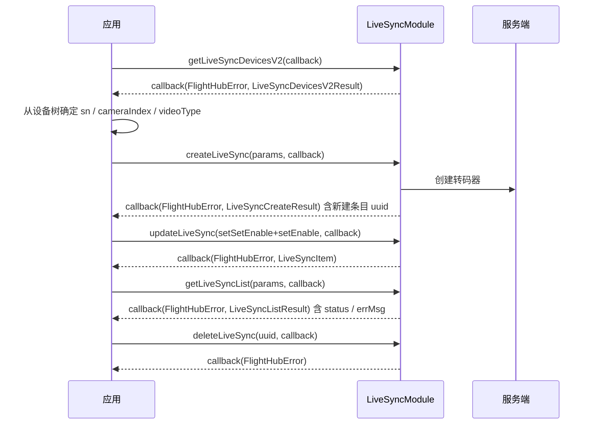

# 直播转发（LiveSyncModule）

<!--
本文全部内容均可溯源，不含未经核实的产品论述（本注释不渲染）

核验基准：
  - 接口签名、字段、取值约束：paas-sdk release/u2 (f27294a)，并与
    release-u2-open-source (e57481a) 逐文件 blob 比对：
    live_sync_module.h / workspace.h / live_sync_module_impl.cpp /
    LiveSyncModule.java / Workspace.java / LiveSyncCreateParams.java /
    LiveSyncUpdateParams.java / LiveSyncItem.java / LiveSyncSchemaOption.java /
    LiveSyncCreateResult.java / LiveSyncListParams.java / LiveSyncListResult.java /
    LiveSyncSummaryResult.java / LiveSyncDevicesV2Result.java /
    LiveSyncDeviceItemV2.java / LiveSyncDeviceV2.java / LiveSyncCameraCapacity.java /
    LiveSyncVideoCapacity.java / new_sdk_demo LiveSyncDemo.java 均一致；
    message.h、FlightHubCallback.java 存在差异，但差异区间分别在 LiveSync 结构体
    （message.h:9356-9486）与 LiveSync 回调（FlightHubCallback.java:3712-3734）之外，
    LiveSync 相关定义逐行一致
  - 模块名「直播转发（旁路转码器 CRUD）」：live_sync_module.h:12 类注释
    + LiveSyncModule.java:13 类 javadoc
  - status 取值 1/2/3：message.h:9390 + LiveSyncItem.java 字段 javadoc
  - schema 取值 rtmp / gb28181 / rtsp：message.h:9395
    + LiveSyncCreateParams / LiveSyncUpdateParams / LiveSyncItem / LiveSyncListParams 字段 javadoc
  - videoQuality 取值 0/1/4：LiveSyncCreateParams.java 与 LiveSyncUpdateParams.java 字段 javadoc
  - 「setSetXxx(true) 才写入」与「停用必须成对调用」：LiveSyncUpdateParams.java 类 javadoc
    + LiveSyncModule.java updateLiveSync javadoc + live_sync_module_impl.cpp:216-237
  - 「停用后再删除」：LiveSyncUpdateParams.java 类 javadoc
  - 「hasLimit 成功时恒 false、超限走 serverCode」：message.h:9421
    + LiveSyncCreateResult.java 字段 javadoc + live_sync_module.h:20-21
  - sn 惯例填飞机 SN：message.h:9411/9436 + LiveSyncCreateParams.java / LiveSyncUpdateParams.java 字段 javadoc
  - deviceType 取值集合：message.h:9467 + LiveSyncDeviceV2.java 字段 javadoc
  - hosts 含无人机与 dock：message.h:9473 + LiveSyncDeviceItemV2.java 字段 javadoc
  - cameraCapacity 解析失败降级为空集合：live_sync_module_impl.cpp:132-152
  - GB28181 localPort 非 0、服务端须能应答 SIP REGISTER；RTMP 推流地址全局唯一；
    cameraIndex 形如 99-0-0 与机型强相关：
    new_sdk_demo/src/main/resources/demo_params.json live_sync._comment_1/_comment_3
    + LiveSyncDemo.java buildSchemaOption() / defaultRtmpUrl() 注释
  - 错误码 233317 / 213025 / 212056：docs/cn/14.error-codes.md
  - 对外口径：按 flight_hub_sdk_docs/README.md「对外 vs 对内文档」，
    不含 @implNote 中的 HTTP path 等对内链路信息

已按「源码为准、最小可用」原则删除的内容（技术方案草稿 pageId=832144885 为唯一来源，
源码无从佐证；如需写入，请在产品侧定稿后补回并标注依据）：
  - 支持与禁用机型清单（EA210/EA220/EA230/EA340/M4D/M4TD 等可转、EI200/EA610 禁转）：
    白名单由服务端下发，SDK 无对应常量；可转设备以 getLiveSyncDevicesV2() 返回为准
  - 「机场转舱外相机、飞机转广角/变焦/红外」的镜头对应关系：SDK 无对应枚举
  - RTSP 播放地址由服务端回填的时机与条件：源码仅给出 rtspUrl 字段本身
  - provider / volcUserId 两个字段的填写规则：源码仅给出字段含义，未说明由谁填写
  - 转发通道上限 20 路是否随部署环境变化：错误码表记为 20 路，源码未给出可配置性
  - 三协议在各 RTC 引擎上的支持矩阵：源码无对应区分
-->

## 1 功能概述

### 1.1 功能简介

`LiveSyncModule` 是**工作空间级**的直播转发（旁路推流）模块，作用域为当前工作空间下的全部转码器。它解决的是「把设备的某一路直播画面，推送到调用方自有的流媒体服务」这一件事：以「转码器」为单位创建、更新、启停与删除转发通道，分页查询转码器列表，查询可用设备树，以及获取转码器总数与启用数的汇总。支持的推流协议为 RTMP、GB28181、RTSP。

本模块只负责**转发通道的配置与启停**，不负责在 SDK 内拉流播放。SDK 内的拉流与逐帧消费见 [直播视频流](./live-stream.md)；可作为转发源的设备与镜头见 [直播设备管理](./live-device.md)。

**获取方式：**

```java
// 通过 FlightHubSDK.getWorkspaceInstance() 获取 Workspace，再取本模块
Workspace workspace = FlightHubSDK.getWorkspaceInstance();
LiveSyncModule liveSyncModule = workspace.getLiveSyncModule();
```

### 1.2 核心概念

| 概念 | 说明 |
| --- | --- |
| 转码器（`LiveSyncItem`） | 一条把某台设备某路直播画面推送到指定地址的转发通道，云端以 `uuid` 唯一标识。条目含 `uuid`、`status`、`orgUuid`、设备 SN/名称/型号/是否机场/是否在线、转发源参数、`region`、`enable`、`errMsg` 等。 |
| 推流协议（`schema`） | 取值 `rtmp` / `gb28181` / `rtsp`，三选一。 |
| 协议参数（`LiveSyncSchemaOption`） | 三种协议的字段**同层扁平**地放在同一个对象里，按所选 `schema` 只填对应那一组，其余留空。 |
| 转发源 | 由 `sn`（设备）+ `cameraIndex`（镜头索引）+ `videoType`（视频流类型）+ `videoQuality`（画质等级）共同指定要转发的那一路画面。`sn` 惯例填飞机（drone）SN；传网关 SN 后端不拦截，但下游行为不保证。 |
| 转码器状态（`status`） | `1` 空闲、`2` 推流中、`3` 失败。失败原因见 `errMsg`。 |
| 启停（`enable`） | 没有独立的启动/停止接口，启停即 `updateLiveSync()` 写入 `enable` 字段。 |
| 标记式更新 | `LiveSyncUpdateParams` 采用 set* 标记模型：**只有调用了 `setSetXxx(true)` 的字段才会写入**，未标记的字段不参与本次更新。仅 `setEnable(false)` 而不调用 `setSetEnable(true)`，停用不会生效。 |
| 设备树（`getLiveSyncDevicesV2`） | 返回可用设备树，每个条目为「网关 + 挂载设备」。V2 的 `hosts` 含无人机与 dock。 |

### 1.3 能力清单

| 能力 | 对应接口 | 接口类型 | 说明 |
| --- | --- | --- | --- |
| 创建转码器 | `createLiveSync(params, cb)` | 异步回调 | 入参 `LiveSyncCreateParams`，回调返回 `LiveSyncCreateResult`，新建条目在 `getItem()` |
| 更新转码器 | `updateLiveSync(params, cb)` | 异步回调 | 入参 `LiveSyncUpdateParams`，按 set* 标记写入；回调返回更新后的 `LiveSyncItem` |
| 删除转码器 | `deleteLiveSync(id, cb)` | 异步回调 | 传入转码器 `uuid`，回调仅返回 `FlightHubError` |
| 分页查询转码器列表 | `getLiveSyncList(params, cb)` | 异步回调 | 入参 `LiveSyncListParams`，回调返回 `LiveSyncListResult`（`page` / `size` / `total` / `list`） |
| 获取可用设备树 | `getLiveSyncDevicesV2(cb)` | 异步回调 | 回调返回 `LiveSyncDevicesV2Result`（`total` + 网关/挂载设备列表） |
| 获取转码器汇总 | `getLiveSyncSummary(cb)` | 异步回调 | 回调返回 `LiveSyncSummaryResult`（`total` 总数与 `enableCnt` 启用数） |

**转发源参数（创建与更新通用）：**

| 字段 | 类型 | 说明 |
| --- | --- | --- |
| `converterName` | `String` | 转码器名称 |
| `sn` | `String` | 直播源设备 SN，惯例填飞机（drone）SN |
| `cameraIndex` | `String` | 镜头索引，形如 `99-0-0`，与机型强相关，取值见设备树 |
| `videoType` | `String` | 视频流类型，取值见设备树的 `LiveSyncVideoCapacity.getVideoType()` |
| `videoQuality` | `int` | 画质等级：`0`=自适应、`1`=标清、`4`=超清 |

**`LiveSyncSchemaOption` 按协议分组：**

| `schema` | 需填字段 | 说明 |
| --- | --- | --- |
| `rtmp` | `url` | RTMP 推流地址，全局唯一 |
| `gb28181` | `serverId` / `serverIp` / `serverPort` / `devicePassword` / `localPort` / `deviceId` / `localChannel` | SIP 服务器信息、设备接入密码、本地 SIP 端口、设备编码 ID 与本地通道编码 |
| `rtsp` | `username` / `password` / `enableTs` | 鉴权用户名、鉴权密码、是否开启 TS 封装 |

> RTSP 字段组还包含 `rtspUrl`（RTSP 推流地址）、`provider`（RTSP 服务商）与 `volcUserId`（火山引擎用户 ID）三个字段。创建转码器时只需填写上表所列字段。

---

## 2 前提条件

- 已完成上云 API 2 底座部署，并获取到服务地址与鉴权 Token。详见 [部署指南](../../../03.deployment/00.index.md)、[鉴权接入指南](../../../10.auth.md)。
- 已完成 SDK 初始化且 `FlightHubSDK.isInitialized()` 返回 `true`。详见 [SDK初始化](../init/sdk-init.md)。
- 已通过 `FlightHubSDK.getWorkspaceInstance()` 获取工作空间实例，并调用其 `getLiveSyncModule()` 拿到本模块实例。
- 作为转发源的设备已完成上云并绑定至当前工作空间。详见 [设备上云](../../../06.device-onboarding/00.index.md)。
- 已先调用 `getLiveSyncDevicesV2()` 取得可用设备树，据此确定 `sn` / `cameraIndex` / `videoType`：`cameraIndex` 形如 `99-0-0`，与机型强相关，不要写死。
- 已具备目标流媒体服务的推流参数，用于填充 `LiveSyncSchemaOption`：
  - RTMP 需要一个全局唯一的推流地址；
  - GB28181 需要一台能应答 SIP REGISTER 并接收 RTP 的国标平台，且 `localPort` 不可为 `0`（填 `0` 会导致推流初始化参数错误，流推不出去）；
  - RTSP 需要鉴权用户名与密码。
- 转码器数量有上限：创建超限时返回错误码 `233317`「转码器个数超过创建限制（20路）」。详见 [错误码](../../../14.error-codes.md)。

---

## 3 快速上手

### 3.1 获取模块实例

```java
// 前置：已完成 FlightHubSDK.initialize(config)
Workspace workspace = FlightHubSDK.getWorkspaceInstance();
LiveSyncModule module = workspace.getLiveSyncModule();
```

### 3.2 使用流程

1. **获取模块实例** —— `FlightHubSDK.getWorkspaceInstance().getLiveSyncModule()`。
2. **选转发源** —— 调用 `getLiveSyncDevicesV2()` 取设备树，从中确定 `sn` / `cameraIndex` / `videoType`。
3. **创建转码器** —— 组装 `LiveSyncCreateParams`（转发源参数 + `schema` + `schemaOption`），调用 `createLiveSync()`，保存返回条目的 `uuid`。
4. **启用推流** —— 调用 `updateLiveSync()`，同时调用 `setSetEnable(true)` 与 `setEnable(true)`。
5. **查询状态** —— 用 `getLiveSyncList()` 分页查看 `status` 与 `errMsg`；用 `getLiveSyncSummary()` 看总数与启用数。
6. **停用与删除** —— 先用 `updateLiveSync()` 停用（`setSetEnable(true)` + `setEnable(false)`），停用成功后再 `deleteLiveSync(uuid)`。

### 3.3 调用时序图



---

## 4 示例代码

### 4.1 完整示例

```java
/**
 * 直播转发：创建转码器 -> 启用推流 -> 分页查状态 -> 停用 -> 删除。
 * 注意：更新接口采用 set* 标记模型，只有调用了 setSetXxx(true) 的字段才会写入。
 */
public class LiveSyncManager {

    private LiveSyncModule module() {
        return FlightHubSDK.getWorkspaceInstance().getLiveSyncModule();
    }

    // ============ 1. 创建转码器（转发源 + 协议参数） ============
    public void create(String sn, String cameraIndex, String videoType) {
        LiveSyncCreateParams params = new LiveSyncCreateParams();
        params.setConverterName("forward-" + System.currentTimeMillis());
        params.setSn(sn);                       // 惯例填飞机（drone）SN
        params.setCameraIndex(cameraIndex);     // 形如 99-0-0，取自设备树，勿写死
        params.setVideoType(videoType);         // 取自设备树的 videoType
        params.setVideoQuality(4);              // 0=自适应, 1=标清, 4=超清
        params.setSchema("rtmp");               // rtmp / gb28181 / rtsp

        LiveSyncSchemaOption option = new LiveSyncSchemaOption();
        // 注意：RTMP 推流地址全局唯一
        option.setUrl("rtmp://your-server:1935/live/streamKey");
        params.setSchemaOption(option);

        module().createLiveSync(params, new FlightHubCallback.CreateLiveSyncCallback() {
            @Override
            public void onResult(FlightHubError error, LiveSyncCreateResult result) {
                if (error == null || !error.isSuccess()) {
                    // 注意：创建超限不体现在 result 上，只能从 serverCode 判断
                    int code = error != null ? error.getServerCode() : -1;
                    if (code == 233317) {
                        System.err.println("转码器数量已达上限（20 路），无法新建");
                    } else {
                        System.err.println("创建转码器失败: serverCode=" + code
                                + " msg=" + (error != null ? error.getServerMessage() : ""));
                    }
                    return;
                }
                if (result == null || result.getItem() == null) return;
                // 注意：创建成功时 isHasLimit() 恒为 false、getLimit() 恒为 0，不要用它们判断是否超限
                System.out.println("转码器已创建: uuid=" + result.getItem().getUuid());
            }
        });
    }

    // ============ 2. 启用 / 停用推流（标记式更新，只写 enable 一个字段） ============
    public void setEnable(String uuid, boolean enable) {
        LiveSyncUpdateParams params = new LiveSyncUpdateParams();
        params.setId(uuid);
        // 注意：这两行必须成对出现。只调用 setEnable(false) 而不调用 setSetEnable(true)，
        //       后端会忽略 enable 字段，转码器不会被停用。
        params.setSetEnable(true);
        params.setEnable(enable);

        module().updateLiveSync(params, new FlightHubCallback.UpdateLiveSyncCallback() {
            @Override
            public void onResult(FlightHubError error, LiveSyncItem result) {
                if (error == null || !error.isSuccess()) {
                    System.err.println((enable ? "启用" : "停用") + "失败: " + error);
                    return;
                }
                System.out.println((enable ? "启用" : "停用") + "成功，当前 enable="
                        + (result != null && result.isEnable()));
            }
        });
    }

    // ============ 3. 分页查询转码器状态 ============
    public void list(int page, int size) {
        LiveSyncListParams params = new LiveSyncListParams();
        params.setPage(page);   // 页码从 1 开始
        params.setSize(size);
        // 可选过滤同样是标记式：需成对调用，例如
        // params.setSetSchema(true); params.setSchema("rtmp");
        // params.setSetEnable(true); params.setEnable(true);

        module().getLiveSyncList(params, new FlightHubCallback.GetLiveSyncListCallback() {
            @Override
            public void onResult(FlightHubError error, LiveSyncListResult result) {
                if (error == null || !error.isSuccess()) {
                    System.err.println("查询转码器列表失败: " + error);
                    return;
                }
                if (result == null || result.getList() == null) return;
                for (LiveSyncItem item : result.getList()) {
                    System.out.println("转码器 uuid=" + item.getUuid()
                            + " 名称=" + item.getName()
                            + " 设备=" + item.getSn() + "(" + item.getDeviceName() + ")"
                            + " 在线=" + item.isDeviceOnline()
                            + " 协议=" + item.getSchema()
                            + " 启用=" + item.isEnable()
                            + " 状态=" + item.getStatus()   // 1=空闲 2=推流中 3=失败
                            + " 错误=" + item.getErrMsg()); // status=3 时给出失败原因
                }
                // 注意：必须处理分页，只取第一页会漏数据
                if ((long) result.getPage() * result.getSize() < result.getTotal()) {
                    list(result.getPage() + 1, result.getSize());
                }
            }
        });
    }

    // ============ 4. 删除转码器（先停用，再删除） ============
    public void disableThenDelete(String uuid) {
        LiveSyncUpdateParams params = new LiveSyncUpdateParams();
        params.setId(uuid);
        params.setSetEnable(true);
        params.setEnable(false);

        module().updateLiveSync(params, (error, item) -> {
            if (error == null || !error.isSuccess()) {
                System.err.println("停用失败，暂不删除: " + error);
                return;
            }
            module().deleteLiveSync(uuid, delErr -> {
                boolean ok = delErr != null && delErr.isSuccess();
                System.out.println("删除转码器: " + (ok ? "成功" : "失败 " + delErr));
            });
        });
    }
}
```

### 4.2 场景化片段

**从设备树取转发源**

```java
// 前置：SDK 已初始化
FlightHubSDK.getWorkspaceInstance().getLiveSyncModule()
        .getLiveSyncDevicesV2((error, result) -> {
            if (error == null || !error.isSuccess() || result == null) {
                System.err.println("获取设备树失败: " + error);
                return;
            }
            for (LiveSyncDeviceItemV2 node : result.getList()) {
                LiveSyncDeviceV2 gateway = node.getGateway();   // 网关（机场 / 遥控器）
                System.out.println("网关 " + gateway.getSn() + " type=" + gateway.getDeviceType());
                // 挂载设备：V2 含无人机和 dock
                for (LiveSyncDeviceV2 host : node.getHosts()) {
                    for (LiveSyncCameraCapacity cam : host.getCameraCapacity()) {
                        for (LiveSyncVideoCapacity video : cam.getVideosList()) {
                            // 这三个值即创建转码器所需的 sn / cameraIndex / videoType
                            System.out.println("可转发源: sn=" + host.getSn()
                                    + " cameraIndex=" + cam.getCameraIndex()
                                    + " videoType=" + video.getVideoType());
                        }
                    }
                }
                // 注意：设备的镜头能力解析失败时会降级为空列表，
                //       getCameraCapacity() 为空不等同于该设备没有镜头
            }
        });
```

**填写 GB28181 协议参数**

```java
// 前置：已有一台能应答 SIP REGISTER 并接收 RTP 的国标平台
LiveSyncSchemaOption option = new LiveSyncSchemaOption();
option.setServerId("34020000002000000001");      // SIP 服务器 ID
option.setServerIp("192.0.2.10");                // SIP 服务器 IP
option.setServerPort("5060");                    // SIP 服务器端口
option.setDeviceId("34020000001320000001");      // 设备编码 ID
option.setLocalChannel("34020000001320000002");  // 本地通道编码
option.setDevicePassword("your-password");       // 设备接入密码
option.setLocalPort("7060");                     // 注意：本地 SIP 端口不可为 0，填 0 会导致推流初始化参数错误

LiveSyncCreateParams params = new LiveSyncCreateParams();
params.setSchema("gb28181");
params.setSchemaOption(option);
// 其余转发源字段（converterName / sn / cameraIndex / videoType / videoQuality）同创建示例
```

**填写 RTSP 协议参数**

```java
LiveSyncSchemaOption option = new LiveSyncSchemaOption();
option.setUsername("your-username");   // 鉴权用户名
option.setPassword("your-password");   // 鉴权密码
option.setEnableTs(false);             // 是否开启 TS 封装

LiveSyncCreateParams params = new LiveSyncCreateParams();
params.setSchema("rtsp");
params.setSchemaOption(option);
// 转码器条目的 RTSP 推流地址可从 item.getSchemaOption().getRtspUrl() 读取
```

**修改已有转码器的协议参数**

```java
// 注意：标记式更新——改哪个字段就先 setSetXxx(true)，未标记的字段保持原值不变
LiveSyncUpdateParams params = new LiveSyncUpdateParams();
params.setId(uuid);

params.setSetSchema(true);
params.setSchema("rtmp");

LiveSyncSchemaOption option = new LiveSyncSchemaOption();
option.setUrl("rtmp://your-server:1935/live/newStreamKey");
params.setSetSchemaOption(true);       // 注意：schemaOption 整体替换，需填齐该协议的全部字段
params.setSchemaOption(option);

FlightHubSDK.getWorkspaceInstance().getLiveSyncModule()
        .updateLiveSync(params, (error, item) ->
                System.out.println("更新配置: " + (error != null && error.isSuccess() ? "成功" : "失败 " + error)));
```

**查询转码器汇总（总数与启用数）**

```java
// 前置：SDK 已初始化
FlightHubSDK.getWorkspaceInstance().getLiveSyncModule()
        .getLiveSyncSummary(new FlightHubCallback.GetLiveSyncSummaryCallback() {
            @Override
            public void onResult(FlightHubError error, LiveSyncSummaryResult result) {
                if (error == null || !error.isSuccess() || result == null) {
                    System.err.println("获取汇总失败: " + error);
                    return;
                }
                System.out.println("转码器总数=" + result.getTotal()
                        + " 已启用=" + result.getEnableCnt());
            }
        });
```

---

## 5 相关文档

- [SDK初始化](../init/sdk-init.md) —— 获取工作空间实例与调用本模块前必须完成的初始化步骤
- [直播设备管理](./live-device.md) —— 可作为转发源的设备与直播源
- [直播视频流](./live-stream.md) —— SDK 内直播流的拉流与播放
- [设备上云](../../../06.device-onboarding/00.index.md) —— 转发源设备绑定到工作空间的前置流程
- [部署指南](../../../03.deployment/00.index.md) —— 上云 API 2 底座部署与服务地址获取
- [鉴权接入指南](../../../10.auth.md) —— 获取鉴权 Token 的接入流程
- [错误码](../../../14.error-codes.md) —— 含 `233317`「转码器个数超过创建限制（20路）」、`213025`「转码器已存在」、`212056`「转码器不存在」
- [使用 API 文档查阅接口详情](../../03.api-docs-guide.md) —— 查阅 `LiveSyncModule` 完整方法签名与字段定义
