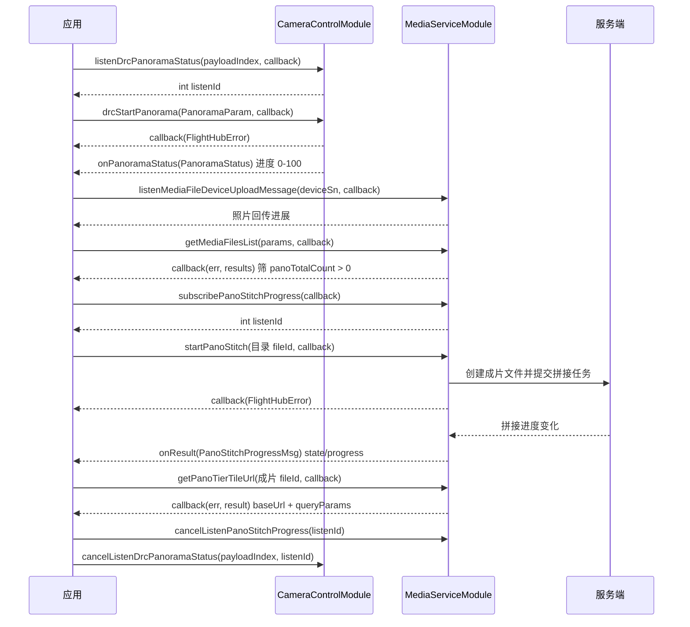

# 超清全景

<!--
本文全部内容均可溯源，不含未经核实的产品论述（本注释不渲染）

核验基准：
  - 接口签名、字段、枚举：paas-sdk release/u2 (f27294a)
  - 错误码：docs/cn/14.error-codes.md
  - 对外口径：按 flight_hub_sdk_docs/README.md，不含 @implNote / @internal 中的
    HTTP path / WebSocket topic / DRC method 等对内链路信息

已由产品确认后写入的内容：
  - 适用机型：仅大疆机场 3（机型代号 EA230），不支持 EA340。
    确认人 sawyer.yan，2026-11-03。对外统一称「大疆机场 3」，与
    09.sdk/01.sdk-intro.md「支持产品」表及 06.device-onboarding 的称呼一致，
    正文不出现机型代号。
    此前 PRD 819833480 的 3.3 写「EA230 + EA340（待确认是否）」、4.1 写
    「设备侧：EA230、EA340」，口径不一致，以本次产品确认为准。

已按「源码为准、最小可用」原则删除的内容（PRD 819833480 为唯一来源，源码无从佐证）：
  - 性能与成功率指标（成功率 99%、拍照 < 3 分钟、合图 ≤ 5 分钟、
    落地后 10 分钟内输出）—— SLA 指标，不属于接口文档范围。
  - 「调用 Terra 完成超清全景拼接」及 PRD 4.4 整节的拼接接口形态
    （任务名称 + 素材文件夹 + WKT + callback_url、错误码 8/119/13/122/125 重试）。
    源码 media_service_module.h:245-249 明写 pf-media 的 pano-stitch 与
    pf-terra 的 createPanorama 是两条独立链路，PRD 描述的入参形态对应后者。
    本文按源码走 MediaServiceModule 路径，并在 1.2 节说明两者区别。
  - 「手动重新合成本期暂无」—— 源码已提供 retryPanoStitch。
-->

## 1 功能概述

### 1.1 功能简介

超清全景（3X 全景拼接）是一条**跨模块的端到端能力**：飞行器悬停并自动旋转云台拍摄多张 3 倍焦段高清照片，照片回传云端后触发云端拼接生成全景成片，成片切片后通过 CDN 瓦片渲染全景播放器。

**适用机型：仅大疆机场 3。** 其它机场型号不支持超清全景，下发拍摄指令会返回错误码 `327203`。

超清全景**不是单一 SDK 模块**，完整链路横跨两个模块：拍摄侧由**单机级**的 `CameraControlModule` 下发 DRC 指令，云端拼接与瓦片由**工作空间级**的 `MediaServiceModule` 负责。本文把两段串起来，按业务流程给出完整调用顺序。

SDK 中与「全景」相关的能力共有**三条相互独立**的链路，接入前须先确认用哪一条：

| 链路 | 入口 | 用途 |
| --- | --- | --- |
| **拍摄侧** | `CameraControlModule.drcStartPanorama()` | 控制飞行器拍摄全景照片，产出一个全景照片目录 |
| **云端媒体库拼接**（本文主线） | `MediaServiceModule.startPanoStitch()` | 对全景照片目录触发 3X 超清拼接，产出全景成片与瓦片 |
| **Terra 全景重建** | `TerraBuildModule.createPanorama()` | 以影像文件夹 UUID + WKT 坐标范围为输入的重建作业，产出全景模型文件 |

后两者**不是同一条链路**，入参形态与结果形态都不同：`startPanoStitch()` 只接受一个媒体文件 ID；`createPanorama()` 需要文件夹 UUID 列表、WKT 与地图展示开关。Terra 路径详见 [模型重建](./3d-reconstruction.md)。

**获取方式：**

```java
// 拍摄侧（单机级）
Drone drone = FlightHubSDK.getDroneInstance("your_drone_sn");
CameraControlModule cameraControlModule = drone.getCameraControlModule();

// 云端拼接与瓦片（工作空间级）
Workspace workspace = FlightHubSDK.getWorkspaceInstance();
MediaServiceModule mediaServiceModule = workspace.getMediaServiceModule();
```

### 1.2 核心概念

| 概念 | 说明 |
| --- | --- |
| 全景照片目录 | 一次全景拍摄回传后在云端生成的文件夹。在媒体文件列表项中以 `type == 1`（文件夹）且 `panoTotalCount > 0` 识别，`panoTotalCount` 为全景源照片数量。该字段是**文件夹字段**，成片文件上该值为 `0`。 |
| 全景成片文件 | 拼接产出的成片。`panoStitchState` 与 `panoStitchProgress` 是**成片字段**，在源照片目录上不表达拼接状态。 |
| `fileId` 的两种身份 | **易错点**：`startPanoStitch()` 的入参是**全景照片目录 ID**；`stopPanoStitch()` / `retryPanoStitch()` / `startPanoTier()` / `getPanoTierTileUrl()` 的入参是**全景成片文件 ID**，不是源照片目录 ID。两者混用会导致接口报错或作用于错误的对象。 |
| `fileId` 的类型差异 | **易错点**：媒体文件列表项的 `fileId` 与 `startPanoStitch()` 等全景接口均为 `long`，但 `getMediaFileDetailById(int fileId, cb)` 的入参是 `int`。由列表取到 `fileId` 后再查详情需要显式窄化转换。 |
| 拼接状态（`PanoStitchState`） | `0` 未处理（可 `startPanoStitch`）、`1` 等待资源（可 `stopPanoStitch`）、`2` 处理中（可 `stopPanoStitch`）、`3` 成功、`4` 失败（可 `retryPanoStitch`）、`5` 取消（可 `retryPanoStitch`）、`6` 余额不足（可 `retryPanoStitch`）、`0xFFFF` 未知。状态与可执行动作严格对应，在其它状态下调用对应接口会返回业务错误。**SDK 对外未提供该枚举类型**，相关字段均为 `int`，需按上述取值自行对照。 |
| 瓦片状态（`PanoTierState`） | `0` 未处理、`1` 等待资源、`2` 处理中、`3` 成功（可获取瓦片 URL）、`4` 失败、`0xFFFF` 未知。仅 `3` 时 `getPanoTierTileUrl()` 返回的 `baseUrl` / `queryParams` 有效。**SDK 对外同样未提供该枚举类型**，字段为 `int`。 |
| 3X 与 1X 的切片差异 | **3X 超清全景拼接任务自带切片，不需要单独调用 `startPanoTier()`**；`startPanoTier()` 是 1X 全景成片使用的接口。 |
| 瓦片鉴权 | `getPanoTierTileUrl()` 返回 `baseUrl` 与 `queryParams`。用 `baseUrl` 拼瓦片路径、附加 `queryParams` 完成 CDN 鉴权是 PaaS 通道的推荐做法。**`cookies` 字段在 PaaS 通道下不填充**（后端经 HTTP 响应头下发，SDK 当前不解析响应头），浏览器场景由 HTTP client 自动携带。 |
| 进度订阅的作用域与任务关联 | **易错点**：`subscribePanoStitchProgress()` 是**工作空间级订阅且无过滤入参**，会收到该工作空间下所有拼接任务的推送；而 `startPanoStitch()` 的回调只返回错误（`onResult(FlightHubError)`），**不返回成片文件 ID**。因此无法从一次 `startPanoStitch()` 直接得到对应的成片 ID。单任务串行场景可直接取推送中的 `getFileId()`；多任务并发场景需用推送中的 `getWorkspaceId()` / `getName()` 配合媒体文件列表自行比对归属。 |
| 全景拍摄运行状态（`PanoramaRunningState`） | `PanoramaStatus.getCurrentStep()` 的取值：`0` 空闲、`1` 拍摄中、`2` 合成中、`3` 已完成、`0xFFFF` 未知。该枚举在 `com.dji.flighthubsdk.value` 包下对外提供。 |
| 拍照结果状态（`CameraPhotoState`） | `PanoramaStatus.getPhotoState()` 的取值：`0` 拍摄中、`1` 拍摄成功、`2` 拍摄失败、`3` 已取消、`0xFFFF` 未知。该枚举同样在 `value` 包下对外提供。 |
| 负载索引（`payloadIndex`） | 格式为 `{type-subtype-gimbalindex}`，例如 `"81-0-0"`。拍摄侧的启停与状态订阅均以该索引定位负载。 |
| 相机模式（`CameraMode.PANO_PHOTO`） | 全景拍摄期间相机处于该模式，可通过 `CameraState.getCameraMode()` 配合 `CameraMode.fromValue(int)` 对照确认。详见 [相机控制](../remote-control/camera-control.md)。 |

### 1.3 能力清单

**拍摄侧（`CameraControlModule`，单机级）**

| 能力 | 对应接口 | 接口类型 | 说明 |
| --- | --- | --- | --- |
| 开始全景拍摄 | `drcStartPanorama(params, cb)` | 异步回调 | 入参 `PanoramaParam`，仅含 `payloadIndex` 一个字段 |
| 停止全景拍摄 | `drcStopPanorama(payloadIndex, cb)` | 异步回调 | 回调仅返回错误信息 |
| 订阅全景拍摄状态 | `listenDrcPanoramaStatus(payloadIndex, cb)` | 事件订阅 | 返回 `int listenId`，**失败返回 `-1`**；回调返回 `PanoramaStatus`（运行步骤、进度 0–100、拍照结果状态） |
| 取消订阅全景拍摄状态 | `cancelListenDrcPanoramaStatus(payloadIndex, listenId)` | 同步返回 | 需同时回传 `payloadIndex` 与订阅时返回的 `listenId` |

**云端拼接与瓦片（`MediaServiceModule`，工作空间级）**

| 能力 | 对应接口 | 接口类型 | 说明 |
| --- | --- | --- | --- |
| 查询全景照片目录 | `getMediaFilesList(params, cb)` | 异步回调 | 以 `type == 1` 且 `panoTotalCount > 0` 筛出全景照片目录。`GetMediaFilesListParams` 为**偏移量分页**（`setStartIndex` + `setPageSize`，默认 `0` / `100`），返回结果含 `nextIndex` 与 `total` |
| 查询拼接状态 | `getMediaFileDetailById(fileId, cb)` | 异步回调 | 返回 `panoStitchState` / `panoStitchProgress` / `panoErrorCode`。**入参为 `int`** |
| 触发 3X 超清拼接 | `startPanoStitch(fileId, cb)` | 异步回调 | 入参为**全景照片目录 ID**，要求该目录 `panoTotalCount > 0` 且其下所有子照片已上传完成 |
| 停止拼接 | `stopPanoStitch(fileId, cb)` | 异步回调 | 入参为**成片文件 ID**；仅状态为 `1` 等待资源或 `2` 处理中时允许停止 |
| 重试拼接 | `retryPanoStitch(fileId, cb)` | 异步回调 | 入参为**成片文件 ID**；仅状态为 `4` 失败 / `5` 取消 / `6` 余额不足时允许重试，重试复用同一成片文件 |
| 触发瓦片切片 | `startPanoTier(fileId, cb)` | 异步回调 | **1X 全景成片使用**；3X 超清拼接任务自带切片，无需调用本接口 |
| 获取瓦片 CDN URL | `getPanoTierTileUrl(fileId, cb)` | 异步回调 | 返回 `GetPanoTierTileUrlResult`；仅 `getState() == 3` 时 `baseUrl` / `queryParams` 有效 |
| 订阅拼接进度 | `subscribePanoStitchProgress(cb)` | 事件订阅 | **仅一个入参**，回调返回 `PanoStitchProgressMsg`；返回 `listenId`，小于 0 表示订阅失败 |
| 取消订阅拼接进度 | `cancelListenPanoStitchProgress(listenId)` | 同步返回 | 传入订阅时返回的 `listenId` |

**上传环节的辅助订阅**

| 能力 | 对应接口 | 接口类型 | 说明 |
| --- | --- | --- | --- |
| 订阅设备媒体回传通知 | `listenMediaFileDeviceUploadMessage(deviceSn, cb)` | 事件订阅 | 用于掌握照片回传进展 |
| 订阅媒体后处理完成通知 | `listenMediaFilePostProcessMessage(deviceSn, cb)` | 事件订阅 | 详见 [媒体服务](./media-service.md) |

---

## 2 前提条件

- 已完成上云 API 2 底座部署，并获取到服务地址与鉴权 Token。详见 [部署指南](../../../03.deployment/00.index.md)、[鉴权接入指南](../../../10.auth.md)。
- 已完成 SDK 初始化且 `FlightHubSDK.isInitialized()` 返回 `true`。详见 [SDK初始化](../init/sdk-init.md)。
- 已通过 `FlightHubSDK.getDroneInstance(sn)` 取得飞行器实例并获取 `CameraControlModule`；已通过 `FlightHubSDK.getWorkspaceInstance()` 取得工作空间实例并获取 `MediaServiceModule`。
- **设备为大疆机场 3**：超清全景仅大疆机场 3 支持。其它机场型号下发拍摄指令会返回错误码 `327203`（当前设备不支持全景拍照）。
- **飞行器已起飞**：未起飞时下发返回错误码 `327206`（飞机未起飞，无法开始全景拍摄）。
- **已取得飞行控制权**：控制权获取失败会导致拍摄终止，返回错误码 `327207`。控制权抢占详见 [控制权管理](../remote-control/control-auth.md)。
- **已建立 DRC 链路**：拍摄侧的启停指令经 DRC 下发。详见 [DRC链路](../remote-control/drc.md)。
- **照片已全部回传云端**：`startPanoStitch()` 要求目录下所有子照片上传完成，可用 `listenMediaFileDeviceUploadMessage()` 确认回传进展。
- 若需订阅拍摄状态或拼接进度，SDK 配置中的通知服务地址必须正确且连接可用。详见 [SDK配置](../init/sdk-config.md)。

---

## 3 快速上手

### 3.1 获取模块实例

```java
// 前置：已完成 FlightHubSDK.initialize(config)
Drone drone = FlightHubSDK.getDroneInstance("your_drone_sn");
CameraControlModule cameraControlModule = drone.getCameraControlModule();

Workspace workspace = FlightHubSDK.getWorkspaceInstance();
MediaServiceModule mediaServiceModule = workspace.getMediaServiceModule();
```

### 3.2 使用流程

1. **准备控制权与链路** —— 抢得飞行控制权（[控制权管理](../remote-control/control-auth.md)）并建立 DRC 链路（[DRC链路](../remote-control/drc.md)），飞行器已起飞。
2. **订阅拍摄状态** —— 调用 `listenDrcPanoramaStatus(payloadIndex, cb)` 并保存 `listenId`（失败返回 `-1`，此时不应调用 cancel），用 `getCurrentStep()` 与 `getPercent()` 驱动进度展示。
3. **发起全景拍摄** —— 组装 `PanoramaParam`（设置 `payloadIndex`），调用 `drcStartPanorama()`。需要中止时调用 `drcStopPanorama(payloadIndex, cb)`。
4. **等待照片回传** —— 订阅 `listenMediaFileDeviceUploadMessage(deviceSn, cb)` 掌握回传进展，直到该次全景的所有照片上传完成。
5. **定位全景照片目录** —— 调用 `getMediaFilesList()`，筛出 `type == 1` 且 `panoTotalCount > 0` 的条目，取其 `fileId` 作为拼接入参。
6. **订阅拼接进度** —— 先调用 `subscribePanoStitchProgress(cb)` 并保存 `listenId`，再触发拼接，避免错过早期进度推送。
7. **触发拼接** —— 以步骤 5 的目录 `fileId` 调用 `startPanoStitch()`。后端会先创建成片文件，再提交拼接任务。
8. **跟踪拼接结果** —— 进度回调中 `getPanoStitchState() == 3` 视为完成；`4` / `5` / `6` 分别为失败、取消、余额不足，可用回调中的 `getFileId()`（**成片文件 ID**）调用 `retryPanoStitch()` 重试。
9. **获取瓦片并渲染** —— 以成片文件 ID 调用 `getPanoTierTileUrl()`，`getState() == 3` 时用 `baseUrl` 拼瓦片路径、附加 `queryParams` 完成 CDN 鉴权。3X 拼接自带切片，不需要调用 `startPanoTier()`。
10. **退出时取消订阅** —— 用保存的 `listenId` 分别调用 `cancelListenDrcPanoramaStatus()` 与 `cancelListenPanoStitchProgress()`。

### 3.3 调用时序图



---

## 4 示例代码

### 4.1 完整示例

```java
import com.dji.flighthubsdk.FlightHubSDK;
import com.dji.flighthubsdk.FlightHubCallback;
import com.dji.flighthubsdk.bean.FlightHubError;
import com.dji.flighthubsdk.bean.GetMediaFilesListParams;
import com.dji.flighthubsdk.bean.GetMediaFilesListResults;
import com.dji.flighthubsdk.bean.GetPanoTierTileUrlResult;
import com.dji.flighthubsdk.bean.MediaFilesListItemInfoData;
import com.dji.flighthubsdk.bean.PanoStitchProgressMsg;
import com.dji.flighthubsdk.bean.PanoramaParam;
import com.dji.flighthubsdk.bean.PanoramaStatus;
import com.dji.flighthubsdk.core.CameraControlModule;
import com.dji.flighthubsdk.core.MediaServiceModule;

import java.util.Map;

/**
 * 超清全景端到端：订阅拍摄状态 -> 发起拍摄 -> 定位全景目录 -> 订阅拼接进度
 *                -> 触发拼接 -> 取瓦片 URL -> 退订收尾。
 * 前提：已抢得飞行控制权并建立 DRC 链路，飞行器已起飞。
 */
public class UltraHdPanoramaDemo {

    private final String droneSn;
    private final String payloadIndex;          // 形如 "81-0-0"
    private int panoramaStatusListenId = -1;
    private int stitchProgressListenId = -1;
    private long resultFileId = -1;             // 成片文件 ID，由进度推送带出

    public UltraHdPanoramaDemo(String droneSn, String payloadIndex) {
        this.droneSn = droneSn;
        this.payloadIndex = payloadIndex;
    }

    // ============ 1. 订阅拍摄状态并发起全景拍摄 ============
    public void startShooting() {
        CameraControlModule camera = FlightHubSDK.getDroneInstance(droneSn).getCameraControlModule();

        panoramaStatusListenId = camera.listenDrcPanoramaStatus(payloadIndex,
                new FlightHubCallback.PanoramaStatusCallback() {
                    @Override
                    public void onResult(PanoramaStatus status) {
                        if (status == null) return;   // 注意：事件订阅回调无 error 参数，必须判空
                        System.out.println("[拍摄] 运行状态=" + runningStateText(status.getCurrentStep())
                                + " 进度=" + status.getPercent() + "%"
                                // 注意：C++ 侧字段名为 status，Java 侧 getter 为 getPhotoState()
                                + " 拍照结果=" + photoStateText(status.getPhotoState()));
                    }
                });
        // 注意：listenDrcPanoramaStatus 失败返回 -1，此时不应调用 cancel
        if (panoramaStatusListenId == -1) {
            System.err.println("订阅全景拍摄状态失败");
            return;
        }

        PanoramaParam params = new PanoramaParam();
        params.setPayloadIndex(payloadIndex);     // PanoramaParam 仅此一个字段

        camera.drcStartPanorama(params, error -> {
            // 注意：先判 error != null 再取 serverCode，否则成功分支之外的 null 会 NPE
            if (error != null && !error.isSuccess()) {
                // 注意：327203 设备不支持 / 327206 飞机未起飞 / 327207 控制权获取失败
                System.err.println("发起全景拍摄失败: " + error
                        + " serverCode=" + error.getServerCode()
                        + " msg=" + error.getServerMessage());
                return;
            }
            System.out.println("全景拍摄已发起，等待照片回传云端");
        });
    }

    /** 中止本次全景拍摄 */
    public void stopShooting() {
        FlightHubSDK.getDroneInstance(droneSn).getCameraControlModule()
                .drcStopPanorama(payloadIndex, error -> {
                    boolean ok = error != null && error.isSuccess();
                    System.out.println("停止全景拍摄: " + (ok ? "成功" : "失败 " + error));
                });
    }

    // ============ 2. 定位全景照片目录（type==1 且 panoTotalCount>0） ============
    public void findPanoDirectory(java.util.function.LongConsumer onFound) {
        findPanoDirectory(0, onFound);
    }

    private void findPanoDirectory(int startIndex, java.util.function.LongConsumer onFound) {
        MediaServiceModule media = FlightHubSDK.getWorkspaceInstance().getMediaServiceModule();

        GetMediaFilesListParams params = new GetMediaFilesListParams();
        params.setStartIndex(startIndex);          // 偏移量分页，不是页码
        params.setPageSize(20);                    // 默认 100

        media.getMediaFilesList(params, new FlightHubCallback.GetMediaFilesListCallback() {
            @Override
            public void onResult(FlightHubError error, GetMediaFilesListResults results) {
                if (error != null && !error.isSuccess()) {
                    System.err.println("查询媒体列表失败: " + error);
                    return;
                }
                if (results == null || results.getList() == null) return;

                for (MediaFilesListItemInfoData item : results.getList()) {
                    // 注意：panoTotalCount 是文件夹字段，成片文件上该值为 0
                    if (item.getType() == 1 && item.getPanoTotalCount() > 0) {
                        System.out.println("全景照片目录 fileId=" + item.getFileId()
                                + " 源照片数=" + item.getPanoTotalCount());
                        onFound.accept(item.getFileId());
                        return;
                    }
                }
                // 注意：本页未命中要续查，用返回的 nextIndex 作为下次的 startIndex
                if (results.getNextIndex() > startIndex
                        && results.getNextIndex() < results.getTotal()) {
                    findPanoDirectory(results.getNextIndex(), onFound);
                }
            }
        });
    }

    // ============ 3. 先订阅进度，再触发拼接（避免错过早期推送） ============
    public void stitch(long panoDirectoryFileId) {
        MediaServiceModule media = FlightHubSDK.getWorkspaceInstance().getMediaServiceModule();

        // 注意：subscribePanoStitchProgress 只有一个入参，workspaceId 是推送消息的返回字段
        stitchProgressListenId = media.subscribePanoStitchProgress(
                new FlightHubCallback.PanoStitchProgressCallback() {
                    @Override
                    public void onResult(PanoStitchProgressMsg msg) {
                        if (msg == null) return;
                        // 注意：本订阅是工作空间级且无过滤入参，会收到该工作空间下所有拼接任务的推送；
                        // 而 startPanoStitch 的回调不返回成片 fileId，无法直接关联到本次请求。
                        // 本例按「同一时刻只有一个拼接任务」处理；多任务并发时须改为用
                        // msg.getName() 配合媒体文件列表比对归属，不能像这样直接覆盖。
                        resultFileId = msg.getFileId();     // 成片文件 ID，后续接口都用它
                        System.out.println("[拼接] workspaceId=" + msg.getWorkspaceId()
                                + " 成片 fileId=" + resultFileId
                                + " 名称=" + msg.getName()
                                + " 状态=" + stitchStateText(msg.getPanoStitchState())
                                + " 进度=" + msg.getPanoStitchProgress() + "%"
                                + " errorCode=" + msg.getPanoErrorCode());

                        if (msg.getPanoStitchState() == 3) {
                            fetchTileUrl(resultFileId);
                        }
                    }
                });
        if (stitchProgressListenId < 0) {
            System.err.println("订阅拼接进度失败");   // 注意：小于 0 表示失败，此时不应调用 cancel
            return;
        }

        // 入参是全景照片目录 ID，不是成片文件 ID
        media.startPanoStitch(panoDirectoryFileId, error -> {
            boolean ok = error != null && error.isSuccess();
            System.out.println("触发 3X 超清拼接: " + (ok ? "成功" : "失败 " + error));
        });
    }

    // ============ 4. 取瓦片 CDN URL（3X 拼接自带切片，无需调 startPanoTier） ============
    private void fetchTileUrl(long resultFileIdArg) {
        FlightHubSDK.getWorkspaceInstance().getMediaServiceModule()
                .getPanoTierTileUrl(resultFileIdArg, new FlightHubCallback.GetPanoTierTileUrlCallback() {
                    @Override
                    public void onResult(FlightHubError error, GetPanoTierTileUrlResult result) {
                        if (error != null && !error.isSuccess()) {
                            System.err.println("获取瓦片 URL 失败: " + error);
                            return;
                        }
                        if (result == null) return;
                        // 注意：仅 state==3（切片成功）时 baseUrl / queryParams 才有效
                        if (result.getState() != 3) {
                            System.out.println("切片未完成，state=" + result.getState());
                            return;
                        }
                        System.out.println("瓦片基础 URL=" + result.getBaseUrl());
                        // 注意：PaaS 通道下 cookies 不填充，用 queryParams 完成 CDN 鉴权
                        for (Map.Entry<String, String> e : result.getQueryParams().entrySet()) {
                            System.out.println("  鉴权参数 " + e.getKey() + "=" + e.getValue());
                        }
                    }
                });
    }

    // ============ 5. 停止 / 重试拼接（入参均为成片文件 ID） ============
    public void stopStitch() {
        if (resultFileId < 0) return;
        // 注意：仅状态为 1 等待资源 / 2 处理中时才允许停止
        FlightHubSDK.getWorkspaceInstance().getMediaServiceModule()
                .stopPanoStitch(resultFileId, error -> {
                    boolean ok = error != null && error.isSuccess();
                    System.out.println("停止拼接: " + (ok ? "成功" : "失败 " + error));
                });
    }

    public void retryStitch() {
        if (resultFileId < 0) return;
        // 注意：仅状态为 4 失败 / 5 取消 / 6 余额不足时才允许重试
        FlightHubSDK.getWorkspaceInstance().getMediaServiceModule()
                .retryPanoStitch(resultFileId, error -> {
                    boolean ok = error != null && error.isSuccess();
                    System.out.println("重试拼接: " + (ok ? "成功" : "失败 " + error));
                });
    }

    // ============ 6. 退出前取消全部订阅 ============
    public void release() {
        if (panoramaStatusListenId != -1) {
            FlightHubSDK.getDroneInstance(droneSn).getCameraControlModule()
                    .cancelListenDrcPanoramaStatus(payloadIndex, panoramaStatusListenId);
            panoramaStatusListenId = -1;
        }
        if (stitchProgressListenId >= 0) {
            FlightHubSDK.getWorkspaceInstance().getMediaServiceModule()
                    .cancelListenPanoStitchProgress(stitchProgressListenId);
            stitchProgressListenId = -1;
        }
    }

    /** PanoramaRunningState */
    private static String runningStateText(int s) {
        switch (s) {
            case 0: return "空闲";
            case 1: return "拍摄中";
            case 2: return "合成中";
            case 3: return "已完成";
            default: return "未知(" + s + ")";
        }
    }

    /** CameraPhotoState */
    private static String photoStateText(int s) {
        switch (s) {
            case 0: return "拍摄中";
            case 1: return "拍摄成功";
            case 2: return "拍摄失败";
            case 3: return "已取消";
            default: return "未知(" + s + ")";
        }
    }

    /** PanoStitchState */
    private static String stitchStateText(int s) {
        switch (s) {
            case 0: return "未处理";
            case 1: return "等待资源";
            case 2: return "处理中";
            case 3: return "成功";
            case 4: return "失败";
            case 5: return "取消";
            case 6: return "余额不足";
            default: return "未知(" + s + ")";
        }
    }
}
```

### 4.2 场景化片段

**只订阅拼接进度，到达终态后自动退订**

```java
MediaServiceModule media = FlightHubSDK.getWorkspaceInstance().getMediaServiceModule();
final int[] listenIdHolder = new int[1];

listenIdHolder[0] = media.subscribePanoStitchProgress(msg -> {
    if (msg == null) return;
    int state = msg.getPanoStitchState();
    if (state == 3) {
        System.out.println("拼接完成, 成片 fileId=" + msg.getFileId());
        media.cancelListenPanoStitchProgress(listenIdHolder[0]);
    } else if (state == 4 || state == 5 || state == 6) {
        System.out.println("拼接结束, state=" + state + " errorCode=" + msg.getPanoErrorCode());
        media.cancelListenPanoStitchProgress(listenIdHolder[0]);
    }
});
```

**按状态决定下一步动作，避免在错误状态下调接口**

```java
// 注意：fileId 在列表项与全景接口中是 long，而 getMediaFileDetailById 入参是 int，需显式转换
int detailFileId = (int) resultFileId;

FlightHubSDK.getWorkspaceInstance().getMediaServiceModule()
        .getMediaFileDetailById(detailFileId, (error, result) -> {
            if ((error != null && !error.isSuccess()) || result == null) return;
            switch (result.getPanoStitchState()) {
                case 1:
                case 2:
                    // 仅这两个状态可停止
                    System.out.println("进行中，可调 stopPanoStitch");
                    break;
                case 4:
                case 5:
                case 6:
                    // 仅这三个状态可重试
                    System.out.println("已结束且可重试，errorCode=" + result.getPanoErrorCode());
                    break;
                case 3:
                    System.out.println("已成功，可调 getPanoTierTileUrl 取瓦片");
                    break;
                default:
                    System.out.println("state=" + result.getPanoStitchState());
            }
        });
```

**1X 全景成片需要手动切片**

```java
// 注意：仅 1X 全景成片需要调用本接口；3X 超清拼接任务自带切片
FlightHubSDK.getWorkspaceInstance().getMediaServiceModule()
        .startPanoTier(resultFileId, error -> {
            boolean ok = error != null && error.isSuccess();
            System.out.println("触发瓦片切片: " + (ok ? "成功" : "失败 " + error));
        });
```

---

## 5 相关文档

- [媒体服务](./media-service.md) —— 媒体文件列表、详情、下载与上传通知，全景照片目录的来源
- [模型重建](./3d-reconstruction.md) —— Terra 全景重建（`createPanorama`），与本文的云端拼接链路相互独立
- [相机控制](../remote-control/camera-control.md) —— 相机模式、照片分辨率与其它 DRC 相机指令
- [控制权管理](../remote-control/control-auth.md) —— 下发拍摄指令前必须抢得的飞行控制权
- [DRC链路](../remote-control/drc.md) —— 拍摄侧指令依赖的低时延链路
- [飞行控制](../remote-control/flight-control.md) —— 飞行器基础飞行控制能力
- [错误码](../../../14.error-codes.md) —— 全景拍摄错误码（`327020`、`327201`–`327209`）的完整含义
- [SDK初始化](../init/sdk-init.md) —— 获取飞行器与工作空间实例前必须完成的初始化步骤
- [SDK配置](../init/sdk-config.md) —— 通知服务地址等配置项，影响拍摄状态与拼接进度订阅能否收到推送
- [部署指南](../../../03.deployment/00.index.md) —— 上云 API 2 底座部署与服务地址获取
- [鉴权接入指南](../../../10.auth.md) —— 获取鉴权 Token 的接入流程
- [使用 API 文档查阅接口详情](../../03.api-docs-guide.md) —— 查阅 `CameraControlModule`、`MediaServiceModule` 完整方法签名与字段定义
