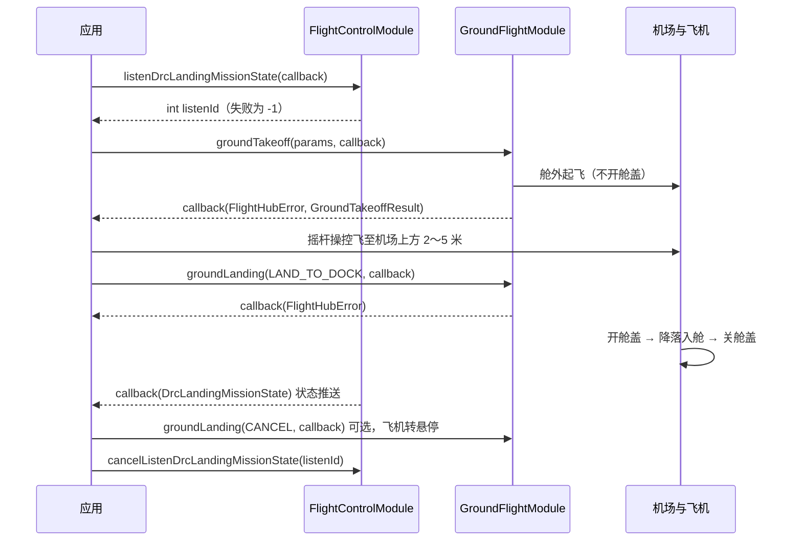

# 无人机从地面起飞降落回机场（GroundFlightModule）

## 1 功能概述

### 1.1 功能简介

`GroundFlightModule` 是**无人机**从地面起飞、降落回机场的模块，作用域为一架具体的无人机（由设备 SN 指定）。它解决的是「无人机不在舱内，怎么飞回机场」的问题：无人机开机后停放在机场**舱外地面**，由本模块下发起飞指令让它离地，手动操控飞到机场上方后，再下发一条降落指令，由机场自动开舱盖、无人机降落入舱、机场自动关舱盖。

机场常部署在人难以到达的位置（信号灯杆、塔架顶部等）。更换负载、更换 SIM / SD 卡、发生备降、维修后放回机场等场景下，原本需要斗臂车加人工把无人机放进机场；有了本模块，无人机落在地面也能自己飞回舱内。

与 [一键起飞](./takeoff.md)（`TakeoffModule`，飞机在舱内，起飞要先开舱盖）不同，本模块面向「飞机已在舱外地面」的场景：**起飞不经开舱盖流程**；降落则由机场完成「开舱盖 → 降落 → 关舱盖」整套动作。

无人机从舱外一键起飞时，要求无人机电量 >50%。无人机起飞后飞行至机场上方，调用降落至机场接口时，务必保证无人机：飞到机场上方 2～5 米、水平距离 2 米以内、机头朝向机场前方（和停机坪上标记的箭头方向一致）。请注意：如果机头朝向错误，无人机降落后将导致无法起飞，只能人到机场部署现场手动调整。

:::warning
本模块目前仅**大疆机场 3 的最新版本固件**支持，使用前请先升级到最新固件。
:::

**获取方式：**

```java
Drone drone = FlightHubSDK.getDroneInstance("your_device_sn");
GroundFlightModule groundFlightModule = drone.getGroundFlightModule();
```

### 1.2 核心概念

| 概念 | 说明 |
| --- | --- |
| 舱外起飞 | 无人机停在机场舱外地面时的起飞。不经开舱盖流程，起飞后爬升到 `autoTakeoffHeight` 指定高度。 |
| 舱外降落 | 无人机飞到机场上方后下发的降落指令。由**机场自动开舱盖 → 无人机降落入舱 → 机场自动关舱盖**，全程自动完成。 |
| 起飞参数（`GroundTakeoffParams`） | 舱外起飞入参，含自动起飞高度与失控动作两项，均为必填。`device_sn` 由模块自动注入网关 SN，**调用方无需填写**。 |
| 起飞结果（`GroundTakeoffResult`） | `groundTakeoff()` 回调返回，含飞行任务 ID（`flightId`）。 |
| 降落指令（`GroundLandingCommand`） | `LAND_TO_DOCK`（降落至机场）与 `CANCEL`（取消降落，飞机转为悬停）两条指令，经同一个 `groundLanding()` 下发。 |
| 降落任务状态（`DrcLandingMissionState`） | 降落过程的细分状态推送，由 `FlightControlModule.listenDrcLandingMissionState()` 订阅，含降落阶段、暂停原因、舱盖开合百分比与舱盖错误码。属 DRC 北向推送，**须先建立 DRC 链路才有数据**。 |
| 模块实例可能为 `null` | `drone.getGroundFlightModule()` 在 SDK 内部获取失败时返回 `null`，调用前必须判空。 |

### 1.3 能力清单

| 能力 | 对应接口 | 接口类型 | 说明 |
| --- | --- | --- | --- |
| 舱外起飞 | `groundTakeoff(params, callback)` | 异步回调 | 回调 `onResult(FlightHubError, GroundTakeoffResult)`，成功时返回 `flightId` |
| 舱外降落 / 取消降落 | `groundLanding(cmd, callback)` | 异步回调 | 回调 `onResult(FlightHubError)`，只返回错误信息；指令由 `GroundLandingCommand` 区分 |
| 订阅降落任务状态 | `FlightControlModule.listenDrcLandingMissionState(cb)` / `cancelListenDrcLandingMissionState(listenId)` | 事件订阅 | 事件回调 `onResult(DrcLandingMissionState)`，**无 error 参数**；`listenId` 失败返回 `-1` |

**舱外起飞入参（`GroundTakeoffParams`）**

| 字段 | 类型 | 说明 |
| --- | --- | --- |
| `autoTakeoffHeight` | `int` | 自动起飞高度（米），**必填**，服务端硬校验范围 `2`–`1500`，越界会被直接拒绝 |
| `outOfControlAction` | `OutOfControlAction` | 失控动作，**必填**。`HOVER`=`0` 悬停 / `RETURN_HOME`=`1` 返航 / `CONTINUE`=`2` 继续；`UNKNOWN`=`65535` |

**舱外降落指令（`GroundLandingCommand`）**

| 枚举 | 值 | 说明 |
| --- | --- | --- |
| `LAND_TO_DOCK` | `0` | 降落至机场：机场自动开舱盖 → 无人机降落 → 关舱盖 |
| `CANCEL` | `1` | 取消降落：飞机转为悬停，可继续由用户手动操控 |
| `UNKNOWN` | `65535` | 未知。`fromValue(int)` 未命中已知取值时返回此项 |

:::warning
`OutOfControlAction.fromValue()` 与 `GroundLandingCommand.fromValue()` 对非法入参返回 `UNKNOWN`（`65535`），**不会抛异常**。若入参来自配置文件或外部输入，务必先判断是否为 `UNKNOWN` 再下发，否则 `65535` 会被原样发往服务端。
:::

### 1.4 降落任务状态码

`DrcLandingMissionState` 的 `getLanding_state()` 取值与含义：

| 值 | 含义 |
| --- | --- |
| `0` | 初始空闲 |
| `1` | 等待参数同步 |
| `2` | 航向对齐 |
| `3` | 精准降落（有水平源） |
| `4` | 无源降落（无水平源，继续下降） |
| `5` | 悬停微调（有水平源） |
| `6` | 纯悬停（无水平源） |
| `7` | 备降（有源） |
| `8` | 备降（无源） |
| `9` | 备降（用户 RC 接管） |

该对象另有三个字段：`getPause_reason()` 暂停原因、`getCover_percent()` 舱盖开合百分比、`getCover_error_code()` 舱盖错误码。

:::tip
判断「确实已降落入舱」不要只看降落指令的回调。指令下发成功只代表服务端收下了指令，推荐同时订阅机场侧状态交叉确认：`DockOsdModule.listenDroneInDock()` 返回 `1`（在舱内）且 `listenDockCoverState()` 返回 `0`（舱盖关闭），才是完整的降落终态。
:::

---

## 2 前提条件

- 已完成上云 API 2 底座部署，并获取到服务地址与鉴权 Token。详见 [部署指南](../../../03.deployment/00.index.md)、[鉴权接入指南](../../../10.auth.md)。
- 已完成 SDK 初始化且 `FlightHubSDK.isInitialized()` 返回 `true`。详见 [SDK初始化](../init/sdk-init.md)。
- 目标设备已完成上云、已绑定至当前工作空间且在线。详见 [设备上云](../../../06.device-onboarding/00.index.md)。
- **机场为大疆机场 3，且已升级到支持舱外起降的高版本固件**。固件不满足时接口不可用，详见 [固件管理](../device/firmware.md)。
- **无人机已开机并停放在机场舱外地面**，电量建议大于 50%。
- 已通过 `ControlAuthModule` 抢得该飞机的**飞行控制权**，并通过 `DrcModule.connectDrcLink()` 建立 **DRC 链路**。起飞后到降落前的手动操控依赖二者，降落任务状态推送也属 DRC 北向推送。详见 [控制权管理](./control-auth.md)、[DRC链路](./drc.md)。
- 若需接收降落任务状态推送，SDK 配置中的 `notificationServerAddress` 必须正确且连接可用。详见 [SDK配置](../init/sdk-config.md)。

---

## 3 快速上手

### 3.1 获取模块实例

```java
// 前置：已完成 FlightHubSDK.initialize(config)，且已抢得飞行控制权、建立 DRC 链路
Drone drone = FlightHubSDK.getDroneInstance("your_device_sn");
GroundFlightModule module = drone.getGroundFlightModule();
if (module == null) {
    // SDK 内部获取失败，无法执行舱外起降
    return;
}
```

### 3.2 使用流程

1. **抢控制权** —— 经 [控制权管理](./control-auth.md) 抢得目标飞机的飞行控制权。
2. **建 DRC 链路** —— 经 [DRC链路](./drc.md) 调用 `connectDrcLink()` 建链成功。
3. **获取模块实例** —— 调用 `drone.getGroundFlightModule()` 并判空。
4. **订阅降落任务状态**（建议） —— 经 `FlightControlModule.listenDrcLandingMissionState()` 订阅并保存 `listenId`，用于观察降落全过程。
5. **舱外起飞** —— 构造 `GroundTakeoffParams`（起飞高度 + 失控动作），调用 `groundTakeoff()`，回调返回 `flightId`。
6. **手动飞至机场上方** —— 经 [飞行控制](./flight-control.md) 的摇杆指令，把飞机操控到**机场正上方 2～5 米、水平距离 2 米以内，机头朝向机场前方**。
7. **降落至机场** —— 以 `GroundLandingCommand.LAND_TO_DOCK` 调用 `groundLanding()`，机场自动完成开舱盖、降落、关舱盖。
8. **（按需）取消降落** —— 降落过程中以 `GroundLandingCommand.CANCEL` 调用 `groundLanding()`，飞机转为悬停，可重新手动操控。
9. **确认降落终态** —— 经机场侧「飞机在舱」与「舱盖关闭」交叉确认，而非只看指令回调。
10. **退订** —— 用步骤 4 保存的 `listenId` 调用 `cancelListenDrcLandingMissionState()`。

### 3.3 调用时序图



---

## 4 示例代码

### 4.1 完整示例

```java
/**
 * 舱外起降：订阅降落状态 -> 舱外起飞 -> （手动飞至机场上方）-> 降落至机场 -> 退订。
 */
public class GroundFlightController {

    private int landingListenId = -1;

    // ============ 1. 订阅降落任务状态（事件回调无 error 参数） ============
    public void listenLandingState(Drone drone) {
        FlightControlModule fc = drone.getFlightControlModule();
        if (fc == null) {
            System.err.println("获取 FlightControlModule 失败，无法订阅降落任务状态");
            return;
        }

        landingListenId = fc.listenDrcLandingMissionState(
                new FlightHubCallback.DrcLandingMissionStateCallback() {
                    @Override
                    public void onResult(DrcLandingMissionState info) {
                        if (info == null) return;   // 事件回调无 error 参数，需对 info 判空
                        System.out.println("[降落状态] state=" + info.getLanding_state()
                                + " 暂停原因=" + info.getPause_reason()
                                + " 舱盖开合=" + info.getCover_percent() + "%"
                                + " 舱盖错误码=" + info.getCover_error_code());
                    }
                });
        // 注意：失败返回 -1，退订前需判断
        System.out.println("降落状态订阅: listenId=" + landingListenId);
    }

    // ============ 2. 舱外起飞 ============
    public void takeoffFromGround(Drone drone, int takeoffHeight) {
        GroundFlightModule module = drone.getGroundFlightModule();
        if (module == null) {
            System.err.println("获取 GroundFlightModule 失败，无法舱外起飞");
            return;
        }

        GroundTakeoffParams params = new GroundTakeoffParams();
        params.setAutoTakeoffHeight(takeoffHeight);                  // 必填，服务端校验 2-1500 米
        params.setOutOfControlAction(OutOfControlAction.RETURN_HOME); // 必填
        // device_sn 由模块注入网关 SN，无需填写

        if (takeoffHeight < 2 || takeoffHeight > 1500) {
            System.err.println("起飞高度超出 2-1500 米，下发大概率被拒");
            return;
        }

        module.groundTakeoff(params, new FlightHubCallback.GroundTakeoffCallback() {
            @Override
            public void onResult(FlightHubError error, GroundTakeoffResult result) {
                if (error != null && !error.isSuccess()) {
                    System.err.println("舱外起飞失败: " + error);
                    return;
                }
                System.out.println("舱外起飞指令已下发: flightId="
                        + (result != null ? result.getFlightId() : "-"));
                // 注意：指令下发成功不代表已起飞完成，需经 OSD / 模式码观察
            }
        });
    }

    // ============ 3. 降落至机场（机场自动开舱盖 -> 降落 -> 关舱盖） ============
    public void landToDock(Drone drone) {
        GroundFlightModule module = drone.getGroundFlightModule();
        if (module == null) return;

        // 前置：已手动把飞机操控到机场上方 2～5 米、水平距离 2 米以内，机头朝向机场前方
        module.groundLanding(GroundLandingCommand.LAND_TO_DOCK, new FlightHubCallback.ResultCallbackWithError() {
            @Override
            public void onResult(FlightHubError error) {
                if (error != null && !error.isSuccess()) {
                    System.err.println("降落至机场失败: " + error);
                    return;
                }
                // 下发成功 ≠ 已落地：请经降落任务状态推送与机场「飞机在舱」状态确认终态
                System.out.println("降落指令已下发，请观察降落任务状态");
            }
        });
    }

    // ============ 4. 取消降落（飞机转为悬停，可重新手动操控） ============
    public void cancelLanding(Drone drone) {
        GroundFlightModule module = drone.getGroundFlightModule();
        if (module == null) return;

        module.groundLanding(GroundLandingCommand.CANCEL, error -> {
            boolean ok = error == null || error.isSuccess();
            System.out.println("取消降落: " + (ok ? "成功，飞机已转为悬停" : "失败 " + error));
        });
    }

    // ============ 5. 退出前取消订阅（必须执行，否则订阅泄漏） ============
    public void shutdown(Drone drone) {
        if (landingListenId == -1) return;
        FlightControlModule fc = drone.getFlightControlModule();
        if (fc != null) {
            fc.cancelListenDrcLandingMissionState(landingListenId);
        }
        landingListenId = -1;
    }
}
```

### 4.2 场景化片段

**以机场侧状态交叉确认降落终态**

```java
// 前置：已下发 LAND_TO_DOCK。指令回调只说明服务端收下了指令，终态要看机场侧
Dock dock = FlightHubSDK.getDockInstance("your_dock_sn");
DockOsdModule dockOsd = dock.getDockOsdModule();

// 飞机是否已在舱内：0=不在舱内 1=在舱内
dockOsd.listenDroneInDock(v -> {
    if (v != null && v.getDroneInDock() == 1) {
        System.out.println("飞机已入舱");
    }
});

// 舱盖状态：0=关闭 1=打开 2=半开 3=异常
dockOsd.listenDockCoverState(v -> {
    if (v != null && v.getCoverState() == 0) {
        System.out.println("舱盖已关闭");
    }
});
// 两者同时满足，才视为「降落至机场」完整结束
```

**对外部传入的失控动作做合法性校验**

```java
// 前置：失控动作取自配置文件或接口入参，可能越界
int raw = config.getInt("out_of_control_action", 1);
OutOfControlAction action = OutOfControlAction.fromValue(raw);
if (action == OutOfControlAction.UNKNOWN) {
    // fromValue 不抛异常，越界会得到 UNKNOWN(65535)，原样下发只会换来一个服务端错误码
    System.err.println("失控动作配置非法(合法值 0=悬停 1=返航 2=继续)，回退为返航");
    action = OutOfControlAction.RETURN_HOME;
}

GroundTakeoffParams params = new GroundTakeoffParams(100, action);
```

**降落过程中紧急改手动**

```java
// 前置：降落过程中发现对位不准、现场有人员或障碍物
// 取消降落属恢复类动作，飞机立即转为悬停，之后可继续用摇杆重新对位
FlightHubSDK.getDroneInstance("your_device_sn")
        .getGroundFlightModule()
        .groundLanding(GroundLandingCommand.CANCEL, error -> {
            if (error != null && !error.isSuccess()) {
                // 取消失败时应立即改用急停 / 返航等更强的处置手段
                System.err.println("取消降落失败，请改用急停或返航: " + error);
                return;
            }
            System.out.println("已转为悬停，可重新手动操控对位后再次降落");
        });
```

---

## 5 相关文档

- [SDK初始化](../init/sdk-init.md) —— 调用本模块前必须完成的初始化步骤
- [控制权管理](./control-auth.md) —— 抢得飞行控制权，舱外起降与手动操控的前置条件
- [DRC链路](./drc.md) —— 建立 DRC 链路，降落任务状态推送的前置条件
- [一键起飞](./takeoff.md) —— 飞机在舱内时的起飞方式，与舱外起飞互为补充
- [飞行控制](./flight-control.md) —— 起飞后把飞机操控到机场上方所用的摇杆、急停与返航指令
- [机场状态监听](./dock-status.md) —— 订阅舱盖、飞机在舱、推杆等机场侧状态，用于确认降落终态
- [飞机状态监听](./drone-status.md) —— 订阅飞机模式码、位置状态，观察起飞与降落阶段
- [固件管理](../device/firmware.md) —— 升级机场固件至支持舱外起降的版本
- [使用 API 文档查阅接口详情](../../03.api-docs-guide.md) —— 查阅 `GroundFlightModule`、`GroundTakeoffParams`、`GroundLandingCommand` 完整方法签名与字段定义
