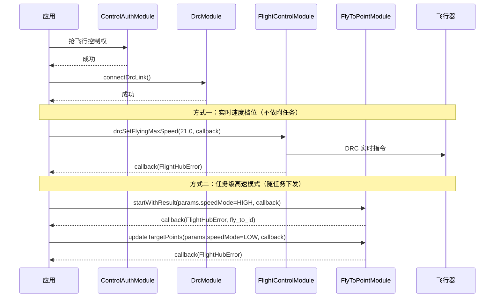

# 高速模式切换

## 1 功能概述

### 1.1 功能简介

高速模式切换解决的是「让飞行器以更高的速度上限飞行」。无人机默认飞行速度上限为 15 m/s，开启高速模式后可提升至 21 m/s，在应急响应等争分夺秒的场景下缩短到达时间；也可降至 5 m/s 的低速档，用于近距离抵近观察。

高速模式切换**不是独立的 SDK 模块**，而是分散在两个模块上的两条能力：

| 方式 | 承载接口 | 通道 | 特点 |
| --- | --- | --- | --- |
| **实时速度档位** | `FlightControlModule.drcSetFlyingMaxSpeed()` | DRC 实时指令 | 不依附任何飞行任务，随时下发、立即生效 |
| **任务级高速模式** | `TakeoffParams` / `FlyToPointParams` / `FlyToUpdateTargetPointsParams` 的 `speedMode` 字段 | HTTP 随任务下发 | 仅作用于本次起飞或指点飞行任务 |

两者不存在覆盖或继承关系：`drcSetFlyingMaxSpeed()` 不会改变任务里的 `speedMode`，`speedMode` 也不会改变实时档位。选哪一种取决于业务形态，详见 [1.4 两种方式如何选](#_1-4-两种方式如何选)。

:::warning
高速模式**仅大疆机场 3 支持，不支持大疆机场 4**。
:::

**获取方式：**

```java
Drone drone = FlightHubSDK.getDroneInstance("your_device_sn");

// 方式一：实时速度档位
FlightControlModule flightControlModule = drone.getFlightControlModule();

// 方式二：任务级高速模式（字段挂在任务入参上，经对应模块下发）
TakeoffModule takeoffModule = drone.getTakeoffModule();
FlyToPointModule flyToPointModule = drone.getFlyToPointModule();
```

### 1.2 核心概念

| 概念 | 说明 |
| --- | --- |
| 实时速度档位（`drcSetFlyingMaxSpeed`） | 经 DRC 链路下发的实时指令，入参为飞行速度（`double`，单位 m/s）。**不依附于任何飞行任务**，下发后立即作用于飞行器当前的速度上限。 |
| 常用档位 | 低速 `5` / 默认 `15` / 高速 `21`（m/s）。**档位仅为调用方约定的参考值**，协议接受连续值，SDK 不做范围校验，超限由设备侧以业务错误码拒绝。 |
| 速度模式（`SpeedMode`） | 任务入参上的速度档位枚举：`LOW` 低速 / `HIGH` 高速 / `UNKNOWN` 未设置。`UNKNOWN` 表示**不下发该字段**，设备保持当前模式。 |
| 速度模式的作用范围 | `speedMode` 是 `TakeoffParams`、`FlyToPointParams`、`FlyToUpdateTargetPointsParams` 三个入参共有的**可选字段**，只对本次任务生效。 |
| 与任务速度上限（`maxSpeed`）的区别 | `maxSpeed` 是本次任务的速度上限（m/s 数值），`speedMode` 是速度档位开关。两者是同一个入参上的**两个独立字段**，不可互相替代。 |
| 与指点飞行风格（`commanderFlightMode`）的区别 | `commanderFlightMode`（`0` 平稳模式 / `1` 运动模式）描述的是飞行风格，与速度档位**是两个独立字段**，设置其中一个不影响另一个。 |
| 无档位回读 | SDK 未提供「当前处于哪一档」的查询或订阅接口。可经 `DroneOsdModule.listenAircraftSpeed()` 观察飞行器的**实际**水平/垂直速度，但那是实时速度，不等于速度上限档位。 |

### 1.3 能力清单

**实时速度档位（`FlightControlModule`）**

| 能力 | 对应接口 | 接口类型 | 说明 |
| --- | --- | --- | --- |
| 设置飞行速度 | `drcSetFlyingMaxSpeed(double speed, cb)` | 异步回调 | 入参单位 m/s，回调 `ResultCallbackWithError` 仅返回错误信息；需先建立 DRC 链路 |

**任务级高速模式（任务入参字段）**

| 能力 | 对应字段 | 所属入参 | 说明 |
| --- | --- | --- | --- |
| 一键起飞时指定速度档位 | `setSpeedMode(SpeedMode)` | `TakeoffParams` | 随 `TakeoffModule.takeoff()` 下发，详见 [一键起飞](./takeoff.md) |
| 指点飞行时指定速度档位 | `setSpeedMode(SpeedMode)` | `FlyToPointParams` | 随 `FlyToPointModule.start()` / `startWithResult()` 下发，详见 [飞向目标点](./fly-to-point.md) |
| 飞行途中更新速度档位 | `setSpeedMode(SpeedMode)` | `FlyToUpdateTargetPointsParams` | 随 `FlyToPointModule.updateTargetPoints()` 下发，可在指点飞行途中改档 |

**速度模式枚举（`SpeedMode`）**

| 枚举 | 值 | 说明 |
| --- | --- | --- |
| `LOW` | `0` | 低速 |
| `HIGH` | `1` | 高速 |
| `UNKNOWN` | `65535` | 未设置：**不下发该字段**，设备保持当前模式 |

:::warning
`SpeedMode.fromValue()` 对非法入参返回 `UNKNOWN`（`65535`），**不会抛异常**。由于 `UNKNOWN` 的语义是「不下发」，配置读取失败或取值越界时会**静默地什么都不设置**，而不是报错——若档位是业务必须项，务必先判断是否为 `UNKNOWN` 再下发。
:::

### 1.4 两种方式如何选

| 业务形态 | 推荐方式 | 原因 |
| --- | --- | --- |
| 驾驶舱里由操作员随时改档 | `drcSetFlyingMaxSpeed()` | 实时指令，不需要先创建任务，改完立即生效 |
| 起飞时就确定本次任务的档位 | `TakeoffParams.speedMode` | 随起飞指令一次下发，无需额外交互 |
| 指点飞行任务要求全程高速 | `FlyToPointParams.speedMode` | 档位绑定任务，任务结束即不再生效 |
| 指点飞行途中临时提速 | `FlyToUpdateTargetPointsParams.speedMode` | 更新目标点的同时改档，复用同一次下发 |

**相关错误码**

| 错误码 | 含义 | 归属 |
| --- | --- | --- |
| `319047` | 高速模式设置失败（设置飞行器最大速度模式失败） | 指令飞行 |
| `337027` | 最大速度设置不合理 | 飞行控制 |

完整错误码见 [错误码](../../../14.error-codes.md)。

---

## 2 前提条件

- 已完成上云 API 2 底座部署，并获取到服务地址与鉴权 Token。详见 [部署指南](../../../03.deployment/00.index.md)、[鉴权接入指南](../../../10.auth.md)。
- 已完成 SDK 初始化且 `FlightHubSDK.isInitialized()` 返回 `true`。详见 [SDK初始化](../init/sdk-init.md)。
- 目标飞行器已完成上云、已绑定至当前工作空间且在线。详见 [设备上云](../../../06.device-onboarding/00.index.md)。
- **机场为大疆机场 3**。大疆机场 4 不支持高速模式，下发不会被 SDK 本地拦截，而是由服务端或设备侧返回错误码。
- 已通过 `ControlAuthModule` 抢得该飞行器的**飞行控制权**。详见 [控制权管理](./control-auth.md)。
- 使用 `drcSetFlyingMaxSpeed()` 时，必须已通过 `DrcModule.connectDrcLink()` 建立 **DRC 链路**；未建链时 SDK 在下发环节即返回链路错误。详见 [DRC链路](./drc.md)。
- 使用任务级 `speedMode` 时，按所属任务的前提条件准备：一键起飞见 [一键起飞](./takeoff.md)，指点飞行见 [飞向目标点](./fly-to-point.md)。

---

## 3 快速上手

### 3.1 获取模块实例

```java
// 前置：已完成 FlightHubSDK.initialize(config)，已抢得飞行控制权
Drone drone = FlightHubSDK.getDroneInstance("your_device_sn");

// 实时改档需要 FlightControlModule，并已建立 DRC 链路
FlightControlModule fc = drone.getFlightControlModule();
if (fc == null) {
    // SDK 内部获取失败，无法实时改档
    return;
}
```

### 3.2 使用流程

**方式一：实时速度档位**

1. **抢控制权** —— 经 [控制权管理](./control-auth.md) 抢得目标飞机的飞行控制权。
2. **建 DRC 链路** —— 经 [DRC链路](./drc.md) 调用 `connectDrcLink()` 建链成功。
3. **获取模块实例** —— 调用 `drone.getFlightControlModule()`。
4. **下发档位** —— 调用 `drcSetFlyingMaxSpeed(21.0, callback)` 切到高速；低速传 `5.0`，恢复默认传 `15.0`。
5. **确认生效** —— 读取回调中的 `FlightHubError`；如需观察实际速度，订阅 `DroneOsdModule.listenAircraftSpeed()`。

**方式二：任务级高速模式**

1. **准备任务入参** —— 构造 `TakeoffParams` 或 `FlyToPointParams`，按原有流程填写必填字段。
2. **设置速度档位** —— 调用 `setSpeedMode(SpeedMode.HIGH)`；**不需要改档时不要调用，或显式传 `UNKNOWN`**，设备会保持当前模式。
3. **下发任务** —— 调用 `takeoff()` 或 `start()` / `startWithResult()`，档位随任务一并下发。
4. **（按需）途中改档** —— 指点飞行途中构造 `FlyToUpdateTargetPointsParams`，带上同一个 `flyToId` 与新的 `speedMode`，调用 `updateTargetPoints()`。

### 3.3 调用时序图



---

## 4 示例代码

### 4.1 完整示例

```java
/**
 * 高速模式切换：实时档位切换 + 任务级速度模式两种方式。
 * 前置：已抢得飞行控制权；实时档位还需已 connectDrcLink 建链。
 */
public class SpeedModeController {

    /** 常用档位，仅为调用方约定的参考值，协议接受连续值 */
    public static final double SPEED_LOW     = 5.0;
    public static final double SPEED_DEFAULT = 15.0;
    public static final double SPEED_HIGH    = 21.0;

    private final String deviceSn;

    public SpeedModeController(String deviceSn) {
        this.deviceSn = deviceSn;
    }

    // ============ 1. 实时切换速度档位（DRC 实时指令，不依附任何任务） ============
    public void setSpeed(double speedMps) {
        FlightControlModule fc = FlightHubSDK.getDroneInstance(deviceSn).getFlightControlModule();
        if (fc == null) {
            System.err.println("获取 FlightControlModule 失败，无法切换速度档位");
            return;
        }

        // 注意：SDK 不做范围校验，超限由设备侧以业务错误码拒绝（337027 最大速度设置不合理）
        fc.drcSetFlyingMaxSpeed(speedMps, new FlightHubCallback.ResultCallbackWithError() {
            @Override
            public void onResult(FlightHubError error) {
                if (error != null && !error.isSuccess()) {
                    // 未建立 DRC 链路时在下发环节即返回链路错误
                    System.err.println("设置飞行速度失败: " + error);
                    return;
                }
                System.out.println("飞行速度已设为 " + speedMps + " m/s");
            }
        });
    }

    // ============ 2. 起飞时指定速度档位（随起飞指令一次下发） ============
    public void takeoffAtHighSpeed(double targetLat, double targetLon) {
        TakeoffModule module = FlightHubSDK.getDroneInstance(deviceSn).getTakeoffModule();

        TakeoffParams params = new TakeoffParams();
        params.setTakeoffMode(TakeoffMode.TakeoffWithFlyTo);
        params.setSecurityTakeoffHeight(20);
        params.setTargetHeight(80);
        params.setTargetLatitude(targetLat);
        params.setTargetLongitude(targetLon);
        params.setMaxSpeed(15);                            // 本次任务的速度上限，与 speedMode 是两个独立字段
        params.setOutOfControlAction(OutOfControlAction.ReturnHome);
        params.setRthAltitude(120);
        params.setSpeedMode(SpeedMode.HIGH);               // 高速模式；不改档时不要调用，或传 UNKNOWN

        module.takeoff(params, new FlightHubCallback.TakeoffCallback() {
            @Override
            public void onResult(FlightHubError error, TakeoffResult result) {
                if (error != null && !error.isSuccess()) {
                    // 319047 高速模式设置失败；大疆机场 4 不支持高速模式
                    System.err.println("起飞失败: " + error);
                    return;
                }
                System.out.println("已以高速模式起飞 flightId="
                        + (result != null ? result.getFlightId() : "-"));
            }
        });
    }

    // ============ 3. 指点飞行时指定速度档位 ============
    public void flyToAtHighSpeed(FlyToTargetPoint startPoint, List<FlyToTargetPoint> targets) {
        FlyToPointModule module = FlightHubSDK.getDroneInstance(deviceSn).getFlyToPointModule();

        FlyToPointParams params = new FlyToPointParams();
        params.setStartPoint(startPoint);                  // 飞机当前位置，与目标点不可混用
        params.setPoints(targets);                         // 目标点数组，至少 1 个
        params.setMaxSpeed(15);                            // 任务速度上限
        params.setSpeedMode(SpeedMode.HIGH);               // 速度档位

        module.startWithResult(params, new FlightHubCallback.FlyToPointStartResultCallback() {
            @Override
            public void onResult(FlightHubError error, FlyToPointStartResult result) {
                if (error != null && !error.isSuccess()) {
                    System.err.println("指点飞行启动失败: " + error);
                    return;
                }
                System.out.println("高速指点飞行已启动 flyToId="
                        + (result != null ? result.getFlyToId() : "-"));
            }
        });
    }

    // ============ 4. 指点飞行途中改档（复用更新目标点的下发） ============
    public void changeSpeedModeInFlight(String flyToId, FlyToTargetPoint startPoint,
                                        List<FlyToTargetPoint> targets, SpeedMode mode) {
        FlyToPointModule module = FlightHubSDK.getDroneInstance(deviceSn).getFlyToPointModule();

        FlyToUpdateTargetPointsParams params = new FlyToUpdateTargetPointsParams();
        params.setFlyToId(flyToId);                        // 必须回传启动时拿到的同一个 ID
        params.setStartPoint(startPoint);                  // 服务端做 required 校验，不传会被拒
        params.setPoints(targets);
        params.setMaxSpeed(15);
        params.setSpeedMode(mode);                         // 改档；传 UNKNOWN 表示本次不改档

        module.updateTargetPoints(params, error -> {
            boolean ok = error == null || error.isSuccess();
            System.out.println("途中改档为 " + mode + ": " + (ok ? "成功" : "失败 " + error));
        });
    }
}
```

### 4.2 场景化片段

**三档循环切换（低速 5 / 默认 15 / 高速 21）**

```java
// 前置：已建立 DRC 链路并持有飞行控制权
// SDK 不提供「循环切档」语义，档位顺序与当前档位由调用方自行维护
private static final double[] GEARS = {15.0, 21.0, 5.0};   // 默认 → 高速 → 低速
private int gearIndex = 0;

public void nextGear() {
    gearIndex = (gearIndex + 1) % GEARS.length;
    double speed = GEARS[gearIndex];

    FlightHubSDK.getDroneInstance(deviceSn).getFlightControlModule()
            .drcSetFlyingMaxSpeed(speed, error -> {
                if (error != null && !error.isSuccess()) {
                    gearIndex = (gearIndex - 1 + GEARS.length) % GEARS.length;  // 失败则回退本地档位
                    System.err.println("切换档位失败，已回退: " + error);
                    return;
                }
                System.out.println("当前档位: " + speed + " m/s");
            });
}
```

**对外部传入的速度模式做合法性校验**

```java
// 前置：档位取自配置文件或接口入参，可能越界
int raw = config.getInt("speed_mode", -1);
SpeedMode mode = SpeedMode.fromValue(raw);
if (mode == SpeedMode.UNKNOWN) {
    // fromValue 不抛异常，越界会得到 UNKNOWN，而 UNKNOWN 的语义是「不下发」——
    // 档位会被静默忽略而非报错，若为业务必须项需在此拦截
    System.err.println("速度模式配置非法(合法值 0=低速 1=高速)，本次不改档");
}

FlyToPointParams params = new FlyToPointParams();
params.setSpeedMode(mode);
```

**观察实际飞行速度（档位无回读接口）**

```java
// 前置：SDK 未提供「当前处于哪一档」的查询接口，只能观察飞行器的实际速度
DroneOsdModule osd = FlightHubSDK.getDroneInstance(deviceSn).getDroneOsdModule();

int listenId = osd.listenAircraftSpeed(new FlightHubCallback.AircraftSpeedCallback() {
    @Override
    public void onResult(AircraftSpeed speed) {
        if (speed == null) return;   // 事件回调无 error 参数，需判空
        // 实际速度受航段、风速、避障影响，达不到档位上限属正常现象
        System.out.println("水平速度=" + speed.getHorizontalSpeed() + " m/s"
                + " 垂直速度=" + speed.getVerticalSpeed() + " m/s");
    }
});

// 退出前取消订阅（listenId 为 -1 表示订阅失败，无需退订）
if (listenId != -1) {
    osd.cancelListenAircraftSpeed(listenId);
}
```

---

## 5 相关文档

- [SDK初始化](../init/sdk-init.md) —— 调用前必须完成的初始化步骤
- [控制权管理](./control-auth.md) —— 抢得飞行控制权，切换速度档位的前置条件
- [DRC链路](./drc.md) —— 建立 DRC 链路，`drcSetFlyingMaxSpeed()` 的前置条件
- [飞行控制](./flight-control.md) —— `drcSetFlyingMaxSpeed()` 所属模块，含摇杆、悬停与安全处置
- [一键起飞](./takeoff.md) —— `TakeoffParams.speedMode` 随起飞指令下发
- [飞向目标点](./fly-to-point.md) —— `FlyToPointParams.speedMode` 与途中更新目标点改档
- [飞机状态监听](./drone-status.md) —— 订阅飞行器实际速度等状态数据
- [错误码](../../../14.error-codes.md) —— `319047`、`337027` 等错误码的完整释义
- [使用 API 文档查阅接口详情](../../03.api-docs-guide.md) —— 查阅 `SpeedMode`、`drcSetFlyingMaxSpeed` 完整方法签名与字段定义
