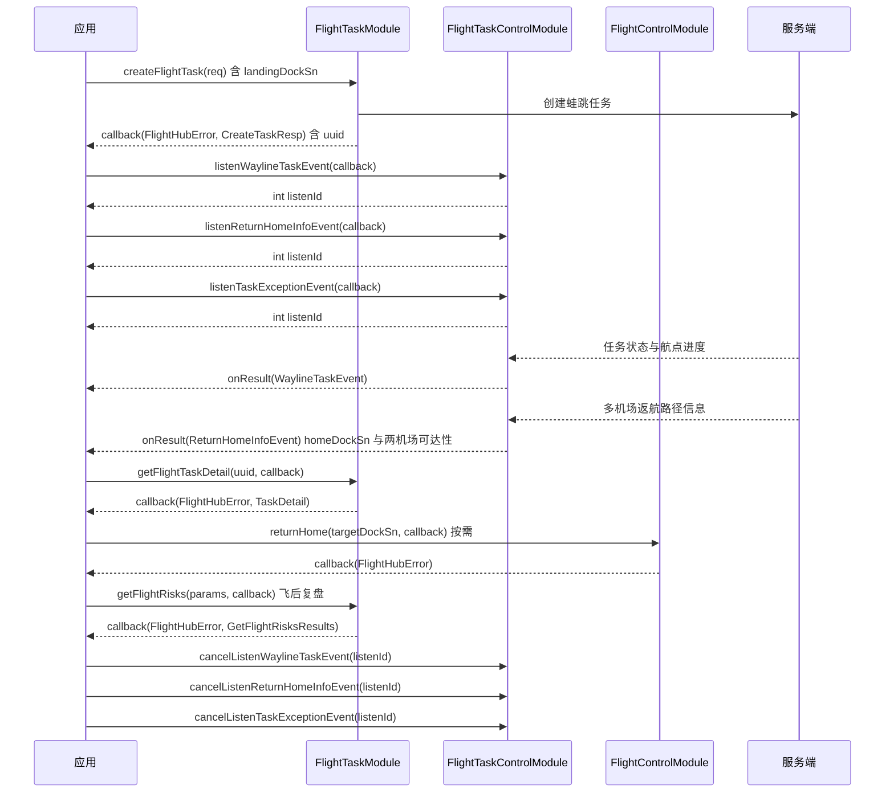

# 蛙跳任务（A 起 B 降）

<!--
本文全部内容均可溯源，不含未经核实的产品论述（本注释不渲染）

核验基准：
  - 接口签名、字段、枚举：paas-sdk release/u2 (f27294a)，并与
    release-u2-open-source (e57481a) 逐文件 blob 比对一致
  - 错误码：docs/cn/14.error-codes.md
  - 对外口径：按 flight_hub_sdk_docs/README.md，不含 @implNote 中的
    HTTP path / WebSocket topic / DRC method 等对内链路信息

已按「源码为准、最小可用」原则删除的内容（PRD/技术方案草稿为唯一来源，
源码无从佐证；如需写入，请在产品侧定稿后补回并标注依据）：
  - 设备型号支持清单（机场型号、飞行器机型、EA610 三层拓扑）
  - 任务模型 1 任务 : 1 航线 : M 设备
  - 进离场航线与机场型号的对应关系
  - Home 点默认值与不可用时的切换规则
  - 失控 failsafe 的降落优先级
  - Best Link 双路图传、防抖与降落前强制切链路
  - 起降排队的调度机制
  - 任务下发时两机场互相校验的内部时序
  注：错误码 315019 的备注为「机场确实导入了进离场，无法执行 A 起 B 降是预期的」，
  与草稿中「EA340 需先导入进离场航线」方向相反，故相关论述一并删除。
-->

## 1 功能概述

### 1.1 功能简介

蛙跳任务（A 起 B 降）是一种**跨机场航线任务**形态：飞行器从起飞机场 A 出发，按预设航线作业，最终降落到另一台降落机场 B。它解决的是「单机场往返航程受限，无法覆盖长距离作业」这一件事。

蛙跳任务**不是独立的 SDK 模块**，而是工作空间级航线任务的一种配置：在 `FlightTaskModule.createFlightTask()` 的请求体中为 `landingDockSn` 填入降落机场序列号，该字段**非空即为蛙跳任务**；留空表示降落机场与起飞机场一致，即普通单机场任务。任务的创建、查询与状态管理复用普通航线任务的同一套接口，详见 [航线任务管理](./wayline-task-manage.md)；运行中的暂停与恢复见 [航线任务控制](./wayline-task-control.md)。

**获取方式：**

```java
Workspace workspace = FlightHubSDK.getWorkspaceInstance();
FlightTaskModule flightTaskModule = workspace.getFlightTaskModule();
```

### 1.2 核心概念

| 概念 | 说明 |
| --- | --- |
| 蛙跳任务标识（`landingDockSn`） | 降落机场序列号。该字段**非空即为蛙跳任务**；留空表示降落机场与起飞机场一致（普通任务）。 |
| 起飞机场 A（`sn`） | 任务的起飞机场序列号，必填。 |
| 降落机场 B（`landingDockSn`） | 任务的目标降落机场序列号。 |
| 降落机场与返航机场的区别 | 两者是独立概念，配置上必须拆开：创建任务时的 `landingDockSn` 是**任务的计划降落点**；`returnHome(targetDockSn, cb)` 的 `targetDockSn` 是**飞行途中临时指定的返航点**。二者可以相同也可以不同，混用会导致飞行器返航到非预期机场。 |
| 多机场返航信息（`MultiDockHomeInfo`） | 蛙跳任务飞行期间服务端推送的返航决策依据，逐机场给出规划状态 `planStatus`（`0` 规划中或失败、`1` 不可达、`2` 电量不可达、`3` 可达）、预计电量消耗 `estimatedBatteryConsumption` 与 Home 点水平距离 `homeDistance`。外层 `ReturnHomeInfo` 另含本次选定的返航机场 `homeDockSn`、规划路径点 `plannedPathPoints` 与末端点可达性 `lastPointType`（`0` 可达、`1` 不可达）。 |
| 离场航线飞行模式码 | 飞行器执行离场航线期间，`DroneOsdModule` 上报的飞行模式码为 `21`。 |

### 1.3 能力清单

**本版本已开放的接口**

| 能力 | 对应接口 | 接口类型 | 说明 |
| --- | --- | --- | --- |
| 创建蛙跳任务 | `FlightTaskModule.createFlightTask(req, cb)` | 异步回调 | 在 `CreateTaskReq` 中同时设置 `sn`（起飞机场 A）与 `landingDockSn`（降落机场 B） |
| 编辑蛙跳任务 | `FlightTaskModule.editFlightTask(taskUuid, req, cb)` | 异步回调 | **服务端按全量替换设计**，`name` / `taskType` / `timeZone` / `sn` / `waylineUuid` / `outOfControlActionInFlight` / `rthAltitude` 每次都必须传入。**蛙跳任务尤须注意：`landingDockSn` 若漏传，任务会退化为普通单机场任务。** 建议先 `getFlightTaskDetail()` 取回完整数据，改动目标字段后再提交 |
| 查询任务列表 | `FlightTaskModule.getFlightTaskList(params, cb)` | 异步回调 | 返回结果含 `landingDockSn`，据此区分蛙跳任务与普通任务 |
| 查询任务详情 | `FlightTaskModule.getFlightTaskDetail(taskUuid, cb)` | 异步回调 | 同上 |
| 更新任务状态 | `FlightTaskModule.updateFlightTaskStatus(taskUuid, status, cb)` | 异步回调 | `status` **仅接受 `0`（待开始）与 `6`（已挂起）两个值**。挂起正在等待执行的蛙跳任务传 `6`，恢复传 `0` |
| 批量更新任务状态 | `FlightTaskModule.batchUpdateFlightTaskStatus(req, cb)` | 异步回调 | 任务 UUID 列表一次 1–50 个，`status` 同样仅接受 `0` 与 `6` |
| 删除蛙跳任务 | `FlightTaskModule.deleteFlightTask(taskUuid, cb)` | 异步回调 | 按任务 UUID 删除 |
| 设备推荐 | `FlightTaskModule.getDeviceRecommendation(req, cb)` | 异步回调 | 依据航线坐标与策略从候选机场中推荐执行设备 |
| 订阅任务事件 | `FlightTaskControlModule.listenWaylineTaskEvent(cb)` | 事件订阅 | 飞机级订阅，获取任务状态流转、当前航点、断点等实时数据 |
| 订阅多机场返航信息 | `FlightTaskControlModule.listenReturnHomeInfoEvent(cb)` | 事件订阅 | **蛙跳任务核心能力**。推送本次返航选定的机场、规划路径与 A、B 两机场各自的可达性、预计电量消耗、Home 点距离。该方法按内容去重，与上一条完全相同的事件不重复回调 |
| 订阅指定设备的返航信息 | `FlightTaskControlModule.listenReturnHomeInfoEventByDevice(deviceSn, cb)` | 事件订阅 | 不去重，每条到达的事件都回调。**蛙跳场景下 `deviceSn` 应传目标降落机场 SN**，与服务端的推送路由对齐；参数非法或失败时返回负值 |
| 订阅任务异常事件 | `FlightTaskControlModule.listenTaskExceptionEvent(cb)` | 事件订阅 | 推送 `TaskExceptionItem`，含错误码 `code`、错误信息 `message`、出错设备 `sn`（可据此区分是 A 还是 B 机场报错）与发生时间 `happenAt`（秒） |
| 查询飞行安全风险 | `FlightTaskModule.getFlightRisks(params, cb)` | 异步回调 | 入参 `GetFlightRisksParams.taskUuid`，返回 `FlightRiskItem` 列表，含风险类型 `riskType`（`1` 避障刹停、`2` 避障绕行、`3` 碰撞炸机）与触发位置经纬高。**任务未完成飞行时列表为空**，用于飞后复盘而非下发前校验 |
| 暂停 / 恢复任务 | `FlightTaskControlModule.pause(cb)` / `resume(cb)` | 异步回调 | 作用于该飞机当前正在执行的航线任务 |
| 一键返航 | `FlightControlModule.returnHome(cb)` / `returnHomeCancel(cb)` | 异步回调 | 返航至飞行器当前 Home 点。**不依赖 DRC 链路**，未建立 DRC 链路时同样可下发 |
| 指定机场返航 | `FlightControlModule.returnHome(targetDockSn, cb)` | 异步回调 | **蛙跳专有重载**。返航到 `targetDockSn` 指定的机场，用于返航至非默认降落点的机场。同样不依赖 DRC 链路 |
| 机场状态订阅 | `DockOsdModule.listen*` | 事件订阅 | A、B 两台机场需分别获取实例后订阅舱盖、供电、网络与图传链路等状态 |
| 飞机状态订阅 | `DroneOsdModule.listen*` | 事件订阅 | 位置、电量、飞行模式、返航配置等实时遥测 |

**本版本未开放的能力**

| 能力 | 当前状态 | 影响与替代方式 |
| --- | --- | --- |
| 进离场航线校验 | SDK 未提供该接口 | 无法通过 API 预先判断某台机场能否执行蛙跳任务，只能由任务下发后的错误码反向判定（见错误码 `315019`） |
| 进离场航线配置写入 | SDK 未提供该接口 | 无法通过 API 读写机场的进离场航线配置 |

---

## 2 前提条件

- 已完成上云 API 2 底座部署，并获取到服务地址与鉴权 Token。详见 [部署指南](../../../03.deployment/00.index.md)、[鉴权接入指南](../../../10.auth.md)。
- 已完成 SDK 初始化且 `FlightHubSDK.isInitialized()` 返回 `true`。详见 [SDK初始化](../init/sdk-init.md)。
- 已通过 `FlightHubSDK.getWorkspaceInstance()` 获取工作空间实例，并调用其 `getFlightTaskModule()` 拿到任务模块实例。
- **A、B 两台机场均已上云、绑定至当前工作空间且在线**。详见 [设备上云](../../../06.device-onboarding/00.index.md)。
- **两台机场部署距离不超过 15 km**，否则起飞前检查不通过（错误码 `338005`）。
- **降落机场不位于禁飞区或限高区内**，否则起飞前检查不通过（错误码 `338006`、`338007`）。
- **航线已上传且校验通过**：`waylineUuid` 来自 [航线资产管理](./wayline-asset-manage.md)。
- **两台机场均未接入中继站**：曾连接或正在连接中继站的机场不支持蛙跳任务（错误码 `315066`）。
- **两台机场位置已收敛**（错误码 `315052`），且使用相同网络信息完成 RTK 标定（错误码 `315008`）。
- 若需订阅任务事件或机场 / 飞机状态，SDK 配置中的 `notificationServerAddress` 必须正确且连接可用。详见 [SDK配置](../init/sdk-config.md)。

---

## 3 快速上手

### 3.1 获取模块实例

```java
// 前置：已完成 FlightHubSDK.initialize(config)
Workspace workspace = FlightHubSDK.getWorkspaceInstance();
FlightTaskModule flightTaskModule = workspace.getFlightTaskModule();
```

### 3.2 使用流程

1. **准备航线** —— 从 [航线资产管理](./wayline-asset-manage.md) 获取要执行的 `waylineUuid`。
2. **确认 A、B 机场在线** —— 分别获取两台机场的 `DockOsdModule` 实例，订阅并确认机场状态。
3. **创建蛙跳任务** —— 组装 `CreateTaskReq`，必填 `name` / `sn` / `taskType` / `timeZone` / `waylineUuid` / `outOfControlActionInFlight` / `rthAltitude`，并设置 `landingDockSn` 为降落机场 B 的序列号，调用 `createFlightTask()` 并保存返回的 `uuid`。
4. **订阅任务事件与返航信息** —— 任务进入执行阶段后，通过飞机实例的 `FlightTaskControlModule` 订阅三类事件并分别保存 `listenId`：`listenWaylineTaskEvent()` 看任务状态与航点进度，`listenReturnHomeInfoEvent()` 看返航决策（选定机场、两机场可达性与电量余量），`listenTaskExceptionEvent()` 看异常上报。
5. **监控执行过程** —— 用 `getFlightTaskDetail()` 查询任务状态与当前航点；用 `DroneOsdModule` 订阅飞机位置、电量与飞行模式码。
6. **按需干预** —— 需要临时中止作业时用 `pause()` / `resume()`；需要立即返航时调用 `returnHome(cb)` 或 `returnHome(targetDockSn, cb)`（指定返航机场），返航目标可对照返航信息事件中的 `homeDockSn` 与各机场可达性确认；需要挂起尚未执行的任务用 `updateFlightTaskStatus(uuid, 6, cb)`，恢复传 `0`；不再需要该任务用 `deleteFlightTask()` 删除。
7. **完成与清理** —— 可用 `getFlightRisks()` 复盘本次飞行触发的安全风险；退出前用保存的 `listenId` 取消全部订阅。

### 3.3 调用时序图



---

## 4 示例代码

### 4.1 完整示例

```java
import com.dji.flighthubsdk.FlightHubSDK;
import com.dji.flighthubsdk.FlightHubCallback;
import com.dji.flighthubsdk.bean.FlightHubError;
import com.dji.flighthubsdk.core.FlightTaskModule;
import com.dji.flighthubsdk.core.FlightTaskControlModule;
import com.dji.flighthubsdk.bean.CreateTaskReq;
import com.dji.flighthubsdk.bean.CreateTaskResp;
import com.dji.flighthubsdk.bean.TaskDetail;
import com.dji.flighthubsdk.bean.WaylineTaskEvent;
import com.dji.flighthubsdk.bean.WaylineTaskData;

/**
 * 蛙跳任务（A 起 B 降）：创建跨机场任务 -> 订阅任务事件 -> 查询执行进度 -> 退订收尾。
 * 前提：A、B 两台机场均在线就绪，部署距离不超过 15 km，航线已上传且校验通过。
 */
public class MultiDockTaskDemo {

    private final String takeoffDockSn;   // 起飞机场 A
    private final String landingDockSn;   // 降落机场 B
    private final String droneSn;         // 执行任务的飞行器
    private int taskEventListenId = -1;
    private String taskUuid;

    public MultiDockTaskDemo(String takeoffDockSn, String landingDockSn, String droneSn) {
        this.takeoffDockSn = takeoffDockSn;
        this.landingDockSn = landingDockSn;
        this.droneSn = droneSn;
    }

    // ============ 1. 创建蛙跳任务（landingDockSn 非空即为蛙跳任务） ============
    public void createTask(String waylineUuid) {
        FlightTaskModule module = FlightHubSDK.getWorkspaceInstance().getFlightTaskModule();

        CreateTaskReq req = new CreateTaskReq();
        req.setName("蛙跳任务-" + System.currentTimeMillis());
        req.setSn(takeoffDockSn);                   // 起飞机场 A（必填）
        req.setLandingDockSn(landingDockSn);        // 降落机场 B：蛙跳任务的关键字段
        req.setTaskType(1);                         // 1=立即任务（必填）
        req.setTimeZone("Asia/Shanghai");           // 时区（必填）
        req.setWaylineUuid(waylineUuid);            // 航线 UUID（必填）
        req.setOutOfControlActionInFlight(1);       // 1=返航, 2=继续执行（必填）
        req.setRthAltitude(100.0);                  // 返航高度，单位：米（必填）

        module.createFlightTask(req, new FlightHubCallback.CreateFlightTaskCallback() {
            @Override
            public void onResult(FlightHubError error, CreateTaskResp result) {
                if (error != null && !error.isSuccess()) {
                    // 注意：蛙跳专有校验失败会在此返回，例如 338005 两机场距离超限、315019 不支持 A 起 B 降
                    System.err.println("创建蛙跳任务失败: " + error
                            + " serverCode=" + error.getServerCode()
                            + " msg=" + error.getServerMessage());
                    return;
                }
                if (result == null) return;
                taskUuid = result.getUuid();
                System.out.println("蛙跳任务已创建: uuid=" + taskUuid
                        + " 航线校验码=" + result.getWaylineValidityCheckCodes());
                listenTaskEvent();
            }
        });
    }

    // ============ 2. 订阅任务事件（飞机级，回调无 error 参数，需判空） ============
    private void listenTaskEvent() {
        FlightTaskControlModule control =
                FlightHubSDK.getDroneInstance(droneSn).getFlightTaskControlModule();

        taskEventListenId = control.listenWaylineTaskEvent(new FlightHubCallback.WaylineTaskEventCallback() {
            @Override
            public void onResult(WaylineTaskEvent event) {
                if (event == null) return;          // 注意：事件订阅回调无 error 参数，必须判空
                WaylineTaskData data = event.getTaskData();
                if (data == null) return;
                System.out.println("[任务事件] action=" + event.getAction()
                        + " uuid=" + event.getUuid()
                        + " status=" + statusText(data.getStatus()));
            }
        });
        if (taskEventListenId == -1) {
            System.err.println("订阅任务事件失败");   // 注意：-1 表示订阅失败，此时不应调用 cancel
        }
    }

    // ============ 3. 查询任务详情，确认是否为蛙跳任务及当前进度 ============
    public void showDetail() {
        if (taskUuid == null) return;
        FlightHubSDK.getWorkspaceInstance().getFlightTaskModule()
                .getFlightTaskDetail(taskUuid, new FlightHubCallback.GetFlightTaskDetailCallback() {
                    @Override
                    public void onResult(FlightHubError error, TaskDetail result) {
                        if (error != null && !error.isSuccess()) {
                            System.err.println("查询任务详情失败: " + error);
                            return;
                        }
                        if (result == null) return;
                        // landingDockSn 非空即为蛙跳任务
                        boolean isMultiDock = result.getLandingDockSn() != null
                                && !result.getLandingDockSn().isEmpty();
                        System.out.println("任务类型=" + (isMultiDock ? "蛙跳任务" : "普通任务")
                                + " 起飞机场=" + result.getSn()
                                + " 降落机场=" + result.getLandingDockSn()
                                + " 状态=" + statusText(result.getStatus())
                                + " 当前航点=" + result.getCurrentWaypointIndex()
                                + "/" + result.getTotalWaypoints());
                    }
                });
    }

    // ============ 4. 挂起 / 恢复任务（status 仅接受 0 与 6） ============
    public void suspend() {
        if (taskUuid == null) return;
        // 注意：updateFlightTaskStatus 的 status 仅接受 0（待开始）与 6（已挂起）
        // 传其它值（如 4）会被服务端拒绝；要彻底移除任务请用 deleteFlightTask
        FlightHubSDK.getWorkspaceInstance().getFlightTaskModule()
                .updateFlightTaskStatus(taskUuid, 6, error -> {
                    boolean ok = error != null && error.isSuccess();
                    System.out.println("挂起蛙跳任务: " + (ok ? "成功" : "失败 " + error));
                });
    }

    public void resumeFromSuspended() {
        if (taskUuid == null) return;
        FlightHubSDK.getWorkspaceInstance().getFlightTaskModule()
                .updateFlightTaskStatus(taskUuid, 0, error -> {
                    boolean ok = error != null && error.isSuccess();
                    System.out.println("恢复为待开始: " + (ok ? "成功" : "失败 " + error));
                });
    }

    // ============ 5. 退出前取消订阅（必须执行，否则订阅泄漏） ============
    public void release() {
        if (taskEventListenId != -1) {
            FlightHubSDK.getDroneInstance(droneSn).getFlightTaskControlModule()
                    .cancelListenWaylineTaskEvent(taskEventListenId);
            taskEventListenId = -1;
        }
    }

    /** 任务状态语义同 FlightTaskModule 的 status 枚举 */
    private static String statusText(int s) {
        switch (s) {
            case 0:  return "待开始";
            case 1:  return "启动失败";
            case 2:  return "执行中";
            case 3:  return "已暂停";
            case 4:  return "已终止";
            case 5:  return "成功";
            case 6:  return "挂起";
            case 7:  return "超时";
            case 8:  return "部分执行";
            case 9:  return "准备中";
            case 10: return "起飞排队中";
            default: return "未知(" + s + ")";
        }
    }
}
```

### 4.2 场景化片段

**订阅多机场返航信息，判断返航目标与两机场可达性（蛙跳任务核心场景）**

```java
// 前置：SDK 已初始化，notificationServerAddress 配置正确，任务处于执行中
FlightTaskControlModule control =
        FlightHubSDK.getDroneInstance(droneSn).getFlightTaskControlModule();

int listenId = control.listenReturnHomeInfoEvent(event -> {
    if (event == null || event.getInfo() == null) return;   // 注意：订阅回调无 error 参数，需判空
    ReturnHomeInfo info = event.getInfo();

    System.out.println("本次选定返航机场=" + info.getHomeDockSn()
            + " 末端点" + (info.getLastPointType() == 0 ? "可达" : "不可达")
            + " 规划路径点数=" + (info.getPlannedPathPoints() == null
                    ? 0 : info.getPlannedPathPoints().size()));

    if (info.getMultiDockHomeInfo() == null) return;
    for (MultiDockHomeInfo dock : info.getMultiDockHomeInfo()) {
        System.out.println("  机场 " + dock.getSn()
                + " 规划状态=" + planStatusText(dock.getPlanStatus())
                + " 预计耗电=" + dock.getEstimatedBatteryConsumption()
                + " Home 点距离(m)=" + dock.getHomeDistance());
    }
});
// 注意：listenId 为负值表示订阅失败，此时不应调用 cancel
if (listenId < 0) {
    System.err.println("订阅多机场返航信息失败");
}

/** MultiDockHomeInfo.planStatus 枚举 */
private static String planStatusText(int s) {
    switch (s) {
        case 0:  return "规划中或规划失败";
        case 1:  return "不可达";
        case 2:  return "电量不可达";
        case 3:  return "可达";
        default: return "未知(" + s + ")";
    }
}
```

该事件还有一个不去重的变体 `listenReturnHomeInfoEventByDevice(deviceSn, cb)`，需要拿到每一条原始推送时使用。蛙跳场景下 `deviceSn` 应传**目标降落机场 SN**，与服务端该 Topic 的路由 SN 对齐：

```java
int rawListenId = control.listenReturnHomeInfoEventByDevice(landingDockSn, event -> {
    // 每条到达的事件都会回调，不做内容去重
});
```

**订阅任务异常，区分 A / B 机场报错**

```java
int exceptionListenId = control.listenTaskExceptionEvent(event -> {
    if (event == null || event.getExceptions() == null) return;
    for (TaskExceptionItem item : event.getExceptions()) {
        // sn 指出错设备：据此判断是起飞机场 A、降落机场 B 还是飞行器报错
        System.err.println("任务异常 code=" + item.getCode()
                + " sn=" + item.getSn()
                + " msg=" + item.getMessage()
                + " 发生时间(s)=" + item.getHappenAt());
    }
});
```

**飞后复盘：查询本次飞行触发的安全风险**

```java
GetFlightRisksParams params = new GetFlightRisksParams();
params.setTaskUuid(taskUuid);                 // 必填

FlightHubSDK.getWorkspaceInstance().getFlightTaskModule()
        .getFlightRisks(params, (error, results) -> {
            if (error != null && !error.isSuccess()) {
                System.err.println("查询飞行风险失败: " + error);
                return;
            }
            // 注意：任务未完成飞行时列表为空，该接口不能用于下发前的阻飞校验
            // riskType：1 避障刹停、2 避障绕行、3 碰撞炸机；每条含触发位置经纬高
            System.out.println("飞行风险: " + results);
        });
```

**从任务列表中筛选出蛙跳任务**

```java
// 前置：SDK 已初始化。landingDockSn 非空即为蛙跳任务
FlightTaskListParams params = new FlightTaskListParams();
params.setPage(1);
params.setPageSize(20);

FlightHubSDK.getWorkspaceInstance().getFlightTaskModule()
        .getFlightTaskList(params, (error, result) -> {
            if (error != null && !error.isSuccess()) {
                System.err.println("查询任务列表失败: " + error);
                return;
            }
            if (result == null || result.getList() == null) return;
            for (TaskDetail t : result.getList()) {
                String landing = t.getLandingDockSn();
                if (landing != null && !landing.isEmpty()) {
                    System.out.println("蛙跳任务 uuid=" + t.getUuid()
                            + " A=" + t.getSn() + " -> B=" + landing);
                }
            }
            // 注意：必须处理分页，只取第一页会漏数据
        });
```

**执行中返航：返航至当前 Home 点，或指定返航机场**

```java
FlightControlModule fc = FlightHubSDK.getDroneInstance(droneSn).getFlightControlModule();

// 方式一：返航至飞行器当前 Home 点（可先用 listenReturnHomeInfoEvent 读取 homeDockSn 确认目标）
fc.returnHome(error -> {
    boolean ok = error != null && error.isSuccess();
    System.out.println("返航下发: " + (ok ? "成功" : "失败 " + error));
});

// 方式二：指定返航机场（蛙跳专有重载）
// 注意：targetDockSn 是飞行途中临时指定的返航点，与创建任务时的 landingDockSn 是两个独立概念
fc.returnHome(targetDockSn, error -> {
    boolean ok = error != null && error.isSuccess();
    System.out.println("指定机场返航下发: " + (ok ? "成功" : "失败 " + error));
});
// 两者均不依赖 DRC 链路，未建立 DRC 链路时同样可下发
```

**任务执行中暂停与恢复**

```java
FlightTaskControlModule control =
        FlightHubSDK.getDroneInstance(droneSn).getFlightTaskControlModule();

control.pause(error -> {
    boolean ok = error != null && error.isSuccess();
    System.out.println("暂停任务: " + (ok ? "成功，飞行器原地悬停" : "失败 " + error));
});

control.resume(error -> {
    boolean ok = error != null && error.isSuccess();
    System.out.println("恢复任务: " + (ok ? "成功" : "失败 " + error));
});
```

---

## 5 相关文档

- [航线任务管理](./wayline-task-manage.md) —— 蛙跳任务的创建、查询与状态编排所依赖的工作空间级模块
- [航线任务控制](./wayline-task-control.md) —— 任务执行过程中的暂停、恢复与任务事件订阅
- [航线资产管理](./wayline-asset-manage.md) —— 创建任务所需 `waylineUuid` 的来源
- [飞行控制](../remote-control/flight-control.md) —— 返航、指定机场返航、取消返航等飞行控制指令
- [控制权管理](../remote-control/control-auth.md) —— 下发 DRC 实时操控指令前的飞行控制权抢占
- [DRC链路](../remote-control/drc.md) —— DRC 实时操控指令依赖的低时延链路
- [机场状态监听](../remote-control/dock-status.md) —— A、B 两台机场的舱盖、供电、网络与图传链路状态
- [飞机状态监听](../remote-control/drone-status.md) —— 飞行器位置、电量、飞行模式等实时遥测
- [飞行记录导出](./flight-record-export.md) —— 任务完成后的飞行记录导出
- [错误码](../../../14.error-codes.md) —— A 起 B 降专有错误码（`315000`–`315019`、`315050`–`315066`、`316041`–`316046`、`338005`–`338007`）的完整含义与处理建议
- [SDK 环境准备](../../02.preparation.md) —— SDK 包结构与自带 demo 的位置
- [SDK初始化](../init/sdk-init.md) —— 获取工作空间实例与调用本模块前必须完成的初始化步骤
- [SDK配置](../init/sdk-config.md) —— WebSocket 通知地址等配置项，影响任务事件订阅能否收到推送
- [设备上云](../../../06.device-onboarding/00.index.md) —— A、B 两台机场绑定到工作空间的前置流程
- [部署指南](../../../03.deployment/00.index.md) —— 上云 API 2 底座部署与服务地址获取
- [鉴权接入指南](../../../10.auth.md) —— 获取鉴权 Token 的接入流程
- [使用 API 文档查阅接口详情](../../03.api-docs-guide.md) —— 查阅 `FlightTaskModule`、`FlightTaskControlModule` 完整方法签名与字段定义
