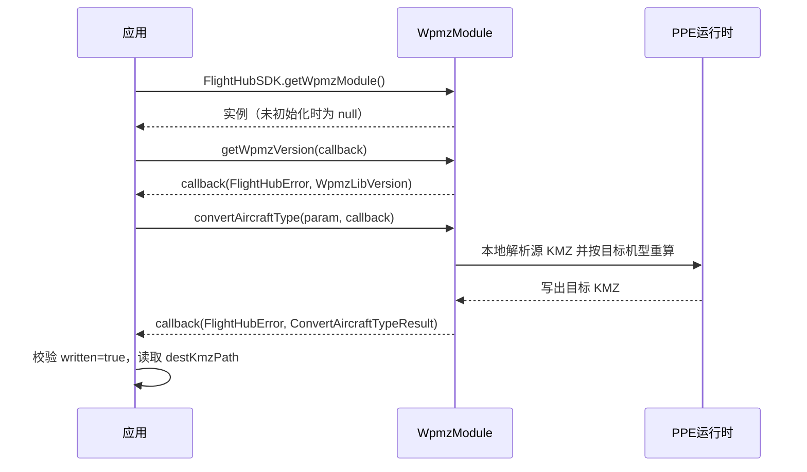

# 航线机型转换（WpmzModule）

## 1 功能概述

### 1.1 功能简介

`WpmzModule` 是**全局单例**的 WPMZ 航线 KMZ 本地机型转换模块。它解决的是「设备换代后，老航线在新机型上飞不对」的问题：读取一个 KMZ 航线文件，按目标机型与目标负载重新计算航点坐标与动作参数，写出一个可直接在新机型上执行的 KMZ。

设备换代后，原有航线在新机型上执行会出现多拍、少拍、拍照模糊、拍偏等不兼容问题——不同机型的机身尺寸、云台安装位置、镜头组合与能力边界都不一样。本模块在转换时对齐云台转动中心、补偿云台 yaw、换算焦距、拆分或合并拍照动作，并保留航线中的用户自定义字段。

本模块是**纯本地能力**：航线转换与 Workspace、设备实例都无关，无需网络。它只做航线文件的格式转换，不负责航线的上传与管理（见 [航线资产管理](./wayline-asset-manage.md)），也不负责用转换后的航线下发任务（见 [航线任务管理](./wayline-task-manage.md)）。

:::warning
转换能力依赖 SDK JAR 内的 PPE 运行时，**官方包仅 Linux x86_64 / aarch64 内含 PPE**。在 macOS 等未打包平台上，`getWpmzModule()` 仍能拿到实例，但 `convertAircraftType()` 会返回明确错误。详见 [2 前提条件](#_2-前提条件)。
:::

**获取方式：**

```java
WpmzModule wpmzModule = FlightHubSDK.getWpmzModule();
```

### 1.2 核心概念

| 概念 | 说明 |
| --- | --- |
| 全局单例 | 本模块由 `FlightHubSDK.getWpmzModule()` 直接获取，不挂在 Workspace 或设备实例下。**SDK 未初始化或获取失败时返回 `null`**，调用前必须判空。 |
| 纯本地转换 | 转换全程在本地完成，无需网络，也不要求设备在线。 |
| PPE 运行时 | 承载转换算法的本地运行时，在 `FlightHubSDK.initialize()` 加载 JNI 时从 JAR 解压到临时目录。仅 Linux x86_64 / aarch64 官方包内含。 |
| 目标机型（`WpmzDroneInfo`） | 由 `droneType` + `droneSubType` 两个整数描述。`droneSubType` 仅传给转换引擎做内部机型判定，**不落盘**到输出 KMZ。 |
| 目标负载（`WpmzPayloadInfo`） | 由 `payloadType` + `payloadSubType` 描述，另有 `payloadPositionIndex` 挂载位置。机场与手飞机型的机身相机也占用一个 `payloadType`。 |
| 机型 + 负载成对 | 转换结果由 `droneType` 与 `payloadType` **两个值共同决定**，只填机型不够。仅支持下文 13 组组合，表外组合可能失败。 |
| 转换结果（`ConvertAircraftTypeResult`） | 含 `written`（是否已写出，**仅成功时为 `true`**）、`destKmzPath`（输出路径）、`invalidList`（转换过程摘要）。 |
| 转换摘要（`WpmzConvertInvalidItem`） | 当前引擎**仅回传无效项计数，尚无逐条明细**，内容承载在 `infoJson` 字符串中。 |

### 1.3 能力清单

| 能力 | 对应接口 | 接口类型 | 说明 |
| --- | --- | --- | --- |
| 机型转换 | `convertAircraftType(param, cb)` | 异步回调 | 入参 `ConvertAircraftTypeParam`（源路径 + 目标机型/负载 + 输出路径），回调返回 `ConvertAircraftTypeResult` |
| 查询本地库版本 | `getWpmzVersion(cb)` | 异步回调 | 回调返回 `WpmzLibVersion`（`major` / `minor` / `patch`），**失败时字段可能为 `0`** |

**入参字段（`ConvertAircraftTypeParam`）**

| 字段 | 类型 | 说明 |
| --- | --- | --- |
| `srcKmzPath` | `String` | 源 KMZ 文件路径 |
| `destKmzPath` | `String` | 转换后 KMZ 输出路径 |
| `destDrone` | `WpmzDroneInfo` | 目标机型 |
| `destPayloads` | `List<WpmzPayloadInfo>` | 目标负载列表，**须非空**；转换仅使用首项的 `type` / `subType` |

### 1.4 支持的机型与负载组合

转换语义是「目标机型 + 目标负载」，`droneType` 与 `payloadType` 必须成对填写。

| 支持的机型 | `droneType` | `payloadType` | `droneSubType` |
| --- | --- | --- | --- |
| M30 | `67` | `52` | `0` |
| M30T | `67` | `53` | `1` |
| M3E | `77` | `66` | `0` |
| M3T | `77` | `67` | `1` |
| M3TA | `77` | `129` | `3` |
| M3D | `91` | `80` | `0` |
| M3TD | `91` | `81` | `1` |
| M4E | `99` | `88` | `0` |
| M4T | `99` | `89` | `1` |
| M4D | `100` | `98` | `0` |
| M4TD | `100` | `99` | `1` |
| M5T | `139` | `128` | `0` |
| M5TD | `130` | `122` | `0` |

:::tip
`droneSubType` 不必手工查表，用 `WpmzDroneInfo.resolveDroneSubType(payloadType)` 按目标负载推导即可（未命中返回 `0`）。规则为：M30T / M3T / M3TD / M4T / M4TD → `1`，M3TA → `3`，其余 → `0`。
:::

---

## 2 前提条件

- 已完成 SDK 初始化且 `FlightHubSDK.isInitialized()` 返回 `true`。详见 [SDK初始化](../init/sdk-init.md)。本模块虽为纯本地能力，但 PPE 运行时在初始化加载 JNI 时才会解压。
- **运行平台为 Linux x86_64 或 aarch64**。
- **以已打包的 Fat JAR / SDK jar 方式运行**。PPE 需从 JAR 内解压，IDE 纯 classpath 直跑通常解不出 `ppe/` 目录，会导致转换失败。
- 已准备好本地源 KMZ 文件，且进程对输出路径所在目录有写权限。
- 目标机型与目标负载的组合在 [1.4 支持的机型与负载组合](#_1-4-支持的机型与负载组合) 列出的 13 组之内。
- 本模块**无需部署底座、无需鉴权 Token、无需设备在线**。

---

## 3 快速上手

### 3.1 获取模块实例

```java
// 前置：已完成 FlightHubSDK.initialize(config)
WpmzModule module = FlightHubSDK.getWpmzModule();
if (module == null) {
    // SDK 未初始化或获取失败
    return;
}
```

### 3.2 使用流程

1. **获取模块实例** —— 调用 `FlightHubSDK.getWpmzModule()`，并对返回值判空。
2. **（可选）查询库版本** —— 调用 `getWpmzVersion()` 确认本地转换库版本，便于问题定位。
3. **确定目标机型与负载** —— 从支持的机型和负载组合中选定 `droneType` 与 `payloadType`。
4. **推导 `droneSubType`** —— 调用 `WpmzDroneInfo.resolveDroneSubType(payloadType)`。
5. **构造入参** —— 填充 `ConvertAircraftTypeParam` 的源路径、输出路径、目标机型与负载列表。
6. **发起转换** —— 调用 `convertAircraftType(param, callback)`。
7. **校验结果** —— 先判 `error`，再确认 `result.isWritten()` 为 `true`，最后读取 `destKmzPath` 与 `invalidList`。
8. **后续使用** —— 将转换后的 KMZ 上传为航线资产，再下发航线任务。

### 3.3 调用时序图



---

## 4 示例代码

### 4.1 完整示例

```java
/**
 * 航线机型转换：查询库版本 -> 构造入参 -> 转换 -> 校验输出。
 */
public class WaylineConverter {

    // ============ 1. 查询本地转换库版本（可选，便于问题定位） ============
    public void printVersion() {
        WpmzModule module = FlightHubSDK.getWpmzModule();
        if (module == null) {
            System.err.println("获取 WpmzModule 失败：SDK 未初始化");
            return;
        }

        module.getWpmzVersion(new FlightHubCallback.GetWpmzVersionCallback() {
            @Override
            public void onResult(FlightHubError error, WpmzLibVersion version) {
                if (error != null && !error.isSuccess()) {
                    System.err.println("查询 WPMZ 库版本失败: " + error);
                    return;
                }
                // 注意：失败时 version 的字段可能为 0
                System.out.println("WPMZ 库版本: " + version);
            }
        });
    }

    // ============ 2. 执行机型转换 ============
    public void convert(String srcKmzPath, String destKmzPath, int destDroneType, int destPayloadType) {
        WpmzModule module = FlightHubSDK.getWpmzModule();
        if (module == null) {
            System.err.println("获取 WpmzModule 失败：SDK 未初始化");
            return;
        }

        // droneSubType 由目标负载推导，无需手工查表
        int droneSubType = WpmzDroneInfo.resolveDroneSubType(destPayloadType);

        // 目标负载：转换场景 payloadSubType 一般为 0，挂载位 0 即主云台
        WpmzPayloadInfo payload = new WpmzPayloadInfo(destPayloadType, 0);
        payload.setPayloadPositionIndex(0);
        payload.setPayloadPositionIndexSet(true);

        List<WpmzPayloadInfo> payloads = new ArrayList<>();
        payloads.add(payload);                       // 必须非空，转换仅使用首项

        ConvertAircraftTypeParam param = new ConvertAircraftTypeParam();
        param.setSrcKmzPath(srcKmzPath);
        param.setDestKmzPath(destKmzPath);
        param.setDestDrone(new WpmzDroneInfo(destDroneType, droneSubType));
        param.setDestPayloads(payloads);

        module.convertAircraftType(param, new FlightHubCallback.ConvertAircraftTypeCallback() {
            @Override
            public void onResult(FlightHubError error, ConvertAircraftTypeResult result) {
                handleResult(error, result);
            }
        });
    }

    // ============ 3. 校验转换结果 ============
    private void handleResult(FlightHubError error, ConvertAircraftTypeResult result) {
        if (error != null && !error.isSuccess()) {
            // 平台不含 PPE、组合未验证、源文件不可读等都会走到这里
            System.err.println("机型转换失败: " + error);
            return;
        }
        if (result == null || !result.isWritten()) {
            // written 仅在成功写出目标文件时为 true，不能只看 error
            System.err.println("机型转换未写出目标文件");
            return;
        }

        System.out.println("转换完成，输出: " + result.getDestKmzPath());

        // 转换过程摘要：当前引擎仅回传无效项计数，尚无逐条明细
        if (result.getInvalidList() != null) {
            for (WpmzConvertInvalidItem item : result.getInvalidList()) {
                System.out.println("  转换摘要: " + item.getInfoJson());
            }
        }
    }
}
```

### 4.2 场景化片段

**转换到 M4T（`droneType=99` / `payloadType=89`）**

```java
// 前置：已完成 SDK 初始化，且运行在 Linux x86_64 / aarch64 的 Fat JAR 中
int destDroneType  = 99;   // Matrice 4E / 4T
int destPayloadType = 89;  // M4T
int droneSubType = WpmzDroneInfo.resolveDroneSubType(destPayloadType);  // 推导得 1

WpmzPayloadInfo payload = new WpmzPayloadInfo(destPayloadType, 0);
payload.setPayloadPositionIndex(0);
payload.setPayloadPositionIndexSet(true);

ConvertAircraftTypeParam param = new ConvertAircraftTypeParam();
param.setSrcKmzPath("/data/waylines/巡检航线-01.kmz");
param.setDestKmzPath("/data/waylines/巡检航线-01-M4T.kmz");
param.setDestDrone(new WpmzDroneInfo(destDroneType, droneSubType));
param.setDestPayloads(Collections.singletonList(payload));

FlightHubSDK.getWpmzModule().convertAircraftType(param, (error, result) -> {
    boolean ok = (error == null || error.isSuccess()) && result != null && result.isWritten();
    System.out.println("转换 M4T: " + (ok ? "成功 " + result.getDestKmzPath() : "失败 " + error));
});
```

**批量转换一个目录下的 KMZ**

```java
// 前置：destDroneType / destPayloadType 取自「1.4 支持的机型与负载组合」
WpmzModule module = FlightHubSDK.getWpmzModule();
int droneSubType = WpmzDroneInfo.resolveDroneSubType(destPayloadType);

File[] kmzFiles = new File("/data/waylines/src").listFiles(
        (dir, name) -> name.toLowerCase().endsWith(".kmz"));
if (kmzFiles == null) return;

for (File src : kmzFiles) {
    WpmzPayloadInfo payload = new WpmzPayloadInfo(destPayloadType, 0);
    payload.setPayloadPositionIndex(0);
    payload.setPayloadPositionIndexSet(true);

    ConvertAircraftTypeParam param = new ConvertAircraftTypeParam();
    param.setSrcKmzPath(src.getAbsolutePath());
    param.setDestKmzPath("/data/waylines/dest/" + src.getName());
    param.setDestDrone(new WpmzDroneInfo(destDroneType, droneSubType));
    param.setDestPayloads(Collections.singletonList(payload));

    module.convertAircraftType(param, (error, result) -> {
        if (error != null && !error.isSuccess()) {
            System.err.println(src.getName() + " 转换失败: " + error);
            return;
        }
        // 逐个判 written，失败项不影响其余文件继续转换
        System.out.println(src.getName() + " -> written=" + (result != null && result.isWritten()));
    });
}
```

**转换后上传为航线资产并下发任务**

```java
// 前置：result.isWritten() == true，拿到 destKmzPath
// 1) 用 WaylineManageModule.importKmz() 把转换后的 KMZ 导入为航线资产，拿到 waylineUuid
//    详见「航线资产管理」
// 2) 用 FlightTaskModule.createFlightTask() 以该 waylineUuid 创建任务
//    详见「航线任务管理」
```

---

## 5 相关文档

- [SDK初始化](../init/sdk-init.md) —— PPE 运行时在初始化加载 JNI 时解压，是本模块可用的前提
- [航线资产管理](./wayline-asset-manage.md) —— 把转换后的 KMZ 导入为航线资产
- [航线任务管理](./wayline-task-manage.md) —— 用转换后的航线创建并下发任务
- [航线安全质量管理](./wayline-safety-quality.md) —— 新航线首飞后复盘是否触发安全风险
- [使用航线转换工具](../../../05.DJI-enterprise-toolkit/01.wayline-convert-tool.md) —— 大疆行业工具包中同等能力的 Windows 桌面端工具，适合不集成 SDK 的批量转换场景
- [使用 API 文档查阅接口详情](../../03.api-docs-guide.md) —— 查阅 `WpmzModule`、`ConvertAircraftTypeParam`、`WpmzDroneInfo`、`WpmzPayloadInfo` 完整方法签名与字段定义
