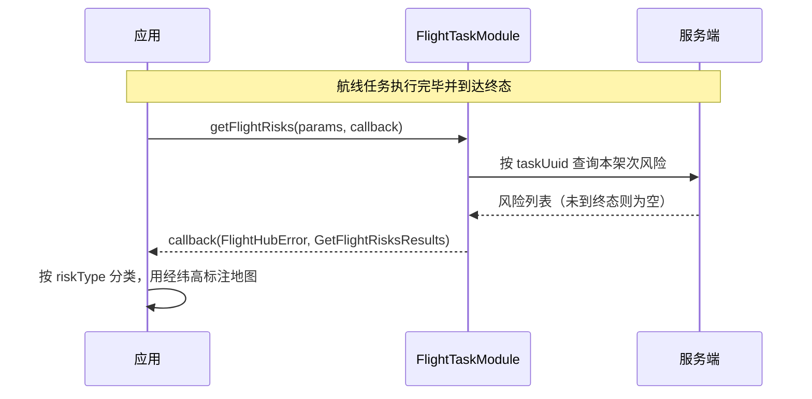

# 航线安全质量管理（FlightTaskModule）

## 1 功能概述

### 1.1 功能简介

航线安全质量管理解决的是「航线飞完了，这一趟到底有没有踩到风险」这件事。

航线任务执行成功、飞行器正常返航，并不代表这条航线是安全的——飞行过程中可能已经触发过避障刹停、避障绕行，甚至发生过碰撞。这些过程信息如果没有被看到，用户会继续用同一条航线飞下去，直到真正炸机。环境是会变的：树长高了、线路迁改了、现场新增了设施，去年安全的航线今年未必安全。

`FlightTaskModule.getFlightRisks()` 按航线任务 UUID 查询该任务执行过程中出现过的飞行安全风险，返回风险类型与触发位置。ISV 可据此在作业复盘页提示用户：哪条航线飞出过风险、风险发生在哪个位置，指导用户及时停飞并修改有问题的航线。

本接口是**飞后复盘**能力，不是飞前校验能力——任务未完成飞行时返回空列表，无法用于下发前的阻飞判断。接口挂在工作空间级的 `FlightTaskModule` 上，与任务的创建、查询、状态编排共用同一个模块实例，详见 [航线任务管理](./wayline-task-manage.md)。

**获取方式：**

```java
Workspace workspace = FlightHubSDK.getWorkspaceInstance();
FlightTaskModule flightTaskModule = workspace.getFlightTaskModule();
```

### 1.2 核心概念

| 概念 | 说明 |
| --- | --- |
| 工作空间级作用域 | 本模块实例从 `getWorkspaceInstance()` 获取，可查询当前工作空间下任意航线任务的风险，按 `taskUuid` 定位具体架次。 |
| 查询入参（`GetFlightRisksParams`） | 仅一个字段 `taskUuid`，为**必填**的航线任务 UUID，来自任务创建返回值或任务列表查询结果。 |
| 查询结果（`GetFlightRisksResults`） | 通过 `getList()` 返回 `List<FlightRiskItem>`。一次飞行触发多个风险则有多个子项；**任务未完成飞行时为空列表**。 |
| 单条风险（`FlightRiskItem`） | 含风险类型 `riskType` 与触发位置的 `latitude`（纬度）、`longitude`（经度）、`height`（高度，单位米）。 |
| 风险类型（`FlightRiskType`） | 枚举：`OBSTACLE_BRAKE` 避障刹停、`OBSTACLE_BYPASS` 避障绕行、`COLLISION` 碰撞炸机，另有 `UNSPECIFIED` 未指定与 `UNKNOWN` 未知。 |
| 绕行计一条 | 一次避障绕行**只在开始点产生一条** `OBSTACLE_BYPASS`，绕行结束点不单独计为一条风险。 |
| 空列表的两种成因 | 任务未到终态（执行中即便已有碰撞记录也被挡住），或该架次确实无风险。两者返回相同，SDK 侧无从分辨。 |

### 1.3 能力清单

| 能力 | 对应接口 | 接口类型 | 说明 |
| --- | --- | --- | --- |
| 查询飞行安全风险 | `getFlightRisks(params, cb)` | 异步回调 | 入参 `GetFlightRisksParams`（仅 `taskUuid`，必填），回调返回 `FlightHubError` 与 `GetFlightRisksResults` |

**风险类型取值**

| 枚举常量 | 整型值 | 含义 | 说明 |
| --- | --- | --- | --- |
| `UNSPECIFIED` | `0` | 未指定 | 服务端未给出具体类型 |
| `OBSTACLE_BRAKE` | `1` | 避障刹停 | 飞行器探测到障碍物并刹停 |
| `OBSTACLE_BYPASS` | `2` | 避障绕行 | 飞行器绕开障碍物继续执行，只在绕行开始点计一条 |
| `COLLISION` | `3` | 碰撞炸机 | 飞行过程中发生碰撞 |
| `UNKNOWN` | `65535` | 未知 | `fromValue()` 未命中已知取值时的兜底返回 |

:::tip
`FlightRiskType` 提供 `getValue()` 取整型值、`fromValue(int)` 由整型反解枚举。与服务端或自有数据库交互时建议存整型值，展示时再转回枚举。
:::

---

## 2 前提条件

- 已完成上云 API 2 底座部署，并获取到服务地址与鉴权 Token。详见 [部署指南](../../../03.deployment/00.index.md)、[鉴权接入指南](../../../10.auth.md)。
- 已完成 SDK 初始化且 `FlightHubSDK.isInitialized()` 返回 `true`。详见 [SDK初始化](../init/sdk-init.md)。
- 已通过 `FlightHubSDK.getWorkspaceInstance()` 获取工作空间实例，并调用其 `getFlightTaskModule()` 拿到本模块实例。
- 已有一个**完成飞行**的航线任务，并持有其 `taskUuid`。任务未到终态时查询会返回空列表。任务的创建与查询见 [航线任务管理](./wayline-task-manage.md)。
- 本接口为一次性查询，不依赖 WebSocket 推送通道，`notificationServerAddress` 配置与否不影响其可用性。

---

## 3 快速上手

### 3.1 获取模块实例

```java
// 前置：已完成 FlightHubSDK.initialize(config)
Workspace workspace = FlightHubSDK.getWorkspaceInstance();
FlightTaskModule module = workspace.getFlightTaskModule();
```

### 3.2 使用流程

1. **获取模块实例** —— 从工作空间实例调用 `getFlightTaskModule()`。
2. **确认任务已完成飞行** —— 通过任务详情或任务事件确认任务已到终态，否则查询必然返回空列表。
3. **构造查询参数** —— 新建 `GetFlightRisksParams`，`setTaskUuid()` 填入目标任务 UUID。
4. **发起查询** —— 调用 `getFlightRisks(params, callback)`。
5. **处理回调** —— 先判 `error`，再取 `results.getList()`，注意对 `results` 与 `list` 判空。
6. **展示与归档** —— 按 `riskType` 分类展示，用经纬高在地图上标出触发位置，供用户定位并修改航线。

### 3.3 调用时序图



---

## 4 示例代码

### 4.1 完整示例

```java
/**
 * 航线安全质量管理：按任务 UUID 查询本架次飞行安全风险并归类展示。
 */
public class FlightRiskInspector {

    // ============ 1. 查询指定任务的飞行安全风险 ============
    public void inspect(String taskUuid) {
        GetFlightRisksParams params = new GetFlightRisksParams();
        params.setTaskUuid(taskUuid);          // 必填，任务未完成飞行时结果为空

        FlightHubSDK.getWorkspaceInstance().getFlightTaskModule()
                .getFlightRisks(params, new FlightHubCallback.GetFlightRisksCallback() {
                    @Override
                    public void onResult(FlightHubError error, GetFlightRisksResults results) {
                        if (error != null && !error.isSuccess()) {
                            System.err.println("查询飞行安全风险失败: " + error);
                            return;
                        }
                        render(taskUuid, results);
                    }
                });
    }

    // ============ 2. 解析结果（results 与 list 都需判空） ============
    private void render(String taskUuid, GetFlightRisksResults results) {
        List<FlightRiskItem> risks =
                (results != null && results.getList() != null) ? results.getList() : new ArrayList<>();

        if (risks.isEmpty()) {
            // 注意：空列表有两种成因且无法区分——任务未到终态，或该架次确实无风险
            System.out.println("任务 " + taskUuid + " 无飞行安全风险（或任务尚未完成飞行）");
            return;
        }

        System.out.println("任务 " + taskUuid + " 共触发 " + risks.size() + " 条飞行安全风险：");
        for (FlightRiskItem item : risks) {
            System.out.printf("  %s  位置[%.7f, %.7f] 高度 %.1f 米%n",
                    riskText(item.getRiskType()),
                    item.getLatitude(),
                    item.getLongitude(),
                    item.getHeight());
        }
    }

    // ============ 3. 风险类型转可读文案 ============
    private static String riskText(FlightRiskType type) {
        if (type == null) return "未知";
        switch (type) {
            case OBSTACLE_BRAKE:  return "避障刹停";
            case OBSTACLE_BYPASS: return "避障绕行";   // 只在绕行开始点计一条
            case COLLISION:       return "碰撞炸机";
            case UNSPECIFIED:     return "未指定";
            default:              return "未知";
        }
    }
}
```

### 4.2 场景化片段

**按风险类型分组统计，驱动复盘面板**

```java
// 前置：已在回调中拿到非空的 risks 列表
Map<FlightRiskType, Integer> counter = new EnumMap<>(FlightRiskType.class);
for (FlightRiskItem item : risks) {
    FlightRiskType type = item.getRiskType();
    if (type == null) continue;
    counter.merge(type, 1, Integer::sum);
}

// 碰撞优先级最高，出现即应提示用户停飞并排查航线
if (counter.getOrDefault(FlightRiskType.COLLISION, 0) > 0) {
    System.err.println("本架次发生过碰撞，建议立即停飞该航线并现场排查");
}
```

**与整型值互转，便于入库与跨系统传递**

```java
// 枚举 -> 整型，写入自有数据库
int raw = FlightRiskType.OBSTACLE_BRAKE.getValue();   // 1

// 整型 -> 枚举，读库后还原；未命中已知取值时返回 UNKNOWN
FlightRiskType type = FlightRiskType.fromValue(raw);
```

**批量复盘：对一批已完成任务逐个查询**

```java
// 前置：taskUuids 来自 getFlightTaskList() 查询结果中已到终态的任务
FlightTaskModule module = FlightHubSDK.getWorkspaceInstance().getFlightTaskModule();

for (String uuid : taskUuids) {
    GetFlightRisksParams params = new GetFlightRisksParams();
    params.setTaskUuid(uuid);

    module.getFlightRisks(params, (error, results) -> {
        if (error != null && !error.isSuccess()) {
            System.err.println("任务 " + uuid + " 查询失败: " + error);
            return;
        }
        List<FlightRiskItem> list =
                (results != null && results.getList() != null) ? results.getList() : new ArrayList<>();
        if (!list.isEmpty()) {
            System.out.println("风险航线待排查: " + uuid + "，共 " + list.size() + " 条");
        }
    });
}
```

---

## 5 相关文档

- [SDK初始化](../init/sdk-init.md) —— 获取工作空间实例与调用本模块前必须完成的初始化步骤
- [航线任务管理](./wayline-task-manage.md) —— `taskUuid` 的来源，以及任务状态查询（判断是否已到终态）
- [航线任务控制](./wayline-task-control.md) —— 任务执行过程中的暂停、恢复与任务事件订阅
- [蛙跳任务（A 起 B 降）](./multi-dock-task.md) —— 跨机场任务的飞后复盘同样使用本接口
- [航线资产管理](./wayline-asset-manage.md) —— 排查出问题航线后，修改与重新上传航线
- [飞行记录导出](./flight-record-export.md) —— 结合飞行记录做更完整的架次复盘
- [部署指南](../../../03.deployment/00.index.md) —— 上云 API 2 底座部署与服务地址获取
- [鉴权接入指南](../../../10.auth.md) —— 获取鉴权 Token 的接入流程
- [使用 API 文档查阅接口详情](../../03.api-docs-guide.md) —— 查阅 `FlightTaskModule`、`FlightRiskItem`、`FlightRiskType` 完整方法签名与字段定义
