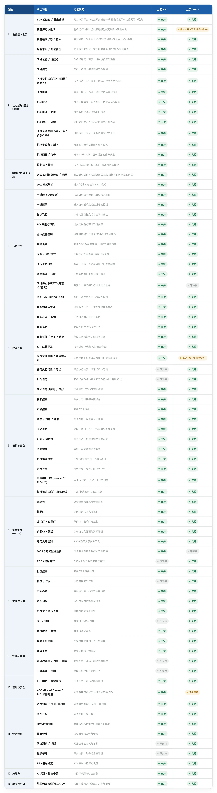

# 上云 API 2 与上云 API 能力集对比

## 1. 功能能力总览

温馨提示：上云 API 2暂未支持的能力，将在后续版本不断更新补强。

## 2. 详细协议对比

### 2.1 设备接入上云

#### SDK初始化 / 登录鉴权

<b>协议对照</b> — 上云 API 共 2 条,上云 API 2 共 6 条

<table style="width:100%;table-layout:fixed;border-collapse:collapse;margin:14px 0;font-size:13px;border:1px solid #d1d9e0;color:#1f2328">
<tr><th style="width:50%;background:#e8eaed;border:1px solid #d4d8dd;padding:9px 12px;text-align:left;font-weight:600;color:#1f2328">上云 API</th><th style="width:50%;background:#cdeee2;border:1px solid #b4e0d0;padding:9px 12px;text-align:left;font-weight:600;color:#1f2328">上云 API 2</th></tr>
<tr><td style="background:#f7f8f9;border:1px solid #d4d8dd;padding:8px 12px;vertical-align:top;line-height:1.6;color:#1f2328;word-break:break-word;overflow-wrap:anywhere"><code style="background:#e8ecf1;padding:2px 6px;border-radius:4px;font-family:ui-monospace,Menlo,monospace;font-size:12px;color:#0550ae">HTTP OAuth鉴权</code></td><td style="background:#edf9f5;border:1px solid #b4e0d0;padding:8px 12px;vertical-align:top;line-height:1.6;color:#1f2328;word-break:break-word;overflow-wrap:anywhere"><code style="background:#e8ecf1;padding:2px 6px;border-radius:4px;font-family:ui-monospace,Menlo,monospace;font-size:12px;color:#0550ae">FlightHubSDK.initialize()</code> SDK初始化</td></tr>
<tr><td style="background:#f0f1f3;border:1px solid #d4d8dd;padding:8px 12px;vertical-align:top;line-height:1.6;color:#1f2328;word-break:break-word;overflow-wrap:anywhere"><code style="background:#e8ecf1;padding:2px 6px;border-radius:4px;font-family:ui-monospace,Menlo,monospace;font-size:12px;color:#0550ae">MQTT Broker建连(自实现客户端)</code></td><td style="background:#e0f4ed;border:1px solid #b4e0d0;padding:8px 12px;vertical-align:top;line-height:1.6;color:#1f2328;word-break:break-word;overflow-wrap:anywhere"><code style="background:#e8ecf1;padding:2px 6px;border-radius:4px;font-family:ui-monospace,Menlo,monospace;font-size:12px;color:#0550ae">FlightHubSDK.isInitialized()</code> 判断SDK是否已初始化</td></tr>
<tr><td style="background:#f7f8f9;border:1px solid #d4d8dd;padding:8px 12px;vertical-align:top;line-height:1.6;color:#1f2328;word-break:break-word;overflow-wrap:anywhere"></td><td style="background:#edf9f5;border:1px solid #b4e0d0;padding:8px 12px;vertical-align:top;line-height:1.6;color:#1f2328;word-break:break-word;overflow-wrap:anywhere"><code style="background:#e8ecf1;padding:2px 6px;border-radius:4px;font-family:ui-monospace,Menlo,monospace;font-size:12px;color:#0550ae">FlightHubSDK.setWebSocketAuthHeaders()</code> 设置WebSocketAuthHeaders</td></tr>
<tr><td style="background:#f0f1f3;border:1px solid #d4d8dd;padding:8px 12px;vertical-align:top;line-height:1.6;color:#1f2328;word-break:break-word;overflow-wrap:anywhere"></td><td style="background:#e0f4ed;border:1px solid #b4e0d0;padding:8px 12px;vertical-align:top;line-height:1.6;color:#1f2328;word-break:break-word;overflow-wrap:anywhere"><code style="background:#e8ecf1;padding:2px 6px;border-radius:4px;font-family:ui-monospace,Menlo,monospace;font-size:12px;color:#0550ae">FlightHubSDK.getConfig()</code> 获取SDK配置</td></tr>
<tr><td style="background:#f7f8f9;border:1px solid #d4d8dd;padding:8px 12px;vertical-align:top;line-height:1.6;color:#1f2328;word-break:break-word;overflow-wrap:anywhere"></td><td style="background:#edf9f5;border:1px solid #b4e0d0;padding:8px 12px;vertical-align:top;line-height:1.6;color:#1f2328;word-break:break-word;overflow-wrap:anywhere"><code style="background:#e8ecf1;padding:2px 6px;border-radius:4px;font-family:ui-monospace,Menlo,monospace;font-size:12px;color:#0550ae">FlightHubSDK.setHttpHeaders()</code> 设置HttpHeaders</td></tr>
<tr><td style="background:#f0f1f3;border:1px solid #d4d8dd;padding:8px 12px;vertical-align:top;line-height:1.6;color:#1f2328;word-break:break-word;overflow-wrap:anywhere"></td><td style="background:#e0f4ed;border:1px solid #b4e0d0;padding:8px 12px;vertical-align:top;line-height:1.6;color:#1f2328;word-break:break-word;overflow-wrap:anywhere"><code style="background:#e8ecf1;padding:2px 6px;border-radius:4px;font-family:ui-monospace,Menlo,monospace;font-size:12px;color:#0550ae">FlightHubSDK.shutdown()</code> SDK关闭</td></tr>
</table>

#### 设备绑定与组织

<b>协议对照</b> — 上云 API 共 3 条,上云 API 2 共 8 条

<table style="width:100%;table-layout:fixed;border-collapse:collapse;margin:14px 0;font-size:13px;border:1px solid #d1d9e0;color:#1f2328">
<tr><th style="width:50%;background:#e8eaed;border:1px solid #d4d8dd;padding:9px 12px;text-align:left;font-weight:600;color:#1f2328">上云 API</th><th style="width:50%;background:#cdeee2;border:1px solid #b4e0d0;padding:9px 12px;text-align:left;font-weight:600;color:#1f2328">上云 API 2</th></tr>
<tr><td style="background:#f7f8f9;border:1px solid #d4d8dd;padding:8px 12px;vertical-align:top;line-height:1.6;color:#1f2328;word-break:break-word;overflow-wrap:anywhere"><code style="background:#e8ecf1;padding:2px 6px;border-radius:4px;font-family:ui-monospace,Menlo,monospace;font-size:12px;color:#0550ae">airport&#95;organization&#95;bind</code> 设备绑定到组织</td><td style="background:#edf9f5;border:1px solid #b4e0d0;padding:8px 12px;vertical-align:top;line-height:1.6;color:#1f2328;word-break:break-word;overflow-wrap:anywhere"><code style="background:#e8ecf1;padding:2px 6px;border-radius:4px;font-family:ui-monospace,Menlo,monospace;font-size:12px;color:#0550ae">DeviceManageModule.unbindDevice</code> 解绑设备</td></tr>
<tr><td style="background:#f0f1f3;border:1px solid #d4d8dd;padding:8px 12px;vertical-align:top;line-height:1.6;color:#1f2328;word-break:break-word;overflow-wrap:anywhere"><code style="background:#e8ecf1;padding:2px 6px;border-radius:4px;font-family:ui-monospace,Menlo,monospace;font-size:12px;color:#0550ae">airport&#95;bind&#95;status</code> 获取设备绑定信息</td><td style="background:#e0f4ed;border:1px solid #b4e0d0;padding:8px 12px;vertical-align:top;line-height:1.6;color:#1f2328;word-break:break-word;overflow-wrap:anywhere"><code style="background:#e8ecf1;padding:2px 6px;border-radius:4px;font-family:ui-monospace,Menlo,monospace;font-size:12px;color:#0550ae">DeviceManageModule.modifyDeviceName</code> 修改设备名称</td></tr>
<tr><td style="background:#f7f8f9;border:1px solid #d4d8dd;padding:8px 12px;vertical-align:top;line-height:1.6;color:#1f2328;word-break:break-word;overflow-wrap:anywhere"><code style="background:#e8ecf1;padding:2px 6px;border-radius:4px;font-family:ui-monospace,Menlo,monospace;font-size:12px;color:#0550ae">airport&#95;organization&#95;get</code> 查询设备绑定对应的组织信息</td><td style="background:#edf9f5;border:1px solid #b4e0d0;padding:8px 12px;vertical-align:top;line-height:1.6;color:#1f2328;word-break:break-word;overflow-wrap:anywhere"><code style="background:#e8ecf1;padding:2px 6px;border-radius:4px;font-family:ui-monospace,Menlo,monospace;font-size:12px;color:#0550ae">DeviceManageModule.getDeviceDetailInfo</code> 获取设备详细信息</td></tr>
<tr><td style="background:#f0f1f3;border:1px solid #d4d8dd;padding:8px 12px;vertical-align:top;line-height:1.6;color:#1f2328;word-break:break-word;overflow-wrap:anywhere"></td><td style="background:#e0f4ed;border:1px solid #b4e0d0;padding:8px 12px;vertical-align:top;line-height:1.6;color:#1f2328;word-break:break-word;overflow-wrap:anywhere"><code style="background:#e8ecf1;padding:2px 6px;border-radius:4px;font-family:ui-monospace,Menlo,monospace;font-size:12px;color:#0550ae">DeviceManageModule.getDeviceList</code> 获取设备列表</td></tr>
<tr><td style="background:#f7f8f9;border:1px solid #d4d8dd;padding:8px 12px;vertical-align:top;line-height:1.6;color:#1f2328;word-break:break-word;overflow-wrap:anywhere"></td><td style="background:#edf9f5;border:1px solid #b4e0d0;padding:8px 12px;vertical-align:top;line-height:1.6;color:#1f2328;word-break:break-word;overflow-wrap:anywhere"><code style="background:#e8ecf1;padding:2px 6px;border-radius:4px;font-family:ui-monospace,Menlo,monospace;font-size:12px;color:#0550ae">DeviceManageModule.getDockDeviceStatus</code> 获取机场设备状态</td></tr>
<tr><td style="background:#f0f1f3;border:1px solid #d4d8dd;padding:8px 12px;vertical-align:top;line-height:1.6;color:#1f2328;word-break:break-word;overflow-wrap:anywhere"></td><td style="background:#e0f4ed;border:1px solid #b4e0d0;padding:8px 12px;vertical-align:top;line-height:1.6;color:#1f2328;word-break:break-word;overflow-wrap:anywhere"><code style="background:#e8ecf1;padding:2px 6px;border-radius:4px;font-family:ui-monospace,Menlo,monospace;font-size:12px;color:#0550ae">DeviceManageModule.getDroneDeviceStatus</code> 获取飞机设备状态</td></tr>
<tr><td style="background:#f7f8f9;border:1px solid #d4d8dd;padding:8px 12px;vertical-align:top;line-height:1.6;color:#1f2328;word-break:break-word;overflow-wrap:anywhere"></td><td style="background:#edf9f5;border:1px solid #b4e0d0;padding:8px 12px;vertical-align:top;line-height:1.6;color:#1f2328;word-break:break-word;overflow-wrap:anywhere"><code style="background:#e8ecf1;padding:2px 6px;border-radius:4px;font-family:ui-monospace,Menlo,monospace;font-size:12px;color:#0550ae">DeviceManageModule.listenDeviceTopoChanged</code> 监听设备拓扑变化</td></tr>
<tr><td style="background:#f0f1f3;border:1px solid #d4d8dd;padding:8px 12px;vertical-align:top;line-height:1.6;color:#1f2328;word-break:break-word;overflow-wrap:anywhere"></td><td style="background:#e0f4ed;border:1px solid #b4e0d0;padding:8px 12px;vertical-align:top;line-height:1.6;color:#1f2328;word-break:break-word;overflow-wrap:anywhere"><code style="background:#e8ecf1;padding:2px 6px;border-radius:4px;font-family:ui-monospace,Menlo,monospace;font-size:12px;color:#0550ae">DeviceManageModule.listenWorkspaceDeviceChanged</code> 监听工作空间设备变化</td></tr>
</table>

#### 设备在线状态 / 拓扑

<b>协议对照</b> — 上云 API 共 1 条,上云 API 2 共 3 条

<table style="width:100%;table-layout:fixed;border-collapse:collapse;margin:14px 0;font-size:13px;border:1px solid #d1d9e0;color:#1f2328">
<tr><th style="width:50%;background:#e8eaed;border:1px solid #d4d8dd;padding:9px 12px;text-align:left;font-weight:600;color:#1f2328">上云 API</th><th style="width:50%;background:#cdeee2;border:1px solid #b4e0d0;padding:9px 12px;text-align:left;font-weight:600;color:#1f2328">上云 API 2</th></tr>
<tr><td style="background:#f7f8f9;border:1px solid #d4d8dd;padding:8px 12px;vertical-align:top;line-height:1.6;color:#1f2328;word-break:break-word;overflow-wrap:anywhere"><code style="background:#e8ecf1;padding:2px 6px;border-radius:4px;font-family:ui-monospace,Menlo,monospace;font-size:12px;color:#0550ae">update&#95;topo</code> 设备拓扑更新</td><td style="background:#edf9f5;border:1px solid #b4e0d0;padding:8px 12px;vertical-align:top;line-height:1.6;color:#1f2328;word-break:break-word;overflow-wrap:anywhere"><code style="background:#e8ecf1;padding:2px 6px;border-radius:4px;font-family:ui-monospace,Menlo,monospace;font-size:12px;color:#0550ae">DeviceManageModule.listenDeviceTopoChanged</code> 监听设备拓扑变化</td></tr>
<tr><td style="background:#f0f1f3;border:1px solid #d4d8dd;padding:8px 12px;vertical-align:top;line-height:1.6;color:#1f2328;word-break:break-word;overflow-wrap:anywhere"></td><td style="background:#e0f4ed;border:1px solid #b4e0d0;padding:8px 12px;vertical-align:top;line-height:1.6;color:#1f2328;word-break:break-word;overflow-wrap:anywhere"><code style="background:#e8ecf1;padding:2px 6px;border-radius:4px;font-family:ui-monospace,Menlo,monospace;font-size:12px;color:#0550ae">DeviceStateModule.listenDockOnlineStatus</code> 监听机场在线状态</td></tr>
<tr><td style="background:#f7f8f9;border:1px solid #d4d8dd;padding:8px 12px;vertical-align:top;line-height:1.6;color:#1f2328;word-break:break-word;overflow-wrap:anywhere"></td><td style="background:#edf9f5;border:1px solid #b4e0d0;padding:8px 12px;vertical-align:top;line-height:1.6;color:#1f2328;word-break:break-word;overflow-wrap:anywhere"><code style="background:#e8ecf1;padding:2px 6px;border-radius:4px;font-family:ui-monospace,Menlo,monospace;font-size:12px;color:#0550ae">DeviceStateModule.listenDroneOnlineStatus</code> 监听飞机在线状态</td></tr>
</table>

### 2.2 状态感知(遥测OSD)

#### 飞机位置 / 返航点

<b>协议对照</b> — 上云 API 共 8 条,上云 API 2 共 3 条

<table style="width:100%;table-layout:fixed;border-collapse:collapse;margin:14px 0;font-size:13px;border:1px solid #d1d9e0;color:#1f2328">
<tr><th style="width:50%;background:#e8eaed;border:1px solid #d4d8dd;padding:9px 12px;text-align:left;font-weight:600;color:#1f2328">上云 API</th><th style="width:50%;background:#cdeee2;border:1px solid #b4e0d0;padding:9px 12px;text-align:left;font-weight:600;color:#1f2328">上云 API 2</th></tr>
<tr><td style="background:#f7f8f9;border:1px solid #d4d8dd;padding:8px 12px;vertical-align:top;line-height:1.6;color:#1f2328;word-break:break-word;overflow-wrap:anywhere"><code style="background:#e8ecf1;padding:2px 6px;border-radius:4px;font-family:ui-monospace,Menlo,monospace;font-size:12px;color:#0550ae">position&#95;state</code> 搜星状态</td><td style="background:#edf9f5;border:1px solid #b4e0d0;padding:8px 12px;vertical-align:top;line-height:1.6;color:#1f2328;word-break:break-word;overflow-wrap:anywhere"><code style="background:#e8ecf1;padding:2px 6px;border-radius:4px;font-family:ui-monospace,Menlo,monospace;font-size:12px;color:#0550ae">DroneOsdModule.listenAircraftPositionState</code> 监听飞机定位状态</td></tr>
<tr><td style="background:#f0f1f3;border:1px solid #d4d8dd;padding:8px 12px;vertical-align:top;line-height:1.6;color:#1f2328;word-break:break-word;overflow-wrap:anywhere"><code style="background:#e8ecf1;padding:2px 6px;border-radius:4px;font-family:ui-monospace,Menlo,monospace;font-size:12px;color:#0550ae">elevation</code> 相对起飞点高度</td><td style="background:#e0f4ed;border:1px solid #b4e0d0;padding:8px 12px;vertical-align:top;line-height:1.6;color:#1f2328;word-break:break-word;overflow-wrap:anywhere"><code style="background:#e8ecf1;padding:2px 6px;border-radius:4px;font-family:ui-monospace,Menlo,monospace;font-size:12px;color:#0550ae">DroneOsdModule.listenAircraftLocation</code> 监听飞机位置</td></tr>
<tr><td style="background:#f7f8f9;border:1px solid #d4d8dd;padding:8px 12px;vertical-align:top;line-height:1.6;color:#1f2328;word-break:break-word;overflow-wrap:anywhere"><code style="background:#e8ecf1;padding:2px 6px;border-radius:4px;font-family:ui-monospace,Menlo,monospace;font-size:12px;color:#0550ae">longitude</code> 经度</td><td style="background:#edf9f5;border:1px solid #b4e0d0;padding:8px 12px;vertical-align:top;line-height:1.6;color:#1f2328;word-break:break-word;overflow-wrap:anywhere"><code style="background:#e8ecf1;padding:2px 6px;border-radius:4px;font-family:ui-monospace,Menlo,monospace;font-size:12px;color:#0550ae">DroneOsdModule.listenAircraftHomeGeographicalInfo</code> 监听飞机Home点地理信息</td></tr>
<tr><td style="background:#f0f1f3;border:1px solid #d4d8dd;padding:8px 12px;vertical-align:top;line-height:1.6;color:#1f2328;word-break:break-word;overflow-wrap:anywhere"><code style="background:#e8ecf1;padding:2px 6px;border-radius:4px;font-family:ui-monospace,Menlo,monospace;font-size:12px;color:#0550ae">latitude</code> 纬度</td><td style="background:#e0f4ed;border:1px solid #b4e0d0;padding:8px 12px;vertical-align:top;line-height:1.6;color:#1f2328;word-break:break-word;overflow-wrap:anywhere"></td></tr>
<tr><td style="background:#f7f8f9;border:1px solid #d4d8dd;padding:8px 12px;vertical-align:top;line-height:1.6;color:#1f2328;word-break:break-word;overflow-wrap:anywhere"><code style="background:#e8ecf1;padding:2px 6px;border-radius:4px;font-family:ui-monospace,Menlo,monospace;font-size:12px;color:#0550ae">height</code> 椭球高度</td><td style="background:#edf9f5;border:1px solid #b4e0d0;padding:8px 12px;vertical-align:top;line-height:1.6;color:#1f2328;word-break:break-word;overflow-wrap:anywhere"></td></tr>
<tr><td style="background:#f0f1f3;border:1px solid #d4d8dd;padding:8px 12px;vertical-align:top;line-height:1.6;color:#1f2328;word-break:break-word;overflow-wrap:anywhere"><code style="background:#e8ecf1;padding:2px 6px;border-radius:4px;font-family:ui-monospace,Menlo,monospace;font-size:12px;color:#0550ae">home&#95;latitude</code> Home 点纬度</td><td style="background:#e0f4ed;border:1px solid #b4e0d0;padding:8px 12px;vertical-align:top;line-height:1.6;color:#1f2328;word-break:break-word;overflow-wrap:anywhere"></td></tr>
<tr><td style="background:#f7f8f9;border:1px solid #d4d8dd;padding:8px 12px;vertical-align:top;line-height:1.6;color:#1f2328;word-break:break-word;overflow-wrap:anywhere"><code style="background:#e8ecf1;padding:2px 6px;border-radius:4px;font-family:ui-monospace,Menlo,monospace;font-size:12px;color:#0550ae">home&#95;longitude</code> Home 点经度</td><td style="background:#edf9f5;border:1px solid #b4e0d0;padding:8px 12px;vertical-align:top;line-height:1.6;color:#1f2328;word-break:break-word;overflow-wrap:anywhere"></td></tr>
<tr><td style="background:#f0f1f3;border:1px solid #d4d8dd;padding:8px 12px;vertical-align:top;line-height:1.6;color:#1f2328;word-break:break-word;overflow-wrap:anywhere"><code style="background:#e8ecf1;padding:2px 6px;border-radius:4px;font-family:ui-monospace,Menlo,monospace;font-size:12px;color:#0550ae">home&#95;position&#95;is&#95;valid</code> Home 点有效性</td><td style="background:#e0f4ed;border:1px solid #b4e0d0;padding:8px 12px;vertical-align:top;line-height:1.6;color:#1f2328;word-break:break-word;overflow-wrap:anywhere"></td></tr>
</table>

#### 飞机姿态

<b>协议对照</b> — 上云 API 共 7 条,上云 API 2 共 4 条

<table style="width:100%;table-layout:fixed;border-collapse:collapse;margin:14px 0;font-size:13px;border:1px solid #d1d9e0;color:#1f2328">
<tr><th style="width:50%;background:#e8eaed;border:1px solid #d4d8dd;padding:9px 12px;text-align:left;font-weight:600;color:#1f2328">上云 API</th><th style="width:50%;background:#cdeee2;border:1px solid #b4e0d0;padding:9px 12px;text-align:left;font-weight:600;color:#1f2328">上云 API 2</th></tr>
<tr><td style="background:#f7f8f9;border:1px solid #d4d8dd;padding:8px 12px;vertical-align:top;line-height:1.6;color:#1f2328;word-break:break-word;overflow-wrap:anywhere"><code style="background:#e8ecf1;padding:2px 6px;border-radius:4px;font-family:ui-monospace,Menlo,monospace;font-size:12px;color:#0550ae">wind&#95;direction</code> 当前风向</td><td style="background:#edf9f5;border:1px solid #b4e0d0;padding:8px 12px;vertical-align:top;line-height:1.6;color:#1f2328;word-break:break-word;overflow-wrap:anywhere"><code style="background:#e8ecf1;padding:2px 6px;border-radius:4px;font-family:ui-monospace,Menlo,monospace;font-size:12px;color:#0550ae">DroneOsdModule.listenAircraftWindSpeed</code> 监听飞机风速</td></tr>
<tr><td style="background:#f0f1f3;border:1px solid #d4d8dd;padding:8px 12px;vertical-align:top;line-height:1.6;color:#1f2328;word-break:break-word;overflow-wrap:anywhere"><code style="background:#e8ecf1;padding:2px 6px;border-radius:4px;font-family:ui-monospace,Menlo,monospace;font-size:12px;color:#0550ae">wind&#95;speed</code> 风速</td><td style="background:#e0f4ed;border:1px solid #b4e0d0;padding:8px 12px;vertical-align:top;line-height:1.6;color:#1f2328;word-break:break-word;overflow-wrap:anywhere"><code style="background:#e8ecf1;padding:2px 6px;border-radius:4px;font-family:ui-monospace,Menlo,monospace;font-size:12px;color:#0550ae">DroneOsdModule.listenAircraftAttitude</code> 监听飞机姿态</td></tr>
<tr><td style="background:#f7f8f9;border:1px solid #d4d8dd;padding:8px 12px;vertical-align:top;line-height:1.6;color:#1f2328;word-break:break-word;overflow-wrap:anywhere"><code style="background:#e8ecf1;padding:2px 6px;border-radius:4px;font-family:ui-monospace,Menlo,monospace;font-size:12px;color:#0550ae">attitude&#95;head</code> 偏航轴角度</td><td style="background:#edf9f5;border:1px solid #b4e0d0;padding:8px 12px;vertical-align:top;line-height:1.6;color:#1f2328;word-break:break-word;overflow-wrap:anywhere"><code style="background:#e8ecf1;padding:2px 6px;border-radius:4px;font-family:ui-monospace,Menlo,monospace;font-size:12px;color:#0550ae">DroneOsdModule.listenAircraftSpeed</code> 监听飞机速度</td></tr>
<tr><td style="background:#f0f1f3;border:1px solid #d4d8dd;padding:8px 12px;vertical-align:top;line-height:1.6;color:#1f2328;word-break:break-word;overflow-wrap:anywhere"><code style="background:#e8ecf1;padding:2px 6px;border-radius:4px;font-family:ui-monospace,Menlo,monospace;font-size:12px;color:#0550ae">attitude&#95;roll</code> 横滚轴角度</td><td style="background:#e0f4ed;border:1px solid #b4e0d0;padding:8px 12px;vertical-align:top;line-height:1.6;color:#1f2328;word-break:break-word;overflow-wrap:anywhere"><code style="background:#e8ecf1;padding:2px 6px;border-radius:4px;font-family:ui-monospace,Menlo,monospace;font-size:12px;color:#0550ae">DroneOsdModule.listenAircraftPayloadsGimbalAttitude</code> 监听飞机云台姿态</td></tr>
<tr><td style="background:#f7f8f9;border:1px solid #d4d8dd;padding:8px 12px;vertical-align:top;line-height:1.6;color:#1f2328;word-break:break-word;overflow-wrap:anywhere"><code style="background:#e8ecf1;padding:2px 6px;border-radius:4px;font-family:ui-monospace,Menlo,monospace;font-size:12px;color:#0550ae">attitude&#95;pitch</code> 俯仰轴角度</td><td style="background:#edf9f5;border:1px solid #b4e0d0;padding:8px 12px;vertical-align:top;line-height:1.6;color:#1f2328;word-break:break-word;overflow-wrap:anywhere"></td></tr>
<tr><td style="background:#f0f1f3;border:1px solid #d4d8dd;padding:8px 12px;vertical-align:top;line-height:1.6;color:#1f2328;word-break:break-word;overflow-wrap:anywhere"><code style="background:#e8ecf1;padding:2px 6px;border-radius:4px;font-family:ui-monospace,Menlo,monospace;font-size:12px;color:#0550ae">vertical&#95;speed</code> 垂直速度</td><td style="background:#e0f4ed;border:1px solid #b4e0d0;padding:8px 12px;vertical-align:top;line-height:1.6;color:#1f2328;word-break:break-word;overflow-wrap:anywhere"></td></tr>
<tr><td style="background:#f7f8f9;border:1px solid #d4d8dd;padding:8px 12px;vertical-align:top;line-height:1.6;color:#1f2328;word-break:break-word;overflow-wrap:anywhere"><code style="background:#e8ecf1;padding:2px 6px;border-radius:4px;font-family:ui-monospace,Menlo,monospace;font-size:12px;color:#0550ae">horizontal&#95;speed</code> 水平速度</td><td style="background:#edf9f5;border:1px solid #b4e0d0;padding:8px 12px;vertical-align:top;line-height:1.6;color:#1f2328;word-break:break-word;overflow-wrap:anywhere"></td></tr>
</table>

#### 飞机整机状态(固件/网络/存储等)

<b>协议对照</b> — 上云 API 共 41 条,上云 API 2 共 34 条

<table style="width:100%;table-layout:fixed;border-collapse:collapse;margin:14px 0;font-size:13px;border:1px solid #d1d9e0;color:#1f2328">
<tr><th style="width:50%;background:#e8eaed;border:1px solid #d4d8dd;padding:9px 12px;text-align:left;font-weight:600;color:#1f2328">上云 API</th><th style="width:50%;background:#cdeee2;border:1px solid #b4e0d0;padding:9px 12px;text-align:left;font-weight:600;color:#1f2328">上云 API 2</th></tr>
<tr><td style="background:#f7f8f9;border:1px solid #d4d8dd;padding:8px 12px;vertical-align:top;line-height:1.6;color:#1f2328;word-break:break-word;overflow-wrap:anywhere"><code style="background:#e8ecf1;padding:2px 6px;border-radius:4px;font-family:ui-monospace,Menlo,monospace;font-size:12px;color:#0550ae">relay&#95;search&#95;mode</code> 中继搜索模式</td><td style="background:#edf9f5;border:1px solid #b4e0d0;padding:8px 12px;vertical-align:top;line-height:1.6;color:#1f2328;word-break:break-word;overflow-wrap:anywhere"><code style="background:#e8ecf1;padding:2px 6px;border-radius:4px;font-family:ui-monospace,Menlo,monospace;font-size:12px;color:#0550ae">RelayControlModule.setRelaySearchMode</code> 设置中继器搜索模式</td></tr>
<tr><td style="background:#f0f1f3;border:1px solid #d4d8dd;padding:8px 12px;vertical-align:top;line-height:1.6;color:#1f2328;word-break:break-word;overflow-wrap:anywhere"><code style="background:#e8ecf1;padding:2px 6px;border-radius:4px;font-family:ui-monospace,Menlo,monospace;font-size:12px;color:#0550ae">electric&#95;supply&#95;mode</code> 供电模式</td><td style="background:#e0f4ed;border:1px solid #b4e0d0;padding:8px 12px;vertical-align:top;line-height:1.6;color:#1f2328;word-break:break-word;overflow-wrap:anywhere"><code style="background:#e8ecf1;padding:2px 6px;border-radius:4px;font-family:ui-monospace,Menlo,monospace;font-size:12px;color:#0550ae">BaseStation.getRtkCalibrationModule</code> 获取基站 RTK 标定模块</td></tr>
<tr><td style="background:#f7f8f9;border:1px solid #d4d8dd;padding:8px 12px;vertical-align:top;line-height:1.6;color:#1f2328;word-break:break-word;overflow-wrap:anywhere"><code style="background:#e8ecf1;padding:2px 6px;border-radius:4px;font-family:ui-monospace,Menlo,monospace;font-size:12px;color:#0550ae">basestation&#95;work&#95;mode</code> 基站 / 中继模式标识（待确认）</td><td style="background:#edf9f5;border:1px solid #b4e0d0;padding:8px 12px;vertical-align:top;line-height:1.6;color:#1f2328;word-break:break-word;overflow-wrap:anywhere"><code style="background:#e8ecf1;padding:2px 6px;border-radius:4px;font-family:ui-monospace,Menlo,monospace;font-size:12px;color:#0550ae">AircraftComplianceInfo.getRidState()</code> RID工作状态</td></tr>
<tr><td style="background:#f0f1f3;border:1px solid #d4d8dd;padding:8px 12px;vertical-align:top;line-height:1.6;color:#1f2328;word-break:break-word;overflow-wrap:anywhere"><code style="background:#e8ecf1;padding:2px 6px;border-radius:4px;font-family:ui-monospace,Menlo,monospace;font-size:12px;color:#0550ae">network&#95;state</code> 网络状态</td><td style="background:#e0f4ed;border:1px solid #b4e0d0;padding:8px 12px;vertical-align:top;line-height:1.6;color:#1f2328;word-break:break-word;overflow-wrap:anywhere"><code style="background:#e8ecf1;padding:2px 6px;border-radius:4px;font-family:ui-monospace,Menlo,monospace;font-size:12px;color:#0550ae">SafetyServiceModule.getCustomizedFlightAreas</code> 查询自定义飞行区域列表</td></tr>
<tr><td style="background:#f7f8f9;border:1px solid #d4d8dd;padding:8px 12px;vertical-align:top;line-height:1.6;color:#1f2328;word-break:break-word;overflow-wrap:anywhere"><code style="background:#e8ecf1;padding:2px 6px;border-radius:4px;font-family:ui-monospace,Menlo,monospace;font-size:12px;color:#0550ae">rid&#95;state</code> RID 工作状态</td><td style="background:#edf9f5;border:1px solid #b4e0d0;padding:8px 12px;vertical-align:top;line-height:1.6;color:#1f2328;word-break:break-word;overflow-wrap:anywhere"><code style="background:#e8ecf1;padding:2px 6px;border-radius:4px;font-family:ui-monospace,Menlo,monospace;font-size:12px;color:#0550ae">DroneOsdModule.listenAircraftFirmwareStatus</code> 监听飞机固件状态</td></tr>
<tr><td style="background:#f0f1f3;border:1px solid #d4d8dd;padding:8px 12px;vertical-align:top;line-height:1.6;color:#1f2328;word-break:break-word;overflow-wrap:anywhere"><code style="background:#e8ecf1;padding:2px 6px;border-radius:4px;font-family:ui-monospace,Menlo,monospace;font-size:12px;color:#0550ae">mode&#95;code&#95;reason</code> 飞行器进入当前状态的原因</td><td style="background:#e0f4ed;border:1px solid #b4e0d0;padding:8px 12px;vertical-align:top;line-height:1.6;color:#1f2328;word-break:break-word;overflow-wrap:anywhere"><code style="background:#e8ecf1;padding:2px 6px;border-radius:4px;font-family:ui-monospace,Menlo,monospace;font-size:12px;color:#0550ae">DockOsdModule.listenDockPositionState</code> 监听机场定位状态</td></tr>
<tr><td style="background:#f7f8f9;border:1px solid #d4d8dd;padding:8px 12px;vertical-align:top;line-height:1.6;color:#1f2328;word-break:break-word;overflow-wrap:anywhere"><code style="background:#e8ecf1;padding:2px 6px;border-radius:4px;font-family:ui-monospace,Menlo,monospace;font-size:12px;color:#0550ae">best&#95;link&#95;gateway</code> 飞行器图传连接质量最好的网关SN</td><td style="background:#edf9f5;border:1px solid #b4e0d0;padding:8px 12px;vertical-align:top;line-height:1.6;color:#1f2328;word-break:break-word;overflow-wrap:anywhere"><code style="background:#e8ecf1;padding:2px 6px;border-radius:4px;font-family:ui-monospace,Menlo,monospace;font-size:12px;color:#0550ae">DockOsdModule.listenDockNetworkState</code> 监听机场网络状态</td></tr>
<tr><td style="background:#f0f1f3;border:1px solid #d4d8dd;padding:8px 12px;vertical-align:top;line-height:1.6;color:#1f2328;word-break:break-word;overflow-wrap:anywhere"><code style="background:#e8ecf1;padding:2px 6px;border-radius:4px;font-family:ui-monospace,Menlo,monospace;font-size:12px;color:#0550ae">flysafe&#95;database&#95;version</code> 飞行安全数据库版本</td><td style="background:#e0f4ed;border:1px solid #b4e0d0;padding:8px 12px;vertical-align:top;line-height:1.6;color:#1f2328;word-break:break-word;overflow-wrap:anywhere"><code style="background:#e8ecf1;padding:2px 6px;border-radius:4px;font-family:ui-monospace,Menlo,monospace;font-size:12px;color:#0550ae">DroneOsdModule.listenAircraftMaintainStatusInfo</code> 监听飞机维保状态</td></tr>
<tr><td style="background:#f7f8f9;border:1px solid #d4d8dd;padding:8px 12px;vertical-align:top;line-height:1.6;color:#1f2328;word-break:break-word;overflow-wrap:anywhere"><code style="background:#e8ecf1;padding:2px 6px;border-radius:4px;font-family:ui-monospace,Menlo,monospace;font-size:12px;color:#0550ae">total&#95;flight&#95;sorties</code> 飞行器累计飞行总架次</td><td style="background:#edf9f5;border:1px solid #b4e0d0;padding:8px 12px;vertical-align:top;line-height:1.6;color:#1f2328;word-break:break-word;overflow-wrap:anywhere"><code style="background:#e8ecf1;padding:2px 6px;border-radius:4px;font-family:ui-monospace,Menlo,monospace;font-size:12px;color:#0550ae">SafetyServiceModule.listenDroneOfflineMapEnable</code> 监听指定无人机的离线地图开关状态变化</td></tr>
<tr><td style="background:#f0f1f3;border:1px solid #d4d8dd;padding:8px 12px;vertical-align:top;line-height:1.6;color:#1f2328;word-break:break-word;overflow-wrap:anywhere"><code style="background:#e8ecf1;padding:2px 6px;border-radius:4px;font-family:ui-monospace,Menlo,monospace;font-size:12px;color:#0550ae">total&#95;flight&#95;distance</code> 飞行器累计飞行总里程</td><td style="background:#e0f4ed;border:1px solid #b4e0d0;padding:8px 12px;vertical-align:top;line-height:1.6;color:#1f2328;word-break:break-word;overflow-wrap:anywhere"><code style="background:#e8ecf1;padding:2px 6px;border-radius:4px;font-family:ui-monospace,Menlo,monospace;font-size:12px;color:#0550ae">SafetyServiceModule.setOfflineMaps</code> 为指定无人机设置/下发离线地图数据</td></tr>
<tr><td style="background:#f7f8f9;border:1px solid #d4d8dd;padding:8px 12px;vertical-align:top;line-height:1.6;color:#1f2328;word-break:break-word;overflow-wrap:anywhere"><code style="background:#e8ecf1;padding:2px 6px;border-radius:4px;font-family:ui-monospace,Menlo,monospace;font-size:12px;color:#0550ae">total&#95;flight&#95;time</code> 飞行器累计飞行航时</td><td style="background:#edf9f5;border:1px solid #b4e0d0;padding:8px 12px;vertical-align:top;line-height:1.6;color:#1f2328;word-break:break-word;overflow-wrap:anywhere"><code style="background:#e8ecf1;padding:2px 6px;border-radius:4px;font-family:ui-monospace,Menlo,monospace;font-size:12px;color:#0550ae">DroneOsdModule.listenControlRightsCloudControlStatus</code> 监听云端控制权状态</td></tr>
<tr><td style="background:#f0f1f3;border:1px solid #d4d8dd;padding:8px 12px;vertical-align:top;line-height:1.6;color:#1f2328;word-break:break-word;overflow-wrap:anywhere"><code style="background:#e8ecf1;padding:2px 6px;border-radius:4px;font-family:ui-monospace,Menlo,monospace;font-size:12px;color:#0550ae">distance&#95;limit&#95;status</code> 飞行器限远状态</td><td style="background:#e0f4ed;border:1px solid #b4e0d0;padding:8px 12px;vertical-align:top;line-height:1.6;color:#1f2328;word-break:break-word;overflow-wrap:anywhere"><code style="background:#e8ecf1;padding:2px 6px;border-radius:4px;font-family:ui-monospace,Menlo,monospace;font-size:12px;color:#0550ae">DockOsdModule.listenDockFirmwareInfo</code> 监听机场固件信息</td></tr>
<tr><td style="background:#f7f8f9;border:1px solid #d4d8dd;padding:8px 12px;vertical-align:top;line-height:1.6;color:#1f2328;word-break:break-word;overflow-wrap:anywhere"><code style="background:#e8ecf1;padding:2px 6px;border-radius:4px;font-family:ui-monospace,Menlo,monospace;font-size:12px;color:#0550ae">firmware&#95;version</code> 固件版本</td><td style="background:#edf9f5;border:1px solid #b4e0d0;padding:8px 12px;vertical-align:top;line-height:1.6;color:#1f2328;word-break:break-word;overflow-wrap:anywhere"><code style="background:#e8ecf1;padding:2px 6px;border-radius:4px;font-family:ui-monospace,Menlo,monospace;font-size:12px;color:#0550ae">DockOsdModule.listenDockWirelessLink</code> 监听机场无线链路</td></tr>
<tr><td style="background:#f0f1f3;border:1px solid #d4d8dd;padding:8px 12px;vertical-align:top;line-height:1.6;color:#1f2328;word-break:break-word;overflow-wrap:anywhere"><code style="background:#e8ecf1;padding:2px 6px;border-radius:4px;font-family:ui-monospace,Menlo,monospace;font-size:12px;color:#0550ae">wireless&#95;link</code> 图传链路</td><td style="background:#e0f4ed;border:1px solid #b4e0d0;padding:8px 12px;vertical-align:top;line-height:1.6;color:#1f2328;word-break:break-word;overflow-wrap:anywhere"><code style="background:#e8ecf1;padding:2px 6px;border-radius:4px;font-family:ui-monospace,Menlo,monospace;font-size:12px;color:#0550ae">DroneOsdModule.listenAircraftStorageInfo</code> 监听飞机存储信息</td></tr>
<tr><td style="background:#f7f8f9;border:1px solid #d4d8dd;padding:8px 12px;vertical-align:top;line-height:1.6;color:#1f2328;word-break:break-word;overflow-wrap:anywhere"><code style="background:#e8ecf1;padding:2px 6px;border-radius:4px;font-family:ui-monospace,Menlo,monospace;font-size:12px;color:#0550ae">storage</code> 存储容量</td><td style="background:#edf9f5;border:1px solid #b4e0d0;padding:8px 12px;vertical-align:top;line-height:1.6;color:#1f2328;word-break:break-word;overflow-wrap:anywhere"><code style="background:#e8ecf1;padding:2px 6px;border-radius:4px;font-family:ui-monospace,Menlo,monospace;font-size:12px;color:#0550ae">DockOsdModule.listenDockAccumulatedRunningTime</code> 监听机场累计运行时间</td></tr>
<tr><td style="background:#f0f1f3;border:1px solid #d4d8dd;padding:8px 12px;vertical-align:top;line-height:1.6;color:#1f2328;word-break:break-word;overflow-wrap:anywhere"><code style="background:#e8ecf1;padding:2px 6px;border-radius:4px;font-family:ui-monospace,Menlo,monospace;font-size:12px;color:#0550ae">acc&#95;time</code> 机场累计运行时长</td><td style="background:#e0f4ed;border:1px solid #b4e0d0;padding:8px 12px;vertical-align:top;line-height:1.6;color:#1f2328;word-break:break-word;overflow-wrap:anywhere"><code style="background:#e8ecf1;padding:2px 6px;border-radius:4px;font-family:ui-monospace,Menlo,monospace;font-size:12px;color:#0550ae">DroneOsdModule.listenAircraftActivationTime</code> 监听飞机激活时间</td></tr>
<tr><td style="background:#f7f8f9;border:1px solid #d4d8dd;padding:8px 12px;vertical-align:top;line-height:1.6;color:#1f2328;word-break:break-word;overflow-wrap:anywhere"><code style="background:#e8ecf1;padding:2px 6px;border-radius:4px;font-family:ui-monospace,Menlo,monospace;font-size:12px;color:#0550ae">activation&#95;time</code> 机场激活时间(unix 时间戳)</td><td style="background:#edf9f5;border:1px solid #b4e0d0;padding:8px 12px;vertical-align:top;line-height:1.6;color:#1f2328;word-break:break-word;overflow-wrap:anywhere"><code style="background:#e8ecf1;padding:2px 6px;border-radius:4px;font-family:ui-monospace,Menlo,monospace;font-size:12px;color:#0550ae">DroneOsdModule.listenDroneWpmzVersion</code> 监听飞机航线格式（WPMZ）版本信息</td></tr>
<tr><td style="background:#f0f1f3;border:1px solid #d4d8dd;padding:8px 12px;vertical-align:top;line-height:1.6;color:#1f2328;word-break:break-word;overflow-wrap:anywhere"><code style="background:#e8ecf1;padding:2px 6px;border-radius:4px;font-family:ui-monospace,Menlo,monospace;font-size:12px;color:#0550ae">wpmz&#95;version</code> 机场的航线解析库版本号</td><td style="background:#e0f4ed;border:1px solid #b4e0d0;padding:8px 12px;vertical-align:top;line-height:1.6;color:#1f2328;word-break:break-word;overflow-wrap:anywhere"><code style="background:#e8ecf1;padding:2px 6px;border-radius:4px;font-family:ui-monospace,Menlo,monospace;font-size:12px;color:#0550ae">DockOsdModule.listenDockSelfConvergeCoordinate</code> 监听机场自收敛坐标</td></tr>
<tr><td style="background:#f7f8f9;border:1px solid #d4d8dd;padding:8px 12px;vertical-align:top;line-height:1.6;color:#1f2328;word-break:break-word;overflow-wrap:anywhere"><code style="background:#e8ecf1;padding:2px 6px;border-radius:4px;font-family:ui-monospace,Menlo,monospace;font-size:12px;color:#0550ae">data</code> 消息内容</td><td style="background:#edf9f5;border:1px solid #b4e0d0;padding:8px 12px;vertical-align:top;line-height:1.6;color:#1f2328;word-break:break-word;overflow-wrap:anywhere"><code style="background:#e8ecf1;padding:2px 6px;border-radius:4px;font-family:ui-monospace,Menlo,monospace;font-size:12px;color:#0550ae">DroneOsdModule.listenDroneFlysafeDatabaseVersion</code> 监听飞机限飞数据库版本信息</td></tr>
<tr><td style="background:#f0f1f3;border:1px solid #d4d8dd;padding:8px 12px;vertical-align:top;line-height:1.6;color:#1f2328;word-break:break-word;overflow-wrap:anywhere"><code style="background:#e8ecf1;padding:2px 6px;border-radius:4px;font-family:ui-monospace,Menlo,monospace;font-size:12px;color:#0550ae">wireless&#95;link&#95;topo</code> 图传连接拓扑</td><td style="background:#e0f4ed;border:1px solid #b4e0d0;padding:8px 12px;vertical-align:top;line-height:1.6;color:#1f2328;word-break:break-word;overflow-wrap:anywhere"><code style="background:#e8ecf1;padding:2px 6px;border-radius:4px;font-family:ui-monospace,Menlo,monospace;font-size:12px;color:#0550ae">DroneOsdModule.listenAircraftHomeDistance</code> 监听飞机归航点距离</td></tr>
<tr><td style="background:#f7f8f9;border:1px solid #d4d8dd;padding:8px 12px;vertical-align:top;line-height:1.6;color:#1f2328;word-break:break-word;overflow-wrap:anywhere"><code style="background:#e8ecf1;padding:2px 6px;border-radius:4px;font-family:ui-monospace,Menlo,monospace;font-size:12px;color:#0550ae">self&#95;converge&#95;coordinate</code> 自收敛坐标</td><td style="background:#edf9f5;border:1px solid #b4e0d0;padding:8px 12px;vertical-align:top;line-height:1.6;color:#1f2328;word-break:break-word;overflow-wrap:anywhere"><code style="background:#e8ecf1;padding:2px 6px;border-radius:4px;font-family:ui-monospace,Menlo,monospace;font-size:12px;color:#0550ae">DroneOsdModule.listenDroneModeCodeReason</code> 监听飞机模式码变更原因</td></tr>
<tr><td style="background:#f0f1f3;border:1px solid #d4d8dd;padding:8px 12px;vertical-align:top;line-height:1.6;color:#1f2328;word-break:break-word;overflow-wrap:anywhere"><code style="background:#e8ecf1;padding:2px 6px;border-radius:4px;font-family:ui-monospace,Menlo,monospace;font-size:12px;color:#0550ae">offline&#95;map&#95;enable</code> 离线地图开关</td><td style="background:#e0f4ed;border:1px solid #b4e0d0;padding:8px 12px;vertical-align:top;line-height:1.6;color:#1f2328;word-break:break-word;overflow-wrap:anywhere"><code style="background:#e8ecf1;padding:2px 6px;border-radius:4px;font-family:ui-monospace,Menlo,monospace;font-size:12px;color:#0550ae">DroneOsdModule.listenAircraftLimitsInfo</code> 监听飞机限制信息</td></tr>
<tr><td style="background:#f7f8f9;border:1px solid #d4d8dd;padding:8px 12px;vertical-align:top;line-height:1.6;color:#1f2328;word-break:break-word;overflow-wrap:anywhere"><code style="background:#e8ecf1;padding:2px 6px;border-radius:4px;font-family:ui-monospace,Menlo,monospace;font-size:12px;color:#0550ae">is&#95;near&#95;area&#95;limit</code> 是否接近限飞区</td><td style="background:#edf9f5;border:1px solid #b4e0d0;padding:8px 12px;vertical-align:top;line-height:1.6;color:#1f2328;word-break:break-word;overflow-wrap:anywhere"><code style="background:#e8ecf1;padding:2px 6px;border-radius:4px;font-family:ui-monospace,Menlo,monospace;font-size:12px;color:#0550ae">DroneOsdModule.listenAircraftComplianceInfo</code> 监听飞机合规信息</td></tr>
<tr><td style="background:#f0f1f3;border:1px solid #d4d8dd;padding:8px 12px;vertical-align:top;line-height:1.6;color:#1f2328;word-break:break-word;overflow-wrap:anywhere"><code style="background:#e8ecf1;padding:2px 6px;border-radius:4px;font-family:ui-monospace,Menlo,monospace;font-size:12px;color:#0550ae">track&#95;id</code> 航迹 ID</td><td style="background:#e0f4ed;border:1px solid #b4e0d0;padding:8px 12px;vertical-align:top;line-height:1.6;color:#1f2328;word-break:break-word;overflow-wrap:anywhere"><code style="background:#e8ecf1;padding:2px 6px;border-radius:4px;font-family:ui-monospace,Menlo,monospace;font-size:12px;color:#0550ae">DockOsdModule.listenDockPowerState</code> 监听机场电源状态</td></tr>
<tr><td style="background:#f7f8f9;border:1px solid #d4d8dd;padding:8px 12px;vertical-align:top;line-height:1.6;color:#1f2328;word-break:break-word;overflow-wrap:anywhere"><code style="background:#e8ecf1;padding:2px 6px;border-radius:4px;font-family:ui-monospace,Menlo,monospace;font-size:12px;color:#0550ae">home&#95;distance</code> 距离 Home 点的距离</td><td style="background:#edf9f5;border:1px solid #b4e0d0;padding:8px 12px;vertical-align:top;line-height:1.6;color:#1f2328;word-break:break-word;overflow-wrap:anywhere"><code style="background:#e8ecf1;padding:2px 6px;border-radius:4px;font-family:ui-monospace,Menlo,monospace;font-size:12px;color:#0550ae">DroneOsdModule.listenAircraftBatteryInfo</code> 监听飞机电池信息</td></tr>
<tr><td style="background:#f0f1f3;border:1px solid #d4d8dd;padding:8px 12px;vertical-align:top;line-height:1.6;color:#1f2328;word-break:break-word;overflow-wrap:anywhere"><code style="background:#e8ecf1;padding:2px 6px;border-radius:4px;font-family:ui-monospace,Menlo,monospace;font-size:12px;color:#0550ae">gear</code> 档位</td><td style="background:#e0f4ed;border:1px solid #b4e0d0;padding:8px 12px;vertical-align:top;line-height:1.6;color:#1f2328;word-break:break-word;overflow-wrap:anywhere"><code style="background:#e8ecf1;padding:2px 6px;border-radius:4px;font-family:ui-monospace,Menlo,monospace;font-size:12px;color:#0550ae">DroneOsdModule.listenAircraftControlCode</code> 监听飞机控制码</td></tr>
<tr><td style="background:#f7f8f9;border:1px solid #d4d8dd;padding:8px 12px;vertical-align:top;line-height:1.6;color:#1f2328;word-break:break-word;overflow-wrap:anywhere"><code style="background:#e8ecf1;padding:2px 6px;border-radius:4px;font-family:ui-monospace,Menlo,monospace;font-size:12px;color:#0550ae">country</code> 国家区域码</td><td style="background:#edf9f5;border:1px solid #b4e0d0;padding:8px 12px;vertical-align:top;line-height:1.6;color:#1f2328;word-break:break-word;overflow-wrap:anywhere"><code style="background:#e8ecf1;padding:2px 6px;border-radius:4px;font-family:ui-monospace,Menlo,monospace;font-size:12px;color:#0550ae">DroneOsdModule.listenAircraftGear</code> 监听飞机起落架状态</td></tr>
<tr><td style="background:#f0f1f3;border:1px solid #d4d8dd;padding:8px 12px;vertical-align:top;line-height:1.6;color:#1f2328;word-break:break-word;overflow-wrap:anywhere"><code style="background:#e8ecf1;padding:2px 6px;border-radius:4px;font-family:ui-monospace,Menlo,monospace;font-size:12px;color:#0550ae">electric&#95;supply&#95;power</code> 供电功率</td><td style="background:#e0f4ed;border:1px solid #b4e0d0;padding:8px 12px;vertical-align:top;line-height:1.6;color:#1f2328;word-break:break-word;overflow-wrap:anywhere"><code style="background:#e8ecf1;padding:2px 6px;border-radius:4px;font-family:ui-monospace,Menlo,monospace;font-size:12px;color:#0550ae">DroneOsdModule.listenAircraftModeCode</code> 监听飞机模式码</td></tr>
<tr><td style="background:#f7f8f9;border:1px solid #d4d8dd;padding:8px 12px;vertical-align:top;line-height:1.6;color:#1f2328;word-break:break-word;overflow-wrap:anywhere"><code style="background:#e8ecf1;padding:2px 6px;border-radius:4px;font-family:ui-monospace,Menlo,monospace;font-size:12px;color:#0550ae">electric&#95;supply&#95;voltage</code> 市电电压</td><td style="background:#edf9f5;border:1px solid #b4e0d0;padding:8px 12px;vertical-align:top;line-height:1.6;color:#1f2328;word-break:break-word;overflow-wrap:anywhere"><code style="background:#e8ecf1;padding:2px 6px;border-radius:4px;font-family:ui-monospace,Menlo,monospace;font-size:12px;color:#0550ae">DroneOsdModule.listenAircraftRcLostAction</code> 监听飞机遥控器丢失动作</td></tr>
<tr><td style="background:#f0f1f3;border:1px solid #d4d8dd;padding:8px 12px;vertical-align:top;line-height:1.6;color:#1f2328;word-break:break-word;overflow-wrap:anywhere"><code style="background:#e8ecf1;padding:2px 6px;border-radius:4px;font-family:ui-monospace,Menlo,monospace;font-size:12px;color:#0550ae">tilt&#95;angle</code> 倾斜角度</td><td style="background:#e0f4ed;border:1px solid #b4e0d0;padding:8px 12px;vertical-align:top;line-height:1.6;color:#1f2328;word-break:break-word;overflow-wrap:anywhere"><code style="background:#e8ecf1;padding:2px 6px;border-radius:4px;font-family:ui-monospace,Menlo,monospace;font-size:12px;color:#0550ae">DroneOsdModule.listenAircraftTotalFlightInfo</code> 监听飞机总飞行信息</td></tr>
<tr><td style="background:#f7f8f9;border:1px solid #d4d8dd;padding:8px 12px;vertical-align:top;line-height:1.6;color:#1f2328;word-break:break-word;overflow-wrap:anywhere"><code style="background:#e8ecf1;padding:2px 6px;border-radius:4px;font-family:ui-monospace,Menlo,monospace;font-size:12px;color:#0550ae">is&#95;beidou&#95;version</code> 是否为北斗版</td><td style="background:#edf9f5;border:1px solid #b4e0d0;padding:8px 12px;vertical-align:top;line-height:1.6;color:#1f2328;word-break:break-word;overflow-wrap:anywhere"><code style="background:#e8ecf1;padding:2px 6px;border-radius:4px;font-family:ui-monospace,Menlo,monospace;font-size:12px;color:#0550ae">DroneOsdModule.listenAircraftTrackId</code> 监听飞机轨迹ID</td></tr>
<tr><td style="background:#f0f1f3;border:1px solid #d4d8dd;padding:8px 12px;vertical-align:top;line-height:1.6;color:#1f2328;word-break:break-word;overflow-wrap:anywhere"><code style="background:#e8ecf1;padding:2px 6px;border-radius:4px;font-family:ui-monospace,Menlo,monospace;font-size:12px;color:#0550ae">heading</code> 机场朝向角</td><td style="background:#e0f4ed;border:1px solid #b4e0d0;padding:8px 12px;vertical-align:top;line-height:1.6;color:#1f2328;word-break:break-word;overflow-wrap:anywhere"><code style="background:#e8ecf1;padding:2px 6px;border-radius:4px;font-family:ui-monospace,Menlo,monospace;font-size:12px;color:#0550ae">DroneOsdModule.listenControlRightsDeviceControlStatus</code> 监听设备端控制权状态</td></tr>
<tr><td style="background:#f7f8f9;border:1px solid #d4d8dd;padding:8px 12px;vertical-align:top;line-height:1.6;color:#1f2328;word-break:break-word;overflow-wrap:anywhere"><code style="background:#e8ecf1;padding:2px 6px;border-radius:4px;font-family:ui-monospace,Menlo,monospace;font-size:12px;color:#0550ae">capacity&#95;percent</code> 剩余电量</td><td style="background:#edf9f5;border:1px solid #b4e0d0;padding:8px 12px;vertical-align:top;line-height:1.6;color:#1f2328;word-break:break-word;overflow-wrap:anywhere"><code style="background:#e8ecf1;padding:2px 6px;border-radius:4px;font-family:ui-monospace,Menlo,monospace;font-size:12px;color:#0550ae">DroneOsdModule.listenDroneDongleInfos</code> 监听飞机 Dongle（4G/5G 模块）信息</td></tr>
<tr><td style="background:#f0f1f3;border:1px solid #d4d8dd;padding:8px 12px;vertical-align:top;line-height:1.6;color:#1f2328;word-break:break-word;overflow-wrap:anywhere"><code style="background:#e8ecf1;padding:2px 6px;border-radius:4px;font-family:ui-monospace,Menlo,monospace;font-size:12px;color:#0550ae">firmware&#95;upgrade&#95;status</code> 固件升级状态</td><td style="background:#e0f4ed;border:1px solid #b4e0d0;padding:8px 12px;vertical-align:top;line-height:1.6;color:#1f2328;word-break:break-word;overflow-wrap:anywhere"><code style="background:#e8ecf1;padding:2px 6px;border-radius:4px;font-family:ui-monospace,Menlo,monospace;font-size:12px;color:#0550ae">DroneOsdModule.listenFlightTasksMediaFileDisplayAvailable</code> 监听飞行任务媒体文件显示可用性</td></tr>
<tr><td style="background:#f7f8f9;border:1px solid #d4d8dd;padding:8px 12px;vertical-align:top;line-height:1.6;color:#1f2328;word-break:break-word;overflow-wrap:anywhere"><code style="background:#e8ecf1;padding:2px 6px;border-radius:4px;font-family:ui-monospace,Menlo,monospace;font-size:12px;color:#0550ae">mode&#95;code</code> 机场状态</td><td style="background:#edf9f5;border:1px solid #b4e0d0;padding:8px 12px;vertical-align:top;line-height:1.6;color:#1f2328;word-break:break-word;overflow-wrap:anywhere"></td></tr>
<tr><td style="background:#f0f1f3;border:1px solid #d4d8dd;padding:8px 12px;vertical-align:top;line-height:1.6;color:#1f2328;word-break:break-word;overflow-wrap:anywhere"><code style="background:#e8ecf1;padding:2px 6px;border-radius:4px;font-family:ui-monospace,Menlo,monospace;font-size:12px;color:#0550ae">lan&#95;status</code> LAN 口连接状态（待确认）</td><td style="background:#e0f4ed;border:1px solid #b4e0d0;padding:8px 12px;vertical-align:top;line-height:1.6;color:#1f2328;word-break:break-word;overflow-wrap:anywhere"></td></tr>
<tr><td style="background:#f7f8f9;border:1px solid #d4d8dd;padding:8px 12px;vertical-align:top;line-height:1.6;color:#1f2328;word-break:break-word;overflow-wrap:anywhere"><code style="background:#e8ecf1;padding:2px 6px;border-radius:4px;font-family:ui-monospace,Menlo,monospace;font-size:12px;color:#0550ae">rtcm&#95;info</code> 机场 RTK 标定源</td><td style="background:#edf9f5;border:1px solid #b4e0d0;padding:8px 12px;vertical-align:top;line-height:1.6;color:#1f2328;word-break:break-word;overflow-wrap:anywhere"></td></tr>
<tr><td style="background:#f0f1f3;border:1px solid #d4d8dd;padding:8px 12px;vertical-align:top;line-height:1.6;color:#1f2328;word-break:break-word;overflow-wrap:anywhere"><code style="background:#e8ecf1;padding:2px 6px;border-radius:4px;font-family:ui-monospace,Menlo,monospace;font-size:12px;color:#0550ae">dongle&#95;infos</code> 4G Dongle信息</td><td style="background:#e0f4ed;border:1px solid #b4e0d0;padding:8px 12px;vertical-align:top;line-height:1.6;color:#1f2328;word-break:break-word;overflow-wrap:anywhere"></td></tr>
<tr><td style="background:#f7f8f9;border:1px solid #d4d8dd;padding:8px 12px;vertical-align:top;line-height:1.6;color:#1f2328;word-break:break-word;overflow-wrap:anywhere"><code style="background:#e8ecf1;padding:2px 6px;border-radius:4px;font-family:ui-monospace,Menlo,monospace;font-size:12px;color:#0550ae">compatible&#95;status</code> 固件一致性</td><td style="background:#edf9f5;border:1px solid #b4e0d0;padding:8px 12px;vertical-align:top;line-height:1.6;color:#1f2328;word-break:break-word;overflow-wrap:anywhere"></td></tr>
<tr><td style="background:#f0f1f3;border:1px solid #d4d8dd;padding:8px 12px;vertical-align:top;line-height:1.6;color:#1f2328;word-break:break-word;overflow-wrap:anywhere"><code style="background:#e8ecf1;padding:2px 6px;border-radius:4px;font-family:ui-monospace,Menlo,monospace;font-size:12px;color:#0550ae">maintain&#95;status</code> 保养信息</td><td style="background:#e0f4ed;border:1px solid #b4e0d0;padding:8px 12px;vertical-align:top;line-height:1.6;color:#1f2328;word-break:break-word;overflow-wrap:anywhere"></td></tr>
<tr><td style="background:#f7f8f9;border:1px solid #d4d8dd;padding:8px 12px;vertical-align:top;line-height:1.6;color:#1f2328;word-break:break-word;overflow-wrap:anywhere"><code style="background:#e8ecf1;padding:2px 6px;border-radius:4px;font-family:ui-monospace,Menlo,monospace;font-size:12px;color:#0550ae">poe&#95;status</code> PoE 功率等级（待确认）</td><td style="background:#edf9f5;border:1px solid #b4e0d0;padding:8px 12px;vertical-align:top;line-height:1.6;color:#1f2328;word-break:break-word;overflow-wrap:anywhere"></td></tr>
</table>

#### 飞机电池

<b>协议对照</b> — 上云 API 共 3 条,上云 API 2 共 2 条

<table style="width:100%;table-layout:fixed;border-collapse:collapse;margin:14px 0;font-size:13px;border:1px solid #d1d9e0;color:#1f2328">
<tr><th style="width:50%;background:#e8eaed;border:1px solid #d4d8dd;padding:9px 12px;text-align:left;font-weight:600;color:#1f2328">上云 API</th><th style="width:50%;background:#cdeee2;border:1px solid #b4e0d0;padding:9px 12px;text-align:left;font-weight:600;color:#1f2328">上云 API 2</th></tr>
<tr><td style="background:#f7f8f9;border:1px solid #d4d8dd;padding:8px 12px;vertical-align:top;line-height:1.6;color:#1f2328;word-break:break-word;overflow-wrap:anywhere"><code style="background:#e8ecf1;padding:2px 6px;border-radius:4px;font-family:ui-monospace,Menlo,monospace;font-size:12px;color:#0550ae">battery</code> 飞行器电池信息</td><td style="background:#edf9f5;border:1px solid #b4e0d0;padding:8px 12px;vertical-align:top;line-height:1.6;color:#1f2328;word-break:break-word;overflow-wrap:anywhere"><code style="background:#e8ecf1;padding:2px 6px;border-radius:4px;font-family:ui-monospace,Menlo,monospace;font-size:12px;color:#0550ae">DroneOsdModule.listenAircraftBatteryInfo</code> 监听飞机电池信息</td></tr>
<tr><td style="background:#f0f1f3;border:1px solid #d4d8dd;padding:8px 12px;vertical-align:top;line-height:1.6;color:#1f2328;word-break:break-word;overflow-wrap:anywhere"><code style="background:#e8ecf1;padding:2px 6px;border-radius:4px;font-family:ui-monospace,Menlo,monospace;font-size:12px;color:#0550ae">serious&#95;low&#95;battery&#95;warning&#95;threshold</code> 严重低电量告警</td><td style="background:#e0f4ed;border:1px solid #b4e0d0;padding:8px 12px;vertical-align:top;line-height:1.6;color:#1f2328;word-break:break-word;overflow-wrap:anywhere"><code style="background:#e8ecf1;padding:2px 6px;border-radius:4px;font-family:ui-monospace,Menlo,monospace;font-size:12px;color:#0550ae">DroneOsdModule.listenAircraftBatteryWarningThresholds</code> 监听飞机电池告警阈值</td></tr>
<tr><td style="background:#f7f8f9;border:1px solid #d4d8dd;padding:8px 12px;vertical-align:top;line-height:1.6;color:#1f2328;word-break:break-word;overflow-wrap:anywhere"><code style="background:#e8ecf1;padding:2px 6px;border-radius:4px;font-family:ui-monospace,Menlo,monospace;font-size:12px;color:#0550ae">low&#95;battery&#95;warning&#95;threshold</code> 低电量告警</td><td style="background:#edf9f5;border:1px solid #b4e0d0;padding:8px 12px;vertical-align:top;line-height:1.6;color:#1f2328;word-break:break-word;overflow-wrap:anywhere"></td></tr>
</table>

#### 机场状态

<b>协议对照</b> — 上云 API 共 10 条,上云 API 2 共 18 条

<table style="width:100%;table-layout:fixed;border-collapse:collapse;margin:14px 0;font-size:13px;border:1px solid #d1d9e0;color:#1f2328">
<tr><th style="width:50%;background:#e8eaed;border:1px solid #d4d8dd;padding:9px 12px;text-align:left;font-weight:600;color:#1f2328">上云 API</th><th style="width:50%;background:#cdeee2;border:1px solid #b4e0d0;padding:9px 12px;text-align:left;font-weight:600;color:#1f2328">上云 API 2</th></tr>
<tr><td style="background:#f7f8f9;border:1px solid #d4d8dd;padding:8px 12px;vertical-align:top;line-height:1.6;color:#1f2328;word-break:break-word;overflow-wrap:anywhere"><code style="background:#e8ecf1;padding:2px 6px;border-radius:4px;font-family:ui-monospace,Menlo,monospace;font-size:12px;color:#0550ae">media&#95;file&#95;detail</code> 媒体文件上传细节</td><td style="background:#edf9f5;border:1px solid #b4e0d0;padding:8px 12px;vertical-align:top;line-height:1.6;color:#1f2328;word-break:break-word;overflow-wrap:anywhere"><code style="background:#e8ecf1;padding:2px 6px;border-radius:4px;font-family:ui-monospace,Menlo,monospace;font-size:12px;color:#0550ae">DockControlModule.listenDockSupplementLightState</code> 监听机场补光灯状态</td></tr>
<tr><td style="background:#f0f1f3;border:1px solid #d4d8dd;padding:8px 12px;vertical-align:top;line-height:1.6;color:#1f2328;word-break:break-word;overflow-wrap:anywhere"><code style="background:#e8ecf1;padding:2px 6px;border-radius:4px;font-family:ui-monospace,Menlo,monospace;font-size:12px;color:#0550ae">supplement&#95;light&#95;state</code> 补光灯状态</td><td style="background:#e0f4ed;border:1px solid #b4e0d0;padding:8px 12px;vertical-align:top;line-height:1.6;color:#1f2328;word-break:break-word;overflow-wrap:anywhere"><code style="background:#e8ecf1;padding:2px 6px;border-radius:4px;font-family:ui-monospace,Menlo,monospace;font-size:12px;color:#0550ae">DockOsdModule.listenDockAlarmState</code> 监听机场报警状态</td></tr>
<tr><td style="background:#f7f8f9;border:1px solid #d4d8dd;padding:8px 12px;vertical-align:top;line-height:1.6;color:#1f2328;word-break:break-word;overflow-wrap:anywhere"><code style="background:#e8ecf1;padding:2px 6px;border-radius:4px;font-family:ui-monospace,Menlo,monospace;font-size:12px;color:#0550ae">alarm&#95;state</code> 机场声光报警状态</td><td style="background:#edf9f5;border:1px solid #b4e0d0;padding:8px 12px;vertical-align:top;line-height:1.6;color:#1f2328;word-break:break-word;overflow-wrap:anywhere"><code style="background:#e8ecf1;padding:2px 6px;border-radius:4px;font-family:ui-monospace,Menlo,monospace;font-size:12px;color:#0550ae">DockOsdModule.listenDockStorageState</code> 监听机场存储状态</td></tr>
<tr><td style="background:#f0f1f3;border:1px solid #d4d8dd;padding:8px 12px;vertical-align:top;line-height:1.6;color:#1f2328;word-break:break-word;overflow-wrap:anywhere"><code style="background:#e8ecf1;padding:2px 6px;border-radius:4px;font-family:ui-monospace,Menlo,monospace;font-size:12px;color:#0550ae">drc&#95;state</code> DRC 链路的状态</td><td style="background:#e0f4ed;border:1px solid #b4e0d0;padding:8px 12px;vertical-align:top;line-height:1.6;color:#1f2328;word-break:break-word;overflow-wrap:anywhere"><code style="background:#e8ecf1;padding:2px 6px;border-radius:4px;font-family:ui-monospace,Menlo,monospace;font-size:12px;color:#0550ae">DockOsdModule.listenDockJobNumber</code> 监听机场任务编号</td></tr>
<tr><td style="background:#f7f8f9;border:1px solid #d4d8dd;padding:8px 12px;vertical-align:top;line-height:1.6;color:#1f2328;word-break:break-word;overflow-wrap:anywhere"><code style="background:#e8ecf1;padding:2px 6px;border-radius:4px;font-family:ui-monospace,Menlo,monospace;font-size:12px;color:#0550ae">drone&#95;in&#95;dock</code> 飞行器是否在舱</td><td style="background:#edf9f5;border:1px solid #b4e0d0;padding:8px 12px;vertical-align:top;line-height:1.6;color:#1f2328;word-break:break-word;overflow-wrap:anywhere"><code style="background:#e8ecf1;padding:2px 6px;border-radius:4px;font-family:ui-monospace,Menlo,monospace;font-size:12px;color:#0550ae">DockOsdModule.listenDockMediaFileDetail</code> 监听机场媒体文件详情</td></tr>
<tr><td style="background:#f0f1f3;border:1px solid #d4d8dd;padding:8px 12px;vertical-align:top;line-height:1.6;color:#1f2328;word-break:break-word;overflow-wrap:anywhere"><code style="background:#e8ecf1;padding:2px 6px;border-radius:4px;font-family:ui-monospace,Menlo,monospace;font-size:12px;color:#0550ae">job&#95;number</code> 机场累计作业次数</td><td style="background:#e0f4ed;border:1px solid #b4e0d0;padding:8px 12px;vertical-align:top;line-height:1.6;color:#1f2328;word-break:break-word;overflow-wrap:anywhere"><code style="background:#e8ecf1;padding:2px 6px;border-radius:4px;font-family:ui-monospace,Menlo,monospace;font-size:12px;color:#0550ae">DockOsdModule.listenDockPowerState</code> 监听机场电源状态</td></tr>
<tr><td style="background:#f7f8f9;border:1px solid #d4d8dd;padding:8px 12px;vertical-align:top;line-height:1.6;color:#1f2328;word-break:break-word;overflow-wrap:anywhere"><code style="background:#e8ecf1;padding:2px 6px;border-radius:4px;font-family:ui-monospace,Menlo,monospace;font-size:12px;color:#0550ae">working&#95;voltage</code> 工作电压</td><td style="background:#edf9f5;border:1px solid #b4e0d0;padding:8px 12px;vertical-align:top;line-height:1.6;color:#1f2328;word-break:break-word;overflow-wrap:anywhere"><code style="background:#e8ecf1;padding:2px 6px;border-radius:4px;font-family:ui-monospace,Menlo,monospace;font-size:12px;color:#0550ae">DockOsdModule.listenDockFirstPowerOnTime</code> 监听机场首次开机时间</td></tr>
<tr><td style="background:#f0f1f3;border:1px solid #d4d8dd;padding:8px 12px;vertical-align:top;line-height:1.6;color:#1f2328;word-break:break-word;overflow-wrap:anywhere"><code style="background:#e8ecf1;padding:2px 6px;border-radius:4px;font-family:ui-monospace,Menlo,monospace;font-size:12px;color:#0550ae">working&#95;current</code> 工作电流</td><td style="background:#e0f4ed;border:1px solid #b4e0d0;padding:8px 12px;vertical-align:top;line-height:1.6;color:#1f2328;word-break:break-word;overflow-wrap:anywhere"><code style="background:#e8ecf1;padding:2px 6px;border-radius:4px;font-family:ui-monospace,Menlo,monospace;font-size:12px;color:#0550ae">DockOsdModule.listenDockUserExperienceImprovement</code> 监听机场用户体验改进</td></tr>
<tr><td style="background:#f7f8f9;border:1px solid #d4d8dd;padding:8px 12px;vertical-align:top;line-height:1.6;color:#1f2328;word-break:break-word;overflow-wrap:anywhere"><code style="background:#e8ecf1;padding:2px 6px;border-radius:4px;font-family:ui-monospace,Menlo,monospace;font-size:12px;color:#0550ae">first&#95;power&#95;on</code> 首次上电时间</td><td style="background:#edf9f5;border:1px solid #b4e0d0;padding:8px 12px;vertical-align:top;line-height:1.6;color:#1f2328;word-break:break-word;overflow-wrap:anywhere"><code style="background:#e8ecf1;padding:2px 6px;border-radius:4px;font-family:ui-monospace,Menlo,monospace;font-size:12px;color:#0550ae">DockOsdModule.listenDockActivationTime</code> 监听机场激活时间</td></tr>
<tr><td style="background:#f0f1f3;border:1px solid #d4d8dd;padding:8px 12px;vertical-align:top;line-height:1.6;color:#1f2328;word-break:break-word;overflow-wrap:anywhere"><code style="background:#e8ecf1;padding:2px 6px;border-radius:4px;font-family:ui-monospace,Menlo,monospace;font-size:12px;color:#0550ae">user&#95;experience&#95;improvement</code> 用户体验改善计划</td><td style="background:#e0f4ed;border:1px solid #b4e0d0;padding:8px 12px;vertical-align:top;line-height:1.6;color:#1f2328;word-break:break-word;overflow-wrap:anywhere"><code style="background:#e8ecf1;padding:2px 6px;border-radius:4px;font-family:ui-monospace,Menlo,monospace;font-size:12px;color:#0550ae">DockOsdModule.listenDockAirConditionerMode</code> 监听机场空调模式</td></tr>
<tr><td style="background:#f7f8f9;border:1px solid #d4d8dd;padding:8px 12px;vertical-align:top;line-height:1.6;color:#1f2328;word-break:break-word;overflow-wrap:anywhere"></td><td style="background:#edf9f5;border:1px solid #b4e0d0;padding:8px 12px;vertical-align:top;line-height:1.6;color:#1f2328;word-break:break-word;overflow-wrap:anywhere"><code style="background:#e8ecf1;padding:2px 6px;border-radius:4px;font-family:ui-monospace,Menlo,monospace;font-size:12px;color:#0550ae">DockOsdModule.listenDockDongleInfos</code> 监听机场 Dongle（4G/5G 模块）信息</td></tr>
<tr><td style="background:#f0f1f3;border:1px solid #d4d8dd;padding:8px 12px;vertical-align:top;line-height:1.6;color:#1f2328;word-break:break-word;overflow-wrap:anywhere"></td><td style="background:#e0f4ed;border:1px solid #b4e0d0;padding:8px 12px;vertical-align:top;line-height:1.6;color:#1f2328;word-break:break-word;overflow-wrap:anywhere"><code style="background:#e8ecf1;padding:2px 6px;border-radius:4px;font-family:ui-monospace,Menlo,monospace;font-size:12px;color:#0550ae">DockOsdModule.listenDockLocation</code> 监听机场位置</td></tr>
<tr><td style="background:#f7f8f9;border:1px solid #d4d8dd;padding:8px 12px;vertical-align:top;line-height:1.6;color:#1f2328;word-break:break-word;overflow-wrap:anywhere"></td><td style="background:#edf9f5;border:1px solid #b4e0d0;padding:8px 12px;vertical-align:top;line-height:1.6;color:#1f2328;word-break:break-word;overflow-wrap:anywhere"><code style="background:#e8ecf1;padding:2px 6px;border-radius:4px;font-family:ui-monospace,Menlo,monospace;font-size:12px;color:#0550ae">DockOsdModule.listenDockMaintainStatusInfo</code> 监听机场维保状态</td></tr>
<tr><td style="background:#f0f1f3;border:1px solid #d4d8dd;padding:8px 12px;vertical-align:top;line-height:1.6;color:#1f2328;word-break:break-word;overflow-wrap:anywhere"></td><td style="background:#e0f4ed;border:1px solid #b4e0d0;padding:8px 12px;vertical-align:top;line-height:1.6;color:#1f2328;word-break:break-word;overflow-wrap:anywhere"><code style="background:#e8ecf1;padding:2px 6px;border-radius:4px;font-family:ui-monospace,Menlo,monospace;font-size:12px;color:#0550ae">DockOsdModule.listenDockModeCode</code> 监听机场模式码</td></tr>
<tr><td style="background:#f7f8f9;border:1px solid #d4d8dd;padding:8px 12px;vertical-align:top;line-height:1.6;color:#1f2328;word-break:break-word;overflow-wrap:anywhere"></td><td style="background:#edf9f5;border:1px solid #b4e0d0;padding:8px 12px;vertical-align:top;line-height:1.6;color:#1f2328;word-break:break-word;overflow-wrap:anywhere"><code style="background:#e8ecf1;padding:2px 6px;border-radius:4px;font-family:ui-monospace,Menlo,monospace;font-size:12px;color:#0550ae">DockOsdModule.listenDockOnlineStatus</code> 监听机场在线状态</td></tr>
<tr><td style="background:#f0f1f3;border:1px solid #d4d8dd;padding:8px 12px;vertical-align:top;line-height:1.6;color:#1f2328;word-break:break-word;overflow-wrap:anywhere"></td><td style="background:#e0f4ed;border:1px solid #b4e0d0;padding:8px 12px;vertical-align:top;line-height:1.6;color:#1f2328;word-break:break-word;overflow-wrap:anywhere"><code style="background:#e8ecf1;padding:2px 6px;border-radius:4px;font-family:ui-monospace,Menlo,monospace;font-size:12px;color:#0550ae">DockOsdModule.listenDockRelativeAlternateLandPoint</code> 监听机场相对备降点</td></tr>
<tr><td style="background:#f7f8f9;border:1px solid #d4d8dd;padding:8px 12px;vertical-align:top;line-height:1.6;color:#1f2328;word-break:break-word;overflow-wrap:anywhere"></td><td style="background:#edf9f5;border:1px solid #b4e0d0;padding:8px 12px;vertical-align:top;line-height:1.6;color:#1f2328;word-break:break-word;overflow-wrap:anywhere"><code style="background:#e8ecf1;padding:2px 6px;border-radius:4px;font-family:ui-monospace,Menlo,monospace;font-size:12px;color:#0550ae">DockOsdModule.listenDroneInDock</code> 监听飞机在机场内状态</td></tr>
<tr><td style="background:#f0f1f3;border:1px solid #d4d8dd;padding:8px 12px;vertical-align:top;line-height:1.6;color:#1f2328;word-break:break-word;overflow-wrap:anywhere"></td><td style="background:#e0f4ed;border:1px solid #b4e0d0;padding:8px 12px;vertical-align:top;line-height:1.6;color:#1f2328;word-break:break-word;overflow-wrap:anywhere"><code style="background:#e8ecf1;padding:2px 6px;border-radius:4px;font-family:ui-monospace,Menlo,monospace;font-size:12px;color:#0550ae">DockOsdModule.listenDockEmergencyStopState</code> 监听机场急停状态</td></tr>
</table>

#### 机场电池 / 充电

<b>协议对照</b> — 上云 API 共 4 条,上云 API 2 共 4 条

<table style="width:100%;table-layout:fixed;border-collapse:collapse;margin:14px 0;font-size:13px;border:1px solid #d1d9e0;color:#1f2328">
<tr><th style="width:50%;background:#e8eaed;border:1px solid #d4d8dd;padding:9px 12px;text-align:left;font-weight:600;color:#1f2328">上云 API</th><th style="width:50%;background:#cdeee2;border:1px solid #b4e0d0;padding:9px 12px;text-align:left;font-weight:600;color:#1f2328">上云 API 2</th></tr>
<tr><td style="background:#f7f8f9;border:1px solid #d4d8dd;padding:8px 12px;vertical-align:top;line-height:1.6;color:#1f2328;word-break:break-word;overflow-wrap:anywhere"><code style="background:#e8ecf1;padding:2px 6px;border-radius:4px;font-family:ui-monospace,Menlo,monospace;font-size:12px;color:#0550ae">battery&#95;store&#95;mode</code> 电池运行模式</td><td style="background:#edf9f5;border:1px solid #b4e0d0;padding:8px 12px;vertical-align:top;line-height:1.6;color:#1f2328;word-break:break-word;overflow-wrap:anywhere"><code style="background:#e8ecf1;padding:2px 6px;border-radius:4px;font-family:ui-monospace,Menlo,monospace;font-size:12px;color:#0550ae">DockOsdModule.listenDockDroneChargeState</code> 监听机场飞机充电状态</td></tr>
<tr><td style="background:#f0f1f3;border:1px solid #d4d8dd;padding:8px 12px;vertical-align:top;line-height:1.6;color:#1f2328;word-break:break-word;overflow-wrap:anywhere"><code style="background:#e8ecf1;padding:2px 6px;border-radius:4px;font-family:ui-monospace,Menlo,monospace;font-size:12px;color:#0550ae">drone&#95;charge&#95;state</code> 飞行器充电状态</td><td style="background:#e0f4ed;border:1px solid #b4e0d0;padding:8px 12px;vertical-align:top;line-height:1.6;color:#1f2328;word-break:break-word;overflow-wrap:anywhere"><code style="background:#e8ecf1;padding:2px 6px;border-radius:4px;font-family:ui-monospace,Menlo,monospace;font-size:12px;color:#0550ae">DockOsdModule.listenDockBatteryStoreMode</code> 监听机场电池保养模式</td></tr>
<tr><td style="background:#f7f8f9;border:1px solid #d4d8dd;padding:8px 12px;vertical-align:top;line-height:1.6;color:#1f2328;word-break:break-word;overflow-wrap:anywhere"><code style="background:#e8ecf1;padding:2px 6px;border-radius:4px;font-family:ui-monospace,Menlo,monospace;font-size:12px;color:#0550ae">drone&#95;battery&#95;maintenance&#95;info</code> 飞行器电池保养信息</td><td style="background:#edf9f5;border:1px solid #b4e0d0;padding:8px 12px;vertical-align:top;line-height:1.6;color:#1f2328;word-break:break-word;overflow-wrap:anywhere"><code style="background:#e8ecf1;padding:2px 6px;border-radius:4px;font-family:ui-monospace,Menlo,monospace;font-size:12px;color:#0550ae">DockOsdModule.listenDockBackupBatteryInfo</code> 监听机场备用电池信息</td></tr>
<tr><td style="background:#f0f1f3;border:1px solid #d4d8dd;padding:8px 12px;vertical-align:top;line-height:1.6;color:#1f2328;word-break:break-word;overflow-wrap:anywhere"><code style="background:#e8ecf1;padding:2px 6px;border-radius:4px;font-family:ui-monospace,Menlo,monospace;font-size:12px;color:#0550ae">backup&#95;battery</code> 机场备用电池信息</td><td style="background:#e0f4ed;border:1px solid #b4e0d0;padding:8px 12px;vertical-align:top;line-height:1.6;color:#1f2328;word-break:break-word;overflow-wrap:anywhere"><code style="background:#e8ecf1;padding:2px 6px;border-radius:4px;font-family:ui-monospace,Menlo,monospace;font-size:12px;color:#0550ae">DockOsdModule.listenDockDroneBatteryMaintenanceInfo</code> 监听机场无人机电池维护信息</td></tr>
</table>

#### 机场舱内 / 环境

<b>协议对照</b> — 上云 API 共 6 条,上云 API 2 共 3 条

<table style="width:100%;table-layout:fixed;border-collapse:collapse;margin:14px 0;font-size:13px;border:1px solid #d1d9e0;color:#1f2328">
<tr><th style="width:50%;background:#e8eaed;border:1px solid #d4d8dd;padding:9px 12px;text-align:left;font-weight:600;color:#1f2328">上云 API</th><th style="width:50%;background:#cdeee2;border:1px solid #b4e0d0;padding:9px 12px;text-align:left;font-weight:600;color:#1f2328">上云 API 2</th></tr>
<tr><td style="background:#f7f8f9;border:1px solid #d4d8dd;padding:8px 12px;vertical-align:top;line-height:1.6;color:#1f2328;word-break:break-word;overflow-wrap:anywhere"><code style="background:#e8ecf1;padding:2px 6px;border-radius:4px;font-family:ui-monospace,Menlo,monospace;font-size:12px;color:#0550ae">cover&#95;state</code> 舱盖状态</td><td style="background:#edf9f5;border:1px solid #b4e0d0;padding:8px 12px;vertical-align:top;line-height:1.6;color:#1f2328;word-break:break-word;overflow-wrap:anywhere"><code style="background:#e8ecf1;padding:2px 6px;border-radius:4px;font-family:ui-monospace,Menlo,monospace;font-size:12px;color:#0550ae">DockOsdModule.listenDockCoverState</code> 监听机场舱盖状态</td></tr>
<tr><td style="background:#f0f1f3;border:1px solid #d4d8dd;padding:8px 12px;vertical-align:top;line-height:1.6;color:#1f2328;word-break:break-word;overflow-wrap:anywhere"><code style="background:#e8ecf1;padding:2px 6px;border-radius:4px;font-family:ui-monospace,Menlo,monospace;font-size:12px;color:#0550ae">putter&#95;state</code> 推杆状态</td><td style="background:#e0f4ed;border:1px solid #b4e0d0;padding:8px 12px;vertical-align:top;line-height:1.6;color:#1f2328;word-break:break-word;overflow-wrap:anywhere"><code style="background:#e8ecf1;padding:2px 6px;border-radius:4px;font-family:ui-monospace,Menlo,monospace;font-size:12px;color:#0550ae">DockOsdModule.listenDockPutterState</code> 监听机场推杆状态</td></tr>
<tr><td style="background:#f7f8f9;border:1px solid #d4d8dd;padding:8px 12px;vertical-align:top;line-height:1.6;color:#1f2328;word-break:break-word;overflow-wrap:anywhere"><code style="background:#e8ecf1;padding:2px 6px;border-radius:4px;font-family:ui-monospace,Menlo,monospace;font-size:12px;color:#0550ae">rainfall</code> 降雨量</td><td style="background:#edf9f5;border:1px solid #b4e0d0;padding:8px 12px;vertical-align:top;line-height:1.6;color:#1f2328;word-break:break-word;overflow-wrap:anywhere"><code style="background:#e8ecf1;padding:2px 6px;border-radius:4px;font-family:ui-monospace,Menlo,monospace;font-size:12px;color:#0550ae">DockOsdModule.listenDockMeteorologicalInfo</code> 监听机场气象信息</td></tr>
<tr><td style="background:#f0f1f3;border:1px solid #d4d8dd;padding:8px 12px;vertical-align:top;line-height:1.6;color:#1f2328;word-break:break-word;overflow-wrap:anywhere"><code style="background:#e8ecf1;padding:2px 6px;border-radius:4px;font-family:ui-monospace,Menlo,monospace;font-size:12px;color:#0550ae">environment&#95;temperature</code> 环境温度</td><td style="background:#e0f4ed;border:1px solid #b4e0d0;padding:8px 12px;vertical-align:top;line-height:1.6;color:#1f2328;word-break:break-word;overflow-wrap:anywhere"></td></tr>
<tr><td style="background:#f7f8f9;border:1px solid #d4d8dd;padding:8px 12px;vertical-align:top;line-height:1.6;color:#1f2328;word-break:break-word;overflow-wrap:anywhere"><code style="background:#e8ecf1;padding:2px 6px;border-radius:4px;font-family:ui-monospace,Menlo,monospace;font-size:12px;color:#0550ae">temperature</code> 舱内温度</td><td style="background:#edf9f5;border:1px solid #b4e0d0;padding:8px 12px;vertical-align:top;line-height:1.6;color:#1f2328;word-break:break-word;overflow-wrap:anywhere"></td></tr>
<tr><td style="background:#f0f1f3;border:1px solid #d4d8dd;padding:8px 12px;vertical-align:top;line-height:1.6;color:#1f2328;word-break:break-word;overflow-wrap:anywhere"><code style="background:#e8ecf1;padding:2px 6px;border-radius:4px;font-family:ui-monospace,Menlo,monospace;font-size:12px;color:#0550ae">humidity</code> 舱内湿度</td><td style="background:#e0f4ed;border:1px solid #b4e0d0;padding:8px 12px;vertical-align:top;line-height:1.6;color:#1f2328;word-break:break-word;overflow-wrap:anywhere"></td></tr>
</table>

#### 飞机负载遥测(相机/云台/负载OSD)

<b>协议对照</b> — 上云 API 共 0 条,上云 API 2 共 5 条

<table style="width:100%;table-layout:fixed;border-collapse:collapse;margin:14px 0;font-size:13px;border:1px solid #d1d9e0;color:#1f2328">
<tr><th style="width:50%;background:#e8eaed;border:1px solid #d4d8dd;padding:9px 12px;text-align:left;font-weight:600;color:#1f2328">上云 API</th><th style="width:50%;background:#cdeee2;border:1px solid #b4e0d0;padding:9px 12px;text-align:left;font-weight:600;color:#1f2328">上云 API 2</th></tr>
<tr><td style="background:#f7f8f9;border:1px solid #d4d8dd;padding:8px 12px;vertical-align:top;line-height:1.6;color:#1f2328;word-break:break-word;overflow-wrap:anywhere"></td><td style="background:#edf9f5;border:1px solid #b4e0d0;padding:8px 12px;vertical-align:top;line-height:1.6;color:#1f2328;word-break:break-word;overflow-wrap:anywhere"><code style="background:#e8ecf1;padding:2px 6px;border-radius:4px;font-family:ui-monospace,Menlo,monospace;font-size:12px;color:#0550ae">DroneOsdModule.listenAircraftPayloadsOsdInfo</code> 监听飞机负载OSD信息</td></tr>
<tr><td style="background:#f0f1f3;border:1px solid #d4d8dd;padding:8px 12px;vertical-align:top;line-height:1.6;color:#1f2328;word-break:break-word;overflow-wrap:anywhere"></td><td style="background:#e0f4ed;border:1px solid #b4e0d0;padding:8px 12px;vertical-align:top;line-height:1.6;color:#1f2328;word-break:break-word;overflow-wrap:anywhere"><code style="background:#e8ecf1;padding:2px 6px;border-radius:4px;font-family:ui-monospace,Menlo,monospace;font-size:12px;color:#0550ae">DroneOsdModule.listenAircraftPayloadsList</code> 监听飞机负载列表</td></tr>
<tr><td style="background:#f7f8f9;border:1px solid #d4d8dd;padding:8px 12px;vertical-align:top;line-height:1.6;color:#1f2328;word-break:break-word;overflow-wrap:anywhere"></td><td style="background:#edf9f5;border:1px solid #b4e0d0;padding:8px 12px;vertical-align:top;line-height:1.6;color:#1f2328;word-break:break-word;overflow-wrap:anywhere"><code style="background:#e8ecf1;padding:2px 6px;border-radius:4px;font-family:ui-monospace,Menlo,monospace;font-size:12px;color:#0550ae">DroneOsdModule.listenAircraftPayloadsCamerasList</code> 监听飞机负载相机列表</td></tr>
<tr><td style="background:#f0f1f3;border:1px solid #d4d8dd;padding:8px 12px;vertical-align:top;line-height:1.6;color:#1f2328;word-break:break-word;overflow-wrap:anywhere"></td><td style="background:#e0f4ed;border:1px solid #b4e0d0;padding:8px 12px;vertical-align:top;line-height:1.6;color:#1f2328;word-break:break-word;overflow-wrap:anywhere"><code style="background:#e8ecf1;padding:2px 6px;border-radius:4px;font-family:ui-monospace,Menlo,monospace;font-size:12px;color:#0550ae">DroneOsdModule.listenAircraftPayloadsGimbalAttitude</code> 监听飞机云台姿态</td></tr>
<tr><td style="background:#f7f8f9;border:1px solid #d4d8dd;padding:8px 12px;vertical-align:top;line-height:1.6;color:#1f2328;word-break:break-word;overflow-wrap:anywhere"></td><td style="background:#edf9f5;border:1px solid #b4e0d0;padding:8px 12px;vertical-align:top;line-height:1.6;color:#1f2328;word-break:break-word;overflow-wrap:anywhere"><code style="background:#e8ecf1;padding:2px 6px;border-radius:4px;font-family:ui-monospace,Menlo,monospace;font-size:12px;color:#0550ae">DroneOsdModule.listenAircraftPayloadsCameraLiveviewWorldRegion</code> 监听飞机相机实时画面世界坐标区域</td></tr>
</table>

#### 机场子设备 / 版本

<b>协议对照</b> — 上云 API 共 1 条,上云 API 2 共 1 条

<table style="width:100%;table-layout:fixed;border-collapse:collapse;margin:14px 0;font-size:13px;border:1px solid #d1d9e0;color:#1f2328">
<tr><th style="width:50%;background:#e8eaed;border:1px solid #d4d8dd;padding:9px 12px;text-align:left;font-weight:600;color:#1f2328">上云 API</th><th style="width:50%;background:#cdeee2;border:1px solid #b4e0d0;padding:9px 12px;text-align:left;font-weight:600;color:#1f2328">上云 API 2</th></tr>
<tr><td style="background:#f7f8f9;border:1px solid #d4d8dd;padding:8px 12px;vertical-align:top;line-height:1.6;color:#1f2328;word-break:break-word;overflow-wrap:anywhere"><code style="background:#e8ecf1;padding:2px 6px;border-radius:4px;font-family:ui-monospace,Menlo,monospace;font-size:12px;color:#0550ae">sub&#95;device</code> 子设备状态</td><td style="background:#edf9f5;border:1px solid #b4e0d0;padding:8px 12px;vertical-align:top;line-height:1.6;color:#1f2328;word-break:break-word;overflow-wrap:anywhere"><code style="background:#e8ecf1;padding:2px 6px;border-radius:4px;font-family:ui-monospace,Menlo,monospace;font-size:12px;color:#0550ae">DockOsdModule.listenDockSubDevice</code> 监听机场子设备</td></tr>
</table>

### 2.3 控制权与实时链路

#### 控制权管理 / 接管

<b>协议对照</b> — 上云 API 共 6 条,上云 API 2 共 5 条

<table style="width:100%;table-layout:fixed;border-collapse:collapse;margin:14px 0;font-size:13px;border:1px solid #d1d9e0;color:#1f2328">
<tr><th style="width:50%;background:#e8eaed;border:1px solid #d4d8dd;padding:9px 12px;text-align:left;font-weight:600;color:#1f2328">上云 API</th><th style="width:50%;background:#cdeee2;border:1px solid #b4e0d0;padding:9px 12px;text-align:left;font-weight:600;color:#1f2328">上云 API 2</th></tr>
<tr><td style="background:#f7f8f9;border:1px solid #d4d8dd;padding:8px 12px;vertical-align:top;line-height:1.6;color:#1f2328;word-break:break-word;overflow-wrap:anywhere"><code style="background:#e8ecf1;padding:2px 6px;border-radius:4px;font-family:ui-monospace,Menlo,monospace;font-size:12px;color:#0550ae">cloud&#95;control&#95;auth</code> 本遥控器授权云控列表</td><td style="background:#edf9f5;border:1px solid #b4e0d0;padding:8px 12px;vertical-align:top;line-height:1.6;color:#1f2328;word-break:break-word;overflow-wrap:anywhere"><code style="background:#e8ecf1;padding:2px 6px;border-radius:4px;font-family:ui-monospace,Menlo,monospace;font-size:12px;color:#0550ae">ControlAuthModule.acquirePayloadControlAuthority</code> 获取负载控制权</td></tr>
<tr><td style="background:#f0f1f3;border:1px solid #d4d8dd;padding:8px 12px;vertical-align:top;line-height:1.6;color:#1f2328;word-break:break-word;overflow-wrap:anywhere"><code style="background:#e8ecf1;padding:2px 6px;border-radius:4px;font-family:ui-monospace,Menlo,monospace;font-size:12px;color:#0550ae">flight&#95;authority&#95;grab</code> 飞行控制权抢夺</td><td style="background:#e0f4ed;border:1px solid #b4e0d0;padding:8px 12px;vertical-align:top;line-height:1.6;color:#1f2328;word-break:break-word;overflow-wrap:anywhere"><code style="background:#e8ecf1;padding:2px 6px;border-radius:4px;font-family:ui-monospace,Menlo,monospace;font-size:12px;color:#0550ae">ControlAuthModule.acquireFlightControlAuthority</code> 获取飞行控制权</td></tr>
<tr><td style="background:#f7f8f9;border:1px solid #d4d8dd;padding:8px 12px;vertical-align:top;line-height:1.6;color:#1f2328;word-break:break-word;overflow-wrap:anywhere"><code style="background:#e8ecf1;padding:2px 6px;border-radius:4px;font-family:ui-monospace,Menlo,monospace;font-size:12px;color:#0550ae">cloud&#95;control&#95;release</code> 释放云端控制</td><td style="background:#edf9f5;border:1px solid #b4e0d0;padding:8px 12px;vertical-align:top;line-height:1.6;color:#1f2328;word-break:break-word;overflow-wrap:anywhere"><code style="background:#e8ecf1;padding:2px 6px;border-radius:4px;font-family:ui-monospace,Menlo,monospace;font-size:12px;color:#0550ae">ControlAuthModule.listen&#42;(控制权来源/状态)</code></td></tr>
<tr><td style="background:#f0f1f3;border:1px solid #d4d8dd;padding:8px 12px;vertical-align:top;line-height:1.6;color:#1f2328;word-break:break-word;overflow-wrap:anywhere"><code style="background:#e8ecf1;padding:2px 6px;border-radius:4px;font-family:ui-monospace,Menlo,monospace;font-size:12px;color:#0550ae">cloud&#95;control&#95;auth&#95;request</code> 请求授权云端控制</td><td style="background:#e0f4ed;border:1px solid #b4e0d0;padding:8px 12px;vertical-align:top;line-height:1.6;color:#1f2328;word-break:break-word;overflow-wrap:anywhere"><code style="background:#e8ecf1;padding:2px 6px;border-radius:4px;font-family:ui-monospace,Menlo,monospace;font-size:12px;color:#0550ae">ControlAuthModule.releaseFlightControlAuthority</code> 释放飞行控制权</td></tr>
<tr><td style="background:#f7f8f9;border:1px solid #d4d8dd;padding:8px 12px;vertical-align:top;line-height:1.6;color:#1f2328;word-break:break-word;overflow-wrap:anywhere"><code style="background:#e8ecf1;padding:2px 6px;border-radius:4px;font-family:ui-monospace,Menlo,monospace;font-size:12px;color:#0550ae">control&#95;source</code> 当前控制源</td><td style="background:#edf9f5;border:1px solid #b4e0d0;padding:8px 12px;vertical-align:top;line-height:1.6;color:#1f2328;word-break:break-word;overflow-wrap:anywhere"><code style="background:#e8ecf1;padding:2px 6px;border-radius:4px;font-family:ui-monospace,Menlo,monospace;font-size:12px;color:#0550ae">ControlAuthModule.releasePayloadControlAuthority</code> 释放负载控制权</td></tr>
<tr><td style="background:#f0f1f3;border:1px solid #d4d8dd;padding:8px 12px;vertical-align:top;line-height:1.6;color:#1f2328;word-break:break-word;overflow-wrap:anywhere"><code style="background:#e8ecf1;padding:2px 6px;border-radius:4px;font-family:ui-monospace,Menlo,monospace;font-size:12px;color:#0550ae">cloud&#95;control&#95;auth&#95;notify</code> 请求授权结果通知</td><td style="background:#e0f4ed;border:1px solid #b4e0d0;padding:8px 12px;vertical-align:top;line-height:1.6;color:#1f2328;word-break:break-word;overflow-wrap:anywhere"></td></tr>
</table>

#### DRC实时链路建立 / 管理

<b>协议对照</b> — 上云 API 共 5 条,上云 API 2 共 8 条

<table style="width:100%;table-layout:fixed;border-collapse:collapse;margin:14px 0;font-size:13px;border:1px solid #d1d9e0;color:#1f2328">
<tr><th style="width:50%;background:#e8eaed;border:1px solid #d4d8dd;padding:9px 12px;text-align:left;font-weight:600;color:#1f2328">上云 API</th><th style="width:50%;background:#cdeee2;border:1px solid #b4e0d0;padding:9px 12px;text-align:left;font-weight:600;color:#1f2328">上云 API 2</th></tr>
<tr><td style="background:#f7f8f9;border:1px solid #d4d8dd;padding:8px 12px;vertical-align:top;line-height:1.6;color:#1f2328;word-break:break-word;overflow-wrap:anywhere"><code style="background:#e8ecf1;padding:2px 6px;border-radius:4px;font-family:ui-monospace,Menlo,monospace;font-size:12px;color:#0550ae">query&#95;method&#95;data</code> fly_to 任务信息查询（多机场景）</td><td style="background:#edf9f5;border:1px solid #b4e0d0;padding:8px 12px;vertical-align:top;line-height:1.6;color:#1f2328;word-break:break-word;overflow-wrap:anywhere"><code style="background:#e8ecf1;padding:2px 6px;border-radius:4px;font-family:ui-monospace,Menlo,monospace;font-size:12px;color:#0550ae">DrcModule.listenDrcDelayInfo</code> 监听 DRC 链路延迟信息</td></tr>
<tr><td style="background:#f0f1f3;border:1px solid #d4d8dd;padding:8px 12px;vertical-align:top;line-height:1.6;color:#1f2328;word-break:break-word;overflow-wrap:anywhere"><code style="background:#e8ecf1;padding:2px 6px;border-radius:4px;font-family:ui-monospace,Menlo,monospace;font-size:12px;color:#0550ae">drc&#95;initial&#95;state&#95;subscribe</code> DRC初始状态订阅</td><td style="background:#e0f4ed;border:1px solid #b4e0d0;padding:8px 12px;vertical-align:top;line-height:1.6;color:#1f2328;word-break:break-word;overflow-wrap:anywhere"><code style="background:#e8ecf1;padding:2px 6px;border-radius:4px;font-family:ui-monospace,Menlo,monospace;font-size:12px;color:#0550ae">DroneOsdModule.listenHsiInfo</code> 监听HSI信息</td></tr>
<tr><td style="background:#f7f8f9;border:1px solid #d4d8dd;padding:8px 12px;vertical-align:top;line-height:1.6;color:#1f2328;word-break:break-word;overflow-wrap:anywhere"><code style="background:#e8ecf1;padding:2px 6px;border-radius:4px;font-family:ui-monospace,Menlo,monospace;font-size:12px;color:#0550ae">heart&#95;beat</code> DRC-心跳</td><td style="background:#edf9f5;border:1px solid #b4e0d0;padding:8px 12px;vertical-align:top;line-height:1.6;color:#1f2328;word-break:break-word;overflow-wrap:anywhere"><code style="background:#e8ecf1;padding:2px 6px;border-radius:4px;font-family:ui-monospace,Menlo,monospace;font-size:12px;color:#0550ae">DrcModule.listenLinkStatus</code> 监听DRC链路状态</td></tr>
<tr><td style="background:#f0f1f3;border:1px solid #d4d8dd;padding:8px 12px;vertical-align:top;line-height:1.6;color:#1f2328;word-break:break-word;overflow-wrap:anywhere"><code style="background:#e8ecf1;padding:2px 6px;border-radius:4px;font-family:ui-monospace,Menlo,monospace;font-size:12px;color:#0550ae">hsi&#95;info&#95;push</code> DRC-避障信息上报</td><td style="background:#e0f4ed;border:1px solid #b4e0d0;padding:8px 12px;vertical-align:top;line-height:1.6;color:#1f2328;word-break:break-word;overflow-wrap:anywhere"><code style="background:#e8ecf1;padding:2px 6px;border-radius:4px;font-family:ui-monospace,Menlo,monospace;font-size:12px;color:#0550ae">DrcModule.listenDrcDeviceHeartBeat</code> 监听 DRC 设备心跳（确认链路活跃状态）</td></tr>
<tr><td style="background:#f7f8f9;border:1px solid #d4d8dd;padding:8px 12px;vertical-align:top;line-height:1.6;color:#1f2328;word-break:break-word;overflow-wrap:anywhere"><code style="background:#e8ecf1;padding:2px 6px;border-radius:4px;font-family:ui-monospace,Menlo,monospace;font-size:12px;color:#0550ae">delay&#95;info&#95;push</code> DRC-图传链路延时信息上报</td><td style="background:#edf9f5;border:1px solid #b4e0d0;padding:8px 12px;vertical-align:top;line-height:1.6;color:#1f2328;word-break:break-word;overflow-wrap:anywhere"><code style="background:#e8ecf1;padding:2px 6px;border-radius:4px;font-family:ui-monospace,Menlo,monospace;font-size:12px;color:#0550ae">FlyToPointModule.listenFlyToTaskEvent</code> 监听指点飞行任务事件</td></tr>
<tr><td style="background:#f0f1f3;border:1px solid #d4d8dd;padding:8px 12px;vertical-align:top;line-height:1.6;color:#1f2328;word-break:break-word;overflow-wrap:anywhere"></td><td style="background:#e0f4ed;border:1px solid #b4e0d0;padding:8px 12px;vertical-align:top;line-height:1.6;color:#1f2328;word-break:break-word;overflow-wrap:anywhere"><code style="background:#e8ecf1;padding:2px 6px;border-radius:4px;font-family:ui-monospace,Menlo,monospace;font-size:12px;color:#0550ae">DrcModule.connectDrcLink</code> 建立DRC链路连接</td></tr>
<tr><td style="background:#f7f8f9;border:1px solid #d4d8dd;padding:8px 12px;vertical-align:top;line-height:1.6;color:#1f2328;word-break:break-word;overflow-wrap:anywhere"></td><td style="background:#edf9f5;border:1px solid #b4e0d0;padding:8px 12px;vertical-align:top;line-height:1.6;color:#1f2328;word-break:break-word;overflow-wrap:anywhere"><code style="background:#e8ecf1;padding:2px 6px;border-radius:4px;font-family:ui-monospace,Menlo,monospace;font-size:12px;color:#0550ae">DrcModule.drcRtcQualityTest</code> 执行 RTC 链路质量测试（检测延迟/丢包等）</td></tr>
<tr><td style="background:#f0f1f3;border:1px solid #d4d8dd;padding:8px 12px;vertical-align:top;line-height:1.6;color:#1f2328;word-break:break-word;overflow-wrap:anywhere"></td><td style="background:#e0f4ed;border:1px solid #b4e0d0;padding:8px 12px;vertical-align:top;line-height:1.6;color:#1f2328;word-break:break-word;overflow-wrap:anywhere"><code style="background:#e8ecf1;padding:2px 6px;border-radius:4px;font-family:ui-monospace,Menlo,monospace;font-size:12px;color:#0550ae">DrcModule.disconnectDrcLink</code> 断开DRC链路连接</td></tr>
</table>

#### DRC模式切换

<b>协议对照</b> — 上云 API 共 2 条,上云 API 2 共 2 条

<table style="width:100%;table-layout:fixed;border-collapse:collapse;margin:14px 0;font-size:13px;border:1px solid #d1d9e0;color:#1f2328">
<tr><th style="width:50%;background:#e8eaed;border:1px solid #d4d8dd;padding:9px 12px;text-align:left;font-weight:600;color:#1f2328">上云 API</th><th style="width:50%;background:#cdeee2;border:1px solid #b4e0d0;padding:9px 12px;text-align:left;font-weight:600;color:#1f2328">上云 API 2</th></tr>
<tr><td style="background:#f7f8f9;border:1px solid #d4d8dd;padding:8px 12px;vertical-align:top;line-height:1.6;color:#1f2328;word-break:break-word;overflow-wrap:anywhere"><code style="background:#e8ecf1;padding:2px 6px;border-radius:4px;font-family:ui-monospace,Menlo,monospace;font-size:12px;color:#0550ae">drc&#95;mode&#95;enter</code> 进入指令飞行控制模式</td><td style="background:#edf9f5;border:1px solid #b4e0d0;padding:8px 12px;vertical-align:top;line-height:1.6;color:#1f2328;word-break:break-word;overflow-wrap:anywhere"><code style="background:#e8ecf1;padding:2px 6px;border-radius:4px;font-family:ui-monospace,Menlo,monospace;font-size:12px;color:#0550ae">DrcModule.connectDrcLink</code> 建立DRC链路连接</td></tr>
<tr><td style="background:#f0f1f3;border:1px solid #d4d8dd;padding:8px 12px;vertical-align:top;line-height:1.6;color:#1f2328;word-break:break-word;overflow-wrap:anywhere"><code style="background:#e8ecf1;padding:2px 6px;border-radius:4px;font-family:ui-monospace,Menlo,monospace;font-size:12px;color:#0550ae">drc&#95;mode&#95;exit</code> 退出指令飞行控制模式</td><td style="background:#e0f4ed;border:1px solid #b4e0d0;padding:8px 12px;vertical-align:top;line-height:1.6;color:#1f2328;word-break:break-word;overflow-wrap:anywhere"><code style="background:#e8ecf1;padding:2px 6px;border-radius:4px;font-family:ui-monospace,Menlo,monospace;font-size:12px;color:#0550ae">DrcModule.disconnectDrcLink</code> 断开DRC链路连接</td></tr>
</table>

### 2.4 飞行控制

#### 一键起飞(A起B连)

<b>协议对照</b> — 上云 API 共 2 条,上云 API 2 共 2 条

<table style="width:100%;table-layout:fixed;border-collapse:collapse;margin:14px 0;font-size:13px;border:1px solid #d1d9e0;color:#1f2328">
<tr><th style="width:50%;background:#e8eaed;border:1px solid #d4d8dd;padding:9px 12px;text-align:left;font-weight:600;color:#1f2328">上云 API</th><th style="width:50%;background:#cdeee2;border:1px solid #b4e0d0;padding:9px 12px;text-align:left;font-weight:600;color:#1f2328">上云 API 2</th></tr>
<tr><td style="background:#f7f8f9;border:1px solid #d4d8dd;padding:8px 12px;vertical-align:top;line-height:1.6;color:#1f2328;word-break:break-word;overflow-wrap:anywhere"><code style="background:#e8ecf1;padding:2px 6px;border-radius:4px;font-family:ui-monospace,Menlo,monospace;font-size:12px;color:#0550ae">takeoff&#95;to&#95;point(services指令)</code> 一键起飞</td><td style="background:#edf9f5;border:1px solid #b4e0d0;padding:8px 12px;vertical-align:top;line-height:1.6;color:#1f2328;word-break:break-word;overflow-wrap:anywhere"><code style="background:#e8ecf1;padding:2px 6px;border-radius:4px;font-family:ui-monospace,Menlo,monospace;font-size:12px;color:#0550ae">TakeoffModule.listenCommandTaskEvent</code> 监听指令任务事件</td></tr>
<tr><td style="background:#f0f1f3;border:1px solid #d4d8dd;padding:8px 12px;vertical-align:top;line-height:1.6;color:#1f2328;word-break:break-word;overflow-wrap:anywhere"><code style="background:#e8ecf1;padding:2px 6px;border-radius:4px;font-family:ui-monospace,Menlo,monospace;font-size:12px;color:#0550ae">takeoff&#95;to&#95;point&#95;progress(events进度)</code> 一键起飞结果事件通知</td><td style="background:#e0f4ed;border:1px solid #b4e0d0;padding:8px 12px;vertical-align:top;line-height:1.6;color:#1f2328;word-break:break-word;overflow-wrap:anywhere"><code style="background:#e8ecf1;padding:2px 6px;border-radius:4px;font-family:ui-monospace,Menlo,monospace;font-size:12px;color:#0550ae">TakeoffModule.takeoff</code> 一键起飞</td></tr>
</table>

#### 一键返航

<b>协议对照</b> — 上云 API 共 9 条,上云 API 2 共 5 条

<table style="width:100%;table-layout:fixed;border-collapse:collapse;margin:14px 0;font-size:13px;border:1px solid #d1d9e0;color:#1f2328">
<tr><th style="width:50%;background:#e8eaed;border:1px solid #d4d8dd;padding:9px 12px;text-align:left;font-weight:600;color:#1f2328">上云 API</th><th style="width:50%;background:#cdeee2;border:1px solid #b4e0d0;padding:9px 12px;text-align:left;font-weight:600;color:#1f2328">上云 API 2</th></tr>
<tr><td style="background:#f7f8f9;border:1px solid #d4d8dd;padding:8px 12px;vertical-align:top;line-height:1.6;color:#1f2328;word-break:break-word;overflow-wrap:anywhere"><code style="background:#e8ecf1;padding:2px 6px;border-radius:4px;font-family:ui-monospace,Menlo,monospace;font-size:12px;color:#0550ae">rth&#95;mode</code> 返航高度模式设置值</td><td style="background:#edf9f5;border:1px solid #b4e0d0;padding:8px 12px;vertical-align:top;line-height:1.6;color:#1f2328;word-break:break-word;overflow-wrap:anywhere"><code style="background:#e8ecf1;padding:2px 6px;border-radius:4px;font-family:ui-monospace,Menlo,monospace;font-size:12px;color:#0550ae">DroneOsdModule.listenAircraftRthInfo</code> 监听飞机返航信息</td></tr>
<tr><td style="background:#f0f1f3;border:1px solid #d4d8dd;padding:8px 12px;vertical-align:top;line-height:1.6;color:#1f2328;word-break:break-word;overflow-wrap:anywhere"><code style="background:#e8ecf1;padding:2px 6px;border-radius:4px;font-family:ui-monospace,Menlo,monospace;font-size:12px;color:#0550ae">current&#95;rth&#95;mode</code> 返航高度模式当前值</td><td style="background:#e0f4ed;border:1px solid #b4e0d0;padding:8px 12px;vertical-align:top;line-height:1.6;color:#1f2328;word-break:break-word;overflow-wrap:anywhere"><code style="background:#e8ecf1;padding:2px 6px;border-radius:4px;font-family:ui-monospace,Menlo,monospace;font-size:12px;color:#0550ae">DroneOsdModule.listenAircraftCurrentRthMode</code> 监听飞机当前返航模式</td></tr>
<tr><td style="background:#f7f8f9;border:1px solid #d4d8dd;padding:8px 12px;vertical-align:top;line-height:1.6;color:#1f2328;word-break:break-word;overflow-wrap:anywhere"><code style="background:#e8ecf1;padding:2px 6px;border-radius:4px;font-family:ui-monospace,Menlo,monospace;font-size:12px;color:#0550ae">rth&#95;altitude</code> 返航高度</td><td style="background:#edf9f5;border:1px solid #b4e0d0;padding:8px 12px;vertical-align:top;line-height:1.6;color:#1f2328;word-break:break-word;overflow-wrap:anywhere"><code style="background:#e8ecf1;padding:2px 6px;border-radius:4px;font-family:ui-monospace,Menlo,monospace;font-size:12px;color:#0550ae">FlightSettingsModule.setRthAltitude</code> 设置返航高度</td></tr>
<tr><td style="background:#f0f1f3;border:1px solid #d4d8dd;padding:8px 12px;vertical-align:top;line-height:1.6;color:#1f2328;word-break:break-word;overflow-wrap:anywhere"><code style="background:#e8ecf1;padding:2px 6px;border-radius:4px;font-family:ui-monospace,Menlo,monospace;font-size:12px;color:#0550ae">return&#95;home</code> 一键返航</td><td style="background:#e0f4ed;border:1px solid #b4e0d0;padding:8px 12px;vertical-align:top;line-height:1.6;color:#1f2328;word-break:break-word;overflow-wrap:anywhere"><code style="background:#e8ecf1;padding:2px 6px;border-radius:4px;font-family:ui-monospace,Menlo,monospace;font-size:12px;color:#0550ae">FlightControlModule.returnHome</code> 返航</td></tr>
<tr><td style="background:#f7f8f9;border:1px solid #d4d8dd;padding:8px 12px;vertical-align:top;line-height:1.6;color:#1f2328;word-break:break-word;overflow-wrap:anywhere"><code style="background:#e8ecf1;padding:2px 6px;border-radius:4px;font-family:ui-monospace,Menlo,monospace;font-size:12px;color:#0550ae">return&#95;specific&#95;home</code> 指定home点的返航</td><td style="background:#edf9f5;border:1px solid #b4e0d0;padding:8px 12px;vertical-align:top;line-height:1.6;color:#1f2328;word-break:break-word;overflow-wrap:anywhere"><code style="background:#e8ecf1;padding:2px 6px;border-radius:4px;font-family:ui-monospace,Menlo,monospace;font-size:12px;color:#0550ae">FlightControlModule.returnHomeCancel</code> 取消返航</td></tr>
<tr><td style="background:#f0f1f3;border:1px solid #d4d8dd;padding:8px 12px;vertical-align:top;line-height:1.6;color:#1f2328;word-break:break-word;overflow-wrap:anywhere"><code style="background:#e8ecf1;padding:2px 6px;border-radius:4px;font-family:ui-monospace,Menlo,monospace;font-size:12px;color:#0550ae">remaining&#95;power&#95;for&#95;return&#95;home</code> 返航预留电量</td><td style="background:#e0f4ed;border:1px solid #b4e0d0;padding:8px 12px;vertical-align:top;line-height:1.6;color:#1f2328;word-break:break-word;overflow-wrap:anywhere"></td></tr>
<tr><td style="background:#f7f8f9;border:1px solid #d4d8dd;padding:8px 12px;vertical-align:top;line-height:1.6;color:#1f2328;word-break:break-word;overflow-wrap:anywhere"><code style="background:#e8ecf1;padding:2px 6px;border-radius:4px;font-family:ui-monospace,Menlo,monospace;font-size:12px;color:#0550ae">device&#95;exit&#95;homing&#95;notify</code> 设备返航退出状态通知</td><td style="background:#edf9f5;border:1px solid #b4e0d0;padding:8px 12px;vertical-align:top;line-height:1.6;color:#1f2328;word-break:break-word;overflow-wrap:anywhere"></td></tr>
<tr><td style="background:#f0f1f3;border:1px solid #d4d8dd;padding:8px 12px;vertical-align:top;line-height:1.6;color:#1f2328;word-break:break-word;overflow-wrap:anywhere"><code style="background:#e8ecf1;padding:2px 6px;border-radius:4px;font-family:ui-monospace,Menlo,monospace;font-size:12px;color:#0550ae">return&#95;home&#95;info</code> 返航信息</td><td style="background:#e0f4ed;border:1px solid #b4e0d0;padding:8px 12px;vertical-align:top;line-height:1.6;color:#1f2328;word-break:break-word;overflow-wrap:anywhere"></td></tr>
<tr><td style="background:#f7f8f9;border:1px solid #d4d8dd;padding:8px 12px;vertical-align:top;line-height:1.6;color:#1f2328;word-break:break-word;overflow-wrap:anywhere"><code style="background:#e8ecf1;padding:2px 6px;border-radius:4px;font-family:ui-monospace,Menlo,monospace;font-size:12px;color:#0550ae">return&#95;home&#95;cancel</code> 取消返航</td><td style="background:#edf9f5;border:1px solid #b4e0d0;padding:8px 12px;vertical-align:top;line-height:1.6;color:#1f2328;word-break:break-word;overflow-wrap:anywhere"></td></tr>
</table>

#### 指点飞行

<b>协议对照</b> — 上云 API 共 4 条,上云 API 2 共 4 条

<table style="width:100%;table-layout:fixed;border-collapse:collapse;margin:14px 0;font-size:13px;border:1px solid #d1d9e0;color:#1f2328">
<tr><th style="width:50%;background:#e8eaed;border:1px solid #d4d8dd;padding:9px 12px;text-align:left;font-weight:600;color:#1f2328">上云 API</th><th style="width:50%;background:#cdeee2;border:1px solid #b4e0d0;padding:9px 12px;text-align:left;font-weight:600;color:#1f2328">上云 API 2</th></tr>
<tr><td style="background:#f7f8f9;border:1px solid #d4d8dd;padding:8px 12px;vertical-align:top;line-height:1.6;color:#1f2328;word-break:break-word;overflow-wrap:anywhere"><code style="background:#e8ecf1;padding:2px 6px;border-radius:4px;font-family:ui-monospace,Menlo,monospace;font-size:12px;color:#0550ae">fly&#95;to&#95;point&#95;update</code> 更新 flyto 目标点</td><td style="background:#edf9f5;border:1px solid #b4e0d0;padding:8px 12px;vertical-align:top;line-height:1.6;color:#1f2328;word-break:break-word;overflow-wrap:anywhere"><code style="background:#e8ecf1;padding:2px 6px;border-radius:4px;font-family:ui-monospace,Menlo,monospace;font-size:12px;color:#0550ae">FlyToPointModule.listenFlyToTaskEvent</code> 监听指点飞行任务事件</td></tr>
<tr><td style="background:#f0f1f3;border:1px solid #d4d8dd;padding:8px 12px;vertical-align:top;line-height:1.6;color:#1f2328;word-break:break-word;overflow-wrap:anywhere"><code style="background:#e8ecf1;padding:2px 6px;border-radius:4px;font-family:ui-monospace,Menlo,monospace;font-size:12px;color:#0550ae">fly&#95;to&#95;point</code> flyto 飞向目标点</td><td style="background:#e0f4ed;border:1px solid #b4e0d0;padding:8px 12px;vertical-align:top;line-height:1.6;color:#1f2328;word-break:break-word;overflow-wrap:anywhere"><code style="background:#e8ecf1;padding:2px 6px;border-radius:4px;font-family:ui-monospace,Menlo,monospace;font-size:12px;color:#0550ae">FlyToPointModule.updateTargetPoints</code> 更新指点飞行目标点</td></tr>
<tr><td style="background:#f7f8f9;border:1px solid #d4d8dd;padding:8px 12px;vertical-align:top;line-height:1.6;color:#1f2328;word-break:break-word;overflow-wrap:anywhere"><code style="background:#e8ecf1;padding:2px 6px;border-radius:4px;font-family:ui-monospace,Menlo,monospace;font-size:12px;color:#0550ae">fly&#95;to&#95;point&#95;progress</code> flyto 执行结果事件通知</td><td style="background:#edf9f5;border:1px solid #b4e0d0;padding:8px 12px;vertical-align:top;line-height:1.6;color:#1f2328;word-break:break-word;overflow-wrap:anywhere"><code style="background:#e8ecf1;padding:2px 6px;border-radius:4px;font-family:ui-monospace,Menlo,monospace;font-size:12px;color:#0550ae">FlyToPointModule.start</code> 启动直播（同步等待结果）</td></tr>
<tr><td style="background:#f0f1f3;border:1px solid #d4d8dd;padding:8px 12px;vertical-align:top;line-height:1.6;color:#1f2328;word-break:break-word;overflow-wrap:anywhere"><code style="background:#e8ecf1;padding:2px 6px;border-radius:4px;font-family:ui-monospace,Menlo,monospace;font-size:12px;color:#0550ae">fly&#95;to&#95;point&#95;stop</code> 结束 flyto 飞向目标点任务</td><td style="background:#e0f4ed;border:1px solid #b4e0d0;padding:8px 12px;vertical-align:top;line-height:1.6;color:#1f2328;word-break:break-word;overflow-wrap:anywhere"><code style="background:#e8ecf1;padding:2px 6px;border-radius:4px;font-family:ui-monospace,Menlo,monospace;font-size:12px;color:#0550ae">FlyToPointModule.drcStop</code> 停止</td></tr>
</table>

#### POI兴趣点环绕

<b>协议对照</b> — 上云 API 共 5 条,上云 API 2 共 7 条

<table style="width:100%;table-layout:fixed;border-collapse:collapse;margin:14px 0;font-size:13px;border:1px solid #d1d9e0;color:#1f2328">
<tr><th style="width:50%;background:#e8eaed;border:1px solid #d4d8dd;padding:9px 12px;text-align:left;font-weight:600;color:#1f2328">上云 API</th><th style="width:50%;background:#cdeee2;border:1px solid #b4e0d0;padding:9px 12px;text-align:left;font-weight:600;color:#1f2328">上云 API 2</th></tr>
<tr><td style="background:#f7f8f9;border:1px solid #d4d8dd;padding:8px 12px;vertical-align:top;line-height:1.6;color:#1f2328;word-break:break-word;overflow-wrap:anywhere"><code style="background:#e8ecf1;padding:2px 6px;border-radius:4px;font-family:ui-monospace,Menlo,monospace;font-size:12px;color:#0550ae">poi&#95;circle&#95;speed&#95;set</code> 飞行控制—POI 环绕速度设置</td><td style="background:#edf9f5;border:1px solid #b4e0d0;padding:8px 12px;vertical-align:top;line-height:1.6;color:#1f2328;word-break:break-word;overflow-wrap:anywhere"><code style="background:#e8ecf1;padding:2px 6px;border-radius:4px;font-family:ui-monospace,Menlo,monospace;font-size:12px;color:#0550ae">PoiModule.getTask</code> 查询当前 POI 任务信息</td></tr>
<tr><td style="background:#f0f1f3;border:1px solid #d4d8dd;padding:8px 12px;vertical-align:top;line-height:1.6;color:#1f2328;word-break:break-word;overflow-wrap:anywhere"><code style="background:#e8ecf1;padding:2px 6px;border-radius:4px;font-family:ui-monospace,Menlo,monospace;font-size:12px;color:#0550ae">poi&#95;mode&#95;enter</code> 飞行控制—进入 POI 环绕模式</td><td style="background:#e0f4ed;border:1px solid #b4e0d0;padding:8px 12px;vertical-align:top;line-height:1.6;color:#1f2328;word-break:break-word;overflow-wrap:anywhere"><code style="background:#e8ecf1;padding:2px 6px;border-radius:4px;font-family:ui-monospace,Menlo,monospace;font-size:12px;color:#0550ae">PoiModule.listenFlightPoiProgress</code> 监听 POI 环绕飞行实时进度（完成百分比）</td></tr>
<tr><td style="background:#f7f8f9;border:1px solid #d4d8dd;padding:8px 12px;vertical-align:top;line-height:1.6;color:#1f2328;word-break:break-word;overflow-wrap:anywhere"><code style="background:#e8ecf1;padding:2px 6px;border-radius:4px;font-family:ui-monospace,Menlo,monospace;font-size:12px;color:#0550ae">poi&#95;mode&#95;exit</code> 飞行控制—退出 POI 环绕模式</td><td style="background:#edf9f5;border:1px solid #b4e0d0;padding:8px 12px;vertical-align:top;line-height:1.6;color:#1f2328;word-break:break-word;overflow-wrap:anywhere"><code style="background:#e8ecf1;padding:2px 6px;border-radius:4px;font-family:ui-monospace,Menlo,monospace;font-size:12px;color:#0550ae">DockOsdModule.listenDockAlternateLandPoint</code> 监听机场备降点</td></tr>
<tr><td style="background:#f0f1f3;border:1px solid #d4d8dd;padding:8px 12px;vertical-align:top;line-height:1.6;color:#1f2328;word-break:break-word;overflow-wrap:anywhere"><code style="background:#e8ecf1;padding:2px 6px;border-radius:4px;font-family:ui-monospace,Menlo,monospace;font-size:12px;color:#0550ae">poi&#95;status&#95;notify</code> 飞行控制—POI 环绕状态信息通知</td><td style="background:#e0f4ed;border:1px solid #b4e0d0;padding:8px 12px;vertical-align:top;line-height:1.6;color:#1f2328;word-break:break-word;overflow-wrap:anywhere"><code style="background:#e8ecf1;padding:2px 6px;border-radius:4px;font-family:ui-monospace,Menlo,monospace;font-size:12px;color:#0550ae">PoiModule.listenPoiTaskEvent</code> 监听POI任务事件</td></tr>
<tr><td style="background:#f7f8f9;border:1px solid #d4d8dd;padding:8px 12px;vertical-align:top;line-height:1.6;color:#1f2328;word-break:break-word;overflow-wrap:anywhere"><code style="background:#e8ecf1;padding:2px 6px;border-radius:4px;font-family:ui-monospace,Menlo,monospace;font-size:12px;color:#0550ae">alternate&#95;land&#95;point</code> 备降点</td><td style="background:#edf9f5;border:1px solid #b4e0d0;padding:8px 12px;vertical-align:top;line-height:1.6;color:#1f2328;word-break:break-word;overflow-wrap:anywhere"><code style="background:#e8ecf1;padding:2px 6px;border-radius:4px;font-family:ui-monospace,Menlo,monospace;font-size:12px;color:#0550ae">PoiModule.updateSpeed</code> 更新环绕速度</td></tr>
<tr><td style="background:#f0f1f3;border:1px solid #d4d8dd;padding:8px 12px;vertical-align:top;line-height:1.6;color:#1f2328;word-break:break-word;overflow-wrap:anywhere"></td><td style="background:#e0f4ed;border:1px solid #b4e0d0;padding:8px 12px;vertical-align:top;line-height:1.6;color:#1f2328;word-break:break-word;overflow-wrap:anywhere"><code style="background:#e8ecf1;padding:2px 6px;border-radius:4px;font-family:ui-monospace,Menlo,monospace;font-size:12px;color:#0550ae">PoiModule.enter</code> 进入 POI 环绕模式</td></tr>
<tr><td style="background:#f7f8f9;border:1px solid #d4d8dd;padding:8px 12px;vertical-align:top;line-height:1.6;color:#1f2328;word-break:break-word;overflow-wrap:anywhere"></td><td style="background:#edf9f5;border:1px solid #b4e0d0;padding:8px 12px;vertical-align:top;line-height:1.6;color:#1f2328;word-break:break-word;overflow-wrap:anywhere"><code style="background:#e8ecf1;padding:2px 6px;border-radius:4px;font-family:ui-monospace,Menlo,monospace;font-size:12px;color:#0550ae">PoiModule.exit</code> 退出 POI 环绕模式</td></tr>
</table>

#### 虚拟摇杆控制

<b>协议对照</b> — 上云 API 共 1 条,上云 API 2 共 1 条

<table style="width:100%;table-layout:fixed;border-collapse:collapse;margin:14px 0;font-size:13px;border:1px solid #d1d9e0;color:#1f2328">
<tr><th style="width:50%;background:#e8eaed;border:1px solid #d4d8dd;padding:9px 12px;text-align:left;font-weight:600;color:#1f2328">上云 API</th><th style="width:50%;background:#cdeee2;border:1px solid #b4e0d0;padding:9px 12px;text-align:left;font-weight:600;color:#1f2328">上云 API 2</th></tr>
<tr><td style="background:#f7f8f9;border:1px solid #d4d8dd;padding:8px 12px;vertical-align:top;line-height:1.6;color:#1f2328;word-break:break-word;overflow-wrap:anywhere"><code style="background:#e8ecf1;padding:2px 6px;border-radius:4px;font-family:ui-monospace,Menlo,monospace;font-size:12px;color:#0550ae">stick&#95;control</code> DRC-杆量控制</td><td style="background:#edf9f5;border:1px solid #b4e0d0;padding:8px 12px;vertical-align:top;line-height:1.6;color:#1f2328;word-break:break-word;overflow-wrap:anywhere"><code style="background:#e8ecf1;padding:2px 6px;border-radius:4px;font-family:ui-monospace,Menlo,monospace;font-size:12px;color:#0550ae">FlightControlModule.drcSendStickControl</code> 发送摇杆控制指令(DRC)</td></tr>
</table>

#### 避障设置

<b>协议对照</b> — 上云 API 共 2 条,上云 API 2 共 1 条

<table style="width:100%;table-layout:fixed;border-collapse:collapse;margin:14px 0;font-size:13px;border:1px solid #d1d9e0;color:#1f2328">
<tr><th style="width:50%;background:#e8eaed;border:1px solid #d4d8dd;padding:9px 12px;text-align:left;font-weight:600;color:#1f2328">上云 API</th><th style="width:50%;background:#cdeee2;border:1px solid #b4e0d0;padding:9px 12px;text-align:left;font-weight:600;color:#1f2328">上云 API 2</th></tr>
<tr><td style="background:#f7f8f9;border:1px solid #d4d8dd;padding:8px 12px;vertical-align:top;line-height:1.6;color:#1f2328;word-break:break-word;overflow-wrap:anywhere"><code style="background:#e8ecf1;padding:2px 6px;border-radius:4px;font-family:ui-monospace,Menlo,monospace;font-size:12px;color:#0550ae">obstacle&#95;avoidance</code> 飞行器避障状态</td><td style="background:#edf9f5;border:1px solid #b4e0d0;padding:8px 12px;vertical-align:top;line-height:1.6;color:#1f2328;word-break:break-word;overflow-wrap:anywhere"><code style="background:#e8ecf1;padding:2px 6px;border-radius:4px;font-family:ui-monospace,Menlo,monospace;font-size:12px;color:#0550ae">DroneOsdModule.listenAircraftObstacleAvoidanceState</code> 监听飞机避障状态</td></tr>
<tr><td style="background:#f0f1f3;border:1px solid #d4d8dd;padding:8px 12px;vertical-align:top;line-height:1.6;color:#1f2328;word-break:break-word;overflow-wrap:anywhere"><code style="background:#e8ecf1;padding:2px 6px;border-radius:4px;font-family:ui-monospace,Menlo,monospace;font-size:12px;color:#0550ae">obstacle&#95;avoidance&#95;notify</code> 避障记录上报事件通知</td><td style="background:#e0f4ed;border:1px solid #b4e0d0;padding:8px 12px;vertical-align:top;line-height:1.6;color:#1f2328;word-break:break-word;overflow-wrap:anywhere"></td></tr>
</table>

#### 隐蔽 / 静默模式

<b>协议对照</b> — 上云 API 共 2 条,上云 API 2 共 2 条

<table style="width:100%;table-layout:fixed;border-collapse:collapse;margin:14px 0;font-size:13px;border:1px solid #d1d9e0;color:#1f2328">
<tr><th style="width:50%;background:#e8eaed;border:1px solid #d4d8dd;padding:9px 12px;text-align:left;font-weight:600;color:#1f2328">上云 API</th><th style="width:50%;background:#cdeee2;border:1px solid #b4e0d0;padding:9px 12px;text-align:left;font-weight:600;color:#1f2328">上云 API 2</th></tr>
<tr><td style="background:#f7f8f9;border:1px solid #d4d8dd;padding:8px 12px;vertical-align:top;line-height:1.6;color:#1f2328;word-break:break-word;overflow-wrap:anywhere"><code style="background:#e8ecf1;padding:2px 6px;border-radius:4px;font-family:ui-monospace,Menlo,monospace;font-size:12px;color:#0550ae">silent&#95;mode</code> 机场静音模式</td><td style="background:#edf9f5;border:1px solid #b4e0d0;padding:8px 12px;vertical-align:top;line-height:1.6;color:#1f2328;word-break:break-word;overflow-wrap:anywhere"><code style="background:#e8ecf1;padding:2px 6px;border-radius:4px;font-family:ui-monospace,Menlo,monospace;font-size:12px;color:#0550ae">FlightControlModule.drcSetStealthState</code> 设置隐身模式（关闭灯光/降低噪音）</td></tr>
<tr><td style="background:#f0f1f3;border:1px solid #d4d8dd;padding:8px 12px;vertical-align:top;line-height:1.6;color:#1f2328;word-break:break-word;overflow-wrap:anywhere"><code style="background:#e8ecf1;padding:2px 6px;border-radius:4px;font-family:ui-monospace,Menlo,monospace;font-size:12px;color:#0550ae">drc&#95;stealth&#95;state&#95;set</code> 飞行控制—隐蔽模式</td><td style="background:#e0f4ed;border:1px solid #b4e0d0;padding:8px 12px;vertical-align:top;line-height:1.6;color:#1f2328;word-break:break-word;overflow-wrap:anywhere"><code style="background:#e8ecf1;padding:2px 6px;border-radius:4px;font-family:ui-monospace,Menlo,monospace;font-size:12px;color:#0550ae">DockOsdModule.listenDockSilentMode</code> 订阅机场静音模式</td></tr>
</table>

#### 飞行参数设置

<b>协议对照</b> — 上云 API 共 6 条,上云 API 2 共 5 条

<table style="width:100%;table-layout:fixed;border-collapse:collapse;margin:14px 0;font-size:13px;border:1px solid #d1d9e0;color:#1f2328">
<tr><th style="width:50%;background:#e8eaed;border:1px solid #d4d8dd;padding:9px 12px;text-align:left;font-weight:600;color:#1f2328">上云 API</th><th style="width:50%;background:#cdeee2;border:1px solid #b4e0d0;padding:9px 12px;text-align:left;font-weight:600;color:#1f2328">上云 API 2</th></tr>
<tr><td style="background:#f7f8f9;border:1px solid #d4d8dd;padding:8px 12px;vertical-align:top;line-height:1.6;color:#1f2328;word-break:break-word;overflow-wrap:anywhere"><code style="background:#e8ecf1;padding:2px 6px;border-radius:4px;font-family:ui-monospace,Menlo,monospace;font-size:12px;color:#0550ae">commander&#95;mode&#95;lost&#95;action</code> 指点飞行失控动作</td><td style="background:#edf9f5;border:1px solid #b4e0d0;padding:8px 12px;vertical-align:top;line-height:1.6;color:#1f2328;word-break:break-word;overflow-wrap:anywhere"><code style="background:#e8ecf1;padding:2px 6px;border-radius:4px;font-family:ui-monospace,Menlo,monospace;font-size:12px;color:#0550ae">DroneOsdModule.listenAircraftLimitsInfo</code> 订阅飞机限制类信息状态</td></tr>
<tr><td style="background:#f0f1f3;border:1px solid #d4d8dd;padding:8px 12px;vertical-align:top;line-height:1.6;color:#1f2328;word-break:break-word;overflow-wrap:anywhere"><code style="background:#e8ecf1;padding:2px 6px;border-radius:4px;font-family:ui-monospace,Menlo,monospace;font-size:12px;color:#0550ae">commander&#95;flight&#95;height</code> 指点飞行高度</td><td style="background:#e0f4ed;border:1px solid #b4e0d0;padding:8px 12px;vertical-align:top;line-height:1.6;color:#1f2328;word-break:break-word;overflow-wrap:anywhere"><code style="background:#e8ecf1;padding:2px 6px;border-radius:4px;font-family:ui-monospace,Menlo,monospace;font-size:12px;color:#0550ae">DeviceDebugModule.setHeightLimit</code> 设置飞机限高</td></tr>
<tr><td style="background:#f7f8f9;border:1px solid #d4d8dd;padding:8px 12px;vertical-align:top;line-height:1.6;color:#1f2328;word-break:break-word;overflow-wrap:anywhere"><code style="background:#e8ecf1;padding:2px 6px;border-radius:4px;font-family:ui-monospace,Menlo,monospace;font-size:12px;color:#0550ae">height&#95;limit</code> 飞行器限高</td><td style="background:#edf9f5;border:1px solid #b4e0d0;padding:8px 12px;vertical-align:top;line-height:1.6;color:#1f2328;word-break:break-word;overflow-wrap:anywhere"><code style="background:#e8ecf1;padding:2px 6px;border-radius:4px;font-family:ui-monospace,Menlo,monospace;font-size:12px;color:#0550ae">FlightSettingsModule.setOutOfControlAction</code> 设置失控动作</td></tr>
<tr><td style="background:#f0f1f3;border:1px solid #d4d8dd;padding:8px 12px;vertical-align:top;line-height:1.6;color:#1f2328;word-break:break-word;overflow-wrap:anywhere"><code style="background:#e8ecf1;padding:2px 6px;border-radius:4px;font-family:ui-monospace,Menlo,monospace;font-size:12px;color:#0550ae">is&#95;near&#95;height&#95;limit</code> 是否接近设定的限制高度</td><td style="background:#e0f4ed;border:1px solid #b4e0d0;padding:8px 12px;vertical-align:top;line-height:1.6;color:#1f2328;word-break:break-word;overflow-wrap:anywhere"><code style="background:#e8ecf1;padding:2px 6px;border-radius:4px;font-family:ui-monospace,Menlo,monospace;font-size:12px;color:#0550ae">FlightSettingsModule.setFlightSmartPlanMode</code> 设置智能规划模式</td></tr>
<tr><td style="background:#f7f8f9;border:1px solid #d4d8dd;padding:8px 12px;vertical-align:top;line-height:1.6;color:#1f2328;word-break:break-word;overflow-wrap:anywhere"><code style="background:#e8ecf1;padding:2px 6px;border-radius:4px;font-family:ui-monospace,Menlo,monospace;font-size:12px;color:#0550ae">rc&#95;lost&#95;action</code> 遥控器失控动作</td><td style="background:#edf9f5;border:1px solid #b4e0d0;padding:8px 12px;vertical-align:top;line-height:1.6;color:#1f2328;word-break:break-word;overflow-wrap:anywhere"><code style="background:#e8ecf1;padding:2px 6px;border-radius:4px;font-family:ui-monospace,Menlo,monospace;font-size:12px;color:#0550ae">FlightSettingsModule.setFlightTaskHeight</code> 设置飞行任务高度</td></tr>
<tr><td style="background:#f0f1f3;border:1px solid #d4d8dd;padding:8px 12px;vertical-align:top;line-height:1.6;color:#1f2328;word-break:break-word;overflow-wrap:anywhere"><code style="background:#e8ecf1;padding:2px 6px;border-radius:4px;font-family:ui-monospace,Menlo,monospace;font-size:12px;color:#0550ae">exit&#95;wayline&#95;when&#95;rc&#95;lost</code> 【废弃】航线失控动作</td><td style="background:#e0f4ed;border:1px solid #b4e0d0;padding:8px 12px;vertical-align:top;line-height:1.6;color:#1f2328;word-break:break-word;overflow-wrap:anywhere"></td></tr>
</table>

#### 紧急停桨 / 迫降

<b>协议对照</b> — 上云 API 共 4 条,上云 API 2 共 5 条

<table style="width:100%;table-layout:fixed;border-collapse:collapse;margin:14px 0;font-size:13px;border:1px solid #d1d9e0;color:#1f2328">
<tr><th style="width:50%;background:#e8eaed;border:1px solid #d4d8dd;padding:9px 12px;text-align:left;font-weight:600;color:#1f2328">上云 API</th><th style="width:50%;background:#cdeee2;border:1px solid #b4e0d0;padding:9px 12px;text-align:left;font-weight:600;color:#1f2328">上云 API 2</th></tr>
<tr><td style="background:#f7f8f9;border:1px solid #d4d8dd;padding:8px 12px;vertical-align:top;line-height:1.6;color:#1f2328;word-break:break-word;overflow-wrap:anywhere"><code style="background:#e8ecf1;padding:2px 6px;border-radius:4px;font-family:ui-monospace,Menlo,monospace;font-size:12px;color:#0550ae">emergency&#95;stop&#95;state</code> 紧急停止按钮状态</td><td style="background:#edf9f5;border:1px solid #b4e0d0;padding:8px 12px;vertical-align:top;line-height:1.6;color:#1f2328;word-break:break-word;overflow-wrap:anywhere"><code style="background:#e8ecf1;padding:2px 6px;border-radius:4px;font-family:ui-monospace,Menlo,monospace;font-size:12px;color:#0550ae">DockOsdModule.getEmergencyStopState</code> 急停状态</td></tr>
<tr><td style="background:#f0f1f3;border:1px solid #d4d8dd;padding:8px 12px;vertical-align:top;line-height:1.6;color:#1f2328;word-break:break-word;overflow-wrap:anywhere"><code style="background:#e8ecf1;padding:2px 6px;border-radius:4px;font-family:ui-monospace,Menlo,monospace;font-size:12px;color:#0550ae">drone&#95;emergency&#95;stop</code> DRC-飞行器急停</td><td style="background:#e0f4ed;border:1px solid #b4e0d0;padding:8px 12px;vertical-align:top;line-height:1.6;color:#1f2328;word-break:break-word;overflow-wrap:anywhere"><code style="background:#e8ecf1;padding:2px 6px;border-radius:4px;font-family:ui-monospace,Menlo,monospace;font-size:12px;color:#0550ae">DockOsdModule.listenDockEmergencyStopState</code> 监听机场急停状态</td></tr>
<tr><td style="background:#f7f8f9;border:1px solid #d4d8dd;padding:8px 12px;vertical-align:top;line-height:1.6;color:#1f2328;word-break:break-word;overflow-wrap:anywhere"><code style="background:#e8ecf1;padding:2px 6px;border-radius:4px;font-family:ui-monospace,Menlo,monospace;font-size:12px;color:#0550ae">drc&#95;force&#95;landing</code> 强制降落</td><td style="background:#edf9f5;border:1px solid #b4e0d0;padding:8px 12px;vertical-align:top;line-height:1.6;color:#1f2328;word-break:break-word;overflow-wrap:anywhere"><code style="background:#e8ecf1;padding:2px 6px;border-radius:4px;font-family:ui-monospace,Menlo,monospace;font-size:12px;color:#0550ae">FlightControlModule.drcEmergencyLanding</code> 紧急迫降（就地降落，不自动返航）</td></tr>
<tr><td style="background:#f0f1f3;border:1px solid #d4d8dd;padding:8px 12px;vertical-align:top;line-height:1.6;color:#1f2328;word-break:break-word;overflow-wrap:anywhere"><code style="background:#e8ecf1;padding:2px 6px;border-radius:4px;font-family:ui-monospace,Menlo,monospace;font-size:12px;color:#0550ae">drc&#95;emergency&#95;landing</code> 紧急降落</td><td style="background:#e0f4ed;border:1px solid #b4e0d0;padding:8px 12px;vertical-align:top;line-height:1.6;color:#1f2328;word-break:break-word;overflow-wrap:anywhere"><code style="background:#e8ecf1;padding:2px 6px;border-radius:4px;font-family:ui-monospace,Menlo,monospace;font-size:12px;color:#0550ae">FlightControlModule.drcForceLanding</code> 强制着陆（忽略当前状态强制落地）</td></tr>
<tr><td style="background:#f7f8f9;border:1px solid #d4d8dd;padding:8px 12px;vertical-align:top;line-height:1.6;color:#1f2328;word-break:break-word;overflow-wrap:anywhere"></td><td style="background:#edf9f5;border:1px solid #b4e0d0;padding:8px 12px;vertical-align:top;line-height:1.6;color:#1f2328;word-break:break-word;overflow-wrap:anywhere"><code style="background:#e8ecf1;padding:2px 6px;border-radius:4px;font-family:ui-monospace,Menlo,monospace;font-size:12px;color:#0550ae">FlightControlModule.drcEmergencyStop</code> 紧急刹停(DRC)</td></tr>
</table>

#### 飞行终止系统FTS(降落伞/停桨)

<b>协议对照</b> — 上云 API 共 3 条,上云 API 2 共 3 条

<table style="width:100%;table-layout:fixed;border-collapse:collapse;margin:14px 0;font-size:13px;border:1px solid #d1d9e0;color:#1f2328">
<tr><th style="width:50%;background:#e8eaed;border:1px solid #d4d8dd;padding:9px 12px;text-align:left;font-weight:600;color:#1f2328">上云 API</th><th style="width:50%;background:#cdeee2;border:1px solid #b4e0d0;padding:9px 12px;text-align:left;font-weight:600;color:#1f2328">上云 API 2</th></tr>
<tr><td style="background:#f7f8f9;border:1px solid #d4d8dd;padding:8px 12px;vertical-align:top;line-height:1.6;color:#1f2328;word-break:break-word;overflow-wrap:anywhere"><code style="background:#e8ecf1;padding:2px 6px;border-radius:4px;font-family:ui-monospace,Menlo,monospace;font-size:12px;color:#0550ae">fts&#95;config</code> 设置 FTS 服务器配置</td><td style="background:#edf9f5;border:1px solid #b4e0d0;padding:8px 12px;vertical-align:top;line-height:1.6;color:#1f2328;word-break:break-word;overflow-wrap:anywhere"><code style="background:#e8ecf1;padding:2px 6px;border-radius:4px;font-family:ui-monospace,Menlo,monospace;font-size:12px;color:#0550ae">FlightControlModule.listenDrcParachuteInfo</code> 监听降落伞状态信息</td></tr>
<tr><td style="background:#f0f1f3;border:1px solid #d4d8dd;padding:8px 12px;vertical-align:top;line-height:1.6;color:#1f2328;word-break:break-word;overflow-wrap:anywhere"><code style="background:#e8ecf1;padding:2px 6px;border-radius:4px;font-family:ui-monospace,Menlo,monospace;font-size:12px;color:#0550ae">fts&#95;info</code> FTS 信息</td><td style="background:#e0f4ed;border:1px solid #b4e0d0;padding:8px 12px;vertical-align:top;line-height:1.6;color:#1f2328;word-break:break-word;overflow-wrap:anywhere"><code style="background:#e8ecf1;padding:2px 6px;border-radius:4px;font-family:ui-monospace,Menlo,monospace;font-size:12px;color:#0550ae">FlightControlModule.drcOpenParachute</code> 开伞指令（紧急开启降落伞）</td></tr>
<tr><td style="background:#f7f8f9;border:1px solid #d4d8dd;padding:8px 12px;vertical-align:top;line-height:1.6;color:#1f2328;word-break:break-word;overflow-wrap:anywhere"><code style="background:#e8ecf1;padding:2px 6px;border-radius:4px;font-family:ui-monospace,Menlo,monospace;font-size:12px;color:#0550ae">drone&#95;propeller&#95;stop&#95;v1</code> 触发 FTS 停桨</td><td style="background:#edf9f5;border:1px solid #b4e0d0;padding:8px 12px;vertical-align:top;line-height:1.6;color:#1f2328;word-break:break-word;overflow-wrap:anywhere"><code style="background:#e8ecf1;padding:2px 6px;border-radius:4px;font-family:ui-monospace,Menlo,monospace;font-size:12px;color:#0550ae">FlightControlModule.drcEmergencyStop</code> 紧急刹停(DRC)</td></tr>
</table>

#### 其他飞控(跟随/悬停等)

<b>协议对照</b> — 上云 API 共 2 条,上云 API 2 共 5 条

<table style="width:100%;table-layout:fixed;border-collapse:collapse;margin:14px 0;font-size:13px;border:1px solid #d1d9e0;color:#1f2328">
<tr><th style="width:50%;background:#e8eaed;border:1px solid #d4d8dd;padding:9px 12px;text-align:left;font-weight:600;color:#1f2328">上云 API</th><th style="width:50%;background:#cdeee2;border:1px solid #b4e0d0;padding:9px 12px;text-align:left;font-weight:600;color:#1f2328">上云 API 2</th></tr>
<tr><td style="background:#f7f8f9;border:1px solid #d4d8dd;padding:8px 12px;vertical-align:top;line-height:1.6;color:#1f2328;word-break:break-word;overflow-wrap:anywhere"><code style="background:#e8ecf1;padding:2px 6px;border-radius:4px;font-family:ui-monospace,Menlo,monospace;font-size:12px;color:#0550ae">drc&#95;follow&#95;mouse&#95;motion&#95;set</code> DRC实时操控: drc_follow_mouse_motion_set</td><td style="background:#edf9f5;border:1px solid #b4e0d0;padding:8px 12px;vertical-align:top;line-height:1.6;color:#1f2328;word-break:break-word;overflow-wrap:anywhere"><code style="background:#e8ecf1;padding:2px 6px;border-radius:4px;font-family:ui-monospace,Menlo,monospace;font-size:12px;color:#0550ae">FlightControlModule.listenDrcBatteriesInfo</code> 监听 DRC 通道的电池详细信息</td></tr>
<tr><td style="background:#f0f1f3;border:1px solid #d4d8dd;padding:8px 12px;vertical-align:top;line-height:1.6;color:#1f2328;word-break:break-word;overflow-wrap:anywhere"><code style="background:#e8ecf1;padding:2px 6px;border-radius:4px;font-family:ui-monospace,Menlo,monospace;font-size:12px;color:#0550ae">drc&#95;follow&#95;mouse&#95;parameter&#95;set</code> DRC实时操控: drc_follow_mouse_parameter_set</td><td style="background:#e0f4ed;border:1px solid #b4e0d0;padding:8px 12px;vertical-align:top;line-height:1.6;color:#1f2328;word-break:break-word;overflow-wrap:anywhere"><code style="background:#e8ecf1;padding:2px 6px;border-radius:4px;font-family:ui-monospace,Menlo,monospace;font-size:12px;color:#0550ae">FlightControlModule.listenDrcOsdInfo</code> 监听 DRC 通道的飞机 OSD 信息（高频率实时数据）</td></tr>
<tr><td style="background:#f7f8f9;border:1px solid #d4d8dd;padding:8px 12px;vertical-align:top;line-height:1.6;color:#1f2328;word-break:break-word;overflow-wrap:anywhere"></td><td style="background:#edf9f5;border:1px solid #b4e0d0;padding:8px 12px;vertical-align:top;line-height:1.6;color:#1f2328;word-break:break-word;overflow-wrap:anywhere"><code style="background:#e8ecf1;padding:2px 6px;border-radius:4px;font-family:ui-monospace,Menlo,monospace;font-size:12px;color:#0550ae">FlightControlModule.drcSetFollowMouseParameter</code> 设置跟随鼠标的移动速度参数</td></tr>
<tr><td style="background:#f0f1f3;border:1px solid #d4d8dd;padding:8px 12px;vertical-align:top;line-height:1.6;color:#1f2328;word-break:break-word;overflow-wrap:anywhere"></td><td style="background:#e0f4ed;border:1px solid #b4e0d0;padding:8px 12px;vertical-align:top;line-height:1.6;color:#1f2328;word-break:break-word;overflow-wrap:anywhere"><code style="background:#e8ecf1;padding:2px 6px;border-radius:4px;font-family:ui-monospace,Menlo,monospace;font-size:12px;color:#0550ae">FlightControlModule.drcSetDroneHover</code> 设置悬停时长（单位秒，0=持续悬停）</td></tr>
<tr><td style="background:#f7f8f9;border:1px solid #d4d8dd;padding:8px 12px;vertical-align:top;line-height:1.6;color:#1f2328;word-break:break-word;overflow-wrap:anywhere"></td><td style="background:#edf9f5;border:1px solid #b4e0d0;padding:8px 12px;vertical-align:top;line-height:1.6;color:#1f2328;word-break:break-word;overflow-wrap:anywhere"><code style="background:#e8ecf1;padding:2px 6px;border-radius:4px;font-family:ui-monospace,Menlo,monospace;font-size:12px;color:#0550ae">FlightControlModule.drcCameraLookAt</code> 通过 DRC 通道控制相机看向目标</td></tr>
</table>

### 2.5 航线任务

#### 任务创建与管理

<b>协议对照</b> — 上云 API 共 1 条,上云 API 2 共 7 条

<table style="width:100%;table-layout:fixed;border-collapse:collapse;margin:14px 0;font-size:13px;border:1px solid #d1d9e0;color:#1f2328">
<tr><th style="width:50%;background:#e8eaed;border:1px solid #d4d8dd;padding:9px 12px;text-align:left;font-weight:600;color:#1f2328">上云 API</th><th style="width:50%;background:#cdeee2;border:1px solid #b4e0d0;padding:9px 12px;text-align:left;font-weight:600;color:#1f2328">上云 API 2</th></tr>
<tr><td style="background:#f7f8f9;border:1px solid #d4d8dd;padding:8px 12px;vertical-align:top;line-height:1.6;color:#1f2328;word-break:break-word;overflow-wrap:anywhere"><code style="background:#e8ecf1;padding:2px 6px;border-radius:4px;font-family:ui-monospace,Menlo,monospace;font-size:12px;color:#0550ae">flighttask&#95;create</code> 创建航线任务（废弃）</td><td style="background:#edf9f5;border:1px solid #b4e0d0;padding:8px 12px;vertical-align:top;line-height:1.6;color:#1f2328;word-break:break-word;overflow-wrap:anywhere"><code style="background:#e8ecf1;padding:2px 6px;border-radius:4px;font-family:ui-monospace,Menlo,monospace;font-size:12px;color:#0550ae">FlightTaskModule.getDeviceRecommendation</code> 获取设备推荐（根据航线和策略推荐最优设备）</td></tr>
<tr><td style="background:#f0f1f3;border:1px solid #d4d8dd;padding:8px 12px;vertical-align:top;line-height:1.6;color:#1f2328;word-break:break-word;overflow-wrap:anywhere"></td><td style="background:#e0f4ed;border:1px solid #b4e0d0;padding:8px 12px;vertical-align:top;line-height:1.6;color:#1f2328;word-break:break-word;overflow-wrap:anywhere"><code style="background:#e8ecf1;padding:2px 6px;border-radius:4px;font-family:ui-monospace,Menlo,monospace;font-size:12px;color:#0550ae">FlightTaskModule.getFlightTaskList</code> 获取航线任务列表</td></tr>
<tr><td style="background:#f7f8f9;border:1px solid #d4d8dd;padding:8px 12px;vertical-align:top;line-height:1.6;color:#1f2328;word-break:break-word;overflow-wrap:anywhere"></td><td style="background:#edf9f5;border:1px solid #b4e0d0;padding:8px 12px;vertical-align:top;line-height:1.6;color:#1f2328;word-break:break-word;overflow-wrap:anywhere"><code style="background:#e8ecf1;padding:2px 6px;border-radius:4px;font-family:ui-monospace,Menlo,monospace;font-size:12px;color:#0550ae">FlightTaskModule.getInFlightTaskTopos</code> 查询指定无人机当前正在飞行的任务拓扑信息</td></tr>
<tr><td style="background:#f0f1f3;border:1px solid #d4d8dd;padding:8px 12px;vertical-align:top;line-height:1.6;color:#1f2328;word-break:break-word;overflow-wrap:anywhere"></td><td style="background:#e0f4ed;border:1px solid #b4e0d0;padding:8px 12px;vertical-align:top;line-height:1.6;color:#1f2328;word-break:break-word;overflow-wrap:anywhere"><code style="background:#e8ecf1;padding:2px 6px;border-radius:4px;font-family:ui-monospace,Menlo,monospace;font-size:12px;color:#0550ae">FlightTaskModule.listenTaskTopoChanged</code> 监听任务拓扑变更（任务分配/状态变化时触发）</td></tr>
<tr><td style="background:#f7f8f9;border:1px solid #d4d8dd;padding:8px 12px;vertical-align:top;line-height:1.6;color:#1f2328;word-break:break-word;overflow-wrap:anywhere"></td><td style="background:#edf9f5;border:1px solid #b4e0d0;padding:8px 12px;vertical-align:top;line-height:1.6;color:#1f2328;word-break:break-word;overflow-wrap:anywhere"><code style="background:#e8ecf1;padding:2px 6px;border-radius:4px;font-family:ui-monospace,Menlo,monospace;font-size:12px;color:#0550ae">FlightTaskModule.createFlightTask</code> 创建航线任务</td></tr>
<tr><td style="background:#f0f1f3;border:1px solid #d4d8dd;padding:8px 12px;vertical-align:top;line-height:1.6;color:#1f2328;word-break:break-word;overflow-wrap:anywhere"></td><td style="background:#e0f4ed;border:1px solid #b4e0d0;padding:8px 12px;vertical-align:top;line-height:1.6;color:#1f2328;word-break:break-word;overflow-wrap:anywhere"><code style="background:#e8ecf1;padding:2px 6px;border-radius:4px;font-family:ui-monospace,Menlo,monospace;font-size:12px;color:#0550ae">FlightTaskModule.setRoamingStationSn</code> 设置漫游目标机场 SN</td></tr>
<tr><td style="background:#f7f8f9;border:1px solid #d4d8dd;padding:8px 12px;vertical-align:top;line-height:1.6;color:#1f2328;word-break:break-word;overflow-wrap:anywhere"></td><td style="background:#edf9f5;border:1px solid #b4e0d0;padding:8px 12px;vertical-align:top;line-height:1.6;color:#1f2328;word-break:break-word;overflow-wrap:anywhere"><code style="background:#e8ecf1;padding:2px 6px;border-radius:4px;font-family:ui-monospace,Menlo,monospace;font-size:12px;color:#0550ae">FlightTaskModule.startRoaming</code> 启动漫游飞行（飞机在多机场间漫游）</td></tr>
</table>

#### 任务准备 / 取消

<b>协议对照</b> — 上云 API 共 4 条,上云 API 2 共 3 条

<table style="width:100%;table-layout:fixed;border-collapse:collapse;margin:14px 0;font-size:13px;border:1px solid #d1d9e0;color:#1f2328">
<tr><th style="width:50%;background:#e8eaed;border:1px solid #d4d8dd;padding:9px 12px;text-align:left;font-weight:600;color:#1f2328">上云 API</th><th style="width:50%;background:#cdeee2;border:1px solid #b4e0d0;padding:9px 12px;text-align:left;font-weight:600;color:#1f2328">上云 API 2</th></tr>
<tr><td style="background:#f7f8f9;border:1px solid #d4d8dd;padding:8px 12px;vertical-align:top;line-height:1.6;color:#1f2328;word-break:break-word;overflow-wrap:anywhere"><code style="background:#e8ecf1;padding:2px 6px;border-radius:4px;font-family:ui-monospace,Menlo,monospace;font-size:12px;color:#0550ae">flight&#95;setup&#95;exception&#95;notify</code> 机场任务准备异常通知</td><td style="background:#edf9f5;border:1px solid #b4e0d0;padding:8px 12px;vertical-align:top;line-height:1.6;color:#1f2328;word-break:break-word;overflow-wrap:anywhere"><code style="background:#e8ecf1;padding:2px 6px;border-radius:4px;font-family:ui-monospace,Menlo,monospace;font-size:12px;color:#0550ae">DroneOsdModule.listenFlightTasksException</code> 监听飞行任务异常</td></tr>
<tr><td style="background:#f0f1f3;border:1px solid #d4d8dd;padding:8px 12px;vertical-align:top;line-height:1.6;color:#1f2328;word-break:break-word;overflow-wrap:anywhere"><code style="background:#e8ecf1;padding:2px 6px;border-radius:4px;font-family:ui-monospace,Menlo,monospace;font-size:12px;color:#0550ae">flight&#95;setup&#95;abort</code> 取消准备中的任务</td><td style="background:#e0f4ed;border:1px solid #b4e0d0;padding:8px 12px;vertical-align:top;line-height:1.6;color:#1f2328;word-break:break-word;overflow-wrap:anywhere"><code style="background:#e8ecf1;padding:2px 6px;border-radius:4px;font-family:ui-monospace,Menlo,monospace;font-size:12px;color:#0550ae">FlightTaskModule.createFlightTask</code> 创建航线任务</td></tr>
<tr><td style="background:#f7f8f9;border:1px solid #d4d8dd;padding:8px 12px;vertical-align:top;line-height:1.6;color:#1f2328;word-break:break-word;overflow-wrap:anywhere"><code style="background:#e8ecf1;padding:2px 6px;border-radius:4px;font-family:ui-monospace,Menlo,monospace;font-size:12px;color:#0550ae">flighttask&#95;prepare</code> 下发任务</td><td style="background:#edf9f5;border:1px solid #b4e0d0;padding:8px 12px;vertical-align:top;line-height:1.6;color:#1f2328;word-break:break-word;overflow-wrap:anywhere"><code style="background:#e8ecf1;padding:2px 6px;border-radius:4px;font-family:ui-monospace,Menlo,monospace;font-size:12px;color:#0550ae">FlightTaskModule.updateFlightTaskStatus</code> 更新任务状态（0=待开始，6=挂起）</td></tr>
<tr><td style="background:#f0f1f3;border:1px solid #d4d8dd;padding:8px 12px;vertical-align:top;line-height:1.6;color:#1f2328;word-break:break-word;overflow-wrap:anywhere"><code style="background:#e8ecf1;padding:2px 6px;border-radius:4px;font-family:ui-monospace,Menlo,monospace;font-size:12px;color:#0550ae">flighttask&#95;undo</code> 取消任务</td><td style="background:#e0f4ed;border:1px solid #b4e0d0;padding:8px 12px;vertical-align:top;line-height:1.6;color:#1f2328;word-break:break-word;overflow-wrap:anywhere"></td></tr>
</table>

#### 任务执行

<b>协议对照</b> — 上云 API 共 6 条,上云 API 2 共 4 条

<table style="width:100%;table-layout:fixed;border-collapse:collapse;margin:14px 0;font-size:13px;border:1px solid #d1d9e0;color:#1f2328">
<tr><th style="width:50%;background:#e8eaed;border:1px solid #d4d8dd;padding:9px 12px;text-align:left;font-weight:600;color:#1f2328">上云 API</th><th style="width:50%;background:#cdeee2;border:1px solid #b4e0d0;padding:9px 12px;text-align:left;font-weight:600;color:#1f2328">上云 API 2</th></tr>
<tr><td style="background:#f7f8f9;border:1px solid #d4d8dd;padding:8px 12px;vertical-align:top;line-height:1.6;color:#1f2328;word-break:break-word;overflow-wrap:anywhere"><code style="background:#e8ecf1;padding:2px 6px;border-radius:4px;font-family:ui-monospace,Menlo,monospace;font-size:12px;color:#0550ae">flighttask&#95;resource&#95;get</code> 任务资源获取</td><td style="background:#edf9f5;border:1px solid #b4e0d0;padding:8px 12px;vertical-align:top;line-height:1.6;color:#1f2328;word-break:break-word;overflow-wrap:anywhere"><code style="background:#e8ecf1;padding:2px 6px;border-radius:4px;font-family:ui-monospace,Menlo,monospace;font-size:12px;color:#0550ae">FlightTaskModule.getFlightTaskDetail</code> 获取任务详情</td></tr>
<tr><td style="background:#f0f1f3;border:1px solid #d4d8dd;padding:8px 12px;vertical-align:top;line-height:1.6;color:#1f2328;word-break:break-word;overflow-wrap:anywhere"><code style="background:#e8ecf1;padding:2px 6px;border-radius:4px;font-family:ui-monospace,Menlo,monospace;font-size:12px;color:#0550ae">flighttask&#95;progress&#95;get</code> 机场任务状态获取</td><td style="background:#e0f4ed;border:1px solid #b4e0d0;padding:8px 12px;vertical-align:top;line-height:1.6;color:#1f2328;word-break:break-word;overflow-wrap:anywhere"><code style="background:#e8ecf1;padding:2px 6px;border-radius:4px;font-family:ui-monospace,Menlo,monospace;font-size:12px;color:#0550ae">FlightTaskControlModule.listenWaylineTaskEvent</code> 监听航线任务事件</td></tr>
<tr><td style="background:#f7f8f9;border:1px solid #d4d8dd;padding:8px 12px;vertical-align:top;line-height:1.6;color:#1f2328;word-break:break-word;overflow-wrap:anywhere"><code style="background:#e8ecf1;padding:2px 6px;border-radius:4px;font-family:ui-monospace,Menlo,monospace;font-size:12px;color:#0550ae">flighttask&#95;execute</code> 执行任务</td><td style="background:#edf9f5;border:1px solid #b4e0d0;padding:8px 12px;vertical-align:top;line-height:1.6;color:#1f2328;word-break:break-word;overflow-wrap:anywhere"><code style="background:#e8ecf1;padding:2px 6px;border-radius:4px;font-family:ui-monospace,Menlo,monospace;font-size:12px;color:#0550ae">FlightTaskModule.updateFlightTaskStatus</code> 更新任务状态（0=待开始，6=挂起）</td></tr>
<tr><td style="background:#f0f1f3;border:1px solid #d4d8dd;padding:8px 12px;vertical-align:top;line-height:1.6;color:#1f2328;word-break:break-word;overflow-wrap:anywhere"><code style="background:#e8ecf1;padding:2px 6px;border-radius:4px;font-family:ui-monospace,Menlo,monospace;font-size:12px;color:#0550ae">flighttask&#95;ready</code> 任务就绪通知</td><td style="background:#e0f4ed;border:1px solid #b4e0d0;padding:8px 12px;vertical-align:top;line-height:1.6;color:#1f2328;word-break:break-word;overflow-wrap:anywhere"><code style="background:#e8ecf1;padding:2px 6px;border-radius:4px;font-family:ui-monospace,Menlo,monospace;font-size:12px;color:#0550ae">FlightTaskControlModule.resume</code> 恢复当前航线任务</td></tr>
<tr><td style="background:#f7f8f9;border:1px solid #d4d8dd;padding:8px 12px;vertical-align:top;line-height:1.6;color:#1f2328;word-break:break-word;overflow-wrap:anywhere"><code style="background:#e8ecf1;padding:2px 6px;border-radius:4px;font-family:ui-monospace,Menlo,monospace;font-size:12px;color:#0550ae">flighttask&#95;recovery</code> 航线恢复</td><td style="background:#edf9f5;border:1px solid #b4e0d0;padding:8px 12px;vertical-align:top;line-height:1.6;color:#1f2328;word-break:break-word;overflow-wrap:anywhere"></td></tr>
<tr><td style="background:#f0f1f3;border:1px solid #d4d8dd;padding:8px 12px;vertical-align:top;line-height:1.6;color:#1f2328;word-break:break-word;overflow-wrap:anywhere"><code style="background:#e8ecf1;padding:2px 6px;border-radius:4px;font-family:ui-monospace,Menlo,monospace;font-size:12px;color:#0550ae">flighttask&#95;progress</code> 上报航线任务进度</td><td style="background:#e0f4ed;border:1px solid #b4e0d0;padding:8px 12px;vertical-align:top;line-height:1.6;color:#1f2328;word-break:break-word;overflow-wrap:anywhere"></td></tr>
</table>

#### 任务暂停 / 恢复 / 停止

<b>协议对照</b> — 上云 API 共 2 条,上云 API 2 共 2 条

<table style="width:100%;table-layout:fixed;border-collapse:collapse;margin:14px 0;font-size:13px;border:1px solid #d1d9e0;color:#1f2328">
<tr><th style="width:50%;background:#e8eaed;border:1px solid #d4d8dd;padding:9px 12px;text-align:left;font-weight:600;color:#1f2328">上云 API</th><th style="width:50%;background:#cdeee2;border:1px solid #b4e0d0;padding:9px 12px;text-align:left;font-weight:600;color:#1f2328">上云 API 2</th></tr>
<tr><td style="background:#f7f8f9;border:1px solid #d4d8dd;padding:8px 12px;vertical-align:top;line-height:1.6;color:#1f2328;word-break:break-word;overflow-wrap:anywhere"><code style="background:#e8ecf1;padding:2px 6px;border-radius:4px;font-family:ui-monospace,Menlo,monospace;font-size:12px;color:#0550ae">flighttask&#95;pause</code> 航线暂停</td><td style="background:#edf9f5;border:1px solid #b4e0d0;padding:8px 12px;vertical-align:top;line-height:1.6;color:#1f2328;word-break:break-word;overflow-wrap:anywhere"><code style="background:#e8ecf1;padding:2px 6px;border-radius:4px;font-family:ui-monospace,Menlo,monospace;font-size:12px;color:#0550ae">FlightTaskModule.updateFlightTaskStatus</code> 更新任务状态（0=待开始，6=挂起）</td></tr>
<tr><td style="background:#f0f1f3;border:1px solid #d4d8dd;padding:8px 12px;vertical-align:top;line-height:1.6;color:#1f2328;word-break:break-word;overflow-wrap:anywhere"><code style="background:#e8ecf1;padding:2px 6px;border-radius:4px;font-family:ui-monospace,Menlo,monospace;font-size:12px;color:#0550ae">flighttask&#95;stop</code> 任务终止</td><td style="background:#e0f4ed;border:1px solid #b4e0d0;padding:8px 12px;vertical-align:top;line-height:1.6;color:#1f2328;word-break:break-word;overflow-wrap:anywhere"><code style="background:#e8ecf1;padding:2px 6px;border-radius:4px;font-family:ui-monospace,Menlo,monospace;font-size:12px;color:#0550ae">FlightTaskControlModule.pause</code> 暂停当前航线任务</td></tr>
</table>

#### 空中航线下发

<b>协议对照</b> — 上云 API 共 4 条,上云 API 2 共 3 条

<table style="width:100%;table-layout:fixed;border-collapse:collapse;margin:14px 0;font-size:13px;border:1px solid #d1d9e0;color:#1f2328">
<tr><th style="width:50%;background:#e8eaed;border:1px solid #d4d8dd;padding:9px 12px;text-align:left;font-weight:600;color:#1f2328">上云 API</th><th style="width:50%;background:#cdeee2;border:1px solid #b4e0d0;padding:9px 12px;text-align:left;font-weight:600;color:#1f2328">上云 API 2</th></tr>
<tr><td style="background:#f7f8f9;border:1px solid #d4d8dd;padding:8px 12px;vertical-align:top;line-height:1.6;color:#1f2328;word-break:break-word;overflow-wrap:anywhere"><code style="background:#e8ecf1;padding:2px 6px;border-radius:4px;font-family:ui-monospace,Menlo,monospace;font-size:12px;color:#0550ae">in&#95;flight&#95;wayline&#95;progress</code> 空中下发航线状态上报</td><td style="background:#edf9f5;border:1px solid #b4e0d0;padding:8px 12px;vertical-align:top;line-height:1.6;color:#1f2328;word-break:break-word;overflow-wrap:anywhere"><code style="background:#e8ecf1;padding:2px 6px;border-radius:4px;font-family:ui-monospace,Menlo,monospace;font-size:12px;color:#0550ae">InFlightWaylineModule.getActiveInFlightWaylineTask</code> 查询当前活跃的在飞航线任务</td></tr>
<tr><td style="background:#f0f1f3;border:1px solid #d4d8dd;padding:8px 12px;vertical-align:top;line-height:1.6;color:#1f2328;word-break:break-word;overflow-wrap:anywhere"><code style="background:#e8ecf1;padding:2px 6px;border-radius:4px;font-family:ui-monospace,Menlo,monospace;font-size:12px;color:#0550ae">in&#95;flight&#95;wayline&#95;stop</code> 暂停空中航线</td><td style="background:#e0f4ed;border:1px solid #b4e0d0;padding:8px 12px;vertical-align:top;line-height:1.6;color:#1f2328;word-break:break-word;overflow-wrap:anywhere"><code style="background:#e8ecf1;padding:2px 6px;border-radius:4px;font-family:ui-monospace,Menlo,monospace;font-size:12px;color:#0550ae">InFlightWaylineModule.listenInFlightWaylineProgress</code> 监听在飞航线任务执行进度</td></tr>
<tr><td style="background:#f7f8f9;border:1px solid #d4d8dd;padding:8px 12px;vertical-align:top;line-height:1.6;color:#1f2328;word-break:break-word;overflow-wrap:anywhere"><code style="background:#e8ecf1;padding:2px 6px;border-radius:4px;font-family:ui-monospace,Menlo,monospace;font-size:12px;color:#0550ae">in&#95;flight&#95;wayline&#95;recover</code> 恢复空中航线</td><td style="background:#edf9f5;border:1px solid #b4e0d0;padding:8px 12px;vertical-align:top;line-height:1.6;color:#1f2328;word-break:break-word;overflow-wrap:anywhere"><code style="background:#e8ecf1;padding:2px 6px;border-radius:4px;font-family:ui-monospace,Menlo,monospace;font-size:12px;color:#0550ae">InFlightWaylineModule.controlInFlightWaylineTask</code> 控制在飞航线任务（暂停/恢复/停止）</td></tr>
<tr><td style="background:#f0f1f3;border:1px solid #d4d8dd;padding:8px 12px;vertical-align:top;line-height:1.6;color:#1f2328;word-break:break-word;overflow-wrap:anywhere"><code style="background:#e8ecf1;padding:2px 6px;border-radius:4px;font-family:ui-monospace,Menlo,monospace;font-size:12px;color:#0550ae">in&#95;flight&#95;wayline&#95;cancel</code> 取消空中航线</td><td style="background:#e0f4ed;border:1px solid #b4e0d0;padding:8px 12px;vertical-align:top;line-height:1.6;color:#1f2328;word-break:break-word;overflow-wrap:anywhere"></td></tr>
</table>

#### 航线文件管理 / 媒体优先级

<b>协议对照</b> — 上云 API 共 2 条,上云 API 2 共 12 条

<table style="width:100%;table-layout:fixed;border-collapse:collapse;margin:14px 0;font-size:13px;border:1px solid #d1d9e0;color:#1f2328">
<tr><th style="width:50%;background:#e8eaed;border:1px solid #d4d8dd;padding:9px 12px;text-align:left;font-weight:600;color:#1f2328">上云 API</th><th style="width:50%;background:#cdeee2;border:1px solid #b4e0d0;padding:9px 12px;text-align:left;font-weight:600;color:#1f2328">上云 API 2</th></tr>
<tr><td style="background:#f7f8f9;border:1px solid #d4d8dd;padding:8px 12px;vertical-align:top;line-height:1.6;color:#1f2328;word-break:break-word;overflow-wrap:anywhere"><code style="background:#e8ecf1;padding:2px 6px;border-radius:4px;font-family:ui-monospace,Menlo,monospace;font-size:12px;color:#0550ae">upload&#95;flighttask&#95;media&#95;prioritize</code> 调整上传的文件为最高优先级</td><td style="background:#edf9f5;border:1px solid #b4e0d0;padding:8px 12px;vertical-align:top;line-height:1.6;color:#1f2328;word-break:break-word;overflow-wrap:anywhere"><code style="background:#e8ecf1;padding:2px 6px;border-radius:4px;font-family:ui-monospace,Menlo,monospace;font-size:12px;color:#0550ae">WaylineManageModule.getWaylineDetail</code> 获取航线详情</td></tr>
<tr><td style="background:#f0f1f3;border:1px solid #d4d8dd;padding:8px 12px;vertical-align:top;line-height:1.6;color:#1f2328;word-break:break-word;overflow-wrap:anywhere"><code style="background:#e8ecf1;padding:2px 6px;border-radius:4px;font-family:ui-monospace,Menlo,monospace;font-size:12px;color:#0550ae">highest&#95;priority&#95;upload&#95;flighttask&#95;media</code> 媒体文件上传优先级上报</td><td style="background:#e0f4ed;border:1px solid #b4e0d0;padding:8px 12px;vertical-align:top;line-height:1.6;color:#1f2328;word-break:break-word;overflow-wrap:anywhere"><code style="background:#e8ecf1;padding:2px 6px;border-radius:4px;font-family:ui-monospace,Menlo,monospace;font-size:12px;color:#0550ae">WaylineManageModule.getWaylineList</code> 获取航线列表</td></tr>
<tr><td style="background:#f7f8f9;border:1px solid #d4d8dd;padding:8px 12px;vertical-align:top;line-height:1.6;color:#1f2328;word-break:break-word;overflow-wrap:anywhere"></td><td style="background:#edf9f5;border:1px solid #b4e0d0;padding:8px 12px;vertical-align:top;line-height:1.6;color:#1f2328;word-break:break-word;overflow-wrap:anywhere"><code style="background:#e8ecf1;padding:2px 6px;border-radius:4px;font-family:ui-monospace,Menlo,monospace;font-size:12px;color:#0550ae">WaylineManageModule.getWaylineEditorSts</code> 获取航线编辑器的 STS 临时凭证</td></tr>
<tr><td style="background:#f0f1f3;border:1px solid #d4d8dd;padding:8px 12px;vertical-align:top;line-height:1.6;color:#1f2328;word-break:break-word;overflow-wrap:anywhere"></td><td style="background:#e0f4ed;border:1px solid #b4e0d0;padding:8px 12px;vertical-align:top;line-height:1.6;color:#1f2328;word-break:break-word;overflow-wrap:anywhere"><code style="background:#e8ecf1;padding:2px 6px;border-radius:4px;font-family:ui-monospace,Menlo,monospace;font-size:12px;color:#0550ae">WaylineManageModule.listenImportWaylineEvent</code> 监听航线导入事件</td></tr>
<tr><td style="background:#f7f8f9;border:1px solid #d4d8dd;padding:8px 12px;vertical-align:top;line-height:1.6;color:#1f2328;word-break:break-word;overflow-wrap:anywhere"></td><td style="background:#edf9f5;border:1px solid #b4e0d0;padding:8px 12px;vertical-align:top;line-height:1.6;color:#1f2328;word-break:break-word;overflow-wrap:anywhere"><code style="background:#e8ecf1;padding:2px 6px;border-radius:4px;font-family:ui-monospace,Menlo,monospace;font-size:12px;color:#0550ae">WaylineManageModule.copyWayline</code> 复制航线（创建一条完全相同的航线副本）</td></tr>
<tr><td style="background:#f0f1f3;border:1px solid #d4d8dd;padding:8px 12px;vertical-align:top;line-height:1.6;color:#1f2328;word-break:break-word;overflow-wrap:anywhere"></td><td style="background:#e0f4ed;border:1px solid #b4e0d0;padding:8px 12px;vertical-align:top;line-height:1.6;color:#1f2328;word-break:break-word;overflow-wrap:anywhere"><code style="background:#e8ecf1;padding:2px 6px;border-radius:4px;font-family:ui-monospace,Menlo,monospace;font-size:12px;color:#0550ae">WaylineManageModule.updateWayline</code> 更新航线</td></tr>
<tr><td style="background:#f7f8f9;border:1px solid #d4d8dd;padding:8px 12px;vertical-align:top;line-height:1.6;color:#1f2328;word-break:break-word;overflow-wrap:anywhere"></td><td style="background:#edf9f5;border:1px solid #b4e0d0;padding:8px 12px;vertical-align:top;line-height:1.6;color:#1f2328;word-break:break-word;overflow-wrap:anywhere"><code style="background:#e8ecf1;padding:2px 6px;border-radius:4px;font-family:ui-monospace,Menlo,monospace;font-size:12px;color:#0550ae">WaylineManageModule.batchDownloadWaylines</code> 批量下载航线</td></tr>
<tr><td style="background:#f0f1f3;border:1px solid #d4d8dd;padding:8px 12px;vertical-align:top;line-height:1.6;color:#1f2328;word-break:break-word;overflow-wrap:anywhere"></td><td style="background:#e0f4ed;border:1px solid #b4e0d0;padding:8px 12px;vertical-align:top;line-height:1.6;color:#1f2328;word-break:break-word;overflow-wrap:anywhere"><code style="background:#e8ecf1;padding:2px 6px;border-radius:4px;font-family:ui-monospace,Menlo,monospace;font-size:12px;color:#0550ae">WaylineManageModule.concatWayline</code> 拼接多条航线（合并为一条新航线）</td></tr>
<tr><td style="background:#f7f8f9;border:1px solid #d4d8dd;padding:8px 12px;vertical-align:top;line-height:1.6;color:#1f2328;word-break:break-word;overflow-wrap:anywhere"></td><td style="background:#edf9f5;border:1px solid #b4e0d0;padding:8px 12px;vertical-align:top;line-height:1.6;color:#1f2328;word-break:break-word;overflow-wrap:anywhere"><code style="background:#e8ecf1;padding:2px 6px;border-radius:4px;font-family:ui-monospace,Menlo,monospace;font-size:12px;color:#0550ae">WaylineManageModule.duplicateWayline</code> 复制航线</td></tr>
<tr><td style="background:#f0f1f3;border:1px solid #d4d8dd;padding:8px 12px;vertical-align:top;line-height:1.6;color:#1f2328;word-break:break-word;overflow-wrap:anywhere"></td><td style="background:#e0f4ed;border:1px solid #b4e0d0;padding:8px 12px;vertical-align:top;line-height:1.6;color:#1f2328;word-break:break-word;overflow-wrap:anywhere"><code style="background:#e8ecf1;padding:2px 6px;border-radius:4px;font-family:ui-monospace,Menlo,monospace;font-size:12px;color:#0550ae">WaylineManageModule.importKmz</code> 批量导入本地 KMZ 航线文件</td></tr>
<tr><td style="background:#f7f8f9;border:1px solid #d4d8dd;padding:8px 12px;vertical-align:top;line-height:1.6;color:#1f2328;word-break:break-word;overflow-wrap:anywhere"></td><td style="background:#edf9f5;border:1px solid #b4e0d0;padding:8px 12px;vertical-align:top;line-height:1.6;color:#1f2328;word-break:break-word;overflow-wrap:anywhere"><code style="background:#e8ecf1;padding:2px 6px;border-radius:4px;font-family:ui-monospace,Menlo,monospace;font-size:12px;color:#0550ae">WaylineManageModule.submitWaylineInfo</code> 提交航线信息</td></tr>
<tr><td style="background:#f0f1f3;border:1px solid #d4d8dd;padding:8px 12px;vertical-align:top;line-height:1.6;color:#1f2328;word-break:break-word;overflow-wrap:anywhere"></td><td style="background:#e0f4ed;border:1px solid #b4e0d0;padding:8px 12px;vertical-align:top;line-height:1.6;color:#1f2328;word-break:break-word;overflow-wrap:anywhere"><code style="background:#e8ecf1;padding:2px 6px;border-radius:4px;font-family:ui-monospace,Menlo,monospace;font-size:12px;color:#0550ae">WaylineManageModule.batchDeleteWaylines</code> 批量删除航线</td></tr>
</table>

#### 任务执行记录 / 导出

<b>协议对照</b> — 上云 API 共 0 条,上云 API 2 共 2 条

<table style="width:100%;table-layout:fixed;border-collapse:collapse;margin:14px 0;font-size:13px;border:1px solid #d1d9e0;color:#1f2328">
<tr><th style="width:50%;background:#e8eaed;border:1px solid #d4d8dd;padding:9px 12px;text-align:left;font-weight:600;color:#1f2328">上云 API</th><th style="width:50%;background:#cdeee2;border:1px solid #b4e0d0;padding:9px 12px;text-align:left;font-weight:600;color:#1f2328">上云 API 2</th></tr>
<tr><td rowspan="2" style="background:#fafbfc;border:1px solid #d4d8dd;padding:8px 12px;vertical-align:middle;text-align:center;color:#6b7280;font-size:13px">不支持</td><td style="background:#edf9f5;border:1px solid #b4e0d0;padding:8px 12px;vertical-align:top;line-height:1.6;color:#1f2328;word-break:break-word;overflow-wrap:anywhere"><code style="background:#e8ecf1;padding:2px 6px;border-radius:4px;font-family:ui-monospace,Menlo,monospace;font-size:12px;color:#0550ae">FlightTaskRecordModule.getExportFlightRecordsProgress</code> 查询导出进度</td></tr>
<tr><td style="background:#e0f4ed;border:1px solid #b4e0d0;padding:8px 12px;vertical-align:top;line-height:1.6;color:#1f2328;word-break:break-word;overflow-wrap:anywhere"><code style="background:#e8ecf1;padding:2px 6px;border-radius:4px;font-family:ui-monospace,Menlo,monospace;font-size:12px;color:#0550ae">FlightTaskRecordModule.exportFlightRecords</code> 导出飞行记录</td></tr>
</table>

#### 试飞任务

<b>协议对照</b> — 上云 API 共 0 条,上云 API 2 共 2 条

<table style="width:100%;table-layout:fixed;border-collapse:collapse;margin:14px 0;font-size:13px;border:1px solid #d1d9e0;color:#1f2328">
<tr><th style="width:50%;background:#e8eaed;border:1px solid #d4d8dd;padding:9px 12px;text-align:left;font-weight:600;color:#1f2328">上云 API</th><th style="width:50%;background:#cdeee2;border:1px solid #b4e0d0;padding:9px 12px;text-align:left;font-weight:600;color:#1f2328">上云 API 2</th></tr>
<tr><td rowspan="2" style="background:#fafbfc;border:1px solid #d4d8dd;padding:8px 12px;vertical-align:middle;text-align:center;color:#6b7280;font-size:13px">不支持</td><td style="background:#edf9f5;border:1px solid #b4e0d0;padding:8px 12px;vertical-align:top;line-height:1.6;color:#1f2328;word-break:break-word;overflow-wrap:anywhere"><code style="background:#e8ecf1;padding:2px 6px;border-radius:4px;font-family:ui-monospace,Menlo,monospace;font-size:12px;color:#0550ae">TestFlightModule.generateTryFlightWayline</code> 根据项目 ID 和参数自动生成试飞航线</td></tr>
<tr><td style="background:#e0f4ed;border:1px solid #b4e0d0;padding:8px 12px;vertical-align:top;line-height:1.6;color:#1f2328;word-break:break-word;overflow-wrap:anywhere"><code style="background:#e8ecf1;padding:2px 6px;border-radius:4px;font-family:ui-monospace,Menlo,monospace;font-size:12px;color:#0550ae">TestFlightModule.createTestFlightTask</code> 创建试飞任务（用于新机场/新区域首次飞行前安全验证）</td></tr>
</table>

#### 航线任务步骤码 / 其他

<b>协议对照</b> — 上云 API 共 1 条,上云 API 2 共 1 条

<table style="width:100%;table-layout:fixed;border-collapse:collapse;margin:14px 0;font-size:13px;border:1px solid #d1d9e0;color:#1f2328">
<tr><th style="width:50%;background:#e8eaed;border:1px solid #d4d8dd;padding:9px 12px;text-align:left;font-weight:600;color:#1f2328">上云 API</th><th style="width:50%;background:#cdeee2;border:1px solid #b4e0d0;padding:9px 12px;text-align:left;font-weight:600;color:#1f2328">上云 API 2</th></tr>
<tr><td style="background:#f7f8f9;border:1px solid #d4d8dd;padding:8px 12px;vertical-align:top;line-height:1.6;color:#1f2328;word-break:break-word;overflow-wrap:anywhere"><code style="background:#e8ecf1;padding:2px 6px;border-radius:4px;font-family:ui-monospace,Menlo,monospace;font-size:12px;color:#0550ae">flighttask&#95;step&#95;code</code> 机场任务状态</td><td style="background:#edf9f5;border:1px solid #b4e0d0;padding:8px 12px;vertical-align:top;line-height:1.6;color:#1f2328;word-break:break-word;overflow-wrap:anywhere"><code style="background:#e8ecf1;padding:2px 6px;border-radius:4px;font-family:ui-monospace,Menlo,monospace;font-size:12px;color:#0550ae">FlightTaskControlModule.listenWaylineTaskEvent</code> 监听航线任务事件</td></tr>
</table>

### 2.6 相机与云台

#### 拍照控制

<b>协议对照</b> — 上云 API 共 11 条,上云 API 2 共 13 条

<table style="width:100%;table-layout:fixed;border-collapse:collapse;margin:14px 0;font-size:13px;border:1px solid #d1d9e0;color:#1f2328">
<tr><th style="width:50%;background:#e8eaed;border:1px solid #d4d8dd;padding:9px 12px;text-align:left;font-weight:600;color:#1f2328">上云 API</th><th style="width:50%;background:#cdeee2;border:1px solid #b4e0d0;padding:9px 12px;text-align:left;font-weight:600;color:#1f2328">上云 API 2</th></tr>
<tr><td style="background:#f7f8f9;border:1px solid #d4d8dd;padding:8px 12px;vertical-align:top;line-height:1.6;color:#1f2328;word-break:break-word;overflow-wrap:anywhere"><code style="background:#e8ecf1;padding:2px 6px;border-radius:4px;font-family:ui-monospace,Menlo,monospace;font-size:12px;color:#0550ae">drc&#95;photo&#95;storage&#95;set</code> 负载控制—照片存储设置</td><td style="background:#edf9f5;border:1px solid #b4e0d0;padding:8px 12px;vertical-align:top;line-height:1.6;color:#1f2328;word-break:break-word;overflow-wrap:anywhere"><code style="background:#e8ecf1;padding:2px 6px;border-radius:4px;font-family:ui-monospace,Menlo,monospace;font-size:12px;color:#0550ae">CameraControlModule.listenDrcIntervalTakePhotoStatus</code> 监听定时拍照状态</td></tr>
<tr><td style="background:#f0f1f3;border:1px solid #d4d8dd;padding:8px 12px;vertical-align:top;line-height:1.6;color:#1f2328;word-break:break-word;overflow-wrap:anywhere"><code style="background:#e8ecf1;padding:2px 6px;border-radius:4px;font-family:ui-monospace,Menlo,monospace;font-size:12px;color:#0550ae">drc&#95;interval&#95;photo&#95;set</code> 负载控制—设置定时拍</td><td style="background:#e0f4ed;border:1px solid #b4e0d0;padding:8px 12px;vertical-align:top;line-height:1.6;color:#1f2328;word-break:break-word;overflow-wrap:anywhere"><code style="background:#e8ecf1;padding:2px 6px;border-radius:4px;font-family:ui-monospace,Menlo,monospace;font-size:12px;color:#0550ae">CameraControlModule.listenDrcCameraPhotoInfo</code> 监听相机拍照信息</td></tr>
<tr><td style="background:#f7f8f9;border:1px solid #d4d8dd;padding:8px 12px;vertical-align:top;line-height:1.6;color:#1f2328;word-break:break-word;overflow-wrap:anywhere"><code style="background:#e8ecf1;padding:2px 6px;border-radius:4px;font-family:ui-monospace,Menlo,monospace;font-size:12px;color:#0550ae">drc&#95;camera&#95;photo&#95;format&#95;set</code> 红外照片格式设置</td><td style="background:#edf9f5;border:1px solid #b4e0d0;padding:8px 12px;vertical-align:top;line-height:1.6;color:#1f2328;word-break:break-word;overflow-wrap:anywhere"><code style="background:#e8ecf1;padding:2px 6px;border-radius:4px;font-family:ui-monospace,Menlo,monospace;font-size:12px;color:#0550ae">CameraControlModule.listenDrcPanoramaStatus</code> 监听全景拍摄状态(DRC)</td></tr>
<tr><td style="background:#f0f1f3;border:1px solid #d4d8dd;padding:8px 12px;vertical-align:top;line-height:1.6;color:#1f2328;word-break:break-word;overflow-wrap:anywhere"><code style="background:#e8ecf1;padding:2px 6px;border-radius:4px;font-family:ui-monospace,Menlo,monospace;font-size:12px;color:#0550ae">photo&#95;storage&#95;set</code> 负载控制—照片存储设置</td><td style="background:#e0f4ed;border:1px solid #b4e0d0;padding:8px 12px;vertical-align:top;line-height:1.6;color:#1f2328;word-break:break-word;overflow-wrap:anywhere"><code style="background:#e8ecf1;padding:2px 6px;border-radius:4px;font-family:ui-monospace,Menlo,monospace;font-size:12px;color:#0550ae">CameraControlModule.drcSetPhotoSize</code> 设置照片分辨率/尺寸</td></tr>
<tr><td style="background:#f7f8f9;border:1px solid #d4d8dd;padding:8px 12px;vertical-align:top;line-height:1.6;color:#1f2328;word-break:break-word;overflow-wrap:anywhere"><code style="background:#e8ecf1;padding:2px 6px;border-radius:4px;font-family:ui-monospace,Menlo,monospace;font-size:12px;color:#0550ae">drc&#95;camera&#95;photo&#95;size&#95;set</code> DRC实时操控: drc_camera_photo_size_set</td><td style="background:#edf9f5;border:1px solid #b4e0d0;padding:8px 12px;vertical-align:top;line-height:1.6;color:#1f2328;word-break:break-word;overflow-wrap:anywhere"><code style="background:#e8ecf1;padding:2px 6px;border-radius:4px;font-family:ui-monospace,Menlo,monospace;font-size:12px;color:#0550ae">CameraControlModule.drcSetIntervalTakePhoto</code> 配置定时拍照参数（间隔时间等）</td></tr>
<tr><td style="background:#f0f1f3;border:1px solid #d4d8dd;padding:8px 12px;vertical-align:top;line-height:1.6;color:#1f2328;word-break:break-word;overflow-wrap:anywhere"><code style="background:#e8ecf1;padding:2px 6px;border-radius:4px;font-family:ui-monospace,Menlo,monospace;font-size:12px;color:#0550ae">drc&#95;camera&#95;photo&#95;take</code> 负载控制—开始拍照</td><td style="background:#e0f4ed;border:1px solid #b4e0d0;padding:8px 12px;vertical-align:top;line-height:1.6;color:#1f2328;word-break:break-word;overflow-wrap:anywhere"><code style="background:#e8ecf1;padding:2px 6px;border-radius:4px;font-family:ui-monospace,Menlo,monospace;font-size:12px;color:#0550ae">CameraControlModule.drcSetCameraPhotoFormat</code> 设置照片格式（JPEG/RAW/JPEG+RAW）</td></tr>
<tr><td style="background:#f7f8f9;border:1px solid #d4d8dd;padding:8px 12px;vertical-align:top;line-height:1.6;color:#1f2328;word-break:break-word;overflow-wrap:anywhere"><code style="background:#e8ecf1;padding:2px 6px;border-radius:4px;font-family:ui-monospace,Menlo,monospace;font-size:12px;color:#0550ae">camera&#95;photo&#95;take</code> 负载控制—开始拍照</td><td style="background:#edf9f5;border:1px solid #b4e0d0;padding:8px 12px;vertical-align:top;line-height:1.6;color:#1f2328;word-break:break-word;overflow-wrap:anywhere"><code style="background:#e8ecf1;padding:2px 6px;border-radius:4px;font-family:ui-monospace,Menlo,monospace;font-size:12px;color:#0550ae">CameraControlModule.drcSetPhotoStorageSettings</code> 设置照片存储配置(DRC)</td></tr>
<tr><td style="background:#f0f1f3;border:1px solid #d4d8dd;padding:8px 12px;vertical-align:top;line-height:1.6;color:#1f2328;word-break:break-word;overflow-wrap:anywhere"><code style="background:#e8ecf1;padding:2px 6px;border-radius:4px;font-family:ui-monospace,Menlo,monospace;font-size:12px;color:#0550ae">camera&#95;photo&#95;take&#95;progress</code> 上报拍照进度</td><td style="background:#e0f4ed;border:1px solid #b4e0d0;padding:8px 12px;vertical-align:top;line-height:1.6;color:#1f2328;word-break:break-word;overflow-wrap:anywhere"><code style="background:#e8ecf1;padding:2px 6px;border-radius:4px;font-family:ui-monospace,Menlo,monospace;font-size:12px;color:#0550ae">CameraControlModule.drcSmartPhotoTakePhoto</code> 智能拍照（自动选择最优曝光参数）</td></tr>
<tr><td style="background:#f7f8f9;border:1px solid #d4d8dd;padding:8px 12px;vertical-align:top;line-height:1.6;color:#1f2328;word-break:break-word;overflow-wrap:anywhere"><code style="background:#e8ecf1;padding:2px 6px;border-radius:4px;font-family:ui-monospace,Menlo,monospace;font-size:12px;color:#0550ae">drc&#95;camera&#95;photo&#95;info&#95;push</code> 拍照信息上报</td><td style="background:#edf9f5;border:1px solid #b4e0d0;padding:8px 12px;vertical-align:top;line-height:1.6;color:#1f2328;word-break:break-word;overflow-wrap:anywhere"><code style="background:#e8ecf1;padding:2px 6px;border-radius:4px;font-family:ui-monospace,Menlo,monospace;font-size:12px;color:#0550ae">CameraControlModule.drcStartPanorama</code> 开始全景拍摄(DRC)</td></tr>
<tr><td style="background:#f0f1f3;border:1px solid #d4d8dd;padding:8px 12px;vertical-align:top;line-height:1.6;color:#1f2328;word-break:break-word;overflow-wrap:anywhere"><code style="background:#e8ecf1;padding:2px 6px;border-radius:4px;font-family:ui-monospace,Menlo,monospace;font-size:12px;color:#0550ae">camera&#95;photo&#95;stop</code> 负载控制—停止拍照</td><td style="background:#e0f4ed;border:1px solid #b4e0d0;padding:8px 12px;vertical-align:top;line-height:1.6;color:#1f2328;word-break:break-word;overflow-wrap:anywhere"><code style="background:#e8ecf1;padding:2px 6px;border-radius:4px;font-family:ui-monospace,Menlo,monospace;font-size:12px;color:#0550ae">CameraControlModule.drcIntervalTakePhoto</code> 启动定时拍照</td></tr>
<tr><td style="background:#f7f8f9;border:1px solid #d4d8dd;padding:8px 12px;vertical-align:top;line-height:1.6;color:#1f2328;word-break:break-word;overflow-wrap:anywhere"><code style="background:#e8ecf1;padding:2px 6px;border-radius:4px;font-family:ui-monospace,Menlo,monospace;font-size:12px;color:#0550ae">drc&#95;camera&#95;photo&#95;stop</code> 负载控制—停止拍照</td><td style="background:#edf9f5;border:1px solid #b4e0d0;padding:8px 12px;vertical-align:top;line-height:1.6;color:#1f2328;word-break:break-word;overflow-wrap:anywhere"><code style="background:#e8ecf1;padding:2px 6px;border-radius:4px;font-family:ui-monospace,Menlo,monospace;font-size:12px;color:#0550ae">CameraControlModule.drcTakePhoto</code> 拍照(DRC)</td></tr>
<tr><td style="background:#f0f1f3;border:1px solid #d4d8dd;padding:8px 12px;vertical-align:top;line-height:1.6;color:#1f2328;word-break:break-word;overflow-wrap:anywhere"></td><td style="background:#e0f4ed;border:1px solid #b4e0d0;padding:8px 12px;vertical-align:top;line-height:1.6;color:#1f2328;word-break:break-word;overflow-wrap:anywhere"><code style="background:#e8ecf1;padding:2px 6px;border-radius:4px;font-family:ui-monospace,Menlo,monospace;font-size:12px;color:#0550ae">CameraControlModule.drcStopPanorama</code> 停止全景拍摄(DRC)</td></tr>
<tr><td style="background:#f7f8f9;border:1px solid #d4d8dd;padding:8px 12px;vertical-align:top;line-height:1.6;color:#1f2328;word-break:break-word;overflow-wrap:anywhere"></td><td style="background:#edf9f5;border:1px solid #b4e0d0;padding:8px 12px;vertical-align:top;line-height:1.6;color:#1f2328;word-break:break-word;overflow-wrap:anywhere"><code style="background:#e8ecf1;padding:2px 6px;border-radius:4px;font-family:ui-monospace,Menlo,monospace;font-size:12px;color:#0550ae">CameraControlModule.drcStopTakePhoto</code> 停止当前拍照操作</td></tr>
</table>

#### 录像控制

<b>协议对照</b> — 上云 API 共 11 条,上云 API 2 共 10 条

<table style="width:100%;table-layout:fixed;border-collapse:collapse;margin:14px 0;font-size:13px;border:1px solid #d1d9e0;color:#1f2328">
<tr><th style="width:50%;background:#e8eaed;border:1px solid #d4d8dd;padding:9px 12px;text-align:left;font-weight:600;color:#1f2328">上云 API</th><th style="width:50%;background:#cdeee2;border:1px solid #b4e0d0;padding:9px 12px;text-align:left;font-weight:600;color:#1f2328">上云 API 2</th></tr>
<tr><td style="background:#f7f8f9;border:1px solid #d4d8dd;padding:8px 12px;vertical-align:top;line-height:1.6;color:#1f2328;word-break:break-word;overflow-wrap:anywhere"><code style="background:#e8ecf1;padding:2px 6px;border-radius:4px;font-family:ui-monospace,Menlo,monospace;font-size:12px;color:#0550ae">video&#95;storage&#95;set</code> 负载控制—视频存储设置</td><td style="background:#edf9f5;border:1px solid #b4e0d0;padding:8px 12px;vertical-align:top;line-height:1.6;color:#1f2328;word-break:break-word;overflow-wrap:anywhere"><code style="background:#e8ecf1;padding:2px 6px;border-radius:4px;font-family:ui-monospace,Menlo,monospace;font-size:12px;color:#0550ae">CameraControlModule.listenDrcCameraPreRecordedInfo</code> 监听相机预录制信息</td></tr>
<tr><td style="background:#f0f1f3;border:1px solid #d4d8dd;padding:8px 12px;vertical-align:top;line-height:1.6;color:#1f2328;word-break:break-word;overflow-wrap:anywhere"><code style="background:#e8ecf1;padding:2px 6px;border-radius:4px;font-family:ui-monospace,Menlo,monospace;font-size:12px;color:#0550ae">drc&#95;video&#95;resolution&#95;set</code> 负载控制—视频分辨率设置</td><td style="background:#e0f4ed;border:1px solid #b4e0d0;padding:8px 12px;vertical-align:top;line-height:1.6;color:#1f2328;word-break:break-word;overflow-wrap:anywhere"><code style="background:#e8ecf1;padding:2px 6px;border-radius:4px;font-family:ui-monospace,Menlo,monospace;font-size:12px;color:#0550ae">CameraControlModule.listenDrcLiveVideoInfo</code> 监听直播视频信息(DRC)</td></tr>
<tr><td style="background:#f7f8f9;border:1px solid #d4d8dd;padding:8px 12px;vertical-align:top;line-height:1.6;color:#1f2328;word-break:break-word;overflow-wrap:anywhere"><code style="background:#e8ecf1;padding:2px 6px;border-radius:4px;font-family:ui-monospace,Menlo,monospace;font-size:12px;color:#0550ae">drc&#95;video&#95;storage&#95;set</code> 负载控制—视频存储设置</td><td style="background:#edf9f5;border:1px solid #b4e0d0;padding:8px 12px;vertical-align:top;line-height:1.6;color:#1f2328;word-break:break-word;overflow-wrap:anywhere"><code style="background:#e8ecf1;padding:2px 6px;border-radius:4px;font-family:ui-monospace,Menlo,monospace;font-size:12px;color:#0550ae">CameraControlModule.drcSetPreRecordedTime</code> 设置预录制时长</td></tr>
<tr><td style="background:#f0f1f3;border:1px solid #d4d8dd;padding:8px 12px;vertical-align:top;line-height:1.6;color:#1f2328;word-break:break-word;overflow-wrap:anywhere"><code style="background:#e8ecf1;padding:2px 6px;border-radius:4px;font-family:ui-monospace,Menlo,monospace;font-size:12px;color:#0550ae">drc&#95;assistant&#95;video&#95;switch&#95;set</code> DRC实时操控: drc_assistant_video_switch_set</td><td style="background:#e0f4ed;border:1px solid #b4e0d0;padding:8px 12px;vertical-align:top;line-height:1.6;color:#1f2328;word-break:break-word;overflow-wrap:anywhere"><code style="background:#e8ecf1;padding:2px 6px;border-radius:4px;font-family:ui-monospace,Menlo,monospace;font-size:12px;color:#0550ae">CameraControlModule.drcSetVideoResolution</code> 设置视频分辨率（如 4K/2.7K/1080P）</td></tr>
<tr><td style="background:#f7f8f9;border:1px solid #d4d8dd;padding:8px 12px;vertical-align:top;line-height:1.6;color:#1f2328;word-break:break-word;overflow-wrap:anywhere"><code style="background:#e8ecf1;padding:2px 6px;border-radius:4px;font-family:ui-monospace,Menlo,monospace;font-size:12px;color:#0550ae">drc&#95;assistant&#95;video&#95;mode&#95;set</code> DRC实时操控: drc_assistant_video_mode_set</td><td style="background:#edf9f5;border:1px solid #b4e0d0;padding:8px 12px;vertical-align:top;line-height:1.6;color:#1f2328;word-break:break-word;overflow-wrap:anywhere"><code style="background:#e8ecf1;padding:2px 6px;border-radius:4px;font-family:ui-monospace,Menlo,monospace;font-size:12px;color:#0550ae">CameraControlModule.drcSetVideoStorageSettings</code> 设置视频存储配置(DRC)</td></tr>
<tr><td style="background:#f0f1f3;border:1px solid #d4d8dd;padding:8px 12px;vertical-align:top;line-height:1.6;color:#1f2328;word-break:break-word;overflow-wrap:anywhere"><code style="background:#e8ecf1;padding:2px 6px;border-radius:4px;font-family:ui-monospace,Menlo,monospace;font-size:12px;color:#0550ae">drc&#95;pre&#95;recorded&#95;status&#95;set</code> DRC实时操控: drc_pre_recorded_status_set</td><td style="background:#e0f4ed;border:1px solid #b4e0d0;padding:8px 12px;vertical-align:top;line-height:1.6;color:#1f2328;word-break:break-word;overflow-wrap:anywhere"><code style="background:#e8ecf1;padding:2px 6px;border-radius:4px;font-family:ui-monospace,Menlo,monospace;font-size:12px;color:#0550ae">CameraControlModule.drcSetAssistantVideoMode</code> 设置辅助影像模式</td></tr>
<tr><td style="background:#f7f8f9;border:1px solid #d4d8dd;padding:8px 12px;vertical-align:top;line-height:1.6;color:#1f2328;word-break:break-word;overflow-wrap:anywhere"><code style="background:#e8ecf1;padding:2px 6px;border-radius:4px;font-family:ui-monospace,Menlo,monospace;font-size:12px;color:#0550ae">drc&#95;pre&#95;recorded&#95;time&#95;set</code> DRC实时操控: drc_pre_recorded_time_set</td><td style="background:#edf9f5;border:1px solid #b4e0d0;padding:8px 12px;vertical-align:top;line-height:1.6;color:#1f2328;word-break:break-word;overflow-wrap:anywhere"><code style="background:#e8ecf1;padding:2px 6px;border-radius:4px;font-family:ui-monospace,Menlo,monospace;font-size:12px;color:#0550ae">CameraControlModule.drcSetPreRecordedStatus</code> 设置预录制（倒带录制）开关</td></tr>
<tr><td style="background:#f0f1f3;border:1px solid #d4d8dd;padding:8px 12px;vertical-align:top;line-height:1.6;color:#1f2328;word-break:break-word;overflow-wrap:anywhere"><code style="background:#e8ecf1;padding:2px 6px;border-radius:4px;font-family:ui-monospace,Menlo,monospace;font-size:12px;color:#0550ae">camera&#95;recording&#95;start</code> 负载控制—开始录像</td><td style="background:#e0f4ed;border:1px solid #b4e0d0;padding:8px 12px;vertical-align:top;line-height:1.6;color:#1f2328;word-break:break-word;overflow-wrap:anywhere"><code style="background:#e8ecf1;padding:2px 6px;border-radius:4px;font-family:ui-monospace,Menlo,monospace;font-size:12px;color:#0550ae">CameraControlModule.drcStartRecord</code> 开始录像(DRC)</td></tr>
<tr><td style="background:#f7f8f9;border:1px solid #d4d8dd;padding:8px 12px;vertical-align:top;line-height:1.6;color:#1f2328;word-break:break-word;overflow-wrap:anywhere"><code style="background:#e8ecf1;padding:2px 6px;border-radius:4px;font-family:ui-monospace,Menlo,monospace;font-size:12px;color:#0550ae">drc&#95;camera&#95;recording&#95;start</code> 负载控制—开始录像</td><td style="background:#edf9f5;border:1px solid #b4e0d0;padding:8px 12px;vertical-align:top;line-height:1.6;color:#1f2328;word-break:break-word;overflow-wrap:anywhere"><code style="background:#e8ecf1;padding:2px 6px;border-radius:4px;font-family:ui-monospace,Menlo,monospace;font-size:12px;color:#0550ae">CameraControlModule.drcSetAssistantVideoSwitch</code> 开启/关闭辅助影像</td></tr>
<tr><td style="background:#f0f1f3;border:1px solid #d4d8dd;padding:8px 12px;vertical-align:top;line-height:1.6;color:#1f2328;word-break:break-word;overflow-wrap:anywhere"><code style="background:#e8ecf1;padding:2px 6px;border-radius:4px;font-family:ui-monospace,Menlo,monospace;font-size:12px;color:#0550ae">drc&#95;camera&#95;recording&#95;stop</code> 负载控制—停止录像</td><td style="background:#e0f4ed;border:1px solid #b4e0d0;padding:8px 12px;vertical-align:top;line-height:1.6;color:#1f2328;word-break:break-word;overflow-wrap:anywhere"><code style="background:#e8ecf1;padding:2px 6px;border-radius:4px;font-family:ui-monospace,Menlo,monospace;font-size:12px;color:#0550ae">CameraControlModule.drcStopRecord</code> 停止录像(DRC)</td></tr>
<tr><td style="background:#f7f8f9;border:1px solid #d4d8dd;padding:8px 12px;vertical-align:top;line-height:1.6;color:#1f2328;word-break:break-word;overflow-wrap:anywhere"><code style="background:#e8ecf1;padding:2px 6px;border-radius:4px;font-family:ui-monospace,Menlo,monospace;font-size:12px;color:#0550ae">camera&#95;recording&#95;stop</code> 负载控制—停止录像</td><td style="background:#edf9f5;border:1px solid #b4e0d0;padding:8px 12px;vertical-align:top;line-height:1.6;color:#1f2328;word-break:break-word;overflow-wrap:anywhere"></td></tr>
</table>

#### 变焦 / 对焦 / 瞄准

<b>协议对照</b> — 上云 API 共 13 条,上云 API 2 共 8 条

<table style="width:100%;table-layout:fixed;border-collapse:collapse;margin:14px 0;font-size:13px;border:1px solid #d1d9e0;color:#1f2328">
<tr><th style="width:50%;background:#e8eaed;border:1px solid #d4d8dd;padding:9px 12px;text-align:left;font-weight:600;color:#1f2328">上云 API</th><th style="width:50%;background:#cdeee2;border:1px solid #b4e0d0;padding:9px 12px;text-align:left;font-weight:600;color:#1f2328">上云 API 2</th></tr>
<tr><td style="background:#f7f8f9;border:1px solid #d4d8dd;padding:8px 12px;vertical-align:top;line-height:1.6;color:#1f2328;word-break:break-word;overflow-wrap:anywhere"><code style="background:#e8ecf1;padding:2px 6px;border-radius:4px;font-family:ui-monospace,Menlo,monospace;font-size:12px;color:#0550ae">drc&#95;linkage&#95;zoom&#95;set</code> 负载控制—红外联动变焦</td><td style="background:#edf9f5;border:1px solid #b4e0d0;padding:8px 12px;vertical-align:top;line-height:1.6;color:#1f2328;word-break:break-word;overflow-wrap:anywhere"><code style="background:#e8ecf1;padding:2px 6px;border-radius:4px;font-family:ui-monospace,Menlo,monospace;font-size:12px;color:#0550ae">CameraControlModule.listenDrcCameraZoomLensState</code> 监听变焦镜头状态(DRC)</td></tr>
<tr><td style="background:#f0f1f3;border:1px solid #d4d8dd;padding:8px 12px;vertical-align:top;line-height:1.6;color:#1f2328;word-break:break-word;overflow-wrap:anywhere"><code style="background:#e8ecf1;padding:2px 6px;border-radius:4px;font-family:ui-monospace,Menlo,monospace;font-size:12px;color:#0550ae">camera&#95;focal&#95;length&#95;set</code> 负载控制—变焦</td><td style="background:#e0f4ed;border:1px solid #b4e0d0;padding:8px 12px;vertical-align:top;line-height:1.6;color:#1f2328;word-break:break-word;overflow-wrap:anywhere"><code style="background:#e8ecf1;padding:2px 6px;border-radius:4px;font-family:ui-monospace,Menlo,monospace;font-size:12px;color:#0550ae">CameraControlModule.drcSetLinkageZoom</code> 设置联动变焦</td></tr>
<tr><td style="background:#f7f8f9;border:1px solid #d4d8dd;padding:8px 12px;vertical-align:top;line-height:1.6;color:#1f2328;word-break:break-word;overflow-wrap:anywhere"><code style="background:#e8ecf1;padding:2px 6px;border-radius:4px;font-family:ui-monospace,Menlo,monospace;font-size:12px;color:#0550ae">camera&#95;focus&#95;mode&#95;set</code> 负载控制—相机对焦模式设置</td><td style="background:#edf9f5;border:1px solid #b4e0d0;padding:8px 12px;vertical-align:top;line-height:1.6;color:#1f2328;word-break:break-word;overflow-wrap:anywhere"><code style="background:#e8ecf1;padding:2px 6px;border-radius:4px;font-family:ui-monospace,Menlo,monospace;font-size:12px;color:#0550ae">CameraControlModule.drcSetFocalLength</code> 设置焦距(DRC)</td></tr>
<tr><td style="background:#f0f1f3;border:1px solid #d4d8dd;padding:8px 12px;vertical-align:top;line-height:1.6;color:#1f2328;word-break:break-word;overflow-wrap:anywhere"><code style="background:#e8ecf1;padding:2px 6px;border-radius:4px;font-family:ui-monospace,Menlo,monospace;font-size:12px;color:#0550ae">camera&#95;focus&#95;value&#95;set</code> 负载控制—相机对焦值设置</td><td style="background:#e0f4ed;border:1px solid #b4e0d0;padding:8px 12px;vertical-align:top;line-height:1.6;color:#1f2328;word-break:break-word;overflow-wrap:anywhere"><code style="background:#e8ecf1;padding:2px 6px;border-radius:4px;font-family:ui-monospace,Menlo,monospace;font-size:12px;color:#0550ae">CameraControlModule.drcSetCameraFocusMode</code> 设置对焦模式（自动/手动）</td></tr>
<tr><td style="background:#f7f8f9;border:1px solid #d4d8dd;padding:8px 12px;vertical-align:top;line-height:1.6;color:#1f2328;word-break:break-word;overflow-wrap:anywhere"><code style="background:#e8ecf1;padding:2px 6px;border-radius:4px;font-family:ui-monospace,Menlo,monospace;font-size:12px;color:#0550ae">drc&#95;camera&#95;focal&#95;length&#95;set</code> 负载控制—变焦</td><td style="background:#edf9f5;border:1px solid #b4e0d0;padding:8px 12px;vertical-align:top;line-height:1.6;color:#1f2328;word-break:break-word;overflow-wrap:anywhere"><code style="background:#e8ecf1;padding:2px 6px;border-radius:4px;font-family:ui-monospace,Menlo,monospace;font-size:12px;color:#0550ae">CameraControlModule.drcSetCameraFocusValue</code> 设置手动对焦距离值</td></tr>
<tr><td style="background:#f0f1f3;border:1px solid #d4d8dd;padding:8px 12px;vertical-align:top;line-height:1.6;color:#1f2328;word-break:break-word;overflow-wrap:anywhere"><code style="background:#e8ecf1;padding:2px 6px;border-radius:4px;font-family:ui-monospace,Menlo,monospace;font-size:12px;color:#0550ae">drc&#95;camera&#95;focus&#95;mode&#95;set</code> 负载控制—相机对焦模式设置</td><td style="background:#e0f4ed;border:1px solid #b4e0d0;padding:8px 12px;vertical-align:top;line-height:1.6;color:#1f2328;word-break:break-word;overflow-wrap:anywhere"><code style="background:#e8ecf1;padding:2px 6px;border-radius:4px;font-family:ui-monospace,Menlo,monospace;font-size:12px;color:#0550ae">CameraControlModule.drcZoomAtTarget</code> 变焦到目标(DRC)</td></tr>
<tr><td style="background:#f7f8f9;border:1px solid #d4d8dd;padding:8px 12px;vertical-align:top;line-height:1.6;color:#1f2328;word-break:break-word;overflow-wrap:anywhere"><code style="background:#e8ecf1;padding:2px 6px;border-radius:4px;font-family:ui-monospace,Menlo,monospace;font-size:12px;color:#0550ae">drc&#95;camera&#95;focus&#95;value&#95;set</code> 负载控制—相机对焦值设置</td><td style="background:#edf9f5;border:1px solid #b4e0d0;padding:8px 12px;vertical-align:top;line-height:1.6;color:#1f2328;word-break:break-word;overflow-wrap:anywhere"><code style="background:#e8ecf1;padding:2px 6px;border-radius:4px;font-family:ui-monospace,Menlo,monospace;font-size:12px;color:#0550ae">CameraControlModule.drcCameraPointFocusAction</code> 点击屏幕指定位置触发对焦</td></tr>
<tr><td style="background:#f0f1f3;border:1px solid #d4d8dd;padding:8px 12px;vertical-align:top;line-height:1.6;color:#1f2328;word-break:break-word;overflow-wrap:anywhere"><code style="background:#e8ecf1;padding:2px 6px;border-radius:4px;font-family:ui-monospace,Menlo,monospace;font-size:12px;color:#0550ae">drc&#95;camera&#95;frame&#95;zoom</code> 负载控制—框选变焦</td><td style="background:#e0f4ed;border:1px solid #b4e0d0;padding:8px 12px;vertical-align:top;line-height:1.6;color:#1f2328;word-break:break-word;overflow-wrap:anywhere"><code style="background:#e8ecf1;padding:2px 6px;border-radius:4px;font-family:ui-monospace,Menlo,monospace;font-size:12px;color:#0550ae">CameraControlModule.drcCameraAimAtTarget</code> 相机瞄准指定目标（云台自动转向）</td></tr>
<tr><td style="background:#f7f8f9;border:1px solid #d4d8dd;padding:8px 12px;vertical-align:top;line-height:1.6;color:#1f2328;word-break:break-word;overflow-wrap:anywhere"><code style="background:#e8ecf1;padding:2px 6px;border-radius:4px;font-family:ui-monospace,Menlo,monospace;font-size:12px;color:#0550ae">drc&#95;camera&#95;point&#95;focus&#95;action</code> 负载控制—点对焦</td><td style="background:#edf9f5;border:1px solid #b4e0d0;padding:8px 12px;vertical-align:top;line-height:1.6;color:#1f2328;word-break:break-word;overflow-wrap:anywhere"></td></tr>
<tr><td style="background:#f0f1f3;border:1px solid #d4d8dd;padding:8px 12px;vertical-align:top;line-height:1.6;color:#1f2328;word-break:break-word;overflow-wrap:anywhere"><code style="background:#e8ecf1;padding:2px 6px;border-radius:4px;font-family:ui-monospace,Menlo,monospace;font-size:12px;color:#0550ae">camera&#95;aim</code> 负载控制—双击成为 AIM</td><td style="background:#e0f4ed;border:1px solid #b4e0d0;padding:8px 12px;vertical-align:top;line-height:1.6;color:#1f2328;word-break:break-word;overflow-wrap:anywhere"></td></tr>
<tr><td style="background:#f7f8f9;border:1px solid #d4d8dd;padding:8px 12px;vertical-align:top;line-height:1.6;color:#1f2328;word-break:break-word;overflow-wrap:anywhere"><code style="background:#e8ecf1;padding:2px 6px;border-radius:4px;font-family:ui-monospace,Menlo,monospace;font-size:12px;color:#0550ae">camera&#95;point&#95;focus&#95;action</code> 负载控制—点对焦</td><td style="background:#edf9f5;border:1px solid #b4e0d0;padding:8px 12px;vertical-align:top;line-height:1.6;color:#1f2328;word-break:break-word;overflow-wrap:anywhere"></td></tr>
<tr><td style="background:#f0f1f3;border:1px solid #d4d8dd;padding:8px 12px;vertical-align:top;line-height:1.6;color:#1f2328;word-break:break-word;overflow-wrap:anywhere"><code style="background:#e8ecf1;padding:2px 6px;border-radius:4px;font-family:ui-monospace,Menlo,monospace;font-size:12px;color:#0550ae">camera&#95;frame&#95;zoom</code> 负载控制-框选变焦</td><td style="background:#e0f4ed;border:1px solid #b4e0d0;padding:8px 12px;vertical-align:top;line-height:1.6;color:#1f2328;word-break:break-word;overflow-wrap:anywhere"></td></tr>
<tr><td style="background:#f7f8f9;border:1px solid #d4d8dd;padding:8px 12px;vertical-align:top;line-height:1.6;color:#1f2328;word-break:break-word;overflow-wrap:anywhere"><code style="background:#e8ecf1;padding:2px 6px;border-radius:4px;font-family:ui-monospace,Menlo,monospace;font-size:12px;color:#0550ae">drc&#95;camera&#95;aim</code> 负载控制—双击成为 AIM</td><td style="background:#edf9f5;border:1px solid #b4e0d0;padding:8px 12px;vertical-align:top;line-height:1.6;color:#1f2328;word-break:break-word;overflow-wrap:anywhere"></td></tr>
</table>

#### 曝光参数

<b>协议对照</b> — 上云 API 共 8 条,上云 API 2 共 12 条

<table style="width:100%;table-layout:fixed;border-collapse:collapse;margin:14px 0;font-size:13px;border:1px solid #d1d9e0;color:#1f2328">
<tr><th style="width:50%;background:#e8eaed;border:1px solid #d4d8dd;padding:9px 12px;text-align:left;font-weight:600;color:#1f2328">上云 API</th><th style="width:50%;background:#cdeee2;border:1px solid #b4e0d0;padding:9px 12px;text-align:left;font-weight:600;color:#1f2328">上云 API 2</th></tr>
<tr><td style="background:#f7f8f9;border:1px solid #d4d8dd;padding:8px 12px;vertical-align:top;line-height:1.6;color:#1f2328;word-break:break-word;overflow-wrap:anywhere"><code style="background:#e8ecf1;padding:2px 6px;border-radius:4px;font-family:ui-monospace,Menlo,monospace;font-size:12px;color:#0550ae">camera&#95;exposure&#95;mode&#95;set</code> 负载控制—相机曝光模式设置</td><td style="background:#edf9f5;border:1px solid #b4e0d0;padding:8px 12px;vertical-align:top;line-height:1.6;color:#1f2328;word-break:break-word;overflow-wrap:anywhere"><code style="background:#e8ecf1;padding:2px 6px;border-radius:4px;font-family:ui-monospace,Menlo,monospace;font-size:12px;color:#0550ae">CameraControlModule.listenDrcCameraIsothermPolygon</code> 监听等温线多边形信息</td></tr>
<tr><td style="background:#f0f1f3;border:1px solid #d4d8dd;padding:8px 12px;vertical-align:top;line-height:1.6;color:#1f2328;word-break:break-word;overflow-wrap:anywhere"><code style="background:#e8ecf1;padding:2px 6px;border-radius:4px;font-family:ui-monospace,Menlo,monospace;font-size:12px;color:#0550ae">camera&#95;exposure&#95;set</code> 负载控制—相机曝光值调节</td><td style="background:#e0f4ed;border:1px solid #b4e0d0;padding:8px 12px;vertical-align:top;line-height:1.6;color:#1f2328;word-break:break-word;overflow-wrap:anywhere"><code style="background:#e8ecf1;padding:2px 6px;border-radius:4px;font-family:ui-monospace,Menlo,monospace;font-size:12px;color:#0550ae">CameraControlModule.drcSetCameraExposureValue</code> 设置曝光补偿值</td></tr>
<tr><td style="background:#f7f8f9;border:1px solid #d4d8dd;padding:8px 12px;vertical-align:top;line-height:1.6;color:#1f2328;word-break:break-word;overflow-wrap:anywhere"><code style="background:#e8ecf1;padding:2px 6px;border-radius:4px;font-family:ui-monospace,Menlo,monospace;font-size:12px;color:#0550ae">drc&#95;camera&#95;aperture&#95;value&#95;set</code> 负载控制—相机光圈</td><td style="background:#edf9f5;border:1px solid #b4e0d0;padding:8px 12px;vertical-align:top;line-height:1.6;color:#1f2328;word-break:break-word;overflow-wrap:anywhere"><code style="background:#e8ecf1;padding:2px 6px;border-radius:4px;font-family:ui-monospace,Menlo,monospace;font-size:12px;color:#0550ae">CameraControlModule.drcSetIsothermLowerUpperRange</code> 设置等温线上下限温度范围</td></tr>
<tr><td style="background:#f0f1f3;border:1px solid #d4d8dd;padding:8px 12px;vertical-align:top;line-height:1.6;color:#1f2328;word-break:break-word;overflow-wrap:anywhere"><code style="background:#e8ecf1;padding:2px 6px;border-radius:4px;font-family:ui-monospace,Menlo,monospace;font-size:12px;color:#0550ae">drc&#95;camera&#95;shutter&#95;set</code> 负载控制—相机快门</td><td style="background:#e0f4ed;border:1px solid #b4e0d0;padding:8px 12px;vertical-align:top;line-height:1.6;color:#1f2328;word-break:break-word;overflow-wrap:anywhere"><code style="background:#e8ecf1;padding:2px 6px;border-radius:4px;font-family:ui-monospace,Menlo,monospace;font-size:12px;color:#0550ae">CameraControlModule.drcSetCameraApertureValue</code> 设置光圈值</td></tr>
<tr><td style="background:#f7f8f9;border:1px solid #d4d8dd;padding:8px 12px;vertical-align:top;line-height:1.6;color:#1f2328;word-break:break-word;overflow-wrap:anywhere"><code style="background:#e8ecf1;padding:2px 6px;border-radius:4px;font-family:ui-monospace,Menlo,monospace;font-size:12px;color:#0550ae">drc&#95;camera&#95;iso&#95;set</code> 负载控制—ISO设置</td><td style="background:#edf9f5;border:1px solid #b4e0d0;padding:8px 12px;vertical-align:top;line-height:1.6;color:#1f2328;word-break:break-word;overflow-wrap:anywhere"><code style="background:#e8ecf1;padding:2px 6px;border-radius:4px;font-family:ui-monospace,Menlo,monospace;font-size:12px;color:#0550ae">CameraControlModule.drcSetCameraShutter</code> 设置快门速度</td></tr>
<tr><td style="background:#f0f1f3;border:1px solid #d4d8dd;padding:8px 12px;vertical-align:top;line-height:1.6;color:#1f2328;word-break:break-word;overflow-wrap:anywhere"><code style="background:#e8ecf1;padding:2px 6px;border-radius:4px;font-family:ui-monospace,Menlo,monospace;font-size:12px;color:#0550ae">drc&#95;camera&#95;mechanical&#95;shutter&#95;set</code> 负载控制—机械快门</td><td style="background:#e0f4ed;border:1px solid #b4e0d0;padding:8px 12px;vertical-align:top;line-height:1.6;color:#1f2328;word-break:break-word;overflow-wrap:anywhere"><code style="background:#e8ecf1;padding:2px 6px;border-radius:4px;font-family:ui-monospace,Menlo,monospace;font-size:12px;color:#0550ae">CameraControlModule.drcSetCameraIso</code> 设置 ISO 感光度</td></tr>
<tr><td style="background:#f7f8f9;border:1px solid #d4d8dd;padding:8px 12px;vertical-align:top;line-height:1.6;color:#1f2328;word-break:break-word;overflow-wrap:anywhere"><code style="background:#e8ecf1;padding:2px 6px;border-radius:4px;font-family:ui-monospace,Menlo,monospace;font-size:12px;color:#0550ae">drc&#95;camera&#95;exposure&#95;mode&#95;set</code> 负载控制—相机曝光模式设置</td><td style="background:#edf9f5;border:1px solid #b4e0d0;padding:8px 12px;vertical-align:top;line-height:1.6;color:#1f2328;word-break:break-word;overflow-wrap:anywhere"><code style="background:#e8ecf1;padding:2px 6px;border-radius:4px;font-family:ui-monospace,Menlo,monospace;font-size:12px;color:#0550ae">CameraControlModule.drcSetCameraMechanicalShutter</code> 设置机械快门开关</td></tr>
<tr><td style="background:#f0f1f3;border:1px solid #d4d8dd;padding:8px 12px;vertical-align:top;line-height:1.6;color:#1f2328;word-break:break-word;overflow-wrap:anywhere"><code style="background:#e8ecf1;padding:2px 6px;border-radius:4px;font-family:ui-monospace,Menlo,monospace;font-size:12px;color:#0550ae">drc&#95;camera&#95;exposure&#95;set</code> 负载控制—相机曝光值调节</td><td style="background:#e0f4ed;border:1px solid #b4e0d0;padding:8px 12px;vertical-align:top;line-height:1.6;color:#1f2328;word-break:break-word;overflow-wrap:anywhere"><code style="background:#e8ecf1;padding:2px 6px;border-radius:4px;font-family:ui-monospace,Menlo,monospace;font-size:12px;color:#0550ae">CameraControlModule.drcSetCameraExposureMode</code> 设置曝光模式（自动/光圈优先/快门优先/手动）</td></tr>
<tr><td style="background:#f7f8f9;border:1px solid #d4d8dd;padding:8px 12px;vertical-align:top;line-height:1.6;color:#1f2328;word-break:break-word;overflow-wrap:anywhere"></td><td style="background:#edf9f5;border:1px solid #b4e0d0;padding:8px 12px;vertical-align:top;line-height:1.6;color:#1f2328;word-break:break-word;overflow-wrap:anywhere"><code style="background:#e8ecf1;padding:2px 6px;border-radius:4px;font-family:ui-monospace,Menlo,monospace;font-size:12px;color:#0550ae">CameraControlModule.drcSetIsothermColorRenderingType</code> 设置等温线颜色渲染类型</td></tr>
<tr><td style="background:#f0f1f3;border:1px solid #d4d8dd;padding:8px 12px;vertical-align:top;line-height:1.6;color:#1f2328;word-break:break-word;overflow-wrap:anywhere"></td><td style="background:#e0f4ed;border:1px solid #b4e0d0;padding:8px 12px;vertical-align:top;line-height:1.6;color:#1f2328;word-break:break-word;overflow-wrap:anywhere"><code style="background:#e8ecf1;padding:2px 6px;border-radius:4px;font-family:ui-monospace,Menlo,monospace;font-size:12px;color:#0550ae">CameraControlModule.drcSetIsothermRenderingPolygon</code> 设置等温线多边形渲染区域</td></tr>
<tr><td style="background:#f7f8f9;border:1px solid #d4d8dd;padding:8px 12px;vertical-align:top;line-height:1.6;color:#1f2328;word-break:break-word;overflow-wrap:anywhere"></td><td style="background:#edf9f5;border:1px solid #b4e0d0;padding:8px 12px;vertical-align:top;line-height:1.6;color:#1f2328;word-break:break-word;overflow-wrap:anywhere"><code style="background:#e8ecf1;padding:2px 6px;border-radius:4px;font-family:ui-monospace,Menlo,monospace;font-size:12px;color:#0550ae">CameraControlModule.drcSetIsothermEnable</code> 开启/关闭等温线功能</td></tr>
<tr><td style="background:#f0f1f3;border:1px solid #d4d8dd;padding:8px 12px;vertical-align:top;line-height:1.6;color:#1f2328;word-break:break-word;overflow-wrap:anywhere"></td><td style="background:#e0f4ed;border:1px solid #b4e0d0;padding:8px 12px;vertical-align:top;line-height:1.6;color:#1f2328;word-break:break-word;overflow-wrap:anywhere"><code style="background:#e8ecf1;padding:2px 6px;border-radius:4px;font-family:ui-monospace,Menlo,monospace;font-size:12px;color:#0550ae">CameraControlModule.drcSetIsothermRoiBasedRenderingEnable</code> 开启/关闭等温线 ROI 区域渲染</td></tr>
</table>

#### 红外 / 热成像

<b>协议对照</b> — 上云 API 共 13 条,上云 API 2 共 17 条

<table style="width:100%;table-layout:fixed;border-collapse:collapse;margin:14px 0;font-size:13px;border:1px solid #d1d9e0;color:#1f2328">
<tr><th style="width:50%;background:#e8eaed;border:1px solid #d4d8dd;padding:9px 12px;text-align:left;font-weight:600;color:#1f2328">上云 API</th><th style="width:50%;background:#cdeee2;border:1px solid #b4e0d0;padding:9px 12px;text-align:left;font-weight:600;color:#1f2328">上云 API 2</th></tr>
<tr><td style="background:#f7f8f9;border:1px solid #d4d8dd;padding:8px 12px;vertical-align:top;line-height:1.6;color:#1f2328;word-break:break-word;overflow-wrap:anywhere"><code style="background:#e8ecf1;padding:2px 6px;border-radius:4px;font-family:ui-monospace,Menlo,monospace;font-size:12px;color:#0550ae">ir&#95;metering&#95;mode&#95;set</code> 负载控制—红外测温模式设置</td><td style="background:#edf9f5;border:1px solid #b4e0d0;padding:8px 12px;vertical-align:top;line-height:1.6;color:#1f2328;word-break:break-word;overflow-wrap:anywhere"><code style="background:#e8ecf1;padding:2px 6px;border-radius:4px;font-family:ui-monospace,Menlo,monospace;font-size:12px;color:#0550ae">DockControlModule.listenDockAirConditionerStatusInfo</code> 监听机场空调状态信息</td></tr>
<tr><td style="background:#f0f1f3;border:1px solid #d4d8dd;padding:8px 12px;vertical-align:top;line-height:1.6;color:#1f2328;word-break:break-word;overflow-wrap:anywhere"><code style="background:#e8ecf1;padding:2px 6px;border-radius:4px;font-family:ui-monospace,Menlo,monospace;font-size:12px;color:#0550ae">ir&#95;metering&#95;point&#95;set</code> 负载控制—红外测温点设置</td><td style="background:#e0f4ed;border:1px solid #b4e0d0;padding:8px 12px;vertical-align:top;line-height:1.6;color:#1f2328;word-break:break-word;overflow-wrap:anywhere"><code style="background:#e8ecf1;padding:2px 6px;border-radius:4px;font-family:ui-monospace,Menlo,monospace;font-size:12px;color:#0550ae">CameraControlModule.listenDrcCameraIrLensState</code> 监听红外镜头状态</td></tr>
<tr><td style="background:#f7f8f9;border:1px solid #d4d8dd;padding:8px 12px;vertical-align:top;line-height:1.6;color:#1f2328;word-break:break-word;overflow-wrap:anywhere"><code style="background:#e8ecf1;padding:2px 6px;border-radius:4px;font-family:ui-monospace,Menlo,monospace;font-size:12px;color:#0550ae">ir&#95;metering&#95;area&#95;set</code> 负载控制—红外测温区域设置</td><td style="background:#edf9f5;border:1px solid #b4e0d0;padding:8px 12px;vertical-align:top;line-height:1.6;color:#1f2328;word-break:break-word;overflow-wrap:anywhere"><code style="background:#e8ecf1;padding:2px 6px;border-radius:4px;font-family:ui-monospace,Menlo,monospace;font-size:12px;color:#0550ae">CameraControlModule.listenDrcCameraIrPipState</code> 监听红外画中画状态</td></tr>
<tr><td style="background:#f0f1f3;border:1px solid #d4d8dd;padding:8px 12px;vertical-align:top;line-height:1.6;color:#1f2328;word-break:break-word;overflow-wrap:anywhere"><code style="background:#e8ecf1;padding:2px 6px;border-radius:4px;font-family:ui-monospace,Menlo,monospace;font-size:12px;color:#0550ae">drc&#95;ir&#95;metering&#95;area&#95;set</code> 负载控制—红外测温区域设置</td><td style="background:#e0f4ed;border:1px solid #b4e0d0;padding:8px 12px;vertical-align:top;line-height:1.6;color:#1f2328;word-break:break-word;overflow-wrap:anywhere"><code style="background:#e8ecf1;padding:2px 6px;border-radius:4px;font-family:ui-monospace,Menlo,monospace;font-size:12px;color:#0550ae">CameraControlModule.listenDrcCameraIrThermometry</code> 监听红外测温信息</td></tr>
<tr><td style="background:#f7f8f9;border:1px solid #d4d8dd;padding:8px 12px;vertical-align:top;line-height:1.6;color:#1f2328;word-break:break-word;overflow-wrap:anywhere"><code style="background:#e8ecf1;padding:2px 6px;border-radius:4px;font-family:ui-monospace,Menlo,monospace;font-size:12px;color:#0550ae">drc&#95;ir&#95;metering&#95;mode&#95;set</code> 负载控制—红外测温模式设置</td><td style="background:#edf9f5;border:1px solid #b4e0d0;padding:8px 12px;vertical-align:top;line-height:1.6;color:#1f2328;word-break:break-word;overflow-wrap:anywhere"><code style="background:#e8ecf1;padding:2px 6px;border-radius:4px;font-family:ui-monospace,Menlo,monospace;font-size:12px;color:#0550ae">CameraControlModule.listenDrcThermalGainMode</code> 监听红外增益模式(DRC)</td></tr>
<tr><td style="background:#f0f1f3;border:1px solid #d4d8dd;padding:8px 12px;vertical-align:top;line-height:1.6;color:#1f2328;word-break:break-word;overflow-wrap:anywhere"><code style="background:#e8ecf1;padding:2px 6px;border-radius:4px;font-family:ui-monospace,Menlo,monospace;font-size:12px;color:#0550ae">drc&#95;ir&#95;metering&#95;point&#95;set</code> 负载控制—红外测温点设置</td><td style="background:#e0f4ed;border:1px solid #b4e0d0;padding:8px 12px;vertical-align:top;line-height:1.6;color:#1f2328;word-break:break-word;overflow-wrap:anywhere"><code style="background:#e8ecf1;padding:2px 6px;border-radius:4px;font-family:ui-monospace,Menlo,monospace;font-size:12px;color:#0550ae">CameraControlModule.drcSetIrEnhanceMode</code> 设置红外图像增强模式</td></tr>
<tr><td style="background:#f7f8f9;border:1px solid #d4d8dd;padding:8px 12px;vertical-align:top;line-height:1.6;color:#1f2328;word-break:break-word;overflow-wrap:anywhere"><code style="background:#e8ecf1;padding:2px 6px;border-radius:4px;font-family:ui-monospace,Menlo,monospace;font-size:12px;color:#0550ae">air&#95;conditioner&#95;mode&#95;switch</code> 机场空调工作模式切换</td><td style="background:#edf9f5;border:1px solid #b4e0d0;padding:8px 12px;vertical-align:top;line-height:1.6;color:#1f2328;word-break:break-word;overflow-wrap:anywhere"><code style="background:#e8ecf1;padding:2px 6px;border-radius:4px;font-family:ui-monospace,Menlo,monospace;font-size:12px;color:#0550ae">CameraControlModule.drcSetThermalGainMode</code> 设置红外增益模式(DRC)</td></tr>
<tr><td style="background:#f0f1f3;border:1px solid #d4d8dd;padding:8px 12px;vertical-align:top;line-height:1.6;color:#1f2328;word-break:break-word;overflow-wrap:anywhere"><code style="background:#e8ecf1;padding:2px 6px;border-radius:4px;font-family:ui-monospace,Menlo,monospace;font-size:12px;color:#0550ae">drc&#95;thermal&#95;gain&#95;mode&#95;set</code> DRC实时操控: drc_thermal_gain_mode_set</td><td style="background:#e0f4ed;border:1px solid #b4e0d0;padding:8px 12px;vertical-align:top;line-height:1.6;color:#1f2328;word-break:break-word;overflow-wrap:anywhere"><code style="background:#e8ecf1;padding:2px 6px;border-radius:4px;font-family:ui-monospace,Menlo,monospace;font-size:12px;color:#0550ae">FlightSettingsModule.setAirTransferEnable</code> 设置空中转移功能</td></tr>
<tr><td style="background:#f7f8f9;border:1px solid #d4d8dd;padding:8px 12px;vertical-align:top;line-height:1.6;color:#1f2328;word-break:break-word;overflow-wrap:anywhere"><code style="background:#e8ecf1;padding:2px 6px;border-radius:4px;font-family:ui-monospace,Menlo,monospace;font-size:12px;color:#0550ae">drc&#95;thermal&#95;current&#95;palette&#95;set</code> DRC实时操控: drc_thermal_current_palette_set</td><td style="background:#edf9f5;border:1px solid #b4e0d0;padding:8px 12px;vertical-align:top;line-height:1.6;color:#1f2328;word-break:break-word;overflow-wrap:anywhere"><code style="background:#e8ecf1;padding:2px 6px;border-radius:4px;font-family:ui-monospace,Menlo,monospace;font-size:12px;color:#0550ae">CameraControlModule.drcSetIrMeteringArea</code> 设置红外测温区域</td></tr>
<tr><td style="background:#f0f1f3;border:1px solid #d4d8dd;padding:8px 12px;vertical-align:top;line-height:1.6;color:#1f2328;word-break:break-word;overflow-wrap:anywhere"><code style="background:#e8ecf1;padding:2px 6px;border-radius:4px;font-family:ui-monospace,Menlo,monospace;font-size:12px;color:#0550ae">drc&#95;infrared&#95;fill&#95;light&#95;enable</code> 近红外补光使能</td><td style="background:#e0f4ed;border:1px solid #b4e0d0;padding:8px 12px;vertical-align:top;line-height:1.6;color:#1f2328;word-break:break-word;overflow-wrap:anywhere"><code style="background:#e8ecf1;padding:2px 6px;border-radius:4px;font-family:ui-monospace,Menlo,monospace;font-size:12px;color:#0550ae">CameraControlModule.drcSetIrMeteringMode</code> 设置红外测温模式（中心点/区域/全屏）</td></tr>
<tr><td style="background:#f7f8f9;border:1px solid #d4d8dd;padding:8px 12px;vertical-align:top;line-height:1.6;color:#1f2328;word-break:break-word;overflow-wrap:anywhere"><code style="background:#e8ecf1;padding:2px 6px;border-radius:4px;font-family:ui-monospace,Menlo,monospace;font-size:12px;color:#0550ae">drc&#95;thermal&#95;super&#95;resolution&#95;enable</code> DRC实时操控: drc_thermal_super_resolution_enable</td><td style="background:#edf9f5;border:1px solid #b4e0d0;padding:8px 12px;vertical-align:top;line-height:1.6;color:#1f2328;word-break:break-word;overflow-wrap:anywhere"><code style="background:#e8ecf1;padding:2px 6px;border-radius:4px;font-family:ui-monospace,Menlo,monospace;font-size:12px;color:#0550ae">CameraControlModule.drcSetIrMeteringPoint</code> 设置红外测温点位置</td></tr>
<tr><td style="background:#f0f1f3;border:1px solid #d4d8dd;padding:8px 12px;vertical-align:top;line-height:1.6;color:#1f2328;word-break:break-word;overflow-wrap:anywhere"><code style="background:#e8ecf1;padding:2px 6px;border-radius:4px;font-family:ui-monospace,Menlo,monospace;font-size:12px;color:#0550ae">air&#95;transfer&#95;enable</code> 空中回传</td><td style="background:#e0f4ed;border:1px solid #b4e0d0;padding:8px 12px;vertical-align:top;line-height:1.6;color:#1f2328;word-break:break-word;overflow-wrap:anywhere"><code style="background:#e8ecf1;padding:2px 6px;border-radius:4px;font-family:ui-monospace,Menlo,monospace;font-size:12px;color:#0550ae">DockControlModule.setDockAirConditionerMode</code> 设置机场空调模式</td></tr>
<tr><td style="background:#f7f8f9;border:1px solid #d4d8dd;padding:8px 12px;vertical-align:top;line-height:1.6;color:#1f2328;word-break:break-word;overflow-wrap:anywhere"><code style="background:#e8ecf1;padding:2px 6px;border-radius:4px;font-family:ui-monospace,Menlo,monospace;font-size:12px;color:#0550ae">air&#95;conditioner</code> 机场空调工作状态信息</td><td style="background:#edf9f5;border:1px solid #b4e0d0;padding:8px 12px;vertical-align:top;line-height:1.6;color:#1f2328;word-break:break-word;overflow-wrap:anywhere"><code style="background:#e8ecf1;padding:2px 6px;border-radius:4px;font-family:ui-monospace,Menlo,monospace;font-size:12px;color:#0550ae">CameraControlModule.drcSetThermalCurrentPalette</code> 设置红外色带方案（彩色/黑白/铁红等）</td></tr>
<tr><td style="background:#f0f1f3;border:1px solid #d4d8dd;padding:8px 12px;vertical-align:top;line-height:1.6;color:#1f2328;word-break:break-word;overflow-wrap:anywhere"></td><td style="background:#e0f4ed;border:1px solid #b4e0d0;padding:8px 12px;vertical-align:top;line-height:1.6;color:#1f2328;word-break:break-word;overflow-wrap:anywhere"><code style="background:#e8ecf1;padding:2px 6px;border-radius:4px;font-family:ui-monospace,Menlo,monospace;font-size:12px;color:#0550ae">CameraControlModule.drcSetIrDisplayMode</code> 设置红外显示模式（纯红外/可见光/混合）</td></tr>
<tr><td style="background:#f7f8f9;border:1px solid #d4d8dd;padding:8px 12px;vertical-align:top;line-height:1.6;color:#1f2328;word-break:break-word;overflow-wrap:anywhere"></td><td style="background:#edf9f5;border:1px solid #b4e0d0;padding:8px 12px;vertical-align:top;line-height:1.6;color:#1f2328;word-break:break-word;overflow-wrap:anywhere"><code style="background:#e8ecf1;padding:2px 6px;border-radius:4px;font-family:ui-monospace,Menlo,monospace;font-size:12px;color:#0550ae">CameraControlModule.drcSetIrMixRate</code> 设置可见光与红外的混合比例</td></tr>
<tr><td style="background:#f0f1f3;border:1px solid #d4d8dd;padding:8px 12px;vertical-align:top;line-height:1.6;color:#1f2328;word-break:break-word;overflow-wrap:anywhere"></td><td style="background:#e0f4ed;border:1px solid #b4e0d0;padding:8px 12px;vertical-align:top;line-height:1.6;color:#1f2328;word-break:break-word;overflow-wrap:anywhere"><code style="background:#e8ecf1;padding:2px 6px;border-radius:4px;font-family:ui-monospace,Menlo,monospace;font-size:12px;color:#0550ae">CameraControlModule.drcSetInfraredFillLightEnable</code> 开启/关闭红外补光灯</td></tr>
<tr><td style="background:#f7f8f9;border:1px solid #d4d8dd;padding:8px 12px;vertical-align:top;line-height:1.6;color:#1f2328;word-break:break-word;overflow-wrap:anywhere"></td><td style="background:#edf9f5;border:1px solid #b4e0d0;padding:8px 12px;vertical-align:top;line-height:1.6;color:#1f2328;word-break:break-word;overflow-wrap:anywhere"><code style="background:#e8ecf1;padding:2px 6px;border-radius:4px;font-family:ui-monospace,Menlo,monospace;font-size:12px;color:#0550ae">CameraControlModule.drcSetThermalSuperResolutionEnable</code> 开启/关闭红外超分辨率</td></tr>
</table>

#### 图像增强

<b>协议对照</b> — 上云 API 共 6 条,上云 API 2 共 7 条

<table style="width:100%;table-layout:fixed;border-collapse:collapse;margin:14px 0;font-size:13px;border:1px solid #d1d9e0;color:#1f2328">
<tr><th style="width:50%;background:#e8eaed;border:1px solid #d4d8dd;padding:9px 12px;text-align:left;font-weight:600;color:#1f2328">上云 API</th><th style="width:50%;background:#cdeee2;border:1px solid #b4e0d0;padding:9px 12px;text-align:left;font-weight:600;color:#1f2328">上云 API 2</th></tr>
<tr><td style="background:#f7f8f9;border:1px solid #d4d8dd;padding:8px 12px;vertical-align:top;line-height:1.6;color:#1f2328;word-break:break-word;overflow-wrap:anywhere"><code style="background:#e8ecf1;padding:2px 6px;border-radius:4px;font-family:ui-monospace,Menlo,monospace;font-size:12px;color:#0550ae">drc&#95;camera&#95;dewarping&#95;set</code> 负载控制—镜头去畸变</td><td style="background:#edf9f5;border:1px solid #b4e0d0;padding:8px 12px;vertical-align:top;line-height:1.6;color:#1f2328;word-break:break-word;overflow-wrap:anywhere"><code style="background:#e8ecf1;padding:2px 6px;border-radius:4px;font-family:ui-monospace,Menlo,monospace;font-size:12px;color:#0550ae">CameraControlModule.listenDrcCameraAlgorithmDehazeInfo</code> 监听相机算法去雾信息</td></tr>
<tr><td style="background:#f0f1f3;border:1px solid #d4d8dd;padding:8px 12px;vertical-align:top;line-height:1.6;color:#1f2328;word-break:break-word;overflow-wrap:anywhere"><code style="background:#e8ecf1;padding:2px 6px;border-radius:4px;font-family:ui-monospace,Menlo,monospace;font-size:12px;color:#0550ae">drc&#95;camera&#95;night&#95;mode&#95;set</code> 夜景模式设置</td><td style="background:#e0f4ed;border:1px solid #b4e0d0;padding:8px 12px;vertical-align:top;line-height:1.6;color:#1f2328;word-break:break-word;overflow-wrap:anywhere"><code style="background:#e8ecf1;padding:2px 6px;border-radius:4px;font-family:ui-monospace,Menlo,monospace;font-size:12px;color:#0550ae">CameraControlModule.drcSetCameraDewarping</code> 设置镜头畸变校正（去畸变）</td></tr>
<tr><td style="background:#f7f8f9;border:1px solid #d4d8dd;padding:8px 12px;vertical-align:top;line-height:1.6;color:#1f2328;word-break:break-word;overflow-wrap:anywhere"><code style="background:#e8ecf1;padding:2px 6px;border-radius:4px;font-family:ui-monospace,Menlo,monospace;font-size:12px;color:#0550ae">drc&#95;camera&#95;denoise&#95;level&#95;set</code> 降噪等级设置</td><td style="background:#edf9f5;border:1px solid #b4e0d0;padding:8px 12px;vertical-align:top;line-height:1.6;color:#1f2328;word-break:break-word;overflow-wrap:anywhere"><code style="background:#e8ecf1;padding:2px 6px;border-radius:4px;font-family:ui-monospace,Menlo,monospace;font-size:12px;color:#0550ae">CameraControlModule.drcSetNightSceneMode</code> 设置夜景模式(DRC)</td></tr>
<tr><td style="background:#f0f1f3;border:1px solid #d4d8dd;padding:8px 12px;vertical-align:top;line-height:1.6;color:#1f2328;word-break:break-word;overflow-wrap:anywhere"><code style="background:#e8ecf1;padding:2px 6px;border-radius:4px;font-family:ui-monospace,Menlo,monospace;font-size:12px;color:#0550ae">drc&#95;camera&#95;night&#95;vision&#95;enable</code> 黑白夜视使能</td><td style="background:#e0f4ed;border:1px solid #b4e0d0;padding:8px 12px;vertical-align:top;line-height:1.6;color:#1f2328;word-break:break-word;overflow-wrap:anywhere"><code style="background:#e8ecf1;padding:2px 6px;border-radius:4px;font-family:ui-monospace,Menlo,monospace;font-size:12px;color:#0550ae">CameraControlModule.drcSetCameraDenoiseLevelSet</code> 设置图像降噪级别</td></tr>
<tr><td style="background:#f7f8f9;border:1px solid #d4d8dd;padding:8px 12px;vertical-align:top;line-height:1.6;color:#1f2328;word-break:break-word;overflow-wrap:anywhere"><code style="background:#e8ecf1;padding:2px 6px;border-radius:4px;font-family:ui-monospace,Menlo,monospace;font-size:12px;color:#0550ae">drc&#95;algorithm&#95;dehaze&#95;level&#95;set</code> DRC实时操控: drc_algorithm_dehaze_level_set</td><td style="background:#edf9f5;border:1px solid #b4e0d0;padding:8px 12px;vertical-align:top;line-height:1.6;color:#1f2328;word-break:break-word;overflow-wrap:anywhere"><code style="background:#e8ecf1;padding:2px 6px;border-radius:4px;font-family:ui-monospace,Menlo,monospace;font-size:12px;color:#0550ae">CameraControlModule.drcSetAlgorithmDehazeLevel</code> 设置算法去雾强度级别</td></tr>
<tr><td style="background:#f0f1f3;border:1px solid #d4d8dd;padding:8px 12px;vertical-align:top;line-height:1.6;color:#1f2328;word-break:break-word;overflow-wrap:anywhere"><code style="background:#e8ecf1;padding:2px 6px;border-radius:4px;font-family:ui-monospace,Menlo,monospace;font-size:12px;color:#0550ae">drc&#95;algorithm&#95;dehaze&#95;mode&#95;set</code> DRC实时操控: drc_algorithm_dehaze_mode_set</td><td style="background:#e0f4ed;border:1px solid #b4e0d0;padding:8px 12px;vertical-align:top;line-height:1.6;color:#1f2328;word-break:break-word;overflow-wrap:anywhere"><code style="background:#e8ecf1;padding:2px 6px;border-radius:4px;font-family:ui-monospace,Menlo,monospace;font-size:12px;color:#0550ae">CameraControlModule.drcSetCameraNightVisionEnable</code> 开启/关闭夜视功能</td></tr>
<tr><td style="background:#f7f8f9;border:1px solid #d4d8dd;padding:8px 12px;vertical-align:top;line-height:1.6;color:#1f2328;word-break:break-word;overflow-wrap:anywhere"></td><td style="background:#edf9f5;border:1px solid #b4e0d0;padding:8px 12px;vertical-align:top;line-height:1.6;color:#1f2328;word-break:break-word;overflow-wrap:anywhere"><code style="background:#e8ecf1;padding:2px 6px;border-radius:4px;font-family:ui-monospace,Menlo,monospace;font-size:12px;color:#0550ae">CameraControlModule.drcCleanFog</code> 开启/关闭去雾功能</td></tr>
</table>

#### 相机模式设置

<b>协议对照</b> — 上云 API 共 3 条,上云 API 2 共 5 条

<table style="width:100%;table-layout:fixed;border-collapse:collapse;margin:14px 0;font-size:13px;border:1px solid #d1d9e0;color:#1f2328">
<tr><th style="width:50%;background:#e8eaed;border:1px solid #d4d8dd;padding:9px 12px;text-align:left;font-weight:600;color:#1f2328">上云 API</th><th style="width:50%;background:#cdeee2;border:1px solid #b4e0d0;padding:9px 12px;text-align:left;font-weight:600;color:#1f2328">上云 API 2</th></tr>
<tr><td style="background:#f7f8f9;border:1px solid #d4d8dd;padding:8px 12px;vertical-align:top;line-height:1.6;color:#1f2328;word-break:break-word;overflow-wrap:anywhere"><code style="background:#e8ecf1;padding:2px 6px;border-radius:4px;font-family:ui-monospace,Menlo,monospace;font-size:12px;color:#0550ae">drc&#95;camera&#95;mode&#95;switch</code> 负载控制—切换相机模式</td><td style="background:#edf9f5;border:1px solid #b4e0d0;padding:8px 12px;vertical-align:top;line-height:1.6;color:#1f2328;word-break:break-word;overflow-wrap:anywhere"><code style="background:#e8ecf1;padding:2px 6px;border-radius:4px;font-family:ui-monospace,Menlo,monospace;font-size:12px;color:#0550ae">CameraControlModule.listenDrcCameraState</code> 监听相机状态(DRC)</td></tr>
<tr><td style="background:#f0f1f3;border:1px solid #d4d8dd;padding:8px 12px;vertical-align:top;line-height:1.6;color:#1f2328;word-break:break-word;overflow-wrap:anywhere"><code style="background:#e8ecf1;padding:2px 6px;border-radius:4px;font-family:ui-monospace,Menlo,monospace;font-size:12px;color:#0550ae">camera&#95;mode&#95;switch</code> 负载控制—切换相机模式</td><td style="background:#e0f4ed;border:1px solid #b4e0d0;padding:8px 12px;vertical-align:top;line-height:1.6;color:#1f2328;word-break:break-word;overflow-wrap:anywhere"><code style="background:#e8ecf1;padding:2px 6px;border-radius:4px;font-family:ui-monospace,Menlo,monospace;font-size:12px;color:#0550ae">CameraControlModule.listenDrcCameraModeAvailableRange</code> 监听相机模式可用范围(DRC)</td></tr>
<tr><td style="background:#f7f8f9;border:1px solid #d4d8dd;padding:8px 12px;vertical-align:top;line-height:1.6;color:#1f2328;word-break:break-word;overflow-wrap:anywhere"><code style="background:#e8ecf1;padding:2px 6px;border-radius:4px;font-family:ui-monospace,Menlo,monospace;font-size:12px;color:#0550ae">drc&#95;camera&#95;state&#95;push</code> 相机状态上报</td><td style="background:#edf9f5;border:1px solid #b4e0d0;padding:8px 12px;vertical-align:top;line-height:1.6;color:#1f2328;word-break:break-word;overflow-wrap:anywhere"><code style="background:#e8ecf1;padding:2px 6px;border-radius:4px;font-family:ui-monospace,Menlo,monospace;font-size:12px;color:#0550ae">CameraControlModule.listenDrcNightModeSettings</code> 监听夜景模式设置(DRC)</td></tr>
<tr><td style="background:#f0f1f3;border:1px solid #d4d8dd;padding:8px 12px;vertical-align:top;line-height:1.6;color:#1f2328;word-break:break-word;overflow-wrap:anywhere"></td><td style="background:#e0f4ed;border:1px solid #b4e0d0;padding:8px 12px;vertical-align:top;line-height:1.6;color:#1f2328;word-break:break-word;overflow-wrap:anywhere"><code style="background:#e8ecf1;padding:2px 6px;border-radius:4px;font-family:ui-monospace,Menlo,monospace;font-size:12px;color:#0550ae">CameraControlModule.drcSetAlgorithmDehazeMode</code> 设置算法去雾模式（自动/手动）</td></tr>
<tr><td style="background:#f7f8f9;border:1px solid #d4d8dd;padding:8px 12px;vertical-align:top;line-height:1.6;color:#1f2328;word-break:break-word;overflow-wrap:anywhere"></td><td style="background:#edf9f5;border:1px solid #b4e0d0;padding:8px 12px;vertical-align:top;line-height:1.6;color:#1f2328;word-break:break-word;overflow-wrap:anywhere"><code style="background:#e8ecf1;padding:2px 6px;border-radius:4px;font-family:ui-monospace,Menlo,monospace;font-size:12px;color:#0550ae">CameraControlModule.drcSwitchCameraMode</code> 切换相机模式(DRC)</td></tr>
</table>

#### 云台控制

<b>协议对照</b> — 上云 API 共 4 条,上云 API 2 共 2 条

<table style="width:100%;table-layout:fixed;border-collapse:collapse;margin:14px 0;font-size:13px;border:1px solid #d1d9e0;color:#1f2328">
<tr><th style="width:50%;background:#e8eaed;border:1px solid #d4d8dd;padding:9px 12px;text-align:left;font-weight:600;color:#1f2328">上云 API</th><th style="width:50%;background:#cdeee2;border:1px solid #b4e0d0;padding:9px 12px;text-align:left;font-weight:600;color:#1f2328">上云 API 2</th></tr>
<tr><td style="background:#f7f8f9;border:1px solid #d4d8dd;padding:8px 12px;vertical-align:top;line-height:1.6;color:#1f2328;word-break:break-word;overflow-wrap:anywhere"><code style="background:#e8ecf1;padding:2px 6px;border-radius:4px;font-family:ui-monospace,Menlo,monospace;font-size:12px;color:#0550ae">gimbal&#95;reset</code> 负载控制—重置云台</td><td style="background:#edf9f5;border:1px solid #b4e0d0;padding:8px 12px;vertical-align:top;line-height:1.6;color:#1f2328;word-break:break-word;overflow-wrap:anywhere"><code style="background:#e8ecf1;padding:2px 6px;border-radius:4px;font-family:ui-monospace,Menlo,monospace;font-size:12px;color:#0550ae">CameraControlModule.listenDrcGimbalState</code> 监听云台状态(DRC)</td></tr>
<tr><td style="background:#f0f1f3;border:1px solid #d4d8dd;padding:8px 12px;vertical-align:top;line-height:1.6;color:#1f2328;word-break:break-word;overflow-wrap:anywhere"><code style="background:#e8ecf1;padding:2px 6px;border-radius:4px;font-family:ui-monospace,Menlo,monospace;font-size:12px;color:#0550ae">drc&#95;gimbal&#95;reset</code> 负载控制—重置云台</td><td style="background:#e0f4ed;border:1px solid #b4e0d0;padding:8px 12px;vertical-align:top;line-height:1.6;color:#1f2328;word-break:break-word;overflow-wrap:anywhere"><code style="background:#e8ecf1;padding:2px 6px;border-radius:4px;font-family:ui-monospace,Menlo,monospace;font-size:12px;color:#0550ae">CameraControlModule.drcResetGimbal</code> 云台回中(DRC)</td></tr>
<tr><td style="background:#f7f8f9;border:1px solid #d4d8dd;padding:8px 12px;vertical-align:top;line-height:1.6;color:#1f2328;word-break:break-word;overflow-wrap:anywhere"><code style="background:#e8ecf1;padding:2px 6px;border-radius:4px;font-family:ui-monospace,Menlo,monospace;font-size:12px;color:#0550ae">type&#95;subtype&#95;gimbalindex</code> 负载编号</td><td style="background:#edf9f5;border:1px solid #b4e0d0;padding:8px 12px;vertical-align:top;line-height:1.6;color:#1f2328;word-break:break-word;overflow-wrap:anywhere"></td></tr>
<tr><td style="background:#f0f1f3;border:1px solid #d4d8dd;padding:8px 12px;vertical-align:top;line-height:1.6;color:#1f2328;word-break:break-word;overflow-wrap:anywhere"><code style="background:#e8ecf1;padding:2px 6px;border-radius:4px;font-family:ui-monospace,Menlo,monospace;font-size:12px;color:#0550ae">{type-subtype-gimbalindex}</code> 负载编号</td><td style="background:#e0f4ed;border:1px solid #b4e0d0;padding:8px 12px;vertical-align:top;line-height:1.6;color:#1f2328;word-break:break-word;overflow-wrap:anywhere"></td></tr>
</table>

#### 其他相机设置(look at/分屏/水印)

<b>协议对照</b> — 上云 API 共 12 条,上云 API 2 共 18 条

<table style="width:100%;table-layout:fixed;border-collapse:collapse;margin:14px 0;font-size:13px;border:1px solid #d1d9e0;color:#1f2328">
<tr><th style="width:50%;background:#e8eaed;border:1px solid #d4d8dd;padding:9px 12px;text-align:left;font-weight:600;color:#1f2328">上云 API</th><th style="width:50%;background:#cdeee2;border:1px solid #b4e0d0;padding:9px 12px;text-align:left;font-weight:600;color:#1f2328">上云 API 2</th></tr>
<tr><td style="background:#f7f8f9;border:1px solid #d4d8dd;padding:8px 12px;vertical-align:top;line-height:1.6;color:#1f2328;word-break:break-word;overflow-wrap:anywhere"><code style="background:#e8ecf1;padding:2px 6px;border-radius:4px;font-family:ui-monospace,Menlo,monospace;font-size:12px;color:#0550ae">drc&#95;camera&#95;watermark&#95;set</code> DRC实时操控: drc_camera_watermark_set</td><td style="background:#edf9f5;border:1px solid #b4e0d0;padding:8px 12px;vertical-align:top;line-height:1.6;color:#1f2328;word-break:break-word;overflow-wrap:anywhere"><code style="background:#e8ecf1;padding:2px 6px;border-radius:4px;font-family:ui-monospace,Menlo,monospace;font-size:12px;color:#0550ae">DroneOsdModule.listen&#42; 系列</code></td></tr>
<tr><td style="background:#f0f1f3;border:1px solid #d4d8dd;padding:8px 12px;vertical-align:top;line-height:1.6;color:#1f2328;word-break:break-word;overflow-wrap:anywhere"><code style="background:#e8ecf1;padding:2px 6px;border-radius:4px;font-family:ui-monospace,Menlo,monospace;font-size:12px;color:#0550ae">camera&#95;watermark&#95;settings</code> 相机水印设置</td><td style="background:#e0f4ed;border:1px solid #b4e0d0;padding:8px 12px;vertical-align:top;line-height:1.6;color:#1f2328;word-break:break-word;overflow-wrap:anywhere"><code style="background:#e8ecf1;padding:2px 6px;border-radius:4px;font-family:ui-monospace,Menlo,monospace;font-size:12px;color:#0550ae">CameraControlModule.listenDrcCameraStorageInfo</code> 监听相机存储信息</td></tr>
<tr><td style="background:#f7f8f9;border:1px solid #d4d8dd;padding:8px 12px;vertical-align:top;line-height:1.6;color:#1f2328;word-break:break-word;overflow-wrap:anywhere"><code style="background:#e8ecf1;padding:2px 6px;border-radius:4px;font-family:ui-monospace,Menlo,monospace;font-size:12px;color:#0550ae">live&#95;camera&#95;change</code> 直播相机切换</td><td style="background:#edf9f5;border:1px solid #b4e0d0;padding:8px 12px;vertical-align:top;line-height:1.6;color:#1f2328;word-break:break-word;overflow-wrap:anywhere"><code style="background:#e8ecf1;padding:2px 6px;border-radius:4px;font-family:ui-monospace,Menlo,monospace;font-size:12px;color:#0550ae">DroneOsdModule.listenAircraftPayloadsCamerasList</code> 监听飞机负载相机列表</td></tr>
<tr><td style="background:#f0f1f3;border:1px solid #d4d8dd;padding:8px 12px;vertical-align:top;line-height:1.6;color:#1f2328;word-break:break-word;overflow-wrap:anywhere"><code style="background:#e8ecf1;padding:2px 6px;border-radius:4px;font-family:ui-monospace,Menlo,monospace;font-size:12px;color:#0550ae">cameras</code> 飞行器相机信息</td><td style="background:#e0f4ed;border:1px solid #b4e0d0;padding:8px 12px;vertical-align:top;line-height:1.6;color:#1f2328;word-break:break-word;overflow-wrap:anywhere"><code style="background:#e8ecf1;padding:2px 6px;border-radius:4px;font-family:ui-monospace,Menlo,monospace;font-size:12px;color:#0550ae">CameraControlModule.listenDrcCameraWatermarkSettings</code> 监听相机水印设置</td></tr>
<tr><td style="background:#f7f8f9;border:1px solid #d4d8dd;padding:8px 12px;vertical-align:top;line-height:1.6;color:#1f2328;word-break:break-word;overflow-wrap:anywhere"><code style="background:#e8ecf1;padding:2px 6px;border-radius:4px;font-family:ui-monospace,Menlo,monospace;font-size:12px;color:#0550ae">camera&#95;screen&#95;drag</code> 负载控制—画面拖动控制</td><td style="background:#edf9f5;border:1px solid #b4e0d0;padding:8px 12px;vertical-align:top;line-height:1.6;color:#1f2328;word-break:break-word;overflow-wrap:anywhere"><code style="background:#e8ecf1;padding:2px 6px;border-radius:4px;font-family:ui-monospace,Menlo,monospace;font-size:12px;color:#0550ae">CameraControlModule.listenDrcCameraCapability</code> 监听相机能力集合</td></tr>
<tr><td style="background:#f0f1f3;border:1px solid #d4d8dd;padding:8px 12px;vertical-align:top;line-height:1.6;color:#1f2328;word-break:break-word;overflow-wrap:anywhere"><code style="background:#e8ecf1;padding:2px 6px;border-radius:4px;font-family:ui-monospace,Menlo,monospace;font-size:12px;color:#0550ae">camera&#95;look&#95;at</code> 负载控制—Look At</td><td style="background:#e0f4ed;border:1px solid #b4e0d0;padding:8px 12px;vertical-align:top;line-height:1.6;color:#1f2328;word-break:break-word;overflow-wrap:anywhere"><code style="background:#e8ecf1;padding:2px 6px;border-radius:4px;font-family:ui-monospace,Menlo,monospace;font-size:12px;color:#0550ae">CameraControlModule.listenDrcCameraMeasureTarget</code> 监听相机测量目标(DRC)</td></tr>
<tr><td style="background:#f7f8f9;border:1px solid #d4d8dd;padding:8px 12px;vertical-align:top;line-height:1.6;color:#1f2328;word-break:break-word;overflow-wrap:anywhere"><code style="background:#e8ecf1;padding:2px 6px;border-radius:4px;font-family:ui-monospace,Menlo,monospace;font-size:12px;color:#0550ae">camera&#95;screen&#95;split</code> 负载控制—分屏</td><td style="background:#edf9f5;border:1px solid #b4e0d0;padding:8px 12px;vertical-align:top;line-height:1.6;color:#1f2328;word-break:break-word;overflow-wrap:anywhere"><code style="background:#e8ecf1;padding:2px 6px;border-radius:4px;font-family:ui-monospace,Menlo,monospace;font-size:12px;color:#0550ae">CameraControlModule.listenDrcCameraMediaStorage</code> 监听相机媒体存储信息</td></tr>
<tr><td style="background:#f0f1f3;border:1px solid #d4d8dd;padding:8px 12px;vertical-align:top;line-height:1.6;color:#1f2328;word-break:break-word;overflow-wrap:anywhere"><code style="background:#e8ecf1;padding:2px 6px;border-radius:4px;font-family:ui-monospace,Menlo,monospace;font-size:12px;color:#0550ae">drc&#95;camera&#95;look&#95;at</code> 负载控制—Look At</td><td style="background:#e0f4ed;border:1px solid #b4e0d0;padding:8px 12px;vertical-align:top;line-height:1.6;color:#1f2328;word-break:break-word;overflow-wrap:anywhere"><code style="background:#e8ecf1;padding:2px 6px;border-radius:4px;font-family:ui-monospace,Menlo,monospace;font-size:12px;color:#0550ae">CameraControlModule.listenDrcCameraSettableCapability</code> 监听相机可配置能力</td></tr>
<tr><td style="background:#f7f8f9;border:1px solid #d4d8dd;padding:8px 12px;vertical-align:top;line-height:1.6;color:#1f2328;word-break:break-word;overflow-wrap:anywhere"><code style="background:#e8ecf1;padding:2px 6px;border-radius:4px;font-family:ui-monospace,Menlo,monospace;font-size:12px;color:#0550ae">drc&#95;camera&#95;screen&#95;drag</code> 负载控制—画面拖动控制</td><td style="background:#edf9f5;border:1px solid #b4e0d0;padding:8px 12px;vertical-align:top;line-height:1.6;color:#1f2328;word-break:break-word;overflow-wrap:anywhere"><code style="background:#e8ecf1;padding:2px 6px;border-radius:4px;font-family:ui-monospace,Menlo,monospace;font-size:12px;color:#0550ae">CameraControlModule.listenDrcCameraVisibleCapability</code> 监听相机可见光能力</td></tr>
<tr><td style="background:#f0f1f3;border:1px solid #d4d8dd;padding:8px 12px;vertical-align:top;line-height:1.6;color:#1f2328;word-break:break-word;overflow-wrap:anywhere"><code style="background:#e8ecf1;padding:2px 6px;border-radius:4px;font-family:ui-monospace,Menlo,monospace;font-size:12px;color:#0550ae">drc&#95;camera&#95;screen&#95;split</code> 负载控制—分屏</td><td style="background:#e0f4ed;border:1px solid #b4e0d0;padding:8px 12px;vertical-align:top;line-height:1.6;color:#1f2328;word-break:break-word;overflow-wrap:anywhere"><code style="background:#e8ecf1;padding:2px 6px;border-radius:4px;font-family:ui-monospace,Menlo,monospace;font-size:12px;color:#0550ae">CameraControlModule.listenDrcLiveviewWorldRegion</code> 监听实时画面世界坐标(DRC)</td></tr>
<tr><td style="background:#f7f8f9;border:1px solid #d4d8dd;padding:8px 12px;vertical-align:top;line-height:1.6;color:#1f2328;word-break:break-word;overflow-wrap:anywhere"><code style="background:#e8ecf1;padding:2px 6px;border-radius:4px;font-family:ui-monospace,Menlo,monospace;font-size:12px;color:#0550ae">osd&#95;info&#95;push</code> DRC-高频 osd 信息上报</td><td style="background:#edf9f5;border:1px solid #b4e0d0;padding:8px 12px;vertical-align:top;line-height:1.6;color:#1f2328;word-break:break-word;overflow-wrap:anywhere"><code style="background:#e8ecf1;padding:2px 6px;border-radius:4px;font-family:ui-monospace,Menlo,monospace;font-size:12px;color:#0550ae">CameraControlModule.listenDroneCameraWatermarkSettings</code> 监听无人机相机水印设置推送</td></tr>
<tr><td style="background:#f0f1f3;border:1px solid #d4d8dd;padding:8px 12px;vertical-align:top;line-height:1.6;color:#1f2328;word-break:break-word;overflow-wrap:anywhere"><code style="background:#e8ecf1;padding:2px 6px;border-radius:4px;font-family:ui-monospace,Menlo,monospace;font-size:12px;color:#0550ae">drc&#95;camera&#95;osd&#95;info&#95;push</code> 摄像头 osd 推送</td><td style="background:#e0f4ed;border:1px solid #b4e0d0;padding:8px 12px;vertical-align:top;line-height:1.6;color:#1f2328;word-break:break-word;overflow-wrap:anywhere"><code style="background:#e8ecf1;padding:2px 6px;border-radius:4px;font-family:ui-monospace,Menlo,monospace;font-size:12px;color:#0550ae">CameraControlModule.drcSetCameraScreenSplit</code> 设置分屏显示模式</td></tr>
<tr><td style="background:#f7f8f9;border:1px solid #d4d8dd;padding:8px 12px;vertical-align:top;line-height:1.6;color:#1f2328;word-break:break-word;overflow-wrap:anywhere"></td><td style="background:#edf9f5;border:1px solid #b4e0d0;padding:8px 12px;vertical-align:top;line-height:1.6;color:#1f2328;word-break:break-word;overflow-wrap:anywhere"><code style="background:#e8ecf1;padding:2px 6px;border-radius:4px;font-family:ui-monospace,Menlo,monospace;font-size:12px;color:#0550ae">CameraControlModule.drcSetCameraWatermark</code> 设置视频水印</td></tr>
<tr><td style="background:#f0f1f3;border:1px solid #d4d8dd;padding:8px 12px;vertical-align:top;line-height:1.6;color:#1f2328;word-break:break-word;overflow-wrap:anywhere"></td><td style="background:#e0f4ed;border:1px solid #b4e0d0;padding:8px 12px;vertical-align:top;line-height:1.6;color:#1f2328;word-break:break-word;overflow-wrap:anywhere"><code style="background:#e8ecf1;padding:2px 6px;border-radius:4px;font-family:ui-monospace,Menlo,monospace;font-size:12px;color:#0550ae">CameraControlModule.drcResetCameraSettings</code> 重置相机所有设置为默认值</td></tr>
<tr><td style="background:#f7f8f9;border:1px solid #d4d8dd;padding:8px 12px;vertical-align:top;line-height:1.6;color:#1f2328;word-break:break-word;overflow-wrap:anywhere"></td><td style="background:#edf9f5;border:1px solid #b4e0d0;padding:8px 12px;vertical-align:top;line-height:1.6;color:#1f2328;word-break:break-word;overflow-wrap:anywhere"><code style="background:#e8ecf1;padding:2px 6px;border-radius:4px;font-family:ui-monospace,Menlo,monospace;font-size:12px;color:#0550ae">CameraControlModule.drcSetCountDownAction</code> 设置倒计时自动操作（倒计时拍照等）</td></tr>
<tr><td style="background:#f0f1f3;border:1px solid #d4d8dd;padding:8px 12px;vertical-align:top;line-height:1.6;color:#1f2328;word-break:break-word;overflow-wrap:anywhere"></td><td style="background:#e0f4ed;border:1px solid #b4e0d0;padding:8px 12px;vertical-align:top;line-height:1.6;color:#1f2328;word-break:break-word;overflow-wrap:anywhere"><code style="background:#e8ecf1;padding:2px 6px;border-radius:4px;font-family:ui-monospace,Menlo,monospace;font-size:12px;color:#0550ae">CameraControlModule.drcSwitchLiveLens</code> 切换直播镜头(DRC)</td></tr>
<tr><td style="background:#f7f8f9;border:1px solid #d4d8dd;padding:8px 12px;vertical-align:top;line-height:1.6;color:#1f2328;word-break:break-word;overflow-wrap:anywhere"></td><td style="background:#edf9f5;border:1px solid #b4e0d0;padding:8px 12px;vertical-align:top;line-height:1.6;color:#1f2328;word-break:break-word;overflow-wrap:anywhere"><code style="background:#e8ecf1;padding:2px 6px;border-radius:4px;font-family:ui-monospace,Menlo,monospace;font-size:12px;color:#0550ae">CameraControlModule.lookAtTarget</code> 云台朝向目标</td></tr>
<tr><td style="background:#f0f1f3;border:1px solid #d4d8dd;padding:8px 12px;vertical-align:top;line-height:1.6;color:#1f2328;word-break:break-word;overflow-wrap:anywhere"></td><td style="background:#e0f4ed;border:1px solid #b4e0d0;padding:8px 12px;vertical-align:top;line-height:1.6;color:#1f2328;word-break:break-word;overflow-wrap:anywhere"><code style="background:#e8ecf1;padding:2px 6px;border-radius:4px;font-family:ui-monospace,Menlo,monospace;font-size:12px;color:#0550ae">CameraControlModule.drcSendCameraScreenDrag</code> 发送相机屏幕拖拽指令（云台跟随）</td></tr>
</table>

### 2.7 负载扩展(PSDK)

#### 喊话器

<b>协议对照</b> — 上云 API 共 15 条,上云 API 2 共 16 条

<table style="width:100%;table-layout:fixed;border-collapse:collapse;margin:14px 0;font-size:13px;border:1px solid #d1d9e0;color:#1f2328">
<tr><th style="width:50%;background:#e8eaed;border:1px solid #d4d8dd;padding:9px 12px;text-align:left;font-weight:600;color:#1f2328">上云 API</th><th style="width:50%;background:#cdeee2;border:1px solid #b4e0d0;padding:9px 12px;text-align:left;font-weight:600;color:#1f2328">上云 API 2</th></tr>
<tr><td style="background:#f7f8f9;border:1px solid #d4d8dd;padding:8px 12px;vertical-align:top;line-height:1.6;color:#1f2328;word-break:break-word;overflow-wrap:anywhere"><code style="background:#e8ecf1;padding:2px 6px;border-radius:4px;font-family:ui-monospace,Menlo,monospace;font-size:12px;color:#0550ae">speaker&#95;play&#95;mode&#95;set</code> 喊话器-设置播放模式</td><td style="background:#edf9f5;border:1px solid #b4e0d0;padding:8px 12px;vertical-align:top;line-height:1.6;color:#1f2328;word-break:break-word;overflow-wrap:anywhere"><code style="background:#e8ecf1;padding:2px 6px;border-radius:4px;font-family:ui-monospace,Menlo,monospace;font-size:12px;color:#0550ae">PsdkResourceModule.getPsdkSpeakerResourceList</code> 获取PSDK喇叭资源列表</td></tr>
<tr><td style="background:#f0f1f3;border:1px solid #d4d8dd;padding:8px 12px;vertical-align:top;line-height:1.6;color:#1f2328;word-break:break-word;overflow-wrap:anywhere"><code style="background:#e8ecf1;padding:2px 6px;border-radius:4px;font-family:ui-monospace,Menlo,monospace;font-size:12px;color:#0550ae">drc&#95;speaker&#95;tts&#95;set</code> 喊话器—TTS喊话设置</td><td style="background:#e0f4ed;border:1px solid #b4e0d0;padding:8px 12px;vertical-align:top;line-height:1.6;color:#1f2328;word-break:break-word;overflow-wrap:anywhere"><code style="background:#e8ecf1;padding:2px 6px;border-radius:4px;font-family:ui-monospace,Menlo,monospace;font-size:12px;color:#0550ae">PsdkControlModule.listenPsdkSpeakerAudioPlayStartProgress</code> 监听喊话器音频开始播放的进度</td></tr>
<tr><td style="background:#f7f8f9;border:1px solid #d4d8dd;padding:8px 12px;vertical-align:top;line-height:1.6;color:#1f2328;word-break:break-word;overflow-wrap:anywhere"><code style="background:#e8ecf1;padding:2px 6px;border-radius:4px;font-family:ui-monospace,Menlo,monospace;font-size:12px;color:#0550ae">speaker&#95;play&#95;volume&#95;set</code> 喊话器-设置音量</td><td style="background:#edf9f5;border:1px solid #b4e0d0;padding:8px 12px;vertical-align:top;line-height:1.6;color:#1f2328;word-break:break-word;overflow-wrap:anywhere"><code style="background:#e8ecf1;padding:2px 6px;border-radius:4px;font-family:ui-monospace,Menlo,monospace;font-size:12px;color:#0550ae">PsdkControlModule.listenPsdkSpeakerTtsPlayStartProgress</code> 监听喊话器 TTS 开始播放的进度</td></tr>
<tr><td style="background:#f0f1f3;border:1px solid #d4d8dd;padding:8px 12px;vertical-align:top;line-height:1.6;color:#1f2328;word-break:break-word;overflow-wrap:anywhere"><code style="background:#e8ecf1;padding:2px 6px;border-radius:4px;font-family:ui-monospace,Menlo,monospace;font-size:12px;color:#0550ae">drc&#95;speaker&#95;play&#95;volume&#95;set</code> 喊话器—设置音量</td><td style="background:#e0f4ed;border:1px solid #b4e0d0;padding:8px 12px;vertical-align:top;line-height:1.6;color:#1f2328;word-break:break-word;overflow-wrap:anywhere"><code style="background:#e8ecf1;padding:2px 6px;border-radius:4px;font-family:ui-monospace,Menlo,monospace;font-size:12px;color:#0550ae">PsdkControlModule.listenDrcPsdkStateSpeakerInfo</code> 监听PSDK喇叭状态(DRC)</td></tr>
<tr><td style="background:#f7f8f9;border:1px solid #d4d8dd;padding:8px 12px;vertical-align:top;line-height:1.6;color:#1f2328;word-break:break-word;overflow-wrap:anywhere"><code style="background:#e8ecf1;padding:2px 6px;border-radius:4px;font-family:ui-monospace,Menlo,monospace;font-size:12px;color:#0550ae">drc&#95;speaker&#95;play&#95;mode&#95;set</code> 喊话器—模式设置</td><td style="background:#edf9f5;border:1px solid #b4e0d0;padding:8px 12px;vertical-align:top;line-height:1.6;color:#1f2328;word-break:break-word;overflow-wrap:anywhere"><code style="background:#e8ecf1;padding:2px 6px;border-radius:4px;font-family:ui-monospace,Menlo,monospace;font-size:12px;color:#0550ae">PsdkControlModule.listenDrcPsdkSpeakerPlayProgressInfo</code> 监听PSDK喇叭播放进度(DRC)</td></tr>
<tr><td style="background:#f0f1f3;border:1px solid #d4d8dd;padding:8px 12px;vertical-align:top;line-height:1.6;color:#1f2328;word-break:break-word;overflow-wrap:anywhere"><code style="background:#e8ecf1;padding:2px 6px;border-radius:4px;font-family:ui-monospace,Menlo,monospace;font-size:12px;color:#0550ae">speaker&#95;audio&#95;play&#95;start</code> 喊话器-开始播放音频</td><td style="background:#e0f4ed;border:1px solid #b4e0d0;padding:8px 12px;vertical-align:top;line-height:1.6;color:#1f2328;word-break:break-word;overflow-wrap:anywhere"><code style="background:#e8ecf1;padding:2px 6px;border-radius:4px;font-family:ui-monospace,Menlo,monospace;font-size:12px;color:#0550ae">PsdkResourceModule.createPsdkSpeakerResource</code> 创建PSDK喇叭资源</td></tr>
<tr><td style="background:#f7f8f9;border:1px solid #d4d8dd;padding:8px 12px;vertical-align:top;line-height:1.6;color:#1f2328;word-break:break-word;overflow-wrap:anywhere"><code style="background:#e8ecf1;padding:2px 6px;border-radius:4px;font-family:ui-monospace,Menlo,monospace;font-size:12px;color:#0550ae">speaker&#95;tts&#95;play&#95;start</code> 喊话器-开始播放TTS文本</td><td style="background:#edf9f5;border:1px solid #b4e0d0;padding:8px 12px;vertical-align:top;line-height:1.6;color:#1f2328;word-break:break-word;overflow-wrap:anywhere"><code style="background:#e8ecf1;padding:2px 6px;border-radius:4px;font-family:ui-monospace,Menlo,monospace;font-size:12px;color:#0550ae">PsdkResourceModule.uploadSpeakerAudioFile</code> 上传喇叭音频文件</td></tr>
<tr><td style="background:#f0f1f3;border:1px solid #d4d8dd;padding:8px 12px;vertical-align:top;line-height:1.6;color:#1f2328;word-break:break-word;overflow-wrap:anywhere"><code style="background:#e8ecf1;padding:2px 6px;border-radius:4px;font-family:ui-monospace,Menlo,monospace;font-size:12px;color:#0550ae">speaker&#95;replay</code> 喊话器-重新播放</td><td style="background:#e0f4ed;border:1px solid #b4e0d0;padding:8px 12px;vertical-align:top;line-height:1.6;color:#1f2328;word-break:break-word;overflow-wrap:anywhere"><code style="background:#e8ecf1;padding:2px 6px;border-radius:4px;font-family:ui-monospace,Menlo,monospace;font-size:12px;color:#0550ae">PsdkControlModule.speakerPlayModeSet</code> 设置喇叭播放模式</td></tr>
<tr><td style="background:#f7f8f9;border:1px solid #d4d8dd;padding:8px 12px;vertical-align:top;line-height:1.6;color:#1f2328;word-break:break-word;overflow-wrap:anywhere"><code style="background:#e8ecf1;padding:2px 6px;border-radius:4px;font-family:ui-monospace,Menlo,monospace;font-size:12px;color:#0550ae">drc&#95;speaker&#95;replay</code> 喊话器—重新播放</td><td style="background:#edf9f5;border:1px solid #b4e0d0;padding:8px 12px;vertical-align:top;line-height:1.6;color:#1f2328;word-break:break-word;overflow-wrap:anywhere"><code style="background:#e8ecf1;padding:2px 6px;border-radius:4px;font-family:ui-monospace,Menlo,monospace;font-size:12px;color:#0550ae">PsdkControlModule.speakerTTSSet</code> 设置喇叭TTS配置</td></tr>
<tr><td style="background:#f0f1f3;border:1px solid #d4d8dd;padding:8px 12px;vertical-align:top;line-height:1.6;color:#1f2328;word-break:break-word;overflow-wrap:anywhere"><code style="background:#e8ecf1;padding:2px 6px;border-radius:4px;font-family:ui-monospace,Menlo,monospace;font-size:12px;color:#0550ae">drc&#95;speaker&#95;tts&#95;play&#95;start</code> 喊话器—播放TTS文本</td><td style="background:#e0f4ed;border:1px solid #b4e0d0;padding:8px 12px;vertical-align:top;line-height:1.6;color:#1f2328;word-break:break-word;overflow-wrap:anywhere"><code style="background:#e8ecf1;padding:2px 6px;border-radius:4px;font-family:ui-monospace,Menlo,monospace;font-size:12px;color:#0550ae">PsdkControlModule.speakerPlayVolumeSet</code> 设置喇叭音量</td></tr>
<tr><td style="background:#f7f8f9;border:1px solid #d4d8dd;padding:8px 12px;vertical-align:top;line-height:1.6;color:#1f2328;word-break:break-word;overflow-wrap:anywhere"><code style="background:#e8ecf1;padding:2px 6px;border-radius:4px;font-family:ui-monospace,Menlo,monospace;font-size:12px;color:#0550ae">speaker&#95;tts&#95;play&#95;start&#95;progress</code> 喊话器-tts播放进度通知</td><td style="background:#edf9f5;border:1px solid #b4e0d0;padding:8px 12px;vertical-align:top;line-height:1.6;color:#1f2328;word-break:break-word;overflow-wrap:anywhere"><code style="background:#e8ecf1;padding:2px 6px;border-radius:4px;font-family:ui-monospace,Menlo,monospace;font-size:12px;color:#0550ae">PsdkControlModule.speakerAudioPlayStart</code> 喇叭音频播放开始</td></tr>
<tr><td style="background:#f0f1f3;border:1px solid #d4d8dd;padding:8px 12px;vertical-align:top;line-height:1.6;color:#1f2328;word-break:break-word;overflow-wrap:anywhere"><code style="background:#e8ecf1;padding:2px 6px;border-radius:4px;font-family:ui-monospace,Menlo,monospace;font-size:12px;color:#0550ae">drc&#95;speaker&#95;play&#95;progress</code> 喊话器—音频播放进度</td><td style="background:#e0f4ed;border:1px solid #b4e0d0;padding:8px 12px;vertical-align:top;line-height:1.6;color:#1f2328;word-break:break-word;overflow-wrap:anywhere"><code style="background:#e8ecf1;padding:2px 6px;border-radius:4px;font-family:ui-monospace,Menlo,monospace;font-size:12px;color:#0550ae">PsdkControlModule.speakerTTSPlayStart</code> 喇叭TTS播放开始</td></tr>
<tr><td style="background:#f7f8f9;border:1px solid #d4d8dd;padding:8px 12px;vertical-align:top;line-height:1.6;color:#1f2328;word-break:break-word;overflow-wrap:anywhere"><code style="background:#e8ecf1;padding:2px 6px;border-radius:4px;font-family:ui-monospace,Menlo,monospace;font-size:12px;color:#0550ae">speaker&#95;audio&#95;play&#95;start&#95;progress</code> 喊话器-音频播放进度通知</td><td style="background:#edf9f5;border:1px solid #b4e0d0;padding:8px 12px;vertical-align:top;line-height:1.6;color:#1f2328;word-break:break-word;overflow-wrap:anywhere"><code style="background:#e8ecf1;padding:2px 6px;border-radius:4px;font-family:ui-monospace,Menlo,monospace;font-size:12px;color:#0550ae">PsdkResourceModule.editPsdkSpeakerResource</code> 编辑PSDK喇叭资源</td></tr>
<tr><td style="background:#f0f1f3;border:1px solid #d4d8dd;padding:8px 12px;vertical-align:top;line-height:1.6;color:#1f2328;word-break:break-word;overflow-wrap:anywhere"><code style="background:#e8ecf1;padding:2px 6px;border-radius:4px;font-family:ui-monospace,Menlo,monospace;font-size:12px;color:#0550ae">speaker&#95;play&#95;stop</code> 喊话器-停止播放</td><td style="background:#e0f4ed;border:1px solid #b4e0d0;padding:8px 12px;vertical-align:top;line-height:1.6;color:#1f2328;word-break:break-word;overflow-wrap:anywhere"><code style="background:#e8ecf1;padding:2px 6px;border-radius:4px;font-family:ui-monospace,Menlo,monospace;font-size:12px;color:#0550ae">PsdkControlModule.speakerReplay</code> 喇叭重播</td></tr>
<tr><td style="background:#f7f8f9;border:1px solid #d4d8dd;padding:8px 12px;vertical-align:top;line-height:1.6;color:#1f2328;word-break:break-word;overflow-wrap:anywhere"><code style="background:#e8ecf1;padding:2px 6px;border-radius:4px;font-family:ui-monospace,Menlo,monospace;font-size:12px;color:#0550ae">drc&#95;speaker&#95;play&#95;stop</code> 喊话器—停止播放</td><td style="background:#edf9f5;border:1px solid #b4e0d0;padding:8px 12px;vertical-align:top;line-height:1.6;color:#1f2328;word-break:break-word;overflow-wrap:anywhere"><code style="background:#e8ecf1;padding:2px 6px;border-radius:4px;font-family:ui-monospace,Menlo,monospace;font-size:12px;color:#0550ae">PsdkControlModule.speakerPlayStop</code> 喇叭播放停止</td></tr>
<tr><td style="background:#f0f1f3;border:1px solid #d4d8dd;padding:8px 12px;vertical-align:top;line-height:1.6;color:#1f2328;word-break:break-word;overflow-wrap:anywhere"></td><td style="background:#e0f4ed;border:1px solid #b4e0d0;padding:8px 12px;vertical-align:top;line-height:1.6;color:#1f2328;word-break:break-word;overflow-wrap:anywhere"><code style="background:#e8ecf1;padding:2px 6px;border-radius:4px;font-family:ui-monospace,Menlo,monospace;font-size:12px;color:#0550ae">PsdkResourceModule.deletePsdkSpeakerResource</code> 删除PSDK喇叭资源</td></tr>
</table>

#### 探照灯

<b>协议对照</b> — 上云 API 共 11 条,上云 API 2 共 15 条

<table style="width:100%;table-layout:fixed;border-collapse:collapse;margin:14px 0;font-size:13px;border:1px solid #d1d9e0;color:#1f2328">
<tr><th style="width:50%;background:#e8eaed;border:1px solid #d4d8dd;padding:9px 12px;text-align:left;font-weight:600;color:#1f2328">上云 API</th><th style="width:50%;background:#cdeee2;border:1px solid #b4e0d0;padding:9px 12px;text-align:left;font-weight:600;color:#1f2328">上云 API 2</th></tr>
<tr><td style="background:#f7f8f9;border:1px solid #d4d8dd;padding:8px 12px;vertical-align:top;line-height:1.6;color:#1f2328;word-break:break-word;overflow-wrap:anywhere"><code style="background:#e8ecf1;padding:2px 6px;border-radius:4px;font-family:ui-monospace,Menlo,monospace;font-size:12px;color:#0550ae">drc&#95;light&#95;brightness&#95;set</code> 探照灯—亮度设置</td><td style="background:#edf9f5;border:1px solid #b4e0d0;padding:8px 12px;vertical-align:top;line-height:1.6;color:#1f2328;word-break:break-word;overflow-wrap:anywhere"><code style="background:#e8ecf1;padding:2px 6px;border-radius:4px;font-family:ui-monospace,Menlo,monospace;font-size:12px;color:#0550ae">PsdkControlModule.searchlightCalibration</code> 探照灯校准</td></tr>
<tr><td style="background:#f0f1f3;border:1px solid #d4d8dd;padding:8px 12px;vertical-align:top;line-height:1.6;color:#1f2328;word-break:break-word;overflow-wrap:anywhere"><code style="background:#e8ecf1;padding:2px 6px;border-radius:4px;font-family:ui-monospace,Menlo,monospace;font-size:12px;color:#0550ae">drc&#95;light&#95;mode&#95;set</code> 探照灯—模式设置</td><td style="background:#e0f4ed;border:1px solid #b4e0d0;padding:8px 12px;vertical-align:top;line-height:1.6;color:#1f2328;word-break:break-word;overflow-wrap:anywhere"><code style="background:#e8ecf1;padding:2px 6px;border-radius:4px;font-family:ui-monospace,Menlo,monospace;font-size:12px;color:#0550ae">PsdkControlModule.searchlightBrightnessSet</code> 设置探照灯亮度</td></tr>
<tr><td style="background:#f7f8f9;border:1px solid #d4d8dd;padding:8px 12px;vertical-align:top;line-height:1.6;color:#1f2328;word-break:break-word;overflow-wrap:anywhere"><code style="background:#e8ecf1;padding:2px 6px;border-radius:4px;font-family:ui-monospace,Menlo,monospace;font-size:12px;color:#0550ae">drc&#95;light&#95;fine&#95;tuning&#95;set</code> 探照灯—左右角度微调</td><td style="background:#edf9f5;border:1px solid #b4e0d0;padding:8px 12px;vertical-align:top;line-height:1.6;color:#1f2328;word-break:break-word;overflow-wrap:anywhere"><code style="background:#e8ecf1;padding:2px 6px;border-radius:4px;font-family:ui-monospace,Menlo,monospace;font-size:12px;color:#0550ae">PsdkControlModule.searchlightModeSet</code> 设置探照灯模式</td></tr>
<tr><td style="background:#f0f1f3;border:1px solid #d4d8dd;padding:8px 12px;vertical-align:top;line-height:1.6;color:#1f2328;word-break:break-word;overflow-wrap:anywhere"><code style="background:#e8ecf1;padding:2px 6px;border-radius:4px;font-family:ui-monospace,Menlo,monospace;font-size:12px;color:#0550ae">drc&#95;ai&#95;spotlight&#95;zoom&#95;set</code> AI跟随开关设置</td><td style="background:#e0f4ed;border:1px solid #b4e0d0;padding:8px 12px;vertical-align:top;line-height:1.6;color:#1f2328;word-break:break-word;overflow-wrap:anywhere"><code style="background:#e8ecf1;padding:2px 6px;border-radius:4px;font-family:ui-monospace,Menlo,monospace;font-size:12px;color:#0550ae">PsdkControlModule.searchlightFineTuningSet</code> 探照灯微调</td></tr>
<tr><td style="background:#f7f8f9;border:1px solid #d4d8dd;padding:8px 12px;vertical-align:top;line-height:1.6;color:#1f2328;word-break:break-word;overflow-wrap:anywhere"><code style="background:#e8ecf1;padding:2px 6px;border-radius:4px;font-family:ui-monospace,Menlo,monospace;font-size:12px;color:#0550ae">commander&#95;flight&#95;mode</code> 指点飞行模式设置值</td><td style="background:#edf9f5;border:1px solid #b4e0d0;padding:8px 12px;vertical-align:top;line-height:1.6;color:#1f2328;word-break:break-word;overflow-wrap:anywhere"><code style="background:#e8ecf1;padding:2px 6px;border-radius:4px;font-family:ui-monospace,Menlo,monospace;font-size:12px;color:#0550ae">PsdkControlModule.searchlightTypeSet</code> 设置探照灯类型</td></tr>
<tr><td style="background:#f0f1f3;border:1px solid #d4d8dd;padding:8px 12px;vertical-align:top;line-height:1.6;color:#1f2328;word-break:break-word;overflow-wrap:anywhere"><code style="background:#e8ecf1;padding:2px 6px;border-radius:4px;font-family:ui-monospace,Menlo,monospace;font-size:12px;color:#0550ae">current&#95;commander&#95;flight&#95;mode</code> 指点飞行模式当前值</td><td style="background:#e0f4ed;border:1px solid #b4e0d0;padding:8px 12px;vertical-align:top;line-height:1.6;color:#1f2328;word-break:break-word;overflow-wrap:anywhere"><code style="background:#e8ecf1;padding:2px 6px;border-radius:4px;font-family:ui-monospace,Menlo,monospace;font-size:12px;color:#0550ae">PsdkControlModule.searchlightLightGimbalControlSet</code> 设置探照灯云台控制</td></tr>
<tr><td style="background:#f7f8f9;border:1px solid #d4d8dd;padding:8px 12px;vertical-align:top;line-height:1.6;color:#1f2328;word-break:break-word;overflow-wrap:anywhere"><code style="background:#e8ecf1;padding:2px 6px;border-radius:4px;font-family:ui-monospace,Menlo,monospace;font-size:12px;color:#0550ae">drc&#95;ai&#95;spotlight&#95;zoom&#95;track</code> AI识别目标跟随</td><td style="background:#edf9f5;border:1px solid #b4e0d0;padding:8px 12px;vertical-align:top;line-height:1.6;color:#1f2328;word-break:break-word;overflow-wrap:anywhere"><code style="background:#e8ecf1;padding:2px 6px;border-radius:4px;font-family:ui-monospace,Menlo,monospace;font-size:12px;color:#0550ae">PsdkControlModule.searchlightWideFieldModeSet</code> 设置探照灯广域模式</td></tr>
<tr><td style="background:#f0f1f3;border:1px solid #d4d8dd;padding:8px 12px;vertical-align:top;line-height:1.6;color:#1f2328;word-break:break-word;overflow-wrap:anywhere"><code style="background:#e8ecf1;padding:2px 6px;border-radius:4px;font-family:ui-monospace,Menlo,monospace;font-size:12px;color:#0550ae">drc&#95;ai&#95;spotlight&#95;zoom&#95;select</code> AI框选目标跟随</td><td style="background:#e0f4ed;border:1px solid #b4e0d0;padding:8px 12px;vertical-align:top;line-height:1.6;color:#1f2328;word-break:break-word;overflow-wrap:anywhere"><code style="background:#e8ecf1;padding:2px 6px;border-radius:4px;font-family:ui-monospace,Menlo,monospace;font-size:12px;color:#0550ae">TakeoffModule.listenDroneCommanderFlightMode</code> 监听无人机指挥官飞行模式</td></tr>
<tr><td style="background:#f7f8f9;border:1px solid #d4d8dd;padding:8px 12px;vertical-align:top;line-height:1.6;color:#1f2328;word-break:break-word;overflow-wrap:anywhere"><code style="background:#e8ecf1;padding:2px 6px;border-radius:4px;font-family:ui-monospace,Menlo,monospace;font-size:12px;color:#0550ae">drc&#95;ai&#95;spotlight&#95;zoom&#95;confirm</code> AI框选目标跟随确认</td><td style="background:#edf9f5;border:1px solid #b4e0d0;padding:8px 12px;vertical-align:top;line-height:1.6;color:#1f2328;word-break:break-word;overflow-wrap:anywhere"><code style="background:#e8ecf1;padding:2px 6px;border-radius:4px;font-family:ui-monospace,Menlo,monospace;font-size:12px;color:#0550ae">TakeoffModule.listenDroneCurrentCommanderFlightMode</code> 监听无人机当前实际的指挥官飞行模式</td></tr>
<tr><td style="background:#f0f1f3;border:1px solid #d4d8dd;padding:8px 12px;vertical-align:top;line-height:1.6;color:#1f2328;word-break:break-word;overflow-wrap:anywhere"><code style="background:#e8ecf1;padding:2px 6px;border-radius:4px;font-family:ui-monospace,Menlo,monospace;font-size:12px;color:#0550ae">drc&#95;light&#95;calibration</code> 探照灯—云台校准</td><td style="background:#e0f4ed;border:1px solid #b4e0d0;padding:8px 12px;vertical-align:top;line-height:1.6;color:#1f2328;word-break:break-word;overflow-wrap:anywhere"><code style="background:#e8ecf1;padding:2px 6px;border-radius:4px;font-family:ui-monospace,Menlo,monospace;font-size:12px;color:#0550ae">PsdkControlModule.listenDrcPsdkStateSearchlightInfo</code> 监听PSDK探照灯状态(DRC)</td></tr>
<tr><td style="background:#f7f8f9;border:1px solid #d4d8dd;padding:8px 12px;vertical-align:top;line-height:1.6;color:#1f2328;word-break:break-word;overflow-wrap:anywhere"><code style="background:#e8ecf1;padding:2px 6px;border-radius:4px;font-family:ui-monospace,Menlo,monospace;font-size:12px;color:#0550ae">drc&#95;ai&#95;spotlight&#95;zoom&#95;stop</code> 停止目标跟随</td><td style="background:#edf9f5;border:1px solid #b4e0d0;padding:8px 12px;vertical-align:top;line-height:1.6;color:#1f2328;word-break:break-word;overflow-wrap:anywhere"><code style="background:#e8ecf1;padding:2px 6px;border-radius:4px;font-family:ui-monospace,Menlo,monospace;font-size:12px;color:#0550ae">OnboardAiModule.DrcAISpotlightZoomTrack</code> 持续跟踪指定索引的AI目标</td></tr>
<tr><td style="background:#f0f1f3;border:1px solid #d4d8dd;padding:8px 12px;vertical-align:top;line-height:1.6;color:#1f2328;word-break:break-word;overflow-wrap:anywhere"></td><td style="background:#e0f4ed;border:1px solid #b4e0d0;padding:8px 12px;vertical-align:top;line-height:1.6;color:#1f2328;word-break:break-word;overflow-wrap:anywhere"><code style="background:#e8ecf1;padding:2px 6px;border-radius:4px;font-family:ui-monospace,Menlo,monospace;font-size:12px;color:#0550ae">OnboardAiModule.DrcAISpotlightZoomSelect</code> 选择AI追焦目标</td></tr>
<tr><td style="background:#f7f8f9;border:1px solid #d4d8dd;padding:8px 12px;vertical-align:top;line-height:1.6;color:#1f2328;word-break:break-word;overflow-wrap:anywhere"></td><td style="background:#edf9f5;border:1px solid #b4e0d0;padding:8px 12px;vertical-align:top;line-height:1.6;color:#1f2328;word-break:break-word;overflow-wrap:anywhere"><code style="background:#e8ecf1;padding:2px 6px;border-radius:4px;font-family:ui-monospace,Menlo,monospace;font-size:12px;color:#0550ae">OnboardAiModule.DrcAISpotlightZoomConfirm</code> 确认AI追焦目标锁定</td></tr>
<tr><td style="background:#f0f1f3;border:1px solid #d4d8dd;padding:8px 12px;vertical-align:top;line-height:1.6;color:#1f2328;word-break:break-word;overflow-wrap:anywhere"></td><td style="background:#e0f4ed;border:1px solid #b4e0d0;padding:8px 12px;vertical-align:top;line-height:1.6;color:#1f2328;word-break:break-word;overflow-wrap:anywhere"><code style="background:#e8ecf1;padding:2px 6px;border-radius:4px;font-family:ui-monospace,Menlo,monospace;font-size:12px;color:#0550ae">OnboardAiModule.DrcAISpotlightZoomStop</code> 停止AI追焦</td></tr>
<tr><td style="background:#f7f8f9;border:1px solid #d4d8dd;padding:8px 12px;vertical-align:top;line-height:1.6;color:#1f2328;word-break:break-word;overflow-wrap:anywhere"></td><td style="background:#edf9f5;border:1px solid #b4e0d0;padding:8px 12px;vertical-align:top;line-height:1.6;color:#1f2328;word-break:break-word;overflow-wrap:anywhere"><code style="background:#e8ecf1;padding:2px 6px;border-radius:4px;font-family:ui-monospace,Menlo,monospace;font-size:12px;color:#0550ae">OnboardAiModule.DrcAISpotlightZoomSet</code> 开启/关闭AI追焦探照灯变焦功能</td></tr>
</table>

#### 频闪灯 / 夜航灯

<b>协议对照</b> — 上云 API 共 2 条,上云 API 2 共 3 条

<table style="width:100%;table-layout:fixed;border-collapse:collapse;margin:14px 0;font-size:13px;border:1px solid #d1d9e0;color:#1f2328">
<tr><th style="width:50%;background:#e8eaed;border:1px solid #d4d8dd;padding:9px 12px;text-align:left;font-weight:600;color:#1f2328">上云 API</th><th style="width:50%;background:#cdeee2;border:1px solid #b4e0d0;padding:9px 12px;text-align:left;font-weight:600;color:#1f2328">上云 API 2</th></tr>
<tr><td style="background:#f7f8f9;border:1px solid #d4d8dd;padding:8px 12px;vertical-align:top;line-height:1.6;color:#1f2328;word-break:break-word;overflow-wrap:anywhere"><code style="background:#e8ecf1;padding:2px 6px;border-radius:4px;font-family:ui-monospace,Menlo,monospace;font-size:12px;color:#0550ae">drc&#95;night&#95;lights&#95;state&#95;set</code> 夜航灯设置</td><td style="background:#edf9f5;border:1px solid #b4e0d0;padding:8px 12px;vertical-align:top;line-height:1.6;color:#1f2328;word-break:break-word;overflow-wrap:anywhere"><code style="background:#e8ecf1;padding:2px 6px;border-radius:4px;font-family:ui-monospace,Menlo,monospace;font-size:12px;color:#0550ae">DroneOsdModule.listenAircraftNightLightsState</code> 监听飞机夜航灯状态</td></tr>
<tr><td style="background:#f0f1f3;border:1px solid #d4d8dd;padding:8px 12px;vertical-align:top;line-height:1.6;color:#1f2328;word-break:break-word;overflow-wrap:anywhere"><code style="background:#e8ecf1;padding:2px 6px;border-radius:4px;font-family:ui-monospace,Menlo,monospace;font-size:12px;color:#0550ae">night&#95;lights&#95;state</code> 飞行器夜航灯状态</td><td style="background:#e0f4ed;border:1px solid #b4e0d0;padding:8px 12px;vertical-align:top;line-height:1.6;color:#1f2328;word-break:break-word;overflow-wrap:anywhere"><code style="background:#e8ecf1;padding:2px 6px;border-radius:4px;font-family:ui-monospace,Menlo,monospace;font-size:12px;color:#0550ae">FlightControlModule.setNightLightsState</code> 设置夜航灯状态</td></tr>
<tr><td style="background:#f7f8f9;border:1px solid #d4d8dd;padding:8px 12px;vertical-align:top;line-height:1.6;color:#1f2328;word-break:break-word;overflow-wrap:anywhere"></td><td style="background:#edf9f5;border:1px solid #b4e0d0;padding:8px 12px;vertical-align:top;line-height:1.6;color:#1f2328;word-break:break-word;overflow-wrap:anywhere"><code style="background:#e8ecf1;padding:2px 6px;border-radius:4px;font-family:ui-monospace,Menlo,monospace;font-size:12px;color:#0550ae">FlightControlModule.drcSetNightLightsState</code> 夜航灯设置</td></tr>
</table>

#### 负载UI / 资源

<b>协议对照</b> — 上云 API 共 8 条,上云 API 2 共 4 条

<table style="width:100%;table-layout:fixed;border-collapse:collapse;margin:14px 0;font-size:13px;border:1px solid #d1d9e0;color:#1f2328">
<tr><th style="width:50%;background:#e8eaed;border:1px solid #d4d8dd;padding:9px 12px;text-align:left;font-weight:600;color:#1f2328">上云 API</th><th style="width:50%;background:#cdeee2;border:1px solid #b4e0d0;padding:9px 12px;text-align:left;font-weight:600;color:#1f2328">上云 API 2</th></tr>
<tr><td style="background:#f7f8f9;border:1px solid #d4d8dd;padding:8px 12px;vertical-align:top;line-height:1.6;color:#1f2328;word-break:break-word;overflow-wrap:anywhere"><code style="background:#e8ecf1;padding:2px 6px;border-radius:4px;font-family:ui-monospace,Menlo,monospace;font-size:12px;color:#0550ae">drc&#95;psdk&#95;ui&#95;resource</code> PSDK—UI资源包上传</td><td style="background:#edf9f5;border:1px solid #b4e0d0;padding:8px 12px;vertical-align:top;line-height:1.6;color:#1f2328;word-break:break-word;overflow-wrap:anywhere"><code style="background:#e8ecf1;padding:2px 6px;border-radius:4px;font-family:ui-monospace,Menlo,monospace;font-size:12px;color:#0550ae">PsdkControlModule.listenDronePsdkUiResource</code> 监听飞机 PSDK UI 资源推送（Widget 布局等）</td></tr>
<tr><td style="background:#f0f1f3;border:1px solid #d4d8dd;padding:8px 12px;vertical-align:top;line-height:1.6;color:#1f2328;word-break:break-word;overflow-wrap:anywhere"><code style="background:#e8ecf1;padding:2px 6px;border-radius:4px;font-family:ui-monospace,Menlo,monospace;font-size:12px;color:#0550ae">psdk&#95;ui&#95;resource&#95;upload&#95;result</code> psdk-ui资源包上传结果上报</td><td style="background:#e0f4ed;border:1px solid #b4e0d0;padding:8px 12px;vertical-align:top;line-height:1.6;color:#1f2328;word-break:break-word;overflow-wrap:anywhere"><code style="background:#e8ecf1;padding:2px 6px;border-radius:4px;font-family:ui-monospace,Menlo,monospace;font-size:12px;color:#0550ae">PsdkControlModule.listenDrcPsdkFloatingWindowTextInfo</code> 监听PSDK悬浮窗文本(DRC)</td></tr>
<tr><td style="background:#f7f8f9;border:1px solid #d4d8dd;padding:8px 12px;vertical-align:top;line-height:1.6;color:#1f2328;word-break:break-word;overflow-wrap:anywhere"><code style="background:#e8ecf1;padding:2px 6px;border-radius:4px;font-family:ui-monospace,Menlo,monospace;font-size:12px;color:#0550ae">psdk&#95;widget&#95;value&#95;set</code> psdk-设置控件值</td><td style="background:#edf9f5;border:1px solid #b4e0d0;padding:8px 12px;vertical-align:top;line-height:1.6;color:#1f2328;word-break:break-word;overflow-wrap:anywhere"><code style="background:#e8ecf1;padding:2px 6px;border-radius:4px;font-family:ui-monospace,Menlo,monospace;font-size:12px;color:#0550ae">PsdkControlModule.widgetInputBoxTextSet</code> 设置Widget输入框文本</td></tr>
<tr><td style="background:#f0f1f3;border:1px solid #d4d8dd;padding:8px 12px;vertical-align:top;line-height:1.6;color:#1f2328;word-break:break-word;overflow-wrap:anywhere"><code style="background:#e8ecf1;padding:2px 6px;border-radius:4px;font-family:ui-monospace,Menlo,monospace;font-size:12px;color:#0550ae">drc&#95;psdk&#95;widget&#95;value&#95;set</code> PSDK-设置控件值</td><td style="background:#e0f4ed;border:1px solid #b4e0d0;padding:8px 12px;vertical-align:top;line-height:1.6;color:#1f2328;word-break:break-word;overflow-wrap:anywhere"><code style="background:#e8ecf1;padding:2px 6px;border-radius:4px;font-family:ui-monospace,Menlo,monospace;font-size:12px;color:#0550ae">PsdkControlModule.widgetValueSet</code> 设置Widget控件值</td></tr>
<tr><td style="background:#f7f8f9;border:1px solid #d4d8dd;padding:8px 12px;vertical-align:top;line-height:1.6;color:#1f2328;word-break:break-word;overflow-wrap:anywhere"><code style="background:#e8ecf1;padding:2px 6px;border-radius:4px;font-family:ui-monospace,Menlo,monospace;font-size:12px;color:#0550ae">psdk&#95;widget&#95;values</code> psdk 负载设备属性值</td><td style="background:#edf9f5;border:1px solid #b4e0d0;padding:8px 12px;vertical-align:top;line-height:1.6;color:#1f2328;word-break:break-word;overflow-wrap:anywhere"></td></tr>
<tr><td style="background:#f0f1f3;border:1px solid #d4d8dd;padding:8px 12px;vertical-align:top;line-height:1.6;color:#1f2328;word-break:break-word;overflow-wrap:anywhere"><code style="background:#e8ecf1;padding:2px 6px;border-radius:4px;font-family:ui-monospace,Menlo,monospace;font-size:12px;color:#0550ae">psdk&#95;floating&#95;window&#95;text</code> psdk-浮窗文本推送</td><td style="background:#e0f4ed;border:1px solid #b4e0d0;padding:8px 12px;vertical-align:top;line-height:1.6;color:#1f2328;word-break:break-word;overflow-wrap:anywhere"></td></tr>
<tr><td style="background:#f7f8f9;border:1px solid #d4d8dd;padding:8px 12px;vertical-align:top;line-height:1.6;color:#1f2328;word-break:break-word;overflow-wrap:anywhere"><code style="background:#e8ecf1;padding:2px 6px;border-radius:4px;font-family:ui-monospace,Menlo,monospace;font-size:12px;color:#0550ae">drc&#95;psdk&#95;floating&#95;window&#95;text</code> PSDK—浮窗推送</td><td style="background:#edf9f5;border:1px solid #b4e0d0;padding:8px 12px;vertical-align:top;line-height:1.6;color:#1f2328;word-break:break-word;overflow-wrap:anywhere"></td></tr>
<tr><td style="background:#f0f1f3;border:1px solid #d4d8dd;padding:8px 12px;vertical-align:top;line-height:1.6;color:#1f2328;word-break:break-word;overflow-wrap:anywhere"><code style="background:#e8ecf1;padding:2px 6px;border-radius:4px;font-family:ui-monospace,Menlo,monospace;font-size:12px;color:#0550ae">psdk&#95;ui&#95;resource</code> psdk ui 资源包</td><td style="background:#e0f4ed;border:1px solid #b4e0d0;padding:8px 12px;vertical-align:top;line-height:1.6;color:#1f2328;word-break:break-word;overflow-wrap:anywhere"></td></tr>
</table>

#### 通用负载控制

<b>协议对照</b> — 上云 API 共 6 条,上云 API 2 共 6 条

<table style="width:100%;table-layout:fixed;border-collapse:collapse;margin:14px 0;font-size:13px;border:1px solid #d1d9e0;color:#1f2328">
<tr><th style="width:50%;background:#e8eaed;border:1px solid #d4d8dd;padding:9px 12px;text-align:left;font-weight:600;color:#1f2328">上云 API</th><th style="width:50%;background:#cdeee2;border:1px solid #b4e0d0;padding:9px 12px;text-align:left;font-weight:600;color:#1f2328">上云 API 2</th></tr>
<tr><td style="background:#f7f8f9;border:1px solid #d4d8dd;padding:8px 12px;vertical-align:top;line-height:1.6;color:#1f2328;word-break:break-word;overflow-wrap:anywhere"><code style="background:#e8ecf1;padding:2px 6px;border-radius:4px;font-family:ui-monospace,Menlo,monospace;font-size:12px;color:#0550ae">storage&#95;config&#95;get</code> 获取上传临时凭证</td><td style="background:#edf9f5;border:1px solid #b4e0d0;padding:8px 12px;vertical-align:top;line-height:1.6;color:#1f2328;word-break:break-word;overflow-wrap:anywhere"><code style="background:#e8ecf1;padding:2px 6px;border-radius:4px;font-family:ui-monospace,Menlo,monospace;font-size:12px;color:#0550ae">ControlAuthModule.acquirePayloadControlAuthority</code> 获取负载控制权</td></tr>
<tr><td style="background:#f0f1f3;border:1px solid #d4d8dd;padding:8px 12px;vertical-align:top;line-height:1.6;color:#1f2328;word-break:break-word;overflow-wrap:anywhere"><code style="background:#e8ecf1;padding:2px 6px;border-radius:4px;font-family:ui-monospace,Menlo,monospace;font-size:12px;color:#0550ae">psdk&#95;input&#95;box&#95;text&#95;set</code> psdk-发送文本框内容</td><td style="background:#e0f4ed;border:1px solid #b4e0d0;padding:8px 12px;vertical-align:top;line-height:1.6;color:#1f2328;word-break:break-word;overflow-wrap:anywhere"><code style="background:#e8ecf1;padding:2px 6px;border-radius:4px;font-family:ui-monospace,Menlo,monospace;font-size:12px;color:#0550ae">MediaServiceModule.getMediaUploadSts</code> 获取 OSS STS 临时上传凭证</td></tr>
<tr><td style="background:#f7f8f9;border:1px solid #d4d8dd;padding:8px 12px;vertical-align:top;line-height:1.6;color:#1f2328;word-break:break-word;overflow-wrap:anywhere"><code style="background:#e8ecf1;padding:2px 6px;border-radius:4px;font-family:ui-monospace,Menlo,monospace;font-size:12px;color:#0550ae">drc&#95;psdk&#95;input&#95;box&#95;text&#95;set</code> PSDK-发送文本框内容</td><td style="background:#edf9f5;border:1px solid #b4e0d0;padding:8px 12px;vertical-align:top;line-height:1.6;color:#1f2328;word-break:break-word;overflow-wrap:anywhere"><code style="background:#e8ecf1;padding:2px 6px;border-radius:4px;font-family:ui-monospace,Menlo,monospace;font-size:12px;color:#0550ae">PsdkControlModule.listenDrcPsdkStateSummaryInfo</code> 监听PSDK状态摘要(DRC)</td></tr>
<tr><td style="background:#f0f1f3;border:1px solid #d4d8dd;padding:8px 12px;vertical-align:top;line-height:1.6;color:#1f2328;word-break:break-word;overflow-wrap:anywhere"><code style="background:#e8ecf1;padding:2px 6px;border-radius:4px;font-family:ui-monospace,Menlo,monospace;font-size:12px;color:#0550ae">drc&#95;psdk&#95;state&#95;info</code> PSDK—状态上报</td><td style="background:#e0f4ed;border:1px solid #b4e0d0;padding:8px 12px;vertical-align:top;line-height:1.6;color:#1f2328;word-break:break-word;overflow-wrap:anywhere"><code style="background:#e8ecf1;padding:2px 6px;border-radius:4px;font-family:ui-monospace,Menlo,monospace;font-size:12px;color:#0550ae">DroneOsdModule.listenAircraftPayloadsList</code> 监听飞机负载列表</td></tr>
<tr><td style="background:#f7f8f9;border:1px solid #d4d8dd;padding:8px 12px;vertical-align:top;line-height:1.6;color:#1f2328;word-break:break-word;overflow-wrap:anywhere"><code style="background:#e8ecf1;padding:2px 6px;border-radius:4px;font-family:ui-monospace,Menlo,monospace;font-size:12px;color:#0550ae">payload&#95;authority&#95;grab</code> 负载控制权抢夺</td><td style="background:#edf9f5;border:1px solid #b4e0d0;padding:8px 12px;vertical-align:top;line-height:1.6;color:#1f2328;word-break:break-word;overflow-wrap:anywhere"><code style="background:#e8ecf1;padding:2px 6px;border-radius:4px;font-family:ui-monospace,Menlo,monospace;font-size:12px;color:#0550ae">PsdkControlModule.listenDrcPsdkDeviceList</code> 监听PSDK设备列表(DRC)</td></tr>
<tr><td style="background:#f0f1f3;border:1px solid #d4d8dd;padding:8px 12px;vertical-align:top;line-height:1.6;color:#1f2328;word-break:break-word;overflow-wrap:anywhere"><code style="background:#e8ecf1;padding:2px 6px;border-radius:4px;font-family:ui-monospace,Menlo,monospace;font-size:12px;color:#0550ae">payloads</code> 负载状态</td><td style="background:#e0f4ed;border:1px solid #b4e0d0;padding:8px 12px;vertical-align:top;line-height:1.6;color:#1f2328;word-break:break-word;overflow-wrap:anywhere"><code style="background:#e8ecf1;padding:2px 6px;border-radius:4px;font-family:ui-monospace,Menlo,monospace;font-size:12px;color:#0550ae">PsdkControlModule.widgetInputBoxTextSet</code> 设置Widget输入框文本</td></tr>
</table>

#### MOP自定义数据透传

<b>协议对照</b> — 上云 API 共 4 条,上云 API 2 共 0 条

<table style="width:100%;table-layout:fixed;border-collapse:collapse;margin:14px 0;font-size:13px;border:1px solid #d1d9e0;color:#1f2328">
<tr><th style="width:50%;background:#e8eaed;border:1px solid #d4d8dd;padding:9px 12px;text-align:left;font-weight:600;color:#1f2328">上云 API</th><th style="width:50%;background:#cdeee2;border:1px solid #b4e0d0;padding:9px 12px;text-align:left;font-weight:600;color:#1f2328">上云 API 2</th></tr>
<tr><td style="background:#f7f8f9;border:1px solid #d4d8dd;padding:8px 12px;vertical-align:top;line-height:1.6;color:#1f2328;word-break:break-word;overflow-wrap:anywhere"><code style="background:#e8ecf1;padding:2px 6px;border-radius:4px;font-family:ui-monospace,Menlo,monospace;font-size:12px;color:#0550ae">custom&#95;data&#95;transmission&#95;from&#95;psdk</code> 自定义消息推送 Cloud</td><td rowspan="4" style="background:#fafbfc;border:1px solid #b4e0d0;padding:8px 12px;vertical-align:middle;text-align:center;color:#6b7280;font-size:13px">不支持</td></tr>
<tr><td style="background:#f0f1f3;border:1px solid #d4d8dd;padding:8px 12px;vertical-align:top;line-height:1.6;color:#1f2328;word-break:break-word;overflow-wrap:anywhere"><code style="background:#e8ecf1;padding:2px 6px;border-radius:4px;font-family:ui-monospace,Menlo,monospace;font-size:12px;color:#0550ae">custom&#95;data&#95;transmission&#95;to&#95;psdk</code> Cloud - 自定义消息推送到 PSDK</td></tr>
<tr><td style="background:#f7f8f9;border:1px solid #d4d8dd;padding:8px 12px;vertical-align:top;line-height:1.6;color:#1f2328;word-break:break-word;overflow-wrap:anywhere"><code style="background:#e8ecf1;padding:2px 6px;border-radius:4px;font-family:ui-monospace,Menlo,monospace;font-size:12px;color:#0550ae">custom&#95;data&#95;transmission&#95;from&#95;esdk</code> 自定义消息推送cloud</td></tr>
<tr><td style="background:#f0f1f3;border:1px solid #d4d8dd;padding:8px 12px;vertical-align:top;line-height:1.6;color:#1f2328;word-break:break-word;overflow-wrap:anywhere"><code style="background:#e8ecf1;padding:2px 6px;border-radius:4px;font-family:ui-monospace,Menlo,monospace;font-size:12px;color:#0550ae">custom&#95;data&#95;transmission&#95;to&#95;esdk</code> cloud-自定义消息推送到esdk</td></tr>
</table>

#### PSDK资源管理

<b>协议对照</b> — 上云 API 共 0 条,上云 API 2 共 2 条

<table style="width:100%;table-layout:fixed;border-collapse:collapse;margin:14px 0;font-size:13px;border:1px solid #d1d9e0;color:#1f2328">
<tr><th style="width:50%;background:#e8eaed;border:1px solid #d4d8dd;padding:9px 12px;text-align:left;font-weight:600;color:#1f2328">上云 API</th><th style="width:50%;background:#cdeee2;border:1px solid #b4e0d0;padding:9px 12px;text-align:left;font-weight:600;color:#1f2328">上云 API 2</th></tr>
<tr><td rowspan="2" style="background:#fafbfc;border:1px solid #d4d8dd;padding:8px 12px;vertical-align:middle;text-align:center;color:#6b7280;font-size:13px">不支持</td><td style="background:#edf9f5;border:1px solid #b4e0d0;padding:8px 12px;vertical-align:top;line-height:1.6;color:#1f2328;word-break:break-word;overflow-wrap:anywhere"><code style="background:#e8ecf1;padding:2px 6px;border-radius:4px;font-family:ui-monospace,Menlo,monospace;font-size:12px;color:#0550ae">PsdkResourceModule.getPsdkWidgetResources</code> 获取PSDK Widget资源</td></tr>
<tr><td style="background:#e0f4ed;border:1px solid #b4e0d0;padding:8px 12px;vertical-align:top;line-height:1.6;color:#1f2328;word-break:break-word;overflow-wrap:anywhere"><code style="background:#e8ecf1;padding:2px 6px;border-radius:4px;font-family:ui-monospace,Menlo,monospace;font-size:12px;color:#0550ae">PsdkResourceModule.getSTS</code> 获取STS临时凭证</td></tr>
</table>

### 2.8 直播与图传

#### 推流控制

<b>协议对照</b> — 上云 API 共 2 条,上云 API 2 共 2 条

<table style="width:100%;table-layout:fixed;border-collapse:collapse;margin:14px 0;font-size:13px;border:1px solid #d1d9e0;color:#1f2328">
<tr><th style="width:50%;background:#e8eaed;border:1px solid #d4d8dd;padding:9px 12px;text-align:left;font-weight:600;color:#1f2328">上云 API</th><th style="width:50%;background:#cdeee2;border:1px solid #b4e0d0;padding:9px 12px;text-align:left;font-weight:600;color:#1f2328">上云 API 2</th></tr>
<tr><td style="background:#f7f8f9;border:1px solid #d4d8dd;padding:8px 12px;vertical-align:top;line-height:1.6;color:#1f2328;word-break:break-word;overflow-wrap:anywhere"><code style="background:#e8ecf1;padding:2px 6px;border-radius:4px;font-family:ui-monospace,Menlo,monospace;font-size:12px;color:#0550ae">live&#95;start&#95;push</code> 命令设备开始推流到外部媒体服务器</td><td style="background:#edf9f5;border:1px solid #b4e0d0;padding:8px 12px;vertical-align:top;line-height:1.6;color:#1f2328;word-break:break-word;overflow-wrap:anywhere"><code style="background:#e8ecf1;padding:2px 6px;border-radius:4px;font-family:ui-monospace,Menlo,monospace;font-size:12px;color:#0550ae">LiveModule.start</code> 启动直播（SDK客户端拉流,同步等待结果）</td></tr>
<tr><td style="background:#f0f1f3;border:1px solid #d4d8dd;padding:8px 12px;vertical-align:top;line-height:1.6;color:#1f2328;word-break:break-word;overflow-wrap:anywhere"><code style="background:#e8ecf1;padding:2px 6px;border-radius:4px;font-family:ui-monospace,Menlo,monospace;font-size:12px;color:#0550ae">live&#95;stop&#95;push</code> 命令设备停止外部推流</td><td style="background:#e0f4ed;border:1px solid #b4e0d0;padding:8px 12px;vertical-align:top;line-height:1.6;color:#1f2328;word-break:break-word;overflow-wrap:anywhere"><code style="background:#e8ecf1;padding:2px 6px;border-radius:4px;font-family:ui-monospace,Menlo,monospace;font-size:12px;color:#0550ae">LiveModule.stop</code> 停止直播</td></tr>
</table>

#### 拉流 / 订阅

<b>协议对照</b> — 上云 API 共 0 条,上云 API 2 共 4 条

<table style="width:100%;table-layout:fixed;border-collapse:collapse;margin:14px 0;font-size:13px;border:1px solid #d1d9e0;color:#1f2328">
<tr><th style="width:50%;background:#e8eaed;border:1px solid #d4d8dd;padding:9px 12px;text-align:left;font-weight:600;color:#1f2328">上云 API</th><th style="width:50%;background:#cdeee2;border:1px solid #b4e0d0;padding:9px 12px;text-align:left;font-weight:600;color:#1f2328">上云 API 2</th></tr>
<tr><td rowspan="4" style="background:#fafbfc;border:1px solid #d4d8dd;padding:8px 12px;vertical-align:middle;text-align:center;color:#6b7280;font-size:13px">不支持</td><td style="background:#edf9f5;border:1px solid #b4e0d0;padding:8px 12px;vertical-align:top;line-height:1.6;color:#1f2328;word-break:break-word;overflow-wrap:anywhere"><code style="background:#e8ecf1;padding:2px 6px;border-radius:4px;font-family:ui-monospace,Menlo,monospace;font-size:12px;color:#0550ae">PullStreamModule.start</code> 开始直播拉流</td></tr>
<tr><td style="background:#e0f4ed;border:1px solid #b4e0d0;padding:8px 12px;vertical-align:top;line-height:1.6;color:#1f2328;word-break:break-word;overflow-wrap:anywhere"><code style="background:#e8ecf1;padding:2px 6px;border-radius:4px;font-family:ui-monospace,Menlo,monospace;font-size:12px;color:#0550ae">PullStreamModule.startWithURL</code> 获取直播拉流地址（不自动拉流）</td></tr>
<tr><td style="background:#edf9f5;border:1px solid #b4e0d0;padding:8px 12px;vertical-align:top;line-height:1.6;color:#1f2328;word-break:break-word;overflow-wrap:anywhere"><code style="background:#e8ecf1;padding:2px 6px;border-radius:4px;font-family:ui-monospace,Menlo,monospace;font-size:12px;color:#0550ae">PullStreamModule.stopWithURL</code> 停止设备推流（后端停流）</td></tr>
<tr><td style="background:#e0f4ed;border:1px solid #b4e0d0;padding:8px 12px;vertical-align:top;line-height:1.6;color:#1f2328;word-break:break-word;overflow-wrap:anywhere"><code style="background:#e8ecf1;padding:2px 6px;border-radius:4px;font-family:ui-monospace,Menlo,monospace;font-size:12px;color:#0550ae">PullStreamModule.subscribeLiveStream</code> 订阅直播视频帧数据</td></tr>
</table>

#### 画质参数

<b>协议对照</b> — 上云 API 共 1 条,上云 API 2 共 1 条

<table style="width:100%;table-layout:fixed;border-collapse:collapse;margin:14px 0;font-size:13px;border:1px solid #d1d9e0;color:#1f2328">
<tr><th style="width:50%;background:#e8eaed;border:1px solid #d4d8dd;padding:9px 12px;text-align:left;font-weight:600;color:#1f2328">上云 API</th><th style="width:50%;background:#cdeee2;border:1px solid #b4e0d0;padding:9px 12px;text-align:left;font-weight:600;color:#1f2328">上云 API 2</th></tr>
<tr><td style="background:#f7f8f9;border:1px solid #d4d8dd;padding:8px 12px;vertical-align:top;line-height:1.6;color:#1f2328;word-break:break-word;overflow-wrap:anywhere"><code style="background:#e8ecf1;padding:2px 6px;border-radius:4px;font-family:ui-monospace,Menlo,monospace;font-size:12px;color:#0550ae">live&#95;set&#95;quality</code> 设置直播清晰度</td><td style="background:#edf9f5;border:1px solid #b4e0d0;padding:8px 12px;vertical-align:top;line-height:1.6;color:#1f2328;word-break:break-word;overflow-wrap:anywhere"><code style="background:#e8ecf1;padding:2px 6px;border-radius:4px;font-family:ui-monospace,Menlo,monospace;font-size:12px;color:#0550ae">LiveModule.setLiveQuality</code> 设置直播画质</td></tr>
</table>

#### 镜头切换

<b>协议对照</b> — 上云 API 共 2 条,上云 API 2 共 1 条

<table style="width:100%;table-layout:fixed;border-collapse:collapse;margin:14px 0;font-size:13px;border:1px solid #d1d9e0;color:#1f2328">
<tr><th style="width:50%;background:#e8eaed;border:1px solid #d4d8dd;padding:9px 12px;text-align:left;font-weight:600;color:#1f2328">上云 API</th><th style="width:50%;background:#cdeee2;border:1px solid #b4e0d0;padding:9px 12px;text-align:left;font-weight:600;color:#1f2328">上云 API 2</th></tr>
<tr><td style="background:#f7f8f9;border:1px solid #d4d8dd;padding:8px 12px;vertical-align:top;line-height:1.6;color:#1f2328;word-break:break-word;overflow-wrap:anywhere"><code style="background:#e8ecf1;padding:2px 6px;border-radius:4px;font-family:ui-monospace,Menlo,monospace;font-size:12px;color:#0550ae">live&#95;lens&#95;change</code> 设置直播镜头</td><td style="background:#edf9f5;border:1px solid #b4e0d0;padding:8px 12px;vertical-align:top;line-height:1.6;color:#1f2328;word-break:break-word;overflow-wrap:anywhere"><code style="background:#e8ecf1;padding:2px 6px;border-radius:4px;font-family:ui-monospace,Menlo,monospace;font-size:12px;color:#0550ae">CameraControlModule.drcSwitchLiveLens</code> 切换直播镜头(DRC)</td></tr>
<tr><td style="background:#f0f1f3;border:1px solid #d4d8dd;padding:8px 12px;vertical-align:top;line-height:1.6;color:#1f2328;word-break:break-word;overflow-wrap:anywhere"><code style="background:#e8ecf1;padding:2px 6px;border-radius:4px;font-family:ui-monospace,Menlo,monospace;font-size:12px;color:#0550ae">drc&#95;live&#95;lens&#95;change</code> 设置直播镜头</td><td style="background:#e0f4ed;border:1px solid #b4e0d0;padding:8px 12px;vertical-align:top;line-height:1.6;color:#1f2328;word-break:break-word;overflow-wrap:anywhere"></td></tr>
</table>

#### 多机位 / 同步直播

<b>协议对照</b> — 上云 API 共 1 条,上云 API 2 共 1 条

<table style="width:100%;table-layout:fixed;border-collapse:collapse;margin:14px 0;font-size:13px;border:1px solid #d1d9e0;color:#1f2328">
<tr><th style="width:50%;background:#e8eaed;border:1px solid #d4d8dd;padding:9px 12px;text-align:left;font-weight:600;color:#1f2328">上云 API</th><th style="width:50%;background:#cdeee2;border:1px solid #b4e0d0;padding:9px 12px;text-align:left;font-weight:600;color:#1f2328">上云 API 2</th></tr>
<tr><td style="background:#f7f8f9;border:1px solid #d4d8dd;padding:8px 12px;vertical-align:top;line-height:1.6;color:#1f2328;word-break:break-word;overflow-wrap:anywhere"><code style="background:#e8ecf1;padding:2px 6px;border-radius:4px;font-family:ui-monospace,Menlo,monospace;font-size:12px;color:#0550ae">sync&#95;live&#95;view&#95;timestamp(多画面时间戳对齐,待研发确认)</code> 服务命令: sync_live_view_timestamp</td><td style="background:#edf9f5;border:1px solid #b4e0d0;padding:8px 12px;vertical-align:top;line-height:1.6;color:#1f2328;word-break:break-word;overflow-wrap:anywhere"><code style="background:#e8ecf1;padding:2px 6px;border-radius:4px;font-family:ui-monospace,Menlo,monospace;font-size:12px;color:#0550ae">LiveSyncModule.&#42;(直播转发到第三方RTMP,非多画面对齐)</code></td></tr>
</table>

#### SEI / 水印

<b>协议对照</b> — 上云 API 共 0 条,上云 API 2 共 11 条

<table style="width:100%;table-layout:fixed;border-collapse:collapse;margin:14px 0;font-size:13px;border:1px solid #d1d9e0;color:#1f2328">
<tr><th style="width:50%;background:#e8eaed;border:1px solid #d4d8dd;padding:9px 12px;text-align:left;font-weight:600;color:#1f2328">上云 API</th><th style="width:50%;background:#cdeee2;border:1px solid #b4e0d0;padding:9px 12px;text-align:left;font-weight:600;color:#1f2328">上云 API 2</th></tr>
<tr><td rowspan="11" style="background:#fafbfc;border:1px solid #d4d8dd;padding:8px 12px;vertical-align:middle;text-align:center;color:#6b7280;font-size:13px">不支持</td><td style="background:#edf9f5;border:1px solid #b4e0d0;padding:8px 12px;vertical-align:top;line-height:1.6;color:#1f2328;word-break:break-word;overflow-wrap:anywhere"><code style="background:#e8ecf1;padding:2px 6px;border-radius:4px;font-family:ui-monospace,Menlo,monospace;font-size:12px;color:#0550ae">PullStreamModule.subscribeAiSeiInfo</code> 订阅 AI 检测 SEI 信息（目标检测框）</td></tr>
<tr><td style="background:#e0f4ed;border:1px solid #b4e0d0;padding:8px 12px;vertical-align:top;line-height:1.6;color:#1f2328;word-break:break-word;overflow-wrap:anywhere"><code style="background:#e8ecf1;padding:2px 6px;border-radius:4px;font-family:ui-monospace,Menlo,monospace;font-size:12px;color:#0550ae">PullStreamModule.subscribeArSeiInfo</code> 订阅 AR SEI 信息（相机姿态与位置）</td></tr>
<tr><td style="background:#edf9f5;border:1px solid #b4e0d0;padding:8px 12px;vertical-align:top;line-height:1.6;color:#1f2328;word-break:break-word;overflow-wrap:anywhere"><code style="background:#e8ecf1;padding:2px 6px;border-radius:4px;font-family:ui-monospace,Menlo,monospace;font-size:12px;color:#0550ae">PullStreamModule.subscribeAssistantSeiInfo</code> 订阅智能辅助 SEI 信息（自动朝向等）</td></tr>
<tr><td style="background:#e0f4ed;border:1px solid #b4e0d0;padding:8px 12px;vertical-align:top;line-height:1.6;color:#1f2328;word-break:break-word;overflow-wrap:anywhere"><code style="background:#e8ecf1;padding:2px 6px;border-radius:4px;font-family:ui-monospace,Menlo,monospace;font-size:12px;color:#0550ae">PullStreamModule.subscribeEisSeiInfo</code> 订阅 EIS（电子防抖）SEI 信息（裁剪区域坐标）</td></tr>
<tr><td style="background:#edf9f5;border:1px solid #b4e0d0;padding:8px 12px;vertical-align:top;line-height:1.6;color:#1f2328;word-break:break-word;overflow-wrap:anywhere"><code style="background:#e8ecf1;padding:2px 6px;border-radius:4px;font-family:ui-monospace,Menlo,monospace;font-size:12px;color:#0550ae">PullStreamModule.subscribeFovSeiInfo</code> 订阅 FOV SEI 信息（画幅尺寸与焦距，见 FovSeiInfo）</td></tr>
<tr><td style="background:#e0f4ed;border:1px solid #b4e0d0;padding:8px 12px;vertical-align:top;line-height:1.6;color:#1f2328;word-break:break-word;overflow-wrap:anywhere"><code style="background:#e8ecf1;padding:2px 6px;border-radius:4px;font-family:ui-monospace,Menlo,monospace;font-size:12px;color:#0550ae">PullStreamModule.unSubscribeAiSeiInfo</code> 取消订阅 AI 检测 SEI 信息</td></tr>
<tr><td style="background:#edf9f5;border:1px solid #b4e0d0;padding:8px 12px;vertical-align:top;line-height:1.6;color:#1f2328;word-break:break-word;overflow-wrap:anywhere"><code style="background:#e8ecf1;padding:2px 6px;border-radius:4px;font-family:ui-monospace,Menlo,monospace;font-size:12px;color:#0550ae">PullStreamModule.unSubscribeArSeiInfo</code> 取消订阅 AR SEI 信息</td></tr>
<tr><td style="background:#e0f4ed;border:1px solid #b4e0d0;padding:8px 12px;vertical-align:top;line-height:1.6;color:#1f2328;word-break:break-word;overflow-wrap:anywhere"><code style="background:#e8ecf1;padding:2px 6px;border-radius:4px;font-family:ui-monospace,Menlo,monospace;font-size:12px;color:#0550ae">PullStreamModule.unSubscribeAssistantSeiInfo</code> 取消订阅智能辅助 SEI 信息</td></tr>
<tr><td style="background:#edf9f5;border:1px solid #b4e0d0;padding:8px 12px;vertical-align:top;line-height:1.6;color:#1f2328;word-break:break-word;overflow-wrap:anywhere"><code style="background:#e8ecf1;padding:2px 6px;border-radius:4px;font-family:ui-monospace,Menlo,monospace;font-size:12px;color:#0550ae">PullStreamModule.unSubscribeEisSeiInfo</code> 取消订阅 EIS SEI 信息</td></tr>
<tr><td style="background:#e0f4ed;border:1px solid #b4e0d0;padding:8px 12px;vertical-align:top;line-height:1.6;color:#1f2328;word-break:break-word;overflow-wrap:anywhere"><code style="background:#e8ecf1;padding:2px 6px;border-radius:4px;font-family:ui-monospace,Menlo,monospace;font-size:12px;color:#0550ae">PullStreamModule.unSubscribeFovSeiInfo</code> 取消订阅 FOV SEI 信息</td></tr>
<tr><td style="background:#edf9f5;border:1px solid #b4e0d0;padding:8px 12px;vertical-align:top;line-height:1.6;color:#1f2328;word-break:break-word;overflow-wrap:anywhere"><code style="background:#e8ecf1;padding:2px 6px;border-radius:4px;font-family:ui-monospace,Menlo,monospace;font-size:12px;color:#0550ae">PullStreamModule.unSubscribeLiveStream</code> 取消订阅直播视频帧数据</td></tr>
</table>

#### 直播状态 / 其他

<b>协议对照</b> — 上云 API 共 3 条,上云 API 2 共 5 条

<table style="width:100%;table-layout:fixed;border-collapse:collapse;margin:14px 0;font-size:13px;border:1px solid #d1d9e0;color:#1f2328">
<tr><th style="width:50%;background:#e8eaed;border:1px solid #d4d8dd;padding:9px 12px;text-align:left;font-weight:600;color:#1f2328">上云 API</th><th style="width:50%;background:#cdeee2;border:1px solid #b4e0d0;padding:9px 12px;text-align:left;font-weight:600;color:#1f2328">上云 API 2</th></tr>
<tr><td style="background:#f7f8f9;border:1px solid #d4d8dd;padding:8px 12px;vertical-align:top;line-height:1.6;color:#1f2328;word-break:break-word;overflow-wrap:anywhere"><code style="background:#e8ecf1;padding:2px 6px;border-radius:4px;font-family:ui-monospace,Menlo,monospace;font-size:12px;color:#0550ae">in&#95;flight&#95;wayline&#95;deliver</code> 空中下发航线</td><td style="background:#edf9f5;border:1px solid #b4e0d0;padding:8px 12px;vertical-align:top;line-height:1.6;color:#1f2328;word-break:break-word;overflow-wrap:anywhere"><code style="background:#e8ecf1;padding:2px 6px;border-radius:4px;font-family:ui-monospace,Menlo,monospace;font-size:12px;color:#0550ae">LiveDeviceModule.getAudienceCount</code> 获取观众数量</td></tr>
<tr><td style="background:#f0f1f3;border:1px solid #d4d8dd;padding:8px 12px;vertical-align:top;line-height:1.6;color:#1f2328;word-break:break-word;overflow-wrap:anywhere"><code style="background:#e8ecf1;padding:2px 6px;border-radius:4px;font-family:ui-monospace,Menlo,monospace;font-size:12px;color:#0550ae">live&#95;capacity</code> 网关设备直播能力</td><td style="background:#e0f4ed;border:1px solid #b4e0d0;padding:8px 12px;vertical-align:top;line-height:1.6;color:#1f2328;word-break:break-word;overflow-wrap:anywhere"><code style="background:#e8ecf1;padding:2px 6px;border-radius:4px;font-family:ui-monospace,Menlo,monospace;font-size:12px;color:#0550ae">LiveDeviceModule.listenDockLiveStatus</code> 监听机场直播状态（推流中/空闲/异常等）</td></tr>
<tr><td style="background:#f7f8f9;border:1px solid #d4d8dd;padding:8px 12px;vertical-align:top;line-height:1.6;color:#1f2328;word-break:break-word;overflow-wrap:anywhere"><code style="background:#e8ecf1;padding:2px 6px;border-radius:4px;font-family:ui-monospace,Menlo,monospace;font-size:12px;color:#0550ae">live&#95;status</code> 网关当前整体直播状态推送</td><td style="background:#edf9f5;border:1px solid #b4e0d0;padding:8px 12px;vertical-align:top;line-height:1.6;color:#1f2328;word-break:break-word;overflow-wrap:anywhere"><code style="background:#e8ecf1;padding:2px 6px;border-radius:4px;font-family:ui-monospace,Menlo,monospace;font-size:12px;color:#0550ae">LiveDeviceModule.listenDockLiveCapacity</code> 监听机场直播容量（最大并发数/当前使用数）</td></tr>
<tr><td style="background:#f0f1f3;border:1px solid #d4d8dd;padding:8px 12px;vertical-align:top;line-height:1.6;color:#1f2328;word-break:break-word;overflow-wrap:anywhere"></td><td style="background:#e0f4ed;border:1px solid #b4e0d0;padding:8px 12px;vertical-align:top;line-height:1.6;color:#1f2328;word-break:break-word;overflow-wrap:anywhere"><code style="background:#e8ecf1;padding:2px 6px;border-radius:4px;font-family:ui-monospace,Menlo,monospace;font-size:12px;color:#0550ae">LiveDeviceModule.listenLiveAvailableRange</code> 监听直播可用范围</td></tr>
<tr><td style="background:#f7f8f9;border:1px solid #d4d8dd;padding:8px 12px;vertical-align:top;line-height:1.6;color:#1f2328;word-break:break-word;overflow-wrap:anywhere"></td><td style="background:#edf9f5;border:1px solid #b4e0d0;padding:8px 12px;vertical-align:top;line-height:1.6;color:#1f2328;word-break:break-word;overflow-wrap:anywhere"><code style="background:#e8ecf1;padding:2px 6px;border-radius:4px;font-family:ui-monospace,Menlo,monospace;font-size:12px;color:#0550ae">InFlightWaylineModule.createInFlightWaylineTask</code> 在飞机飞行过程中实时创建航线任务</td></tr>
</table>

### 2.9 媒体与建模

#### 媒体上传管理

<b>协议对照</b> — 上云 API 共 2 条,上云 API 2 共 3 条

<table style="width:100%;table-layout:fixed;border-collapse:collapse;margin:14px 0;font-size:13px;border:1px solid #d1d9e0;color:#1f2328">
<tr><th style="width:50%;background:#e8eaed;border:1px solid #d4d8dd;padding:9px 12px;text-align:left;font-weight:600;color:#1f2328">上云 API</th><th style="width:50%;background:#cdeee2;border:1px solid #b4e0d0;padding:9px 12px;text-align:left;font-weight:600;color:#1f2328">上云 API 2</th></tr>
<tr><td style="background:#f7f8f9;border:1px solid #d4d8dd;padding:8px 12px;vertical-align:top;line-height:1.6;color:#1f2328;word-break:break-word;overflow-wrap:anywhere"><code style="background:#e8ecf1;padding:2px 6px;border-radius:4px;font-family:ui-monospace,Menlo,monospace;font-size:12px;color:#0550ae">file&#95;upload&#95;callback</code> 媒体文件上传结果上报</td><td style="background:#edf9f5;border:1px solid #b4e0d0;padding:8px 12px;vertical-align:top;line-height:1.6;color:#1f2328;word-break:break-word;overflow-wrap:anywhere"><code style="background:#e8ecf1;padding:2px 6px;border-radius:4px;font-family:ui-monospace,Menlo,monospace;font-size:12px;color:#0550ae">MediaServiceModule.listenMediaFileDeviceUploadMessage</code> 订阅设备媒体回传通知（设备上传文件后触发）</td></tr>
<tr><td style="background:#f0f1f3;border:1px solid #d4d8dd;padding:8px 12px;vertical-align:top;line-height:1.6;color:#1f2328;word-break:break-word;overflow-wrap:anywhere"><code style="background:#e8ecf1;padding:2px 6px;border-radius:4px;font-family:ui-monospace,Menlo,monospace;font-size:12px;color:#0550ae">direct&#95;file&#95;upload&#95;callback</code> 媒体文件直传结果上报</td><td style="background:#e0f4ed;border:1px solid #b4e0d0;padding:8px 12px;vertical-align:top;line-height:1.6;color:#1f2328;word-break:break-word;overflow-wrap:anywhere"><code style="background:#e8ecf1;padding:2px 6px;border-radius:4px;font-family:ui-monospace,Menlo,monospace;font-size:12px;color:#0550ae">MediaServiceModule.uploadGeoMediaFile</code> 上传地理媒体文件（带有地理坐标信息的图片/视频）</td></tr>
<tr><td style="background:#f7f8f9;border:1px solid #d4d8dd;padding:8px 12px;vertical-align:top;line-height:1.6;color:#1f2328;word-break:break-word;overflow-wrap:anywhere"></td><td style="background:#edf9f5;border:1px solid #b4e0d0;padding:8px 12px;vertical-align:top;line-height:1.6;color:#1f2328;word-break:break-word;overflow-wrap:anywhere"><code style="background:#e8ecf1;padding:2px 6px;border-radius:4px;font-family:ui-monospace,Menlo,monospace;font-size:12px;color:#0550ae">MediaServiceModule.mediaUploadCallback</code> 媒体文件上传完成后通知服务端</td></tr>
</table>

#### 媒体下载

<b>协议对照</b> — 上云 API 共 1 条,上云 API 2 共 1 条

<table style="width:100%;table-layout:fixed;border-collapse:collapse;margin:14px 0;font-size:13px;border:1px solid #d1d9e0;color:#1f2328">
<tr><th style="width:50%;background:#e8eaed;border:1px solid #d4d8dd;padding:9px 12px;text-align:left;font-weight:600;color:#1f2328">上云 API</th><th style="width:50%;background:#cdeee2;border:1px solid #b4e0d0;padding:9px 12px;text-align:left;font-weight:600;color:#1f2328">上云 API 2</th></tr>
<tr><td style="background:#f7f8f9;border:1px solid #d4d8dd;padding:8px 12px;vertical-align:top;line-height:1.6;color:#1f2328;word-break:break-word;overflow-wrap:anywhere"><code style="background:#e8ecf1;padding:2px 6px;border-radius:4px;font-family:ui-monospace,Menlo,monospace;font-size:12px;color:#0550ae">HTTP媒体文件下载接口</code></td><td style="background:#edf9f5;border:1px solid #b4e0d0;padding:8px 12px;vertical-align:top;line-height:1.6;color:#1f2328;word-break:break-word;overflow-wrap:anywhere"><code style="background:#e8ecf1;padding:2px 6px;border-radius:4px;font-family:ui-monospace,Menlo,monospace;font-size:12px;color:#0550ae">MediaServiceModule.getMediaFilesDownloadURL</code> 获取媒体文件下载地址（使用步骤3返回的 fileId）</td></tr>
</table>

#### 媒体后处理 / 列表 / 删除

<b>协议对照</b> — 上云 API 共 0 条,上云 API 2 共 4 条

<table style="width:100%;table-layout:fixed;border-collapse:collapse;margin:14px 0;font-size:13px;border:1px solid #d1d9e0;color:#1f2328">
<tr><th style="width:50%;background:#e8eaed;border:1px solid #d4d8dd;padding:9px 12px;text-align:left;font-weight:600;color:#1f2328">上云 API</th><th style="width:50%;background:#cdeee2;border:1px solid #b4e0d0;padding:9px 12px;text-align:left;font-weight:600;color:#1f2328">上云 API 2</th></tr>
<tr><td rowspan="4" style="background:#fafbfc;border:1px solid #d4d8dd;padding:8px 12px;vertical-align:middle;text-align:center;color:#6b7280;font-size:13px">不支持</td><td style="background:#edf9f5;border:1px solid #b4e0d0;padding:8px 12px;vertical-align:top;line-height:1.6;color:#1f2328;word-break:break-word;overflow-wrap:anywhere"><code style="background:#e8ecf1;padding:2px 6px;border-radius:4px;font-family:ui-monospace,Menlo,monospace;font-size:12px;color:#0550ae">MediaServiceModule.getMediaFileDetailById</code> 根据文件 ID 查询媒体文件详细信息</td></tr>
<tr><td style="background:#e0f4ed;border:1px solid #b4e0d0;padding:8px 12px;vertical-align:top;line-height:1.6;color:#1f2328;word-break:break-word;overflow-wrap:anywhere"><code style="background:#e8ecf1;padding:2px 6px;border-radius:4px;font-family:ui-monospace,Menlo,monospace;font-size:12px;color:#0550ae">MediaServiceModule.getMediaFilesList</code> 获取媒体文件列表</td></tr>
<tr><td style="background:#edf9f5;border:1px solid #b4e0d0;padding:8px 12px;vertical-align:top;line-height:1.6;color:#1f2328;word-break:break-word;overflow-wrap:anywhere"><code style="background:#e8ecf1;padding:2px 6px;border-radius:4px;font-family:ui-monospace,Menlo,monospace;font-size:12px;color:#0550ae">MediaServiceModule.listenMediaFilePostProcessMessage</code> 订阅媒体后处理完成通知</td></tr>
<tr><td style="background:#e0f4ed;border:1px solid #b4e0d0;padding:8px 12px;vertical-align:top;line-height:1.6;color:#1f2328;word-break:break-word;overflow-wrap:anywhere"><code style="background:#e8ecf1;padding:2px 6px;border-radius:4px;font-family:ui-monospace,Menlo,monospace;font-size:12px;color:#0550ae">MediaServiceModule.deleteMediaFiles</code> 批量删除媒体文件</td></tr>
</table>

#### 三维重建 / 建图

<b>协议对照</b> — 上云 API 共 0 条,上云 API 2 共 16 条

<table style="width:100%;table-layout:fixed;border-collapse:collapse;margin:14px 0;font-size:13px;border:1px solid #d1d9e0;color:#1f2328">
<tr><th style="width:50%;background:#e8eaed;border:1px solid #d4d8dd;padding:9px 12px;text-align:left;font-weight:600;color:#1f2328">上云 API</th><th style="width:50%;background:#cdeee2;border:1px solid #b4e0d0;padding:9px 12px;text-align:left;font-weight:600;color:#1f2328">上云 API 2</th></tr>
<tr><td rowspan="16" style="background:#fafbfc;border:1px solid #d4d8dd;padding:8px 12px;vertical-align:middle;text-align:center;color:#6b7280;font-size:13px">不支持</td><td style="background:#edf9f5;border:1px solid #b4e0d0;padding:8px 12px;vertical-align:top;line-height:1.6;color:#1f2328;word-break:break-word;overflow-wrap:anywhere"><code style="background:#e8ecf1;padding:2px 6px;border-radius:4px;font-family:ui-monospace,Menlo,monospace;font-size:12px;color:#0550ae">TerraBuildModule.getModelDetail</code> 根据文件 ID 查询三维模型详细信息</td></tr>
<tr><td style="background:#e0f4ed;border:1px solid #b4e0d0;padding:8px 12px;vertical-align:top;line-height:1.6;color:#1f2328;word-break:break-word;overflow-wrap:anywhere"><code style="background:#e8ecf1;padding:2px 6px;border-radius:4px;font-family:ui-monospace,Menlo,monospace;font-size:12px;color:#0550ae">TerraBuildModule.getModelFileList</code> 查询模型文件列表</td></tr>
<tr><td style="background:#edf9f5;border:1px solid #b4e0d0;padding:8px 12px;vertical-align:top;line-height:1.6;color:#1f2328;word-break:break-word;overflow-wrap:anywhere"><code style="background:#e8ecf1;padding:2px 6px;border-radius:4px;font-family:ui-monospace,Menlo,monospace;font-size:12px;color:#0550ae">TerraBuildModule.getModelFileUrl</code> 获取模型文件签名 URL</td></tr>
<tr><td style="background:#e0f4ed;border:1px solid #b4e0d0;padding:8px 12px;vertical-align:top;line-height:1.6;color:#1f2328;word-break:break-word;overflow-wrap:anywhere"><code style="background:#e8ecf1;padding:2px 6px;border-radius:4px;font-family:ui-monospace,Menlo,monospace;font-size:12px;color:#0550ae">TerraBuildModule.getQualityReport</code> 获取质量报告</td></tr>
<tr><td style="background:#edf9f5;border:1px solid #b4e0d0;padding:8px 12px;vertical-align:top;line-height:1.6;color:#1f2328;word-break:break-word;overflow-wrap:anywhere"><code style="background:#e8ecf1;padding:2px 6px;border-radius:4px;font-family:ui-monospace,Menlo,monospace;font-size:12px;color:#0550ae">TerraBuildModule.listenTerraFileShowOnMap</code> 监听三维文件地图显示事件</td></tr>
<tr><td style="background:#e0f4ed;border:1px solid #b4e0d0;padding:8px 12px;vertical-align:top;line-height:1.6;color:#1f2328;word-break:break-word;overflow-wrap:anywhere"><code style="background:#e8ecf1;padding:2px 6px;border-radius:4px;font-family:ui-monospace,Menlo,monospace;font-size:12px;color:#0550ae">TerraBuildModule.listenTerraMediaFileHideOnMap</code> 监听三维媒体文件地图隐藏事件</td></tr>
<tr><td style="background:#edf9f5;border:1px solid #b4e0d0;padding:8px 12px;vertical-align:top;line-height:1.6;color:#1f2328;word-break:break-word;overflow-wrap:anywhere"><code style="background:#e8ecf1;padding:2px 6px;border-radius:4px;font-family:ui-monospace,Menlo,monospace;font-size:12px;color:#0550ae">TerraBuildModule.listenTerraMediaFileShowOnMap</code> 监听三维媒体文件地图显示事件</td></tr>
<tr><td style="background:#e0f4ed;border:1px solid #b4e0d0;padding:8px 12px;vertical-align:top;line-height:1.6;color:#1f2328;word-break:break-word;overflow-wrap:anywhere"><code style="background:#e8ecf1;padding:2px 6px;border-radius:4px;font-family:ui-monospace,Menlo,monospace;font-size:12px;color:#0550ae">TerraBuildModule.listenTerraModelStatusChanged</code> 监听三维模型状态变更（处理中/完成/失败等）</td></tr>
<tr><td style="background:#edf9f5;border:1px solid #b4e0d0;padding:8px 12px;vertical-align:top;line-height:1.6;color:#1f2328;word-break:break-word;overflow-wrap:anywhere"><code style="background:#e8ecf1;padding:2px 6px;border-radius:4px;font-family:ui-monospace,Menlo,monospace;font-size:12px;color:#0550ae">TerraBuildModule.listenTerraUnzipProgress</code> 监听三维模型文件解压进度</td></tr>
<tr><td style="background:#e0f4ed;border:1px solid #b4e0d0;padding:8px 12px;vertical-align:top;line-height:1.6;color:#1f2328;word-break:break-word;overflow-wrap:anywhere"><code style="background:#e8ecf1;padding:2px 6px;border-radius:4px;font-family:ui-monospace,Menlo,monospace;font-size:12px;color:#0550ae">TerraBuildModule.listenReconstructionStatusChanged</code> 订阅重建状态变更（WebSocket 推送）</td></tr>
<tr><td style="background:#edf9f5;border:1px solid #b4e0d0;padding:8px 12px;vertical-align:top;line-height:1.6;color:#1f2328;word-break:break-word;overflow-wrap:anywhere"><code style="background:#e8ecf1;padding:2px 6px;border-radius:4px;font-family:ui-monospace,Menlo,monospace;font-size:12px;color:#0550ae">TerraBuildModule.createPanorama</code> 创建全景图</td></tr>
<tr><td style="background:#e0f4ed;border:1px solid #b4e0d0;padding:8px 12px;vertical-align:top;line-height:1.6;color:#1f2328;word-break:break-word;overflow-wrap:anywhere"><code style="background:#e8ecf1;padding:2px 6px;border-radius:4px;font-family:ui-monospace,Menlo,monospace;font-size:12px;color:#0550ae">TerraBuildModule.createReconstruction</code> 创建重建任务</td></tr>
<tr><td style="background:#edf9f5;border:1px solid #b4e0d0;padding:8px 12px;vertical-align:top;line-height:1.6;color:#1f2328;word-break:break-word;overflow-wrap:anywhere"><code style="background:#e8ecf1;padding:2px 6px;border-radius:4px;font-family:ui-monospace,Menlo,monospace;font-size:12px;color:#0550ae">TerraBuildModule.uploadModelCallback</code> 模型文件上传完成后的服务端回调</td></tr>
<tr><td style="background:#e0f4ed;border:1px solid #b4e0d0;padding:8px 12px;vertical-align:top;line-height:1.6;color:#1f2328;word-break:break-word;overflow-wrap:anywhere"><code style="background:#e8ecf1;padding:2px 6px;border-radius:4px;font-family:ui-monospace,Menlo,monospace;font-size:12px;color:#0550ae">TerraBuildModule.setLasWkt</code> 设置激光点云文件的 WKT 坐标系</td></tr>
<tr><td style="background:#edf9f5;border:1px solid #b4e0d0;padding:8px 12px;vertical-align:top;line-height:1.6;color:#1f2328;word-break:break-word;overflow-wrap:anywhere"><code style="background:#e8ecf1;padding:2px 6px;border-radius:4px;font-family:ui-monospace,Menlo,monospace;font-size:12px;color:#0550ae">TerraBuildModule.renameModel</code> 重命名三维模型文件</td></tr>
<tr><td style="background:#e0f4ed;border:1px solid #b4e0d0;padding:8px 12px;vertical-align:top;line-height:1.6;color:#1f2328;word-break:break-word;overflow-wrap:anywhere"><code style="background:#e8ecf1;padding:2px 6px;border-radius:4px;font-family:ui-monospace,Menlo,monospace;font-size:12px;color:#0550ae">TerraBuildModule.showModelOnMap</code> 在地图上显示三维模型</td></tr>
</table>

### 2.10 空域与安全

#### 电子围栏 / 解禁授权

<b>协议对照</b> — 上云 API 共 7 条,上云 API 2 共 11 条

<table style="width:100%;table-layout:fixed;border-collapse:collapse;margin:14px 0;font-size:13px;border:1px solid #d1d9e0;color:#1f2328">
<tr><th style="width:50%;background:#e8eaed;border:1px solid #d4d8dd;padding:9px 12px;text-align:left;font-weight:600;color:#1f2328">上云 API</th><th style="width:50%;background:#cdeee2;border:1px solid #b4e0d0;padding:9px 12px;text-align:left;font-weight:600;color:#1f2328">上云 API 2</th></tr>
<tr><td style="background:#f7f8f9;border:1px solid #d4d8dd;padding:8px 12px;vertical-align:top;line-height:1.6;color:#1f2328;word-break:break-word;overflow-wrap:anywhere"><code style="background:#e8ecf1;padding:2px 6px;border-radius:4px;font-family:ui-monospace,Menlo,monospace;font-size:12px;color:#0550ae">unlock&#95;license&#95;list</code> 获取设备的解禁证书列表</td><td style="background:#edf9f5;border:1px solid #b4e0d0;padding:8px 12px;vertical-align:top;line-height:1.6;color:#1f2328;word-break:break-word;overflow-wrap:anywhere"><code style="background:#e8ecf1;padding:2px 6px;border-radius:4px;font-family:ui-monospace,Menlo,monospace;font-size:12px;color:#0550ae">SafetyServiceModule.getUnlockLicenseList</code> 获取解锁证书列表</td></tr>
<tr><td style="background:#f0f1f3;border:1px solid #d4d8dd;padding:8px 12px;vertical-align:top;line-height:1.6;color:#1f2328;word-break:break-word;overflow-wrap:anywhere"><code style="background:#e8ecf1;padding:2px 6px;border-radius:4px;font-family:ui-monospace,Menlo,monospace;font-size:12px;color:#0550ae">flight&#95;areas&#95;get</code> 自定义飞行区文件获取</td><td style="background:#e0f4ed;border:1px solid #b4e0d0;padding:8px 12px;vertical-align:top;line-height:1.6;color:#1f2328;word-break:break-word;overflow-wrap:anywhere"><code style="background:#e8ecf1;padding:2px 6px;border-radius:4px;font-family:ui-monospace,Menlo,monospace;font-size:12px;color:#0550ae">SafetyServiceModule.getCustomizedFlightAreas</code> 查询自定义飞行区域列表</td></tr>
<tr><td style="background:#f7f8f9;border:1px solid #d4d8dd;padding:8px 12px;vertical-align:top;line-height:1.6;color:#1f2328;word-break:break-word;overflow-wrap:anywhere"><code style="background:#e8ecf1;padding:2px 6px;border-radius:4px;font-family:ui-monospace,Menlo,monospace;font-size:12px;color:#0550ae">unlock&#95;license&#95;update</code> 更新设备的解禁证书</td><td style="background:#edf9f5;border:1px solid #b4e0d0;padding:8px 12px;vertical-align:top;line-height:1.6;color:#1f2328;word-break:break-word;overflow-wrap:anywhere"><code style="background:#e8ecf1;padding:2px 6px;border-radius:4px;font-family:ui-monospace,Menlo,monospace;font-size:12px;color:#0550ae">SafetyServiceModule.getFlightAreasSyncStatus</code> 获取自定义飞行区域同步状态</td></tr>
<tr><td style="background:#f0f1f3;border:1px solid #d4d8dd;padding:8px 12px;vertical-align:top;line-height:1.6;color:#1f2328;word-break:break-word;overflow-wrap:anywhere"><code style="background:#e8ecf1;padding:2px 6px;border-radius:4px;font-family:ui-monospace,Menlo,monospace;font-size:12px;color:#0550ae">flight&#95;areas&#95;update</code> 自定义飞行区更新指令</td><td style="background:#e0f4ed;border:1px solid #b4e0d0;padding:8px 12px;vertical-align:top;line-height:1.6;color:#1f2328;word-break:break-word;overflow-wrap:anywhere"><code style="background:#e8ecf1;padding:2px 6px;border-radius:4px;font-family:ui-monospace,Menlo,monospace;font-size:12px;color:#0550ae">SafetyServiceModule.searchSignalMaps</code> 获取信号地图</td></tr>
<tr><td style="background:#f7f8f9;border:1px solid #d4d8dd;padding:8px 12px;vertical-align:top;line-height:1.6;color:#1f2328;word-break:break-word;overflow-wrap:anywhere"><code style="background:#e8ecf1;padding:2px 6px;border-radius:4px;font-family:ui-monospace,Menlo,monospace;font-size:12px;color:#0550ae">flight&#95;areas&#95;drone&#95;location</code> 自定义飞行区告警信息推送</td><td style="background:#edf9f5;border:1px solid #b4e0d0;padding:8px 12px;vertical-align:top;line-height:1.6;color:#1f2328;word-break:break-word;overflow-wrap:anywhere"><code style="background:#e8ecf1;padding:2px 6px;border-radius:4px;font-family:ui-monospace,Menlo,monospace;font-size:12px;color:#0550ae">SafetyServiceModule.createCustomizedFlightAreas</code> 创建自定义飞行区域</td></tr>
<tr><td style="background:#f0f1f3;border:1px solid #d4d8dd;padding:8px 12px;vertical-align:top;line-height:1.6;color:#1f2328;word-break:break-word;overflow-wrap:anywhere"><code style="background:#e8ecf1;padding:2px 6px;border-radius:4px;font-family:ui-monospace,Menlo,monospace;font-size:12px;color:#0550ae">flight&#95;areas&#95;sync&#95;progress</code> 自定义飞行区文件同步状态</td><td style="background:#e0f4ed;border:1px solid #b4e0d0;padding:8px 12px;vertical-align:top;line-height:1.6;color:#1f2328;word-break:break-word;overflow-wrap:anywhere"><code style="background:#e8ecf1;padding:2px 6px;border-radius:4px;font-family:ui-monospace,Menlo,monospace;font-size:12px;color:#0550ae">SafetyServiceModule.uploadUnlockLicenseFile</code> 上传解锁证书文件</td></tr>
<tr><td style="background:#f7f8f9;border:1px solid #d4d8dd;padding:8px 12px;vertical-align:top;line-height:1.6;color:#1f2328;word-break:break-word;overflow-wrap:anywhere"><code style="background:#e8ecf1;padding:2px 6px;border-radius:4px;font-family:ui-monospace,Menlo,monospace;font-size:12px;color:#0550ae">unlock&#95;license&#95;switch</code> 启用/禁用设备的单个解禁证书</td><td style="background:#edf9f5;border:1px solid #b4e0d0;padding:8px 12px;vertical-align:top;line-height:1.6;color:#1f2328;word-break:break-word;overflow-wrap:anywhere"><code style="background:#e8ecf1;padding:2px 6px;border-radius:4px;font-family:ui-monospace,Menlo,monospace;font-size:12px;color:#0550ae">SafetyServiceModule.switchUnlockLicense</code> 切换解锁证书</td></tr>
<tr><td style="background:#f0f1f3;border:1px solid #d4d8dd;padding:8px 12px;vertical-align:top;line-height:1.6;color:#1f2328;word-break:break-word;overflow-wrap:anywhere"></td><td style="background:#e0f4ed;border:1px solid #b4e0d0;padding:8px 12px;vertical-align:top;line-height:1.6;color:#1f2328;word-break:break-word;overflow-wrap:anywhere"><code style="background:#e8ecf1;padding:2px 6px;border-radius:4px;font-family:ui-monospace,Menlo,monospace;font-size:12px;color:#0550ae">SafetyServiceModule.checkUnlockLicense</code> 检查解锁证书</td></tr>
<tr><td style="background:#f7f8f9;border:1px solid #d4d8dd;padding:8px 12px;vertical-align:top;line-height:1.6;color:#1f2328;word-break:break-word;overflow-wrap:anywhere"></td><td style="background:#edf9f5;border:1px solid #b4e0d0;padding:8px 12px;vertical-align:top;line-height:1.6;color:#1f2328;word-break:break-word;overflow-wrap:anywhere"><code style="background:#e8ecf1;padding:2px 6px;border-radius:4px;font-family:ui-monospace,Menlo,monospace;font-size:12px;color:#0550ae">SafetyServiceModule.clearDeviceUnlockLicense</code> 清除设备解锁证书</td></tr>
<tr><td style="background:#f0f1f3;border:1px solid #d4d8dd;padding:8px 12px;vertical-align:top;line-height:1.6;color:#1f2328;word-break:break-word;overflow-wrap:anywhere"></td><td style="background:#e0f4ed;border:1px solid #b4e0d0;padding:8px 12px;vertical-align:top;line-height:1.6;color:#1f2328;word-break:break-word;overflow-wrap:anywhere"><code style="background:#e8ecf1;padding:2px 6px;border-radius:4px;font-family:ui-monospace,Menlo,monospace;font-size:12px;color:#0550ae">SafetyServiceModule.submitUnlockLicense</code> 提交解锁证书</td></tr>
<tr><td style="background:#f7f8f9;border:1px solid #d4d8dd;padding:8px 12px;vertical-align:top;line-height:1.6;color:#1f2328;word-break:break-word;overflow-wrap:anywhere"></td><td style="background:#edf9f5;border:1px solid #b4e0d0;padding:8px 12px;vertical-align:top;line-height:1.6;color:#1f2328;word-break:break-word;overflow-wrap:anywhere"><code style="background:#e8ecf1;padding:2px 6px;border-radius:4px;font-family:ui-monospace,Menlo,monospace;font-size:12px;color:#0550ae">SafetyServiceModule.syncCustomizedFlightAreas</code> 同步自定义飞行区域</td></tr>
</table>

### 2.11 设备运维

#### 机场远程调试(开关舱/重启等)

<b>协议对照</b> — 上云 API 共 28 条,上云 API 2 共 25 条

<table style="width:100%;table-layout:fixed;border-collapse:collapse;margin:14px 0;font-size:13px;border:1px solid #d1d9e0;color:#1f2328">
<tr><th style="width:50%;background:#e8eaed;border:1px solid #d4d8dd;padding:9px 12px;text-align:left;font-weight:600;color:#1f2328">上云 API</th><th style="width:50%;background:#cdeee2;border:1px solid #b4e0d0;padding:9px 12px;text-align:left;font-weight:600;color:#1f2328">上云 API 2</th></tr>
<tr><td style="background:#f7f8f9;border:1px solid #d4d8dd;padding:8px 12px;vertical-align:top;line-height:1.6;color:#1f2328;word-break:break-word;overflow-wrap:anywhere"><code style="background:#e8ecf1;padding:2px 6px;border-radius:4px;font-family:ui-monospace,Menlo,monospace;font-size:12px;color:#0550ae">register&#95;white&#95;list</code> 服务命令: register_white_list</td><td style="background:#edf9f5;border:1px solid #b4e0d0;padding:8px 12px;vertical-align:top;line-height:1.6;color:#1f2328;word-break:break-word;overflow-wrap:anywhere"><code style="background:#e8ecf1;padding:2px 6px;border-radius:4px;font-family:ui-monospace,Menlo,monospace;font-size:12px;color:#0550ae">DeviceDebugModule.getManualBatterySwapProgress</code> 查询手动换电进度</td></tr>
<tr><td style="background:#f0f1f3;border:1px solid #d4d8dd;padding:8px 12px;vertical-align:top;line-height:1.6;color:#1f2328;word-break:break-word;overflow-wrap:anywhere"><code style="background:#e8ecf1;padding:2px 6px;border-radius:4px;font-family:ui-monospace,Menlo,monospace;font-size:12px;color:#0550ae">battery&#95;store&#95;mode&#95;switch</code> 电池运行模式切换</td><td style="background:#e0f4ed;border:1px solid #b4e0d0;padding:8px 12px;vertical-align:top;line-height:1.6;color:#1f2328;word-break:break-word;overflow-wrap:anywhere"><code style="background:#e8ecf1;padding:2px 6px;border-radius:4px;font-family:ui-monospace,Menlo,monospace;font-size:12px;color:#0550ae">DeviceDebugModule.getEsimOperatorSwitchProgress</code> 查询 eSIM 运营商切换进度</td></tr>
<tr><td style="background:#f7f8f9;border:1px solid #d4d8dd;padding:8px 12px;vertical-align:top;line-height:1.6;color:#1f2328;word-break:break-word;overflow-wrap:anywhere"><code style="background:#e8ecf1;padding:2px 6px;border-radius:4px;font-family:ui-monospace,Menlo,monospace;font-size:12px;color:#0550ae">ephemeris&#95;download</code> 服务命令: ephemeris_download</td><td style="background:#edf9f5;border:1px solid #b4e0d0;padding:8px 12px;vertical-align:top;line-height:1.6;color:#1f2328;word-break:break-word;overflow-wrap:anywhere"><code style="background:#e8ecf1;padding:2px 6px;border-radius:4px;font-family:ui-monospace,Menlo,monospace;font-size:12px;color:#0550ae">DockOsdModule.listenDockDroneBatteryMaintenanceInfo</code> 监听机场无人机电池维护信息</td></tr>
<tr><td style="background:#f0f1f3;border:1px solid #d4d8dd;padding:8px 12px;vertical-align:top;line-height:1.6;color:#1f2328;word-break:break-word;overflow-wrap:anywhere"><code style="background:#e8ecf1;padding:2px 6px;border-radius:4px;font-family:ui-monospace,Menlo,monospace;font-size:12px;color:#0550ae">cloud&#95;environment&#95;switch</code> 服务命令: cloud_environment_switch</td><td style="background:#e0f4ed;border:1px solid #b4e0d0;padding:8px 12px;vertical-align:top;line-height:1.6;color:#1f2328;word-break:break-word;overflow-wrap:anywhere"><code style="background:#e8ecf1;padding:2px 6px;border-radius:4px;font-family:ui-monospace,Menlo,monospace;font-size:12px;color:#0550ae">DeviceDebugModule.setBatteryStoreMode</code> 电池存储模式设置</td></tr>
<tr><td style="background:#f7f8f9;border:1px solid #d4d8dd;padding:8px 12px;vertical-align:top;line-height:1.6;color:#1f2328;word-break:break-word;overflow-wrap:anywhere"><code style="background:#e8ecf1;padding:2px 6px;border-radius:4px;font-family:ui-monospace,Menlo,monospace;font-size:12px;color:#0550ae">command&#95;send</code> 服务命令: command_send</td><td style="background:#edf9f5;border:1px solid #b4e0d0;padding:8px 12px;vertical-align:top;line-height:1.6;color:#1f2328;word-break:break-word;overflow-wrap:anywhere"><code style="background:#e8ecf1;padding:2px 6px;border-radius:4px;font-family:ui-monospace,Menlo,monospace;font-size:12px;color:#0550ae">DeviceDebugModule.setLowPowerSwitch</code> 设置低电量省电模式</td></tr>
<tr><td style="background:#f0f1f3;border:1px solid #d4d8dd;padding:8px 12px;vertical-align:top;line-height:1.6;color:#1f2328;word-break:break-word;overflow-wrap:anywhere"><code style="background:#e8ecf1;padding:2px 6px;border-radius:4px;font-family:ui-monospace,Menlo,monospace;font-size:12px;color:#0550ae">debug&#95;mode&#95;open</code> 调试模式开启</td><td style="background:#e0f4ed;border:1px solid #b4e0d0;padding:8px 12px;vertical-align:top;line-height:1.6;color:#1f2328;word-break:break-word;overflow-wrap:anywhere"><code style="background:#e8ecf1;padding:2px 6px;border-radius:4px;font-family:ui-monospace,Menlo,monospace;font-size:12px;color:#0550ae">DockControlModule.setDockCoverState</code> 设置机场舱盖状态</td></tr>
<tr><td style="background:#f7f8f9;border:1px solid #d4d8dd;padding:8px 12px;vertical-align:top;line-height:1.6;color:#1f2328;word-break:break-word;overflow-wrap:anywhere"><code style="background:#e8ecf1;padding:2px 6px;border-radius:4px;font-family:ui-monospace,Menlo,monospace;font-size:12px;color:#0550ae">debug&#95;mode&#95;close</code> 调试模式关闭</td><td style="background:#edf9f5;border:1px solid #b4e0d0;padding:8px 12px;vertical-align:top;line-height:1.6;color:#1f2328;word-break:break-word;overflow-wrap:anywhere"><code style="background:#e8ecf1;padding:2px 6px;border-radius:4px;font-family:ui-monospace,Menlo,monospace;font-size:12px;color:#0550ae">DockControlModule.setDockChargeState</code> 设置机场充电状态</td></tr>
<tr><td style="background:#f0f1f3;border:1px solid #d4d8dd;padding:8px 12px;vertical-align:top;line-height:1.6;color:#1f2328;word-break:break-word;overflow-wrap:anywhere"><code style="background:#e8ecf1;padding:2px 6px;border-radius:4px;font-family:ui-monospace,Menlo,monospace;font-size:12px;color:#0550ae">alarm&#95;state&#95;switch</code> 机场声光报警开关</td><td style="background:#e0f4ed;border:1px solid #b4e0d0;padding:8px 12px;vertical-align:top;line-height:1.6;color:#1f2328;word-break:break-word;overflow-wrap:anywhere"><code style="background:#e8ecf1;padding:2px 6px;border-radius:4px;font-family:ui-monospace,Menlo,monospace;font-size:12px;color:#0550ae">DockControlModule.setDockSupplementLightState</code> 设置机场补光灯状态</td></tr>
<tr><td style="background:#f7f8f9;border:1px solid #d4d8dd;padding:8px 12px;vertical-align:top;line-height:1.6;color:#1f2328;word-break:break-word;overflow-wrap:anywhere"><code style="background:#e8ecf1;padding:2px 6px;border-radius:4px;font-family:ui-monospace,Menlo,monospace;font-size:12px;color:#0550ae">drone&#95;open</code> 飞行器开机进度</td><td style="background:#edf9f5;border:1px solid #b4e0d0;padding:8px 12px;vertical-align:top;line-height:1.6;color:#1f2328;word-break:break-word;overflow-wrap:anywhere"><code style="background:#e8ecf1;padding:2px 6px;border-radius:4px;font-family:ui-monospace,Menlo,monospace;font-size:12px;color:#0550ae">DeviceDebugModule.openDrone</code> 开启飞行器</td></tr>
<tr><td style="background:#f0f1f3;border:1px solid #d4d8dd;padding:8px 12px;vertical-align:top;line-height:1.6;color:#1f2328;word-break:break-word;overflow-wrap:anywhere"><code style="background:#e8ecf1;padding:2px 6px;border-radius:4px;font-family:ui-monospace,Menlo,monospace;font-size:12px;color:#0550ae">supplement&#95;light&#95;open</code> 打开补光灯</td><td style="background:#e0f4ed;border:1px solid #b4e0d0;padding:8px 12px;vertical-align:top;line-height:1.6;color:#1f2328;word-break:break-word;overflow-wrap:anywhere"><code style="background:#e8ecf1;padding:2px 6px;border-radius:4px;font-family:ui-monospace,Menlo,monospace;font-size:12px;color:#0550ae">DeviceDebugModule.openDebugMode</code> 打开调试模式</td></tr>
<tr><td style="background:#f7f8f9;border:1px solid #d4d8dd;padding:8px 12px;vertical-align:top;line-height:1.6;color:#1f2328;word-break:break-word;overflow-wrap:anywhere"><code style="background:#e8ecf1;padding:2px 6px;border-radius:4px;font-family:ui-monospace,Menlo,monospace;font-size:12px;color:#0550ae">esim&#95;operator&#95;switch</code> eSIM 的运营商切换进度</td><td style="background:#edf9f5;border:1px solid #b4e0d0;padding:8px 12px;vertical-align:top;line-height:1.6;color:#1f2328;word-break:break-word;overflow-wrap:anywhere"><code style="background:#e8ecf1;padding:2px 6px;border-radius:4px;font-family:ui-monospace,Menlo,monospace;font-size:12px;color:#0550ae">DeviceDebugModule.esimOperatorSwitch</code> eSIM 运营商切换</td></tr>
<tr><td style="background:#f0f1f3;border:1px solid #d4d8dd;padding:8px 12px;vertical-align:top;line-height:1.6;color:#1f2328;word-break:break-word;overflow-wrap:anywhere"><code style="background:#e8ecf1;padding:2px 6px;border-radius:4px;font-family:ui-monospace,Menlo,monospace;font-size:12px;color:#0550ae">drone&#95;close</code> 飞行器关机进度</td><td style="background:#e0f4ed;border:1px solid #b4e0d0;padding:8px 12px;vertical-align:top;line-height:1.6;color:#1f2328;word-break:break-word;overflow-wrap:anywhere"><code style="background:#e8ecf1;padding:2px 6px;border-radius:4px;font-family:ui-monospace,Menlo,monospace;font-size:12px;color:#0550ae">DeviceDebugModule.closeDrone</code> 关闭飞行器</td></tr>
<tr><td style="background:#f7f8f9;border:1px solid #d4d8dd;padding:8px 12px;vertical-align:top;line-height:1.6;color:#1f2328;word-break:break-word;overflow-wrap:anywhere"><code style="background:#e8ecf1;padding:2px 6px;border-radius:4px;font-family:ui-monospace,Menlo,monospace;font-size:12px;color:#0550ae">sim&#95;slot&#95;switch</code> eSIM 和 SIM 切换</td><td style="background:#edf9f5;border:1px solid #b4e0d0;padding:8px 12px;vertical-align:top;line-height:1.6;color:#1f2328;word-break:break-word;overflow-wrap:anywhere"><code style="background:#e8ecf1;padding:2px 6px;border-radius:4px;font-family:ui-monospace,Menlo,monospace;font-size:12px;color:#0550ae">DeviceDebugModule.getEsimActivateState</code> 查询 eSIM 激活状态</td></tr>
<tr><td style="background:#f0f1f3;border:1px solid #d4d8dd;padding:8px 12px;vertical-align:top;line-height:1.6;color:#1f2328;word-break:break-word;overflow-wrap:anywhere"><code style="background:#e8ecf1;padding:2px 6px;border-radius:4px;font-family:ui-monospace,Menlo,monospace;font-size:12px;color:#0550ae">battery&#95;maintenance&#95;switch</code> 电池保养状态切换</td><td style="background:#e0f4ed;border:1px solid #b4e0d0;padding:8px 12px;vertical-align:top;line-height:1.6;color:#1f2328;word-break:break-word;overflow-wrap:anywhere"><code style="background:#e8ecf1;padding:2px 6px;border-radius:4px;font-family:ui-monospace,Menlo,monospace;font-size:12px;color:#0550ae">DeviceDebugModule.setDonglePowerSwitch</code> 控制 Dongle 电源开关（4G/5G 模块断电节能）</td></tr>
<tr><td style="background:#f7f8f9;border:1px solid #d4d8dd;padding:8px 12px;vertical-align:top;line-height:1.6;color:#1f2328;word-break:break-word;overflow-wrap:anywhere"><code style="background:#e8ecf1;padding:2px 6px;border-radius:4px;font-family:ui-monospace,Menlo,monospace;font-size:12px;color:#0550ae">drone&#95;format</code> 飞行器数据格式化进度</td><td style="background:#edf9f5;border:1px solid #b4e0d0;padding:8px 12px;vertical-align:top;line-height:1.6;color:#1f2328;word-break:break-word;overflow-wrap:anywhere"><code style="background:#e8ecf1;padding:2px 6px;border-radius:4px;font-family:ui-monospace,Menlo,monospace;font-size:12px;color:#0550ae">DeployModule.downloadEphemeris</code> 下载星历数据到飞机（加速 GPS 冷启动）</td></tr>
<tr><td style="background:#f0f1f3;border:1px solid #d4d8dd;padding:8px 12px;vertical-align:top;line-height:1.6;color:#1f2328;word-break:break-word;overflow-wrap:anywhere"><code style="background:#e8ecf1;padding:2px 6px;border-radius:4px;font-family:ui-monospace,Menlo,monospace;font-size:12px;color:#0550ae">sdr&#95;workmode&#95;switch</code> 增强图传开关</td><td style="background:#e0f4ed;border:1px solid #b4e0d0;padding:8px 12px;vertical-align:top;line-height:1.6;color:#1f2328;word-break:break-word;overflow-wrap:anywhere"><code style="background:#e8ecf1;padding:2px 6px;border-radius:4px;font-family:ui-monospace,Menlo,monospace;font-size:12px;color:#0550ae">DeviceDebugModule.openCharge</code> 开启充电</td></tr>
<tr><td style="background:#f7f8f9;border:1px solid #d4d8dd;padding:8px 12px;vertical-align:top;line-height:1.6;color:#1f2328;word-break:break-word;overflow-wrap:anywhere"><code style="background:#e8ecf1;padding:2px 6px;border-radius:4px;font-family:ui-monospace,Menlo,monospace;font-size:12px;color:#0550ae">rtk&#95;calibration</code> 一键标定结果</td><td style="background:#edf9f5;border:1px solid #b4e0d0;padding:8px 12px;vertical-align:top;line-height:1.6;color:#1f2328;word-break:break-word;overflow-wrap:anywhere"><code style="background:#e8ecf1;padding:2px 6px;border-radius:4px;font-family:ui-monospace,Menlo,monospace;font-size:12px;color:#0550ae">DockControlModule.changeDockCameraPosition</code> 切换机场相机位置</td></tr>
<tr><td style="background:#f0f1f3;border:1px solid #d4d8dd;padding:8px 12px;vertical-align:top;line-height:1.6;color:#1f2328;word-break:break-word;overflow-wrap:anywhere"><code style="background:#e8ecf1;padding:2px 6px;border-radius:4px;font-family:ui-monospace,Menlo,monospace;font-size:12px;color:#0550ae">cover&#95;close</code> 关闭舱盖进度</td><td style="background:#e0f4ed;border:1px solid #b4e0d0;padding:8px 12px;vertical-align:top;line-height:1.6;color:#1f2328;word-break:break-word;overflow-wrap:anywhere"><code style="background:#e8ecf1;padding:2px 6px;border-radius:4px;font-family:ui-monospace,Menlo,monospace;font-size:12px;color:#0550ae">DeviceDebugModule.switchAlarmLightState</code> 声光报警开关</td></tr>
<tr><td style="background:#f7f8f9;border:1px solid #d4d8dd;padding:8px 12px;vertical-align:top;line-height:1.6;color:#1f2328;word-break:break-word;overflow-wrap:anywhere"><code style="background:#e8ecf1;padding:2px 6px;border-radius:4px;font-family:ui-monospace,Menlo,monospace;font-size:12px;color:#0550ae">cover&#95;open</code> 打开舱盖进度</td><td style="background:#edf9f5;border:1px solid #b4e0d0;padding:8px 12px;vertical-align:top;line-height:1.6;color:#1f2328;word-break:break-word;overflow-wrap:anywhere"><code style="background:#e8ecf1;padding:2px 6px;border-radius:4px;font-family:ui-monospace,Menlo,monospace;font-size:12px;color:#0550ae">DeviceDebugModule.deviceReboot</code> 设备重启（危险操作，生产环境请二次确认）</td></tr>
<tr><td style="background:#f0f1f3;border:1px solid #d4d8dd;padding:8px 12px;vertical-align:top;line-height:1.6;color:#1f2328;word-break:break-word;overflow-wrap:anywhere"><code style="background:#e8ecf1;padding:2px 6px;border-radius:4px;font-family:ui-monospace,Menlo,monospace;font-size:12px;color:#0550ae">charge&#95;open</code> 打开充电进度</td><td style="background:#e0f4ed;border:1px solid #b4e0d0;padding:8px 12px;vertical-align:top;line-height:1.6;color:#1f2328;word-break:break-word;overflow-wrap:anywhere"><code style="background:#e8ecf1;padding:2px 6px;border-radius:4px;font-family:ui-monospace,Menlo,monospace;font-size:12px;color:#0550ae">DeviceDebugModule.droneSdrWorkMode(String,int,…)</code> 切换飞行器 SDR 工作模式（即时操作）</td></tr>
<tr><td style="background:#f7f8f9;border:1px solid #d4d8dd;padding:8px 12px;vertical-align:top;line-height:1.6;color:#1f2328;word-break:break-word;overflow-wrap:anywhere"><code style="background:#e8ecf1;padding:2px 6px;border-radius:4px;font-family:ui-monospace,Menlo,monospace;font-size:12px;color:#0550ae">putter&#95;open</code> 推杆展开进度</td><td style="background:#edf9f5;border:1px solid #b4e0d0;padding:8px 12px;vertical-align:top;line-height:1.6;color:#1f2328;word-break:break-word;overflow-wrap:anywhere"><code style="background:#e8ecf1;padding:2px 6px;border-radius:4px;font-family:ui-monospace,Menlo,monospace;font-size:12px;color:#0550ae">RtkCalibrationModule.calibrationByManual</code> RTK 手动标定</td></tr>
<tr><td style="background:#f0f1f3;border:1px solid #d4d8dd;padding:8px 12px;vertical-align:top;line-height:1.6;color:#1f2328;word-break:break-word;overflow-wrap:anywhere"><code style="background:#e8ecf1;padding:2px 6px;border-radius:4px;font-family:ui-monospace,Menlo,monospace;font-size:12px;color:#0550ae">device&#95;format</code> 机场数据格式化进度</td><td style="background:#e0f4ed;border:1px solid #b4e0d0;padding:8px 12px;vertical-align:top;line-height:1.6;color:#1f2328;word-break:break-word;overflow-wrap:anywhere"><code style="background:#e8ecf1;padding:2px 6px;border-radius:4px;font-family:ui-monospace,Menlo,monospace;font-size:12px;color:#0550ae">RtkCalibrationModule.calibrationByNetwork</code> RTK 网络标定</td></tr>
<tr><td style="background:#f7f8f9;border:1px solid #d4d8dd;padding:8px 12px;vertical-align:top;line-height:1.6;color:#1f2328;word-break:break-word;overflow-wrap:anywhere"><code style="background:#e8ecf1;padding:2px 6px;border-radius:4px;font-family:ui-monospace,Menlo,monospace;font-size:12px;color:#0550ae">esim&#95;activate</code> eSIM 激活进度</td><td style="background:#edf9f5;border:1px solid #b4e0d0;padding:8px 12px;vertical-align:top;line-height:1.6;color:#1f2328;word-break:break-word;overflow-wrap:anywhere"><code style="background:#e8ecf1;padding:2px 6px;border-radius:4px;font-family:ui-monospace,Menlo,monospace;font-size:12px;color:#0550ae">RtkCalibrationModule.subscribeCalibrationProgress</code> 订阅 RTK 标定进度回调</td></tr>
<tr><td style="background:#f0f1f3;border:1px solid #d4d8dd;padding:8px 12px;vertical-align:top;line-height:1.6;color:#1f2328;word-break:break-word;overflow-wrap:anywhere"><code style="background:#e8ecf1;padding:2px 6px;border-radius:4px;font-family:ui-monospace,Menlo,monospace;font-size:12px;color:#0550ae">cover&#95;force&#95;close</code> 强制关舱盖进度</td><td style="background:#e0f4ed;border:1px solid #b4e0d0;padding:8px 12px;vertical-align:top;line-height:1.6;color:#1f2328;word-break:break-word;overflow-wrap:anywhere"><code style="background:#e8ecf1;padding:2px 6px;border-radius:4px;font-family:ui-monospace,Menlo,monospace;font-size:12px;color:#0550ae">DeviceDebugModule.startManualBatterySwap</code> 触发指定槽位的手动换电流程</td></tr>
<tr><td style="background:#f7f8f9;border:1px solid #d4d8dd;padding:8px 12px;vertical-align:top;line-height:1.6;color:#1f2328;word-break:break-word;overflow-wrap:anywhere"><code style="background:#e8ecf1;padding:2px 6px;border-radius:4px;font-family:ui-monospace,Menlo,monospace;font-size:12px;color:#0550ae">device&#95;reboot</code> 机场重启进度</td><td style="background:#edf9f5;border:1px solid #b4e0d0;padding:8px 12px;vertical-align:top;line-height:1.6;color:#1f2328;word-break:break-word;overflow-wrap:anywhere"><code style="background:#e8ecf1;padding:2px 6px;border-radius:4px;font-family:ui-monospace,Menlo,monospace;font-size:12px;color:#0550ae">DeviceDebugModule.openDockCover</code> 开启舱盖（下发 + 订阅进度推送）</td></tr>
<tr><td style="background:#f0f1f3;border:1px solid #d4d8dd;padding:8px 12px;vertical-align:top;line-height:1.6;color:#1f2328;word-break:break-word;overflow-wrap:anywhere"><code style="background:#e8ecf1;padding:2px 6px;border-radius:4px;font-family:ui-monospace,Menlo,monospace;font-size:12px;color:#0550ae">putter&#95;close</code> 推杆闭合进度</td><td style="background:#e0f4ed;border:1px solid #b4e0d0;padding:8px 12px;vertical-align:top;line-height:1.6;color:#1f2328;word-break:break-word;overflow-wrap:anywhere"></td></tr>
<tr><td style="background:#f7f8f9;border:1px solid #d4d8dd;padding:8px 12px;vertical-align:top;line-height:1.6;color:#1f2328;word-break:break-word;overflow-wrap:anywhere"><code style="background:#e8ecf1;padding:2px 6px;border-radius:4px;font-family:ui-monospace,Menlo,monospace;font-size:12px;color:#0550ae">charge&#95;close</code> 关闭充电进度</td><td style="background:#edf9f5;border:1px solid #b4e0d0;padding:8px 12px;vertical-align:top;line-height:1.6;color:#1f2328;word-break:break-word;overflow-wrap:anywhere"></td></tr>
<tr><td style="background:#f0f1f3;border:1px solid #d4d8dd;padding:8px 12px;vertical-align:top;line-height:1.6;color:#1f2328;word-break:break-word;overflow-wrap:anywhere"><code style="background:#e8ecf1;padding:2px 6px;border-radius:4px;font-family:ui-monospace,Menlo,monospace;font-size:12px;color:#0550ae">supplement&#95;light&#95;close</code> 关闭补光灯</td><td style="background:#e0f4ed;border:1px solid #b4e0d0;padding:8px 12px;vertical-align:top;line-height:1.6;color:#1f2328;word-break:break-word;overflow-wrap:anywhere"></td></tr>
</table>

#### 固件升级

<b>协议对照</b> — 上云 API 共 2 条,上云 API 2 共 12 条

<table style="width:100%;table-layout:fixed;border-collapse:collapse;margin:14px 0;font-size:13px;border:1px solid #d1d9e0;color:#1f2328">
<tr><th style="width:50%;background:#e8eaed;border:1px solid #d4d8dd;padding:9px 12px;text-align:left;font-weight:600;color:#1f2328">上云 API</th><th style="width:50%;background:#cdeee2;border:1px solid #b4e0d0;padding:9px 12px;text-align:left;font-weight:600;color:#1f2328">上云 API 2</th></tr>
<tr><td style="background:#f7f8f9;border:1px solid #d4d8dd;padding:8px 12px;vertical-align:top;line-height:1.6;color:#1f2328;word-break:break-word;overflow-wrap:anywhere"><code style="background:#e8ecf1;padding:2px 6px;border-radius:4px;font-family:ui-monospace,Menlo,monospace;font-size:12px;color:#0550ae">ota&#95;create</code> 固件升级</td><td style="background:#edf9f5;border:1px solid #b4e0d0;padding:8px 12px;vertical-align:top;line-height:1.6;color:#1f2328;word-break:break-word;overflow-wrap:anywhere"><code style="background:#e8ecf1;padding:2px 6px;border-radius:4px;font-family:ui-monospace,Menlo,monospace;font-size:12px;color:#0550ae">FirmwareManageModule.getLatestFirmwareReleaseNote</code> 获取最新固件发布说明</td></tr>
<tr><td style="background:#f0f1f3;border:1px solid #d4d8dd;padding:8px 12px;vertical-align:top;line-height:1.6;color:#1f2328;word-break:break-word;overflow-wrap:anywhere"><code style="background:#e8ecf1;padding:2px 6px;border-radius:4px;font-family:ui-monospace,Menlo,monospace;font-size:12px;color:#0550ae">ota&#95;progress</code> 固件升级进度</td><td style="background:#e0f4ed;border:1px solid #b4e0d0;padding:8px 12px;vertical-align:top;line-height:1.6;color:#1f2328;word-break:break-word;overflow-wrap:anywhere"><code style="background:#e8ecf1;padding:2px 6px;border-radius:4px;font-family:ui-monospace,Menlo,monospace;font-size:12px;color:#0550ae">FirmwareManageModule.queryFirmwareList</code> 查询固件列表</td></tr>
<tr><td style="background:#f7f8f9;border:1px solid #d4d8dd;padding:8px 12px;vertical-align:top;line-height:1.6;color:#1f2328;word-break:break-word;overflow-wrap:anywhere"></td><td style="background:#edf9f5;border:1px solid #b4e0d0;padding:8px 12px;vertical-align:top;line-height:1.6;color:#1f2328;word-break:break-word;overflow-wrap:anywhere"><code style="background:#e8ecf1;padding:2px 6px;border-radius:4px;font-family:ui-monospace,Menlo,monospace;font-size:12px;color:#0550ae">FirmwareManageModule.queryFirmwareCompatibilityConfig</code> 查询固件兼容配置</td></tr>
<tr><td style="background:#f0f1f3;border:1px solid #d4d8dd;padding:8px 12px;vertical-align:top;line-height:1.6;color:#1f2328;word-break:break-word;overflow-wrap:anywhere"></td><td style="background:#e0f4ed;border:1px solid #b4e0d0;padding:8px 12px;vertical-align:top;line-height:1.6;color:#1f2328;word-break:break-word;overflow-wrap:anywhere"><code style="background:#e8ecf1;padding:2px 6px;border-radius:4px;font-family:ui-monospace,Menlo,monospace;font-size:12px;color:#0550ae">FirmwareManageModule.queryFirmwareUpgradeProgress</code> 查询固件升级进度</td></tr>
<tr><td style="background:#f7f8f9;border:1px solid #d4d8dd;padding:8px 12px;vertical-align:top;line-height:1.6;color:#1f2328;word-break:break-word;overflow-wrap:anywhere"></td><td style="background:#edf9f5;border:1px solid #b4e0d0;padding:8px 12px;vertical-align:top;line-height:1.6;color:#1f2328;word-break:break-word;overflow-wrap:anywhere"><code style="background:#e8ecf1;padding:2px 6px;border-radius:4px;font-family:ui-monospace,Menlo,monospace;font-size:12px;color:#0550ae">FirmwareManageModule.listenDeviceOtaProgress</code> 实时监听设备 OTA 升级进度（按 SN 订阅）</td></tr>
<tr><td style="background:#f0f1f3;border:1px solid #d4d8dd;padding:8px 12px;vertical-align:top;line-height:1.6;color:#1f2328;word-break:break-word;overflow-wrap:anywhere"></td><td style="background:#e0f4ed;border:1px solid #b4e0d0;padding:8px 12px;vertical-align:top;line-height:1.6;color:#1f2328;word-break:break-word;overflow-wrap:anywhere"><code style="background:#e8ecf1;padding:2px 6px;border-radius:4px;font-family:ui-monospace,Menlo,monospace;font-size:12px;color:#0550ae">FirmwareManageModule.uploadFirmwareFile</code> 上传固件文件</td></tr>
<tr><td style="background:#f7f8f9;border:1px solid #d4d8dd;padding:8px 12px;vertical-align:top;line-height:1.6;color:#1f2328;word-break:break-word;overflow-wrap:anywhere"></td><td style="background:#edf9f5;border:1px solid #b4e0d0;padding:8px 12px;vertical-align:top;line-height:1.6;color:#1f2328;word-break:break-word;overflow-wrap:anywhere"><code style="background:#e8ecf1;padding:2px 6px;border-radius:4px;font-family:ui-monospace,Menlo,monospace;font-size:12px;color:#0550ae">FirmwareManageModule.unReleaseFirmware</code> 取消发布固件</td></tr>
<tr><td style="background:#f0f1f3;border:1px solid #d4d8dd;padding:8px 12px;vertical-align:top;line-height:1.6;color:#1f2328;word-break:break-word;overflow-wrap:anywhere"></td><td style="background:#e0f4ed;border:1px solid #b4e0d0;padding:8px 12px;vertical-align:top;line-height:1.6;color:#1f2328;word-break:break-word;overflow-wrap:anywhere"><code style="background:#e8ecf1;padding:2px 6px;border-radius:4px;font-family:ui-monospace,Menlo,monospace;font-size:12px;color:#0550ae">FirmwareManageModule.invokeFirmwareUpgrade</code> 触发固件升级</td></tr>
<tr><td style="background:#f7f8f9;border:1px solid #d4d8dd;padding:8px 12px;vertical-align:top;line-height:1.6;color:#1f2328;word-break:break-word;overflow-wrap:anywhere"></td><td style="background:#edf9f5;border:1px solid #b4e0d0;padding:8px 12px;vertical-align:top;line-height:1.6;color:#1f2328;word-break:break-word;overflow-wrap:anywhere"><code style="background:#e8ecf1;padding:2px 6px;border-radius:4px;font-family:ui-monospace,Menlo,monospace;font-size:12px;color:#0550ae">FirmwareManageModule.releaseFirmware</code> 释放负载控制权</td></tr>
<tr><td style="background:#f0f1f3;border:1px solid #d4d8dd;padding:8px 12px;vertical-align:top;line-height:1.6;color:#1f2328;word-break:break-word;overflow-wrap:anywhere"></td><td style="background:#e0f4ed;border:1px solid #b4e0d0;padding:8px 12px;vertical-align:top;line-height:1.6;color:#1f2328;word-break:break-word;overflow-wrap:anywhere"><code style="background:#e8ecf1;padding:2px 6px;border-radius:4px;font-family:ui-monospace,Menlo,monospace;font-size:12px;color:#0550ae">FirmwareManageModule.submitFirmwareInfo</code> 提交固件信息</td></tr>
<tr><td style="background:#f7f8f9;border:1px solid #d4d8dd;padding:8px 12px;vertical-align:top;line-height:1.6;color:#1f2328;word-break:break-word;overflow-wrap:anywhere"></td><td style="background:#edf9f5;border:1px solid #b4e0d0;padding:8px 12px;vertical-align:top;line-height:1.6;color:#1f2328;word-break:break-word;overflow-wrap:anywhere"><code style="background:#e8ecf1;padding:2px 6px;border-radius:4px;font-family:ui-monospace,Menlo,monospace;font-size:12px;color:#0550ae">FirmwareManageModule.checkFirmwareStatus</code> 检查固件状态</td></tr>
<tr><td style="background:#f0f1f3;border:1px solid #d4d8dd;padding:8px 12px;vertical-align:top;line-height:1.6;color:#1f2328;word-break:break-word;overflow-wrap:anywhere"></td><td style="background:#e0f4ed;border:1px solid #b4e0d0;padding:8px 12px;vertical-align:top;line-height:1.6;color:#1f2328;word-break:break-word;overflow-wrap:anywhere"><code style="background:#e8ecf1;padding:2px 6px;border-radius:4px;font-family:ui-monospace,Menlo,monospace;font-size:12px;color:#0550ae">FirmwareManageModule.deleteFirmware</code> 删除固件</td></tr>
</table>

#### HMS健康管理

<b>协议对照</b> — 上云 API 共 1 条,上云 API 2 共 1 条

<table style="width:100%;table-layout:fixed;border-collapse:collapse;margin:14px 0;font-size:13px;border:1px solid #d1d9e0;color:#1f2328">
<tr><th style="width:50%;background:#e8eaed;border:1px solid #d4d8dd;padding:9px 12px;text-align:left;font-weight:600;color:#1f2328">上云 API</th><th style="width:50%;background:#cdeee2;border:1px solid #b4e0d0;padding:9px 12px;text-align:left;font-weight:600;color:#1f2328">上云 API 2</th></tr>
<tr><td style="background:#f7f8f9;border:1px solid #d4d8dd;padding:8px 12px;vertical-align:top;line-height:1.6;color:#1f2328;word-break:break-word;overflow-wrap:anywhere"><code style="background:#e8ecf1;padding:2px 6px;border-radius:4px;font-family:ui-monospace,Menlo,monospace;font-size:12px;color:#0550ae">hms</code> 健康告警</td><td style="background:#edf9f5;border:1px solid #b4e0d0;padding:8px 12px;vertical-align:top;line-height:1.6;color:#1f2328;word-break:break-word;overflow-wrap:anywhere"><code style="background:#e8ecf1;padding:2px 6px;border-radius:4px;font-family:ui-monospace,Menlo,monospace;font-size:12px;color:#0550ae">DeviceHMSModule.listenDeviceHMS</code> 监听设备HMS健康事件</td></tr>
</table>

#### 日志管理

<b>协议对照</b> — 上云 API 共 4 条,上云 API 2 共 4 条

<table style="width:100%;table-layout:fixed;border-collapse:collapse;margin:14px 0;font-size:13px;border:1px solid #d1d9e0;color:#1f2328">
<tr><th style="width:50%;background:#e8eaed;border:1px solid #d4d8dd;padding:9px 12px;text-align:left;font-weight:600;color:#1f2328">上云 API</th><th style="width:50%;background:#cdeee2;border:1px solid #b4e0d0;padding:9px 12px;text-align:left;font-weight:600;color:#1f2328">上云 API 2</th></tr>
<tr><td style="background:#f7f8f9;border:1px solid #d4d8dd;padding:8px 12px;vertical-align:top;line-height:1.6;color:#1f2328;word-break:break-word;overflow-wrap:anywhere"><code style="background:#e8ecf1;padding:2px 6px;border-radius:4px;font-family:ui-monospace,Menlo,monospace;font-size:12px;color:#0550ae">fileupload&#95;list</code> 获取设备可上传的文件列表</td><td style="background:#edf9f5;border:1px solid #b4e0d0;padding:8px 12px;vertical-align:top;line-height:1.6;color:#1f2328;word-break:break-word;overflow-wrap:anywhere"><code style="background:#e8ecf1;padding:2px 6px;border-radius:4px;font-family:ui-monospace,Menlo,monospace;font-size:12px;color:#0550ae">LogManagementModule.listenDeviceFileUploadProgress</code> 监听指定设备的文件上传进度</td></tr>
<tr><td style="background:#f0f1f3;border:1px solid #d4d8dd;padding:8px 12px;vertical-align:top;line-height:1.6;color:#1f2328;word-break:break-word;overflow-wrap:anywhere"><code style="background:#e8ecf1;padding:2px 6px;border-radius:4px;font-family:ui-monospace,Menlo,monospace;font-size:12px;color:#0550ae">fileupload&#95;start</code> 发起日志文件上传</td><td style="background:#e0f4ed;border:1px solid #b4e0d0;padding:8px 12px;vertical-align:top;line-height:1.6;color:#1f2328;word-break:break-word;overflow-wrap:anywhere"><code style="background:#e8ecf1;padding:2px 6px;border-radius:4px;font-family:ui-monospace,Menlo,monospace;font-size:12px;color:#0550ae">LogManagementModule.queryDeviceLogList</code> 请求查询日志列表</td></tr>
<tr><td style="background:#f7f8f9;border:1px solid #d4d8dd;padding:8px 12px;vertical-align:top;line-height:1.6;color:#1f2328;word-break:break-word;overflow-wrap:anywhere"><code style="background:#e8ecf1;padding:2px 6px;border-radius:4px;font-family:ui-monospace,Menlo,monospace;font-size:12px;color:#0550ae">fileupload&#95;progress</code> 文件上传进度通知</td><td style="background:#edf9f5;border:1px solid #b4e0d0;padding:8px 12px;vertical-align:top;line-height:1.6;color:#1f2328;word-break:break-word;overflow-wrap:anywhere"><code style="background:#e8ecf1;padding:2px 6px;border-radius:4px;font-family:ui-monospace,Menlo,monospace;font-size:12px;color:#0550ae">LogManagementModule.logReportList</code> 查询日志报告列表</td></tr>
<tr><td style="background:#f0f1f3;border:1px solid #d4d8dd;padding:8px 12px;vertical-align:top;line-height:1.6;color:#1f2328;word-break:break-word;overflow-wrap:anywhere"><code style="background:#e8ecf1;padding:2px 6px;border-radius:4px;font-family:ui-monospace,Menlo,monospace;font-size:12px;color:#0550ae">fileupload&#95;update</code> 上传状态更新</td><td style="background:#e0f4ed;border:1px solid #b4e0d0;padding:8px 12px;vertical-align:top;line-height:1.6;color:#1f2328;word-break:break-word;overflow-wrap:anywhere"><code style="background:#e8ecf1;padding:2px 6px;border-radius:4px;font-family:ui-monospace,Menlo,monospace;font-size:12px;color:#0550ae">LogManagementModule.createDeviceLogReport</code> 创建日志报告</td></tr>
</table>

#### 网络测试 / 诊断

<b>协议对照</b> — 上云 API 共 0 条,上云 API 2 共 4 条

<table style="width:100%;table-layout:fixed;border-collapse:collapse;margin:14px 0;font-size:13px;border:1px solid #d1d9e0;color:#1f2328">
<tr><th style="width:50%;background:#e8eaed;border:1px solid #d4d8dd;padding:9px 12px;text-align:left;font-weight:600;color:#1f2328">上云 API</th><th style="width:50%;background:#cdeee2;border:1px solid #b4e0d0;padding:9px 12px;text-align:left;font-weight:600;color:#1f2328">上云 API 2</th></tr>
<tr><td rowspan="4" style="background:#fafbfc;border:1px solid #d4d8dd;padding:8px 12px;vertical-align:middle;text-align:center;color:#6b7280;font-size:13px">不支持</td><td style="background:#edf9f5;border:1px solid #b4e0d0;padding:8px 12px;vertical-align:top;line-height:1.6;color:#1f2328;word-break:break-word;overflow-wrap:anywhere"><code style="background:#e8ecf1;padding:2px 6px;border-radius:4px;font-family:ui-monospace,Menlo,monospace;font-size:12px;color:#0550ae">NetworkTestModule.getNetworkTestProgress</code> 获取网络测试进度</td></tr>
<tr><td style="background:#e0f4ed;border:1px solid #b4e0d0;padding:8px 12px;vertical-align:top;line-height:1.6;color:#1f2328;word-break:break-word;overflow-wrap:anywhere"><code style="background:#e8ecf1;padding:2px 6px;border-radius:4px;font-family:ui-monospace,Menlo,monospace;font-size:12px;color:#0550ae">NetworkTestModule.startNetworkTest</code> 开始网络测试</td></tr>
<tr><td style="background:#edf9f5;border:1px solid #b4e0d0;padding:8px 12px;vertical-align:top;line-height:1.6;color:#1f2328;word-break:break-word;overflow-wrap:anywhere"><code style="background:#e8ecf1;padding:2px 6px;border-radius:4px;font-family:ui-monospace,Menlo,monospace;font-size:12px;color:#0550ae">NetworkTestModule.subscribeNetworkTestProgress</code> 订阅网络测试进度</td></tr>
<tr><td style="background:#e0f4ed;border:1px solid #b4e0d0;padding:8px 12px;vertical-align:top;line-height:1.6;color:#1f2328;word-break:break-word;overflow-wrap:anywhere"><code style="background:#e8ecf1;padding:2px 6px;border-radius:4px;font-family:ui-monospace,Menlo,monospace;font-size:12px;color:#0550ae">NetworkTestModule.stopNetworkTest</code> 停止网络测试</td></tr>
</table>

#### 维保管理

<b>协议对照</b> — 上云 API 共 0 条,上云 API 2 共 4 条

<table style="width:100%;table-layout:fixed;border-collapse:collapse;margin:14px 0;font-size:13px;border:1px solid #d1d9e0;color:#1f2328">
<tr><th style="width:50%;background:#e8eaed;border:1px solid #d4d8dd;padding:9px 12px;text-align:left;font-weight:600;color:#1f2328">上云 API</th><th style="width:50%;background:#cdeee2;border:1px solid #b4e0d0;padding:9px 12px;text-align:left;font-weight:600;color:#1f2328">上云 API 2</th></tr>
<tr><td rowspan="4" style="background:#fafbfc;border:1px solid #d4d8dd;padding:8px 12px;vertical-align:middle;text-align:center;color:#6b7280;font-size:13px">不支持</td><td style="background:#edf9f5;border:1px solid #b4e0d0;padding:8px 12px;vertical-align:top;line-height:1.6;color:#1f2328;word-break:break-word;overflow-wrap:anywhere"><code style="background:#e8ecf1;padding:2px 6px;border-radius:4px;font-family:ui-monospace,Menlo,monospace;font-size:12px;color:#0550ae">MaintenanceManagementModule.getMaintenanceOrderDetail</code> 查询订单详情</td></tr>
<tr><td style="background:#e0f4ed;border:1px solid #b4e0d0;padding:8px 12px;vertical-align:top;line-height:1.6;color:#1f2328;word-break:break-word;overflow-wrap:anywhere"><code style="background:#e8ecf1;padding:2px 6px;border-radius:4px;font-family:ui-monospace,Menlo,monospace;font-size:12px;color:#0550ae">MaintenanceManagementModule.getMaintenanceOrdersList</code> 分页查询报修订单列表</td></tr>
<tr><td style="background:#edf9f5;border:1px solid #b4e0d0;padding:8px 12px;vertical-align:top;line-height:1.6;color:#1f2328;word-break:break-word;overflow-wrap:anywhere"><code style="background:#e8ecf1;padding:2px 6px;border-radius:4px;font-family:ui-monospace,Menlo,monospace;font-size:12px;color:#0550ae">MaintenanceManagementModule.getRepairConfigs</code> 获取设备报修配置</td></tr>
<tr><td style="background:#e0f4ed;border:1px solid #b4e0d0;padding:8px 12px;vertical-align:top;line-height:1.6;color:#1f2328;word-break:break-word;overflow-wrap:anywhere"><code style="background:#e8ecf1;padding:2px 6px;border-radius:4px;font-family:ui-monospace,Menlo,monospace;font-size:12px;color:#0550ae">MaintenanceManagementModule.createMaintenanceOrder</code> 创建报修订单</td></tr>
</table>

#### RTK基站标定

<b>协议对照</b> — 上云 API 共 0 条,上云 API 2 共 1 条

<table style="width:100%;table-layout:fixed;border-collapse:collapse;margin:14px 0;font-size:13px;border:1px solid #d1d9e0;color:#1f2328">
<tr><th style="width:50%;background:#e8eaed;border:1px solid #d4d8dd;padding:9px 12px;text-align:left;font-weight:600;color:#1f2328">上云 API</th><th style="width:50%;background:#cdeee2;border:1px solid #b4e0d0;padding:9px 12px;text-align:left;font-weight:600;color:#1f2328">上云 API 2</th></tr>
<tr><td rowspan="1" style="background:#fafbfc;border:1px solid #d4d8dd;padding:8px 12px;vertical-align:middle;text-align:center;color:#6b7280;font-size:13px">不支持</td><td style="background:#edf9f5;border:1px solid #b4e0d0;padding:8px 12px;vertical-align:top;line-height:1.6;color:#1f2328;word-break:break-word;overflow-wrap:anywhere"><code style="background:#e8ecf1;padding:2px 6px;border-radius:4px;font-family:ui-monospace,Menlo,monospace;font-size:12px;color:#0550ae">RtkCalibrationModule.subscribeCalibrationProgress</code> 订阅RTK标定进度</td></tr>
</table>

### 2.12 AI能力

#### AI识别 / 智能告警

<b>协议对照</b> — 上云 API 共 14 条,上云 API 2 共 37 条

<table style="width:100%;table-layout:fixed;border-collapse:collapse;margin:14px 0;font-size:13px;border:1px solid #d1d9e0;color:#1f2328">
<tr><th style="width:50%;background:#e8eaed;border:1px solid #d4d8dd;padding:9px 12px;text-align:left;font-weight:600;color:#1f2328">上云 API</th><th style="width:50%;background:#cdeee2;border:1px solid #b4e0d0;padding:9px 12px;text-align:left;font-weight:600;color:#1f2328">上云 API 2</th></tr>
<tr><td style="background:#f7f8f9;border:1px solid #d4d8dd;padding:8px 12px;vertical-align:top;line-height:1.6;color:#1f2328;word-break:break-word;overflow-wrap:anywhere"><code style="background:#e8ecf1;padding:2px 6px;border-radius:4px;font-family:ui-monospace,Menlo,monospace;font-size:12px;color:#0550ae">drc&#95;ai&#95;identify&#95;filter&#95;set</code> 设置AI识别目标过滤列表</td><td style="background:#edf9f5;border:1px solid #b4e0d0;padding:8px 12px;vertical-align:top;line-height:1.6;color:#1f2328;word-break:break-word;overflow-wrap:anywhere"><code style="background:#e8ecf1;padding:2px 6px;border-radius:4px;font-family:ui-monospace,Menlo,monospace;font-size:12px;color:#0550ae">AiAlertModule.getDeviceSetting</code> 查询 AI 告警设备设置</td></tr>
<tr><td style="background:#f0f1f3;border:1px solid #d4d8dd;padding:8px 12px;vertical-align:top;line-height:1.6;color:#1f2328;word-break:break-word;overflow-wrap:anywhere"><code style="background:#e8ecf1;padding:2px 6px;border-radius:4px;font-family:ui-monospace,Menlo,monospace;font-size:12px;color:#0550ae">ai&#95;box&#95;app&#95;list</code> 服务命令: ai_box_app_list</td><td style="background:#e0f4ed;border:1px solid #b4e0d0;padding:8px 12px;vertical-align:top;line-height:1.6;color:#1f2328;word-break:break-word;overflow-wrap:anywhere"><code style="background:#e8ecf1;padding:2px 6px;border-radius:4px;font-family:ui-monospace,Menlo,monospace;font-size:12px;color:#0550ae">AIBoxModule.fetchAIBoxInfo</code> 获取AIBox信息</td></tr>
<tr><td style="background:#f7f8f9;border:1px solid #d4d8dd;padding:8px 12px;vertical-align:top;line-height:1.6;color:#1f2328;word-break:break-word;overflow-wrap:anywhere"><code style="background:#e8ecf1;padding:2px 6px;border-radius:4px;font-family:ui-monospace,Menlo,monospace;font-size:12px;color:#0550ae">drc&#95;ai&#95;identify&#95;set</code> AI识别开关设置</td><td style="background:#edf9f5;border:1px solid #b4e0d0;padding:8px 12px;vertical-align:top;line-height:1.6;color:#1f2328;word-break:break-word;overflow-wrap:anywhere"><code style="background:#e8ecf1;padding:2px 6px;border-radius:4px;font-family:ui-monospace,Menlo,monospace;font-size:12px;color:#0550ae">AIBoxModule.fetchAppList</code> 获取App列表</td></tr>
<tr><td style="background:#f0f1f3;border:1px solid #d4d8dd;padding:8px 12px;vertical-align:top;line-height:1.6;color:#1f2328;word-break:break-word;overflow-wrap:anywhere"><code style="background:#e8ecf1;padding:2px 6px;border-radius:4px;font-family:ui-monospace,Menlo,monospace;font-size:12px;color:#0550ae">drc&#95;ai&#95;identify&#95;score&#95;mode&#95;set</code> 设置AI识别置信度模式</td><td style="background:#e0f4ed;border:1px solid #b4e0d0;padding:8px 12px;vertical-align:top;line-height:1.6;color:#1f2328;word-break:break-word;overflow-wrap:anywhere"><code style="background:#e8ecf1;padding:2px 6px;border-radius:4px;font-family:ui-monospace,Menlo,monospace;font-size:12px;color:#0550ae">AIBoxModule.fetchFileDownloadUrl</code> 获取文件下载URL</td></tr>
<tr><td style="background:#f7f8f9;border:1px solid #d4d8dd;padding:8px 12px;vertical-align:top;line-height:1.6;color:#1f2328;word-break:break-word;overflow-wrap:anywhere"><code style="background:#e8ecf1;padding:2px 6px;border-radius:4px;font-family:ui-monospace,Menlo,monospace;font-size:12px;color:#0550ae">drc&#95;ai&#95;identify&#95;score&#95;set</code> 设置AI识别置信度</td><td style="background:#edf9f5;border:1px solid #b4e0d0;padding:8px 12px;vertical-align:top;line-height:1.6;color:#1f2328;word-break:break-word;overflow-wrap:anywhere"><code style="background:#e8ecf1;padding:2px 6px;border-radius:4px;font-family:ui-monospace,Menlo,monospace;font-size:12px;color:#0550ae">AIInsideManageModule.getAIInsideModelDevices</code> 查询指定机载AI模型关联的设备列表</td></tr>
<tr><td style="background:#f0f1f3;border:1px solid #d4d8dd;padding:8px 12px;vertical-align:top;line-height:1.6;color:#1f2328;word-break:break-word;overflow-wrap:anywhere"><code style="background:#e8ecf1;padding:2px 6px;border-radius:4px;font-family:ui-monospace,Menlo,monospace;font-size:12px;color:#0550ae">load&#95;ai&#95;box&#95;app</code> 服务命令: load_ai_box_app</td><td style="background:#e0f4ed;border:1px solid #b4e0d0;padding:8px 12px;vertical-align:top;line-height:1.6;color:#1f2328;word-break:break-word;overflow-wrap:anywhere"><code style="background:#e8ecf1;padding:2px 6px;border-radius:4px;font-family:ui-monospace,Menlo,monospace;font-size:12px;color:#0550ae">AIInsideManageModule.getAIInsideModelDevicesSummary</code> 查询机载AI模型设备汇总信息</td></tr>
<tr><td style="background:#f7f8f9;border:1px solid #d4d8dd;padding:8px 12px;vertical-align:top;line-height:1.6;color:#1f2328;word-break:break-word;overflow-wrap:anywhere"><code style="background:#e8ecf1;padding:2px 6px;border-radius:4px;font-family:ui-monospace,Menlo,monospace;font-size:12px;color:#0550ae">load&#95;ai&#95;model</code> 服务命令: load_ai_model</td><td style="background:#edf9f5;border:1px solid #b4e0d0;padding:8px 12px;vertical-align:top;line-height:1.6;color:#1f2328;word-break:break-word;overflow-wrap:anywhere"><code style="background:#e8ecf1;padding:2px 6px;border-radius:4px;font-family:ui-monospace,Menlo,monospace;font-size:12px;color:#0550ae">AIInsideManageModule.getAIInsideModels</code> 查询所有机载AI模型列表</td></tr>
<tr><td style="background:#f0f1f3;border:1px solid #d4d8dd;padding:8px 12px;vertical-align:top;line-height:1.6;color:#1f2328;word-break:break-word;overflow-wrap:anywhere"><code style="background:#e8ecf1;padding:2px 6px;border-radius:4px;font-family:ui-monospace,Menlo,monospace;font-size:12px;color:#0550ae">unload&#95;ai&#95;model</code> 服务命令: unload_ai_model</td><td style="background:#e0f4ed;border:1px solid #b4e0d0;padding:8px 12px;vertical-align:top;line-height:1.6;color:#1f2328;word-break:break-word;overflow-wrap:anywhere"><code style="background:#e8ecf1;padding:2px 6px;border-radius:4px;font-family:ui-monospace,Menlo,monospace;font-size:12px;color:#0550ae">AiAlertModule.getAiAlertRecords</code> 查询 AI 告警详细记录</td></tr>
<tr><td style="background:#f7f8f9;border:1px solid #d4d8dd;padding:8px 12px;vertical-align:top;line-height:1.6;color:#1f2328;word-break:break-word;overflow-wrap:anywhere"><code style="background:#e8ecf1;padding:2px 6px;border-radius:4px;font-family:ui-monospace,Menlo,monospace;font-size:12px;color:#0550ae">ai&#95;box&#95;app&#95;file&#95;export</code> 服务命令: ai_box_app_file_export</td><td style="background:#edf9f5;border:1px solid #b4e0d0;padding:8px 12px;vertical-align:top;line-height:1.6;color:#1f2328;word-break:break-word;overflow-wrap:anywhere"><code style="background:#e8ecf1;padding:2px 6px;border-radius:4px;font-family:ui-monospace,Menlo,monospace;font-size:12px;color:#0550ae">AiAlertModule.getAlgorithmSetting</code> 查询 AI 告警算法设置</td></tr>
<tr><td style="background:#f0f1f3;border:1px solid #d4d8dd;padding:8px 12px;vertical-align:top;line-height:1.6;color:#1f2328;word-break:break-word;overflow-wrap:anywhere"><code style="background:#e8ecf1;padding:2px 6px;border-radius:4px;font-family:ui-monospace,Menlo,monospace;font-size:12px;color:#0550ae">ai&#95;box&#95;app&#95;operate</code> 服务命令: ai_box_app_operate</td><td style="background:#e0f4ed;border:1px solid #b4e0d0;padding:8px 12px;vertical-align:top;line-height:1.6;color:#1f2328;word-break:break-word;overflow-wrap:anywhere"><code style="background:#e8ecf1;padding:2px 6px;border-radius:4px;font-family:ui-monospace,Menlo,monospace;font-size:12px;color:#0550ae">AiAlertModule.getAiAlertFlights</code> 查询触发了 AI 告警的飞行记录列表</td></tr>
<tr><td style="background:#f7f8f9;border:1px solid #d4d8dd;padding:8px 12px;vertical-align:top;line-height:1.6;color:#1f2328;word-break:break-word;overflow-wrap:anywhere"><code style="background:#e8ecf1;padding:2px 6px;border-radius:4px;font-family:ui-monospace,Menlo,monospace;font-size:12px;color:#0550ae">drc&#95;ai&#95;model&#95;select</code> AI模型选择</td><td style="background:#edf9f5;border:1px solid #b4e0d0;padding:8px 12px;vertical-align:top;line-height:1.6;color:#1f2328;word-break:break-word;overflow-wrap:anywhere"><code style="background:#e8ecf1;padding:2px 6px;border-radius:4px;font-family:ui-monospace,Menlo,monospace;font-size:12px;color:#0550ae">AIBoxModule.fetchAppListProgress</code> 获取App列表进度</td></tr>
<tr><td style="background:#f0f1f3;border:1px solid #d4d8dd;padding:8px 12px;vertical-align:top;line-height:1.6;color:#1f2328;word-break:break-word;overflow-wrap:anywhere"><code style="background:#e8ecf1;padding:2px 6px;border-radius:4px;font-family:ui-monospace,Menlo,monospace;font-size:12px;color:#0550ae">drc&#95;ai&#95;identify&#95;score&#95;reset</code> 重置AI识别置信度</td><td style="background:#e0f4ed;border:1px solid #b4e0d0;padding:8px 12px;vertical-align:top;line-height:1.6;color:#1f2328;word-break:break-word;overflow-wrap:anywhere"><code style="background:#e8ecf1;padding:2px 6px;border-radius:4px;font-family:ui-monospace,Menlo,monospace;font-size:12px;color:#0550ae">OnboardAiModule.listenAIDataInfo</code> 监听机载AI实时识别数据（目标框/类别/置信度）</td></tr>
<tr><td style="background:#f7f8f9;border:1px solid #d4d8dd;padding:8px 12px;vertical-align:top;line-height:1.6;color:#1f2328;word-break:break-word;overflow-wrap:anywhere"><code style="background:#e8ecf1;padding:2px 6px;border-radius:4px;font-family:ui-monospace,Menlo,monospace;font-size:12px;color:#0550ae">drc&#95;ai&#95;box&#95;app&#95;control</code> DRC实时操控: drc_ai_box_app_control</td><td style="background:#edf9f5;border:1px solid #b4e0d0;padding:8px 12px;vertical-align:top;line-height:1.6;color:#1f2328;word-break:break-word;overflow-wrap:anywhere"><code style="background:#e8ecf1;padding:2px 6px;border-radius:4px;font-family:ui-monospace,Menlo,monospace;font-size:12px;color:#0550ae">OnboardAiModule.listenDrcAIAlarmState</code> 监听AI告警状态（触发/解除/异常）</td></tr>
<tr><td style="background:#f0f1f3;border:1px solid #d4d8dd;padding:8px 12px;vertical-align:top;line-height:1.6;color:#1f2328;word-break:break-word;overflow-wrap:anywhere"><code style="background:#e8ecf1;padding:2px 6px;border-radius:4px;font-family:ui-monospace,Menlo,monospace;font-size:12px;color:#0550ae">drc&#95;ai&#95;info&#95;push</code> AI状态上报</td><td style="background:#e0f4ed;border:1px solid #b4e0d0;padding:8px 12px;vertical-align:top;line-height:1.6;color:#1f2328;word-break:break-word;overflow-wrap:anywhere"><code style="background:#e8ecf1;padding:2px 6px;border-radius:4px;font-family:ui-monospace,Menlo,monospace;font-size:12px;color:#0550ae">AIBoxModule.uploadAIBoxFile</code> 上传AIBox文件</td></tr>
<tr><td style="background:#f7f8f9;border:1px solid #d4d8dd;padding:8px 12px;vertical-align:top;line-height:1.6;color:#1f2328;word-break:break-word;overflow-wrap:anywhere"></td><td style="background:#edf9f5;border:1px solid #b4e0d0;padding:8px 12px;vertical-align:top;line-height:1.6;color:#1f2328;word-break:break-word;overflow-wrap:anywhere"><code style="background:#e8ecf1;padding:2px 6px;border-radius:4px;font-family:ui-monospace,Menlo,monospace;font-size:12px;color:#0550ae">AIInsideManageModule.createAIInsideAlgorithm</code> 创建机载AI算法记录（上传前先创建）</td></tr>
<tr><td style="background:#f0f1f3;border:1px solid #d4d8dd;padding:8px 12px;vertical-align:top;line-height:1.6;color:#1f2328;word-break:break-word;overflow-wrap:anywhere"></td><td style="background:#e0f4ed;border:1px solid #b4e0d0;padding:8px 12px;vertical-align:top;line-height:1.6;color:#1f2328;word-break:break-word;overflow-wrap:anywhere"><code style="background:#e8ecf1;padding:2px 6px;border-radius:4px;font-family:ui-monospace,Menlo,monospace;font-size:12px;color:#0550ae">AIInsideManageModule.fileUploadAIInsideAlgorithm</code> 上传机载AI算法文件</td></tr>
<tr><td style="background:#f7f8f9;border:1px solid #d4d8dd;padding:8px 12px;vertical-align:top;line-height:1.6;color:#1f2328;word-break:break-word;overflow-wrap:anywhere"></td><td style="background:#edf9f5;border:1px solid #b4e0d0;padding:8px 12px;vertical-align:top;line-height:1.6;color:#1f2328;word-break:break-word;overflow-wrap:anywhere"><code style="background:#e8ecf1;padding:2px 6px;border-radius:4px;font-family:ui-monospace,Menlo,monospace;font-size:12px;color:#0550ae">AIInsideManageModule.uploadAlgorithmFile</code> 上传算法文件到指定路径</td></tr>
<tr><td style="background:#f0f1f3;border:1px solid #d4d8dd;padding:8px 12px;vertical-align:top;line-height:1.6;color:#1f2328;word-break:break-word;overflow-wrap:anywhere"></td><td style="background:#e0f4ed;border:1px solid #b4e0d0;padding:8px 12px;vertical-align:top;line-height:1.6;color:#1f2328;word-break:break-word;overflow-wrap:anywhere"><code style="background:#e8ecf1;padding:2px 6px;border-radius:4px;font-family:ui-monospace,Menlo,monospace;font-size:12px;color:#0550ae">OnboardAiModule.AIIdentifySet</code> 设置AI识别开关（启用/禁用整体识别功能）</td></tr>
<tr><td style="background:#f7f8f9;border:1px solid #d4d8dd;padding:8px 12px;vertical-align:top;line-height:1.6;color:#1f2328;word-break:break-word;overflow-wrap:anywhere"></td><td style="background:#edf9f5;border:1px solid #b4e0d0;padding:8px 12px;vertical-align:top;line-height:1.6;color:#1f2328;word-break:break-word;overflow-wrap:anywhere"><code style="background:#e8ecf1;padding:2px 6px;border-radius:4px;font-family:ui-monospace,Menlo,monospace;font-size:12px;color:#0550ae">OnboardAiModule.AIIdentifyScoreModeSet</code> 设置AI识别评分模式（单目标/多目标）</td></tr>
<tr><td style="background:#f0f1f3;border:1px solid #d4d8dd;padding:8px 12px;vertical-align:top;line-height:1.6;color:#1f2328;word-break:break-word;overflow-wrap:anywhere"></td><td style="background:#e0f4ed;border:1px solid #b4e0d0;padding:8px 12px;vertical-align:top;line-height:1.6;color:#1f2328;word-break:break-word;overflow-wrap:anywhere"><code style="background:#e8ecf1;padding:2px 6px;border-radius:4px;font-family:ui-monospace,Menlo,monospace;font-size:12px;color:#0550ae">OnboardAiModule.AIIdentifyScoreSet</code> 设置AI识别最低置信度分数阈值</td></tr>
<tr><td style="background:#f7f8f9;border:1px solid #d4d8dd;padding:8px 12px;vertical-align:top;line-height:1.6;color:#1f2328;word-break:break-word;overflow-wrap:anywhere"></td><td style="background:#edf9f5;border:1px solid #b4e0d0;padding:8px 12px;vertical-align:top;line-height:1.6;color:#1f2328;word-break:break-word;overflow-wrap:anywhere"><code style="background:#e8ecf1;padding:2px 6px;border-radius:4px;font-family:ui-monospace,Menlo,monospace;font-size:12px;color:#0550ae">AiAlertModule.postAlgorithmSetting</code> 配置 AI 告警的算法设置（目标类别、置信度等）</td></tr>
<tr><td style="background:#f0f1f3;border:1px solid #d4d8dd;padding:8px 12px;vertical-align:top;line-height:1.6;color:#1f2328;word-break:break-word;overflow-wrap:anywhere"></td><td style="background:#e0f4ed;border:1px solid #b4e0d0;padding:8px 12px;vertical-align:top;line-height:1.6;color:#1f2328;word-break:break-word;overflow-wrap:anywhere"><code style="background:#e8ecf1;padding:2px 6px;border-radius:4px;font-family:ui-monospace,Menlo,monospace;font-size:12px;color:#0550ae">OnboardAiModule.AIIdentifyScoreReset</code> 重置AI识别评分设置为默认值</td></tr>
<tr><td style="background:#f7f8f9;border:1px solid #d4d8dd;padding:8px 12px;vertical-align:top;line-height:1.6;color:#1f2328;word-break:break-word;overflow-wrap:anywhere"></td><td style="background:#edf9f5;border:1px solid #b4e0d0;padding:8px 12px;vertical-align:top;line-height:1.6;color:#1f2328;word-break:break-word;overflow-wrap:anywhere"><code style="background:#e8ecf1;padding:2px 6px;border-radius:4px;font-family:ui-monospace,Menlo,monospace;font-size:12px;color:#0550ae">OnboardAiModule.AIIdentifyFilterSet</code> 设置AI识别过滤规则（过滤指定目标类别）</td></tr>
<tr><td style="background:#f0f1f3;border:1px solid #d4d8dd;padding:8px 12px;vertical-align:top;line-height:1.6;color:#1f2328;word-break:break-word;overflow-wrap:anywhere"></td><td style="background:#e0f4ed;border:1px solid #b4e0d0;padding:8px 12px;vertical-align:top;line-height:1.6;color:#1f2328;word-break:break-word;overflow-wrap:anywhere"><code style="background:#e8ecf1;padding:2px 6px;border-radius:4px;font-family:ui-monospace,Menlo,monospace;font-size:12px;color:#0550ae">AiAlertModule.postDeviceSetting</code> 配置 AI 告警的设备设置（告警阈值、触发条件等）</td></tr>
<tr><td style="background:#f7f8f9;border:1px solid #d4d8dd;padding:8px 12px;vertical-align:top;line-height:1.6;color:#1f2328;word-break:break-word;overflow-wrap:anywhere"></td><td style="background:#edf9f5;border:1px solid #b4e0d0;padding:8px 12px;vertical-align:top;line-height:1.6;color:#1f2328;word-break:break-word;overflow-wrap:anywhere"><code style="background:#e8ecf1;padding:2px 6px;border-radius:4px;font-family:ui-monospace,Menlo,monospace;font-size:12px;color:#0550ae">OnboardAiModule.DrcAIModelsConfig</code> 配置AI模型参数（多模型协同设置）</td></tr>
<tr><td style="background:#f0f1f3;border:1px solid #d4d8dd;padding:8px 12px;vertical-align:top;line-height:1.6;color:#1f2328;word-break:break-word;overflow-wrap:anywhere"></td><td style="background:#e0f4ed;border:1px solid #b4e0d0;padding:8px 12px;vertical-align:top;line-height:1.6;color:#1f2328;word-break:break-word;overflow-wrap:anywhere"><code style="background:#e8ecf1;padding:2px 6px;border-radius:4px;font-family:ui-monospace,Menlo,monospace;font-size:12px;color:#0550ae">AIBoxModule.exportFile</code> 导出文件</td></tr>
<tr><td style="background:#f7f8f9;border:1px solid #d4d8dd;padding:8px 12px;vertical-align:top;line-height:1.6;color:#1f2328;word-break:break-word;overflow-wrap:anywhere"></td><td style="background:#edf9f5;border:1px solid #b4e0d0;padding:8px 12px;vertical-align:top;line-height:1.6;color:#1f2328;word-break:break-word;overflow-wrap:anywhere"><code style="background:#e8ecf1;padding:2px 6px;border-radius:4px;font-family:ui-monospace,Menlo,monospace;font-size:12px;color:#0550ae">OnboardAiModule.DrcAIAlarmStart</code> 启动AI告警（检测到目标时触发告警）</td></tr>
<tr><td style="background:#f0f1f3;border:1px solid #d4d8dd;padding:8px 12px;vertical-align:top;line-height:1.6;color:#1f2328;word-break:break-word;overflow-wrap:anywhere"></td><td style="background:#e0f4ed;border:1px solid #b4e0d0;padding:8px 12px;vertical-align:top;line-height:1.6;color:#1f2328;word-break:break-word;overflow-wrap:anywhere"><code style="background:#e8ecf1;padding:2px 6px;border-radius:4px;font-family:ui-monospace,Menlo,monospace;font-size:12px;color:#0550ae">OnboardAiModule.AIModelSelect</code> 选择当前使用的AI识别模型</td></tr>
<tr><td style="background:#f7f8f9;border:1px solid #d4d8dd;padding:8px 12px;vertical-align:top;line-height:1.6;color:#1f2328;word-break:break-word;overflow-wrap:anywhere"></td><td style="background:#edf9f5;border:1px solid #b4e0d0;padding:8px 12px;vertical-align:top;line-height:1.6;color:#1f2328;word-break:break-word;overflow-wrap:anywhere"><code style="background:#e8ecf1;padding:2px 6px;border-radius:4px;font-family:ui-monospace,Menlo,monospace;font-size:12px;color:#0550ae">AIBoxModule.operateApp</code> 操作 App</td></tr>
<tr><td style="background:#f0f1f3;border:1px solid #d4d8dd;padding:8px 12px;vertical-align:top;line-height:1.6;color:#1f2328;word-break:break-word;overflow-wrap:anywhere"></td><td style="background:#e0f4ed;border:1px solid #b4e0d0;padding:8px 12px;vertical-align:top;line-height:1.6;color:#1f2328;word-break:break-word;overflow-wrap:anywhere"><code style="background:#e8ecf1;padding:2px 6px;border-radius:4px;font-family:ui-monospace,Menlo,monospace;font-size:12px;color:#0550ae">AIBoxModule.installApp</code> 安装 App</td></tr>
<tr><td style="background:#f7f8f9;border:1px solid #d4d8dd;padding:8px 12px;vertical-align:top;line-height:1.6;color:#1f2328;word-break:break-word;overflow-wrap:anywhere"></td><td style="background:#edf9f5;border:1px solid #b4e0d0;padding:8px 12px;vertical-align:top;line-height:1.6;color:#1f2328;word-break:break-word;overflow-wrap:anywhere"><code style="background:#e8ecf1;padding:2px 6px;border-radius:4px;font-family:ui-monospace,Menlo,monospace;font-size:12px;color:#0550ae">AIBoxModule.installAppProgress</code> 安装App进度</td></tr>
<tr><td style="background:#f0f1f3;border:1px solid #d4d8dd;padding:8px 12px;vertical-align:top;line-height:1.6;color:#1f2328;word-break:break-word;overflow-wrap:anywhere"></td><td style="background:#e0f4ed;border:1px solid #b4e0d0;padding:8px 12px;vertical-align:top;line-height:1.6;color:#1f2328;word-break:break-word;overflow-wrap:anywhere"><code style="background:#e8ecf1;padding:2px 6px;border-radius:4px;font-family:ui-monospace,Menlo,monospace;font-size:12px;color:#0550ae">AIBoxModule.exportFileProgress</code> 导出文件进度</td></tr>
<tr><td style="background:#f7f8f9;border:1px solid #d4d8dd;padding:8px 12px;vertical-align:top;line-height:1.6;color:#1f2328;word-break:break-word;overflow-wrap:anywhere"></td><td style="background:#edf9f5;border:1px solid #b4e0d0;padding:8px 12px;vertical-align:top;line-height:1.6;color:#1f2328;word-break:break-word;overflow-wrap:anywhere"><code style="background:#e8ecf1;padding:2px 6px;border-radius:4px;font-family:ui-monospace,Menlo,monospace;font-size:12px;color:#0550ae">AIInsideManageModule.operateAIInsideModel</code> 操作机载AI模型（启动/停止/卸载等）</td></tr>
<tr><td style="background:#f0f1f3;border:1px solid #d4d8dd;padding:8px 12px;vertical-align:top;line-height:1.6;color:#1f2328;word-break:break-word;overflow-wrap:anywhere"></td><td style="background:#e0f4ed;border:1px solid #b4e0d0;padding:8px 12px;vertical-align:top;line-height:1.6;color:#1f2328;word-break:break-word;overflow-wrap:anywhere"><code style="background:#e8ecf1;padding:2px 6px;border-radius:4px;font-family:ui-monospace,Menlo,monospace;font-size:12px;color:#0550ae">OnboardAiModule.DrcAIAlarmStop</code> 停止AI告警</td></tr>
<tr><td style="background:#f7f8f9;border:1px solid #d4d8dd;padding:8px 12px;vertical-align:top;line-height:1.6;color:#1f2328;word-break:break-word;overflow-wrap:anywhere"></td><td style="background:#edf9f5;border:1px solid #b4e0d0;padding:8px 12px;vertical-align:top;line-height:1.6;color:#1f2328;word-break:break-word;overflow-wrap:anywhere"><code style="background:#e8ecf1;padding:2px 6px;border-radius:4px;font-family:ui-monospace,Menlo,monospace;font-size:12px;color:#0550ae">AIInsideManageModule.deleteAIInsideAlgorithm</code> 删除机载AI算法</td></tr>
<tr><td style="background:#f0f1f3;border:1px solid #d4d8dd;padding:8px 12px;vertical-align:top;line-height:1.6;color:#1f2328;word-break:break-word;overflow-wrap:anywhere"></td><td style="background:#e0f4ed;border:1px solid #b4e0d0;padding:8px 12px;vertical-align:top;line-height:1.6;color:#1f2328;word-break:break-word;overflow-wrap:anywhere"><code style="background:#e8ecf1;padding:2px 6px;border-radius:4px;font-family:ui-monospace,Menlo,monospace;font-size:12px;color:#0550ae">AIInsideManageModule.destroy</code> 销毁模块实例，释放相关资源</td></tr>
<tr><td style="background:#f7f8f9;border:1px solid #d4d8dd;padding:8px 12px;vertical-align:top;line-height:1.6;color:#1f2328;word-break:break-word;overflow-wrap:anywhere"></td><td style="background:#edf9f5;border:1px solid #b4e0d0;padding:8px 12px;vertical-align:top;line-height:1.6;color:#1f2328;word-break:break-word;overflow-wrap:anywhere"><code style="background:#e8ecf1;padding:2px 6px;border-radius:4px;font-family:ui-monospace,Menlo,monospace;font-size:12px;color:#0550ae">AiAlertModule.destroy</code> 销毁模块实例</td></tr>
</table>

### 2.13 地图与态势

#### 地图元素管理(标注/共享)

<b>协议对照</b> — 上云 API 共 3 条,上云 API 2 共 8 条

<table style="width:100%;table-layout:fixed;border-collapse:collapse;margin:14px 0;font-size:13px;border:1px solid #d1d9e0;color:#1f2328">
<tr><th style="width:50%;background:#e8eaed;border:1px solid #d4d8dd;padding:9px 12px;text-align:left;font-weight:600;color:#1f2328">上云 API</th><th style="width:50%;background:#cdeee2;border:1px solid #b4e0d0;padding:9px 12px;text-align:left;font-weight:600;color:#1f2328">上云 API 2</th></tr>
<tr><td style="background:#f7f8f9;border:1px solid #d4d8dd;padding:8px 12px;vertical-align:top;line-height:1.6;color:#1f2328;word-break:break-word;overflow-wrap:anywhere"><code style="background:#e8ecf1;padding:2px 6px;border-radius:4px;font-family:ui-monospace,Menlo,monospace;font-size:12px;color:#0550ae">mapElementCreate/Update/Delete (WS推送)</code></td><td style="background:#edf9f5;border:1px solid #b4e0d0;padding:8px 12px;vertical-align:top;line-height:1.6;color:#1f2328;word-break:break-word;overflow-wrap:anywhere"><code style="background:#e8ecf1;padding:2px 6px;border-radius:4px;font-family:ui-monospace,Menlo,monospace;font-size:12px;color:#0550ae">ElementModule.listElementHierarchy</code> 查询元素层级列表</td></tr>
<tr><td style="background:#f0f1f3;border:1px solid #d4d8dd;padding:8px 12px;vertical-align:top;line-height:1.6;color:#1f2328;word-break:break-word;overflow-wrap:anywhere"><code style="background:#e8ecf1;padding:2px 6px;border-radius:4px;font-family:ui-monospace,Menlo,monospace;font-size:12px;color:#0550ae">mapGroupRefresh (WS推送)</code> 刷新地图元素组推送</td><td style="background:#e0f4ed;border:1px solid #b4e0d0;padding:8px 12px;vertical-align:top;line-height:1.6;color:#1f2328;word-break:break-word;overflow-wrap:anywhere"><code style="background:#e8ecf1;padding:2px 6px;border-radius:4px;font-family:ui-monospace,Menlo,monospace;font-size:12px;color:#0550ae">ElementModule.listenElementCreate</code> 监听元素创建事件</td></tr>
<tr><td style="background:#f7f8f9;border:1px solid #d4d8dd;padding:8px 12px;vertical-align:top;line-height:1.6;color:#1f2328;word-break:break-word;overflow-wrap:anywhere"><code style="background:#e8ecf1;padding:2px 6px;border-radius:4px;font-family:ui-monospace,Menlo,monospace;font-size:12px;color:#0550ae">POST/PUT/GET/DELETE /map/api/v1/.../elements (HTTP)</code></td><td style="background:#edf9f5;border:1px solid #b4e0d0;padding:8px 12px;vertical-align:top;line-height:1.6;color:#1f2328;word-break:break-word;overflow-wrap:anywhere"><code style="background:#e8ecf1;padding:2px 6px;border-radius:4px;font-family:ui-monospace,Menlo,monospace;font-size:12px;color:#0550ae">ElementModule.listenElementUpdate</code> 监听元素更新事件</td></tr>
<tr><td style="background:#f0f1f3;border:1px solid #d4d8dd;padding:8px 12px;vertical-align:top;line-height:1.6;color:#1f2328;word-break:break-word;overflow-wrap:anywhere"></td><td style="background:#e0f4ed;border:1px solid #b4e0d0;padding:8px 12px;vertical-align:top;line-height:1.6;color:#1f2328;word-break:break-word;overflow-wrap:anywhere"><code style="background:#e8ecf1;padding:2px 6px;border-radius:4px;font-family:ui-monospace,Menlo,monospace;font-size:12px;color:#0550ae">ElementModule.listenElementDelete</code> 监听元素删除事件</td></tr>
<tr><td style="background:#f7f8f9;border:1px solid #d4d8dd;padding:8px 12px;vertical-align:top;line-height:1.6;color:#1f2328;word-break:break-word;overflow-wrap:anywhere"></td><td style="background:#edf9f5;border:1px solid #b4e0d0;padding:8px 12px;vertical-align:top;line-height:1.6;color:#1f2328;word-break:break-word;overflow-wrap:anywhere"><code style="background:#e8ecf1;padding:2px 6px;border-radius:4px;font-family:ui-monospace,Menlo,monospace;font-size:12px;color:#0550ae">ElementModule.createElement</code> 在地图上创建元素（标注点/线/面）</td></tr>
<tr><td style="background:#f0f1f3;border:1px solid #d4d8dd;padding:8px 12px;vertical-align:top;line-height:1.6;color:#1f2328;word-break:break-word;overflow-wrap:anywhere"></td><td style="background:#e0f4ed;border:1px solid #b4e0d0;padding:8px 12px;vertical-align:top;line-height:1.6;color:#1f2328;word-break:break-word;overflow-wrap:anywhere"><code style="background:#e8ecf1;padding:2px 6px;border-radius:4px;font-family:ui-monospace,Menlo,monospace;font-size:12px;color:#0550ae">ElementModule.setElementVisibility</code> 设置元素可见性（显示/隐藏）</td></tr>
<tr><td style="background:#f7f8f9;border:1px solid #d4d8dd;padding:8px 12px;vertical-align:top;line-height:1.6;color:#1f2328;word-break:break-word;overflow-wrap:anywhere"></td><td style="background:#edf9f5;border:1px solid #b4e0d0;padding:8px 12px;vertical-align:top;line-height:1.6;color:#1f2328;word-break:break-word;overflow-wrap:anywhere"><code style="background:#e8ecf1;padding:2px 6px;border-radius:4px;font-family:ui-monospace,Menlo,monospace;font-size:12px;color:#0550ae">ElementModule.updateElement</code> 更新元素属性（坐标/颜色/名称等）</td></tr>
<tr><td style="background:#f0f1f3;border:1px solid #d4d8dd;padding:8px 12px;vertical-align:top;line-height:1.6;color:#1f2328;word-break:break-word;overflow-wrap:anywhere"></td><td style="background:#e0f4ed;border:1px solid #b4e0d0;padding:8px 12px;vertical-align:top;line-height:1.6;color:#1f2328;word-break:break-word;overflow-wrap:anywhere"><code style="background:#e8ecf1;padding:2px 6px;border-radius:4px;font-family:ui-monospace,Menlo,monospace;font-size:12px;color:#0550ae">ElementModule.deleteElement</code> 删除地图元素</td></tr>
</table>

