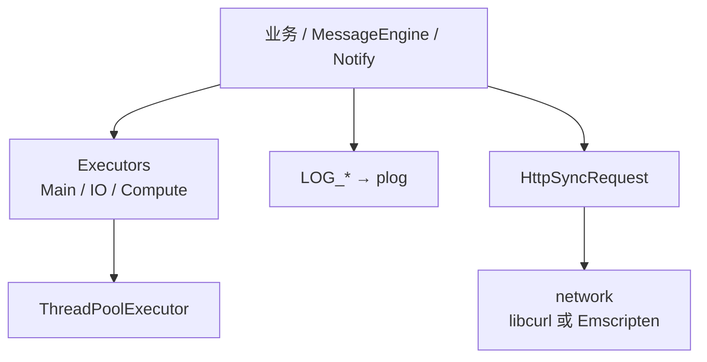

# Base

Cloud API 2 的自研基础库：线程池执行器、日志、同步 HTTP、字节缓冲。Message Engine、Notify、业务层都链它。编进 SDK 时由根 CMake 引入，一般不必单独编译。

头文件按目录包含：`<base/...>`、`<common/...>`。

## 目录

1. [能做什么](#能做什么)
2. [原理](#原理)
3. [在 SDK 中怎么用](#在-sdk-中怎么用)
4. [作为库接入](#作为库接入)
5. [注意](#注意)
6. [目录结构](#目录结构)

## 能做什么

- 执行器：`Post` / `PostDelay` / `Dispatch`，以及全局 `Main` / `IO` / `Compute` 三条队列
- 日志：`LOG_DEBUG` / `LOG_INFO` / `LOG_WARN` / `LOG_ERROR`，底层 plog
- 同步 HTTP：`HttpSyncRequest`（GET / POST / PUT / DELETE、multipart）
- 网络：libcurl；Emscripten 路径另有实现，给 Web 编译预留
- 工具：`ByteBuffer`、RFC 4122 v4 UUID、URL query 解析、异步回调里保护 `this` 的 `WeakDummy`

## 原理



1. `Executors::Init()` 建好三条线程池；`Shutdown()` 停掉。
2. `Main` 跑 SDK 业务与 MessageEngine 回调；`IO` 跑阻塞 HTTP；`Compute` 给计算任务。
3. 日志先 `PlogLogger::InitializePlog`，再打 `LOG_*`。
4. 异步 lambda 捕获 `this` 时，继承 `AsyncCaptureProtect`，用 `WeakDummy` / `WeakDummyReturn` 避免对象销毁后还跑回调。

## 在 SDK 中怎么用

`FlightHubSdk::initialize` 会初始化日志和 `Executors`。业务代码里直接：

```cpp
#include <common/executors/executors.h>
#include <base/common/logger.h>

drc_sdk::common::Executors::Main()->Post([] {
    LOG_INFO("on main");
});
drc_sdk::common::Executors::IO()->Post([] {
    // 阻塞 HTTP
});
```

Java 侧不直接调本库。

## 作为库接入

先链 `cloud_api2::base`（会带上 plog、libcurl 等）。最小例子：

```cpp
#include <common/executors/executors.h>
#include <base/common/logger.h>
#include <base/common/logger_plog.h>

drc_sdk::PlogLogger::InitializePlog(
    static_cast<int>(drc_sdk::LogLevel::kInfo),
    "sdk.log",
    true);

drc_sdk::common::Executors::Init();
drc_sdk::common::Executors::Main()->Post([] {
    LOG_INFO("hello");
});
drc_sdk::common::Executors::Shutdown();
```

UUID：新代码可用 `cloud_api2::generate_uuid_v4()`；历史调用点仍写 `xg::newGuid().str()`，两者同一生成器。

Query 解析：`cloud_api2::parse_query` / `query_param`（`common/util/url_query.h`）。整段百分号解码，不按 `?` 截断。

## 注意

- 命名空间仍是 `drc_sdk`（执行器、日志、HTTP），这是历史名字，不是另一套 SDK。
- Emscripten 执行器与 `network_emsdk` 给 Web 编译预留，原生平台默认走线程池 + libcurl。
- `HttpSyncRequest` 是同步调用，请放到 `IO` 队列，不要堵 `Main`。
- 不要把鉴权头、token 打进 `LOG_*`。

## 目录结构

```
base/
├── base/
│   ├── async/          # Executor、线程池、Timer
│   ├── common/         # 日志、宏
│   ├── io/             # ByteBuffer
│   └── utils/          # base64、线程工具
├── common/
│   ├── executors/      # Main / IO / Compute
│   ├── http_client/    # HttpSyncRequest
│   ├── network/        # libcurl / Emscripten
│   └── util/           # UUID、query、WeakDummy
├── CMakeLists.txt
└── README.md
```
