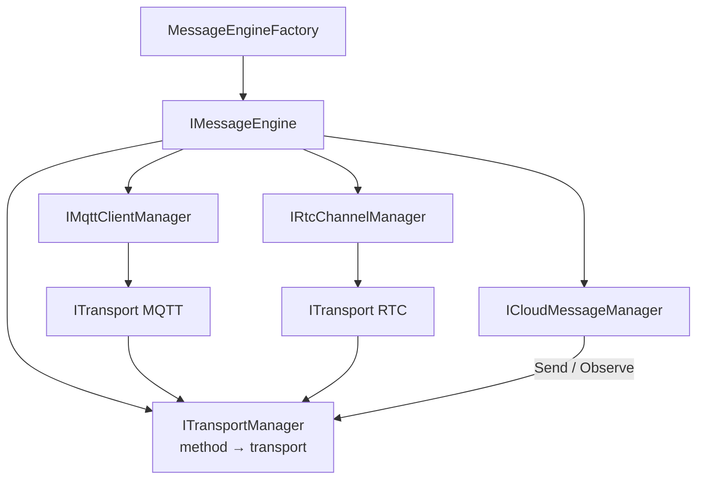

# Message Engine

Cloud API 2 的设备消息与实时通道库：按物模型收发 MQTT / DRC 消息，并管理直播、遥控用的 RTC 通道。飞机、机场等设备对象在创建时拿到一份引擎；上层 Java / C++ 业务一般不必直接 `createMessageEngine`。

本构建默认编入 MQTT（Paho）和内置 WebRTC；有 `libdrtc` 时再编 DRTC。火山 / 声网 native 通道未编入。

## 目录

1. [能做什么](#能做什么)
2. [原理](#原理)
3. [在 SDK 中怎么用](#在-sdk-中怎么用)
4. [作为库接入](#作为库接入)
5. [注意](#注意)
6. [目录结构](#目录结构)

## 能做什么

- 物模型消息：`ICloudMessageManager` 上 `Send*` / `Observe*`，对应 MQTT topic + method
- 传输路由：同一 method 可走 MQTT 或 RTC 实时通道，由 `ITransportManager` 的路由表决定
- MQTT 客户端：Paho，订阅 / 发布、断线恢复观察回调
- RTC：实时通道（遥控数据）和直播通道（拉流）；本构建为 WebRTC、DRTC
- 消息包装：V1 / V2 / V3 与生成代码互转

## 原理



1. `createMessageEngine(working_executor)` 建引擎；回调跑在传入的执行器上（SDK 用 `Executors::Main()`）。
2. `AddMqttClient` / `AddChannel` 会注册 transport。再 `AddMethodRouterMap`，把 method 指到某条 transport。
3. `CloudMessageManager` 发消息时按 method 选 transport；收消息按已注册的 `Observe*` 回调。
4. RTC 只认 `Channel` / `RealTimeChannel` / `LiveStreamChannel` 抽象；具体实现由工厂按 `ChannelProviderType` 选 WebRTC 或 DRTC。

`generated/` 是物模型生成物，不要手改。字段名（含 `volc_rtc`、`ccc_debug_command` 等）与后端协议一致。

## 在 SDK 中怎么用

设备对象（`DroneImpl` / `DockImpl` 等）内部创建引擎。远程控制走 `DrcLinkMgr`：向 PaaS 要数据通道，再按返回的 `provider` 加 MQTT 或 RTC，并写 method 路由。直播拉流走 `LiveModule` 的 `LiveStreamChannel`。

业务 module 从设备对象取能力即可，不必再 init 本库。

## 作为库接入

```cpp
#include <message_engine_factory.h>
#include <i_message_engine.h>
#include <common/executors/executors.h>

drc_sdk::common::Executors::Init();

auto me = message_engine::MessageEngineFactory::createMessageEngine(
    drc_sdk::common::Executors::Main());
if (!me || !me->initialize()) {
    return;
}

auto mqtt = me->getMqttClientManager();
auto rtc = me->getRtcChannelManager();
auto cmm = me->getCloudMessageManager();
auto tm = me->getTransportManager();

// AddMqttClient / AddChannel 之后配置 method 路由，再 Send* / Observe*

message_engine::MessageEngineFactory::destroyMessageEngine(me);
drc_sdk::common::Executors::Shutdown();
```

`AddChannel` 的 `ChannelInfo` 按 provider 选用对应构造函数（WebRTC URL、DRTC room 等），见 `api/i_channel.h`。

## 注意

- 本构建不编火山 / 声网 native。`ChannelProviderType::VolcEngine` / `Agora` 没有实现；SDK 层遇到直播 `url_type=volc`、非 whep 的 `agora`、以及 DRC `provider=volc_rtc` 会直接失败。
- DRTC 仅在存在 `cloud_api2::libdrtc` 时编入 `rtc/drtc_user/`。
- `generated/` 与后端物模型对齐，不要按「上层有没有用到」裁掉。
- 执行器、日志来自 `deps/base`，见该目录 README。

## 目录结构

```
message_engine/
├── src/
│   ├── api/                         # 对外头：Factory、IMessageEngine、通道与 MQTT
│   ├── message_engine_factory.cpp
│   ├── message_engine_impl.*
│   ├── transport/                   # TransportManager、路由表
│   ├── mqtt/                        # Paho MQTT
│   ├── rtc/                         # WebRTC / DRTC 通道
│   └── cloud_message_manager/
│       ├── i_interface_user/        # ICloudMessageManager
│       ├── interface_user/          # Send / Observe 实现
│       ├── message_define_user/     # generated 物模型 + custom
│       ├── message_wrapper/         # V1 / V2 / V3
│       └── message_scheduler/       # 等待回包、超时
├── CMakeLists.txt
└── README.md
```
