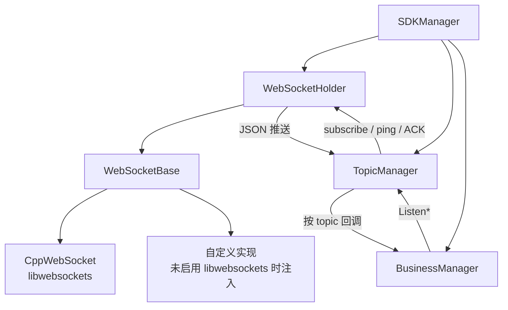

# Notification Center SDK

Cloud API 2 的 Notify 客户端：连上推送服务的 WebSocket，按 topic 订阅，把推送拆成 `Listen*` 回调。

编进 SDK 时默认用 libwebsockets（官方支持平台 Linux x86_64）。上层 Java / C++ 业务通过 `src/bll/notification_center` 包一层，一般不必直接调本库。

## 目录

1. [能做什么](#能做什么)
2. [原理](#原理)
3. [在 SDK 中怎么用](#在-sdk-中怎么用)
4. [换 WebSocket 实现](#换-websocket-实现)
5. [作为库接入](#作为库接入)
6. [注意](#注意)
7. [目录结构](#目录结构)

## 能做什么

- 维护一条 WSS 长连接（鉴权头、自动重连由上层 `NotificationCenter` 配合）
- 按设备 SN + topic + 推送频率向 Notify 服务订阅 / 取消订阅
- 收到推送后按 topic 分发到对应 `Listen*` 回调
- 对需要确认的推送回 ACK；定时 ping

`BusinessManager` 上约有 135 个 `Listen*`，与 `topic_message_define/` 里的 topic 头一一对应。字段定义在 `Message.h`。即使上层模块没有封装某个 Listen，协议面仍保留，可直接调本库订阅。

## 原理



1. `SDKManager::init` 建好执行器、TopicManager、BusinessManager，并挂上 WebSocket。
2. `connect(url)` 打开 WSS。握手鉴权头用 `setWebSocketAuthHeaders`，只在下一次 `connect` 生效。
3. `ListenXxx(...)` 向服务发订阅；后续 `publish` 经 `topic_message_define` 解成 POD，进业务回调。
4. 断线后 TopicManager 会按已订阅列表恢复订阅。

内置 `CppWebSocket` 的线程模型、状态机和发送队列见 [src/websocket/CppWebSocket.md](src/websocket/CppWebSocket.md)。

## 在 SDK 中怎么用

Cloud API 2 初始化时会创建本库、连 Notify，并在各业务 module 里 `Listen*`。Java demo 走 `FlightHubSDK` 即可，不必再单独 init 本库。

需要自己接推送时，从 `NotificationCenter::getBusinessManager()` 取 `BusinessManager`，或直接用下面的 C++ 入口。

## 换 WebSocket 实现

实现 `notification_center::WebSocketBase`（`connect` / `send` / `close` / `isOpen`，以及按需的 `setAuthHeaders`），在 `ENABLE_LIBWEBSOCKETS` **未定义** 时调用 `SDKManager::setWebSocket`。

本仓构建默认会链 `cloud_api2::websockets`，因而会定义 `ENABLE_LIBWEBSOCKETS`，此时 `setWebSocket` **会被忽略**，始终用 `CppWebSocket`。要换成自己的链路：

1. 本库 CMake 不再 `PRIVATE` 链接 `cloud_api2::websockets`
2. 实现 `WebSocketBase` 并在 init 前 `setWebSocket`

上层已有 `FlightHubSdk::injectWebSocket`，语义与此相同；在默认构建里同样不会替换内置实现。

## 作为库接入

```cpp
#include <SDKFactory.h>
#include <SDKManager.h>
#include <BusinessManager.h>

auto sdk = notification_center::SDKFactory::createSDKManager();

notification_center::SdkInitializeInfo info;
info.log_path = "notification_center.log";
info.log_level = notification_center::SdkLogLevel::INFO_LEVEL;
sdk->init(info);

sdk->setWebSocketAuthHeaders({{"x-auth-token", token}});
sdk->connect("wss://example.com/notify");

auto biz = sdk->getBusinessManager();
biz->ListenAircraftLocation(
    [](const notification_center::AircraftLocation& msg) {
        (void)msg;
    },
    [](const notification_center::NotificationCenterErrorCode& err) {
        (void)err;
    },
    "device_sn",
    notification_center::NotificationFrequency_OnChanged);
```

频率：`OnChanged` 按变推送，或 `Push_1s` … `Push_30s` 定频。`CancelObserve(listen_id)` 取消。

## 注意

- 只支持内置 libwebsockets 路径（官方支持平台 Linux x86_64）；Windows 无配方。
- `setAuthHeaders` 只作用于下一次 `connect`，连上之后改头需要断开重连。
- topic 头与 `Message.h` 是协议面，不要按「上层有没有 Listen」裁掉。
- `Message.h` 里部分时间戳仍是 `long`，与历史 JSON 对齐，不要随便改成 `long long`。

## 目录结构

```
notification_center_sdk/
├── src/
│   ├── notification_center_sdk_api/   # 对外头：SDKManager / BusinessManager / Message
│   ├── sdk_manager/                   # 初始化、连接、组装各组件
│   ├── topic_engine/                  # 订阅匹配、ping、ACK、断线恢复
│   ├── business_manager/              # Listen* 实现 + topic_message_define/
│   ├── websocket/                     # WebSocketBase / Holder / CppWebSocket
│   └── base_utils/                    # uuid、JSON 校验薄壳
├── CMakeLists.txt
└── README.md
```
