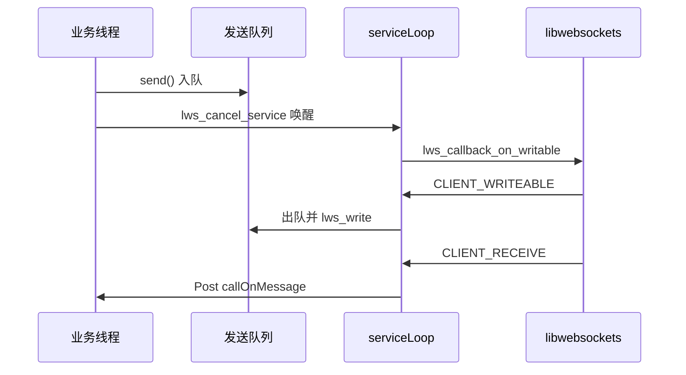

# CppWebSocket

内置 WebSocket，基于 libwebsockets。实现 `WebSocketBase`，供 TopicManager 收发 Notify 报文。

要换成自己的实现，见上级 [README · 换 WebSocket 实现](../../README.md#换-websocket-实现)。常量以 `CppWebSocket.cpp` 为准。

## 目录

1. [结构](#结构)
2. [状态机](#状态机)
3. [线程模型](#线程模型)
4. [发送与关闭](#发送与关闭)
5. [接收与流控](#接收与流控)
6. [当前缓冲区与超时](#当前缓冲区与超时)

## 结构

```
WebSocketBase          抽象接口：connect / send / close / isOpen / setAuthHeaders
    └── CppWebSocket   对外类，PIMPL
            └── Impl   libwebsockets context、wsi、发送队列、service 线程
```

公共方法全部委托给 `Impl`。`lws` 头文件只出现在 `.cpp`。

未定义 `ENABLE_LIBWEBSOCKETS` 时，`CppWebSocket` 是空壳；此时应注入自定义 `WebSocketBase`。

## 状态机

```
DISCONNECTED ──connect()──► CONNECTING ──ESTABLISHED──► CONNECTED
                                                          │
                     close()                              ▼
CLOSED ◄────────────────────────────── CLOSING
   ▲
   └── 对端关闭 / 连接错误：从 CONNECTING 或 CONNECTED 直接到 CLOSED
```

状态存在 `std::atomic<WebSocketState>` 里，用 `compare_exchange_strong` 转换。只有 `DISCONNECTED` / `CLOSED` 可以再 `connect()`；只有 `CONNECTED` 可以 `send()`。

## 线程模型

业务线程（SDK 主执行器）只做：`connect` / `send` 入队 / `close`。

`serviceLoop` 跑在独立线程：创建 `lws_context`、`lws_service`、处理 callback。`wsi` 上的 `lws_callback_on_writable` 只在这条线程触发。

callback 里不直接调业务：`callOnOpen` / `callOnMessage` / `callOnClose` / `callOnError` 经 `Executors::Main()->Post` 回到主执行器。对象生命周期用 `AsyncCaptureProtect` / weak dummy 护住。



## 发送与关闭

**发送。** 消息先入队。业务线程置 `writeableRequested`，再 `lws_cancel_service` 唤醒 service 线程；由 service 线程在 `lws_wsi_user(wsi) == this` 之后调用 `lws_callback_on_writable`。`lws_service` 前后各消费一次该标志，缩短唤醒到真正可写的间隔。

macOS 上 libwebsockets 可能丢 writable，用 `writeablePending` 超时再请求一次。

堆积时超过 TTL 的 ACK 会被丢掉，避免旧确认占住带宽。

**关闭顺序：** 转到 `CLOSING` → 锁内把 `wsi` 置空 → 清队列 → `lws_cancel_service` → `join` service 线程 → 复位 `writeableRequested` → `lws_context_destroy` → `CLOSED`。即使已经是 `CLOSING`/`CLOSED`，仍走 join / 回收，避免漏线程。

从 `CLOSED` 再 `connect()` 时，同样先停旧循环、join、再 destroy context。

## 接收与流控

分片先拼进 `receiveBuffer`，`lws_is_final_fragment` 为真才交给上层。单条消息上限 64MB。

SSL 读内循环可能饿死 `POLLOUT`（libwebsockets issue 1700）。每收到若干条后 `lws_cancel_service`，让 poll 有机会调度可写。`rx_buffer_size` 保持较小，避免一次 `SSL_read` 过长。

URL 支持 `ws://` / `wss://`；默认端口 80 / 443。鉴权头只在下一次握手使用。

## 当前缓冲区与超时

| 项 | 值 | 作用 |
|----|----|------|
| `NCSDK_LWS_RX_BUFFER_SIZE` | 4KB | lws 协议层接收缓冲；过大易加剧 POLLOUT 饥饿 |
| `NCSDK_TCP_SEND_BUFFER_SIZE` / `RECV` | 256KB | `SO_SNDBUF` / `SO_RCVBUF` |
| `NCSDK_WRITEABLE_BATCH_SIZE` | 64 | 一次 WRITEABLE 最多连续写出的条数 |
| `NCSDK_MSG_TTL_MS` | 30s | 过期 ACK 丢弃 |
| `NCSDK_MAX_MESSAGE_SIZE` | 64MB | 单条接收上限 |
| Keep-Alive | 30s / 10s / 3 | TCP keepalive |
| 连接超时 | 10s | `lws` `timeout_secs` |

改这些数字前先看 `CppWebSocket.cpp` 文件头注释：接收缓冲和 SSL 节流是一对，单独加大 rx 缓冲会把可写事件拖死。
