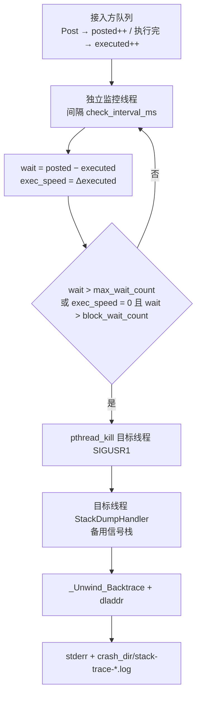

# Thread Blocking Detector

监控任务队列是否卡住，卡住时抓 native 堆栈。用于排查工作线程无响应。仅支持 POSIX 平台（Windows 不支持）；官方支持平台为 Linux x86_64。

Cloud API 2 编译时会链入本库，运行时默认不启动；本目录也可单独编译示例。

## 目录

1. [能做什么](#能做什么)
2. [原理](#原理)
3. [在 SDK 中启用](#在-sdk-中启用)
4. [单独编译示例](#单独编译示例)
5. [作为库接入](#作为库接入)
6. [配置项](#配置项)
7. [注意](#注意)
8. [目录结构](#目录结构)

## 能做什么

检测器按间隔读取「已提交 / 已执行」任务数。满足任一条件即视为阻塞：

- 待执行任务数超过 `max_wait_count`
- 执行速度为 0，且待执行任务数超过 `block_wait_count`

判定阻塞后，向目标线程发送 `SIGUSR1`，在信号处理里抓堆栈：

- 诊断过程打到 **stderr**
- 堆栈文件写到 `crash_dir`
- Linux 上若打开 `dump_all_threads`，会把进程内其它线程的堆栈写进同一文件

堆栈地址可用 `addr2line` 解析。Java 进程若帧停在 `libjvm.so` 附近，可再配合 `jstack <pid>`。

## 原理

线程卡死时，从监控线程去 unwind **拿不到**卡住那条线程的栈。本库因此分两步：旁路观察任务队列是否还在推进；确认卡住后，把信号打到目标线程，让它**自己**在信号处理里回溯当前栈。

接入方实现 `TaskStatistics`，只提供三件事：已提交数、已执行数、目标 `pthread_t`。检测器不解析任务内容，也不改执行器实现。



**判定。** 监控线程周期读取计数，不算 CPU、也不看锁。`wait` 是积压；`exec_speed` 是相对上次检查「完成了几件」。积压过大，或积压已过 `block_wait_count` 且本周期完成数为 0，都视为阻塞。队列恢复推进后会清掉上次堆栈指纹，同一处再卡会重新写文件。

**抓栈。** `Init()` 注册 `SIGUSR1`，并用 `sigaltstack` 准备备用栈。`pthread_kill` 只中断目标线程；handler 里 `_Unwind_Backtrace` 拿到的就是该线程当时的 PC。符号用 `dladdr` 解析（库名、符号、偏移）；handler 走 `write` / `open` 这类异步信号安全调用，避免在信号里 `new` / `printf`。同一套 PC 序列会算指纹，连续重复上报会跳过。

**全线程 dump（仅 Linux）。** `dump_all_threads` 打开时，遍历 `/proc/self/task`，对每个 tid `tgkill(SIGUSR1)`，各线程把栈追加到同一个 `stack-trace-all-*.log`。被监控线程会标 `[Monitored/Main]`。macOS 没有等价的 `/proc` 接口，只对目标线程 `pthread_kill`。

**为何看队列而不是看「线程还活着」。** 工作线程可能卡在锁、同步调用、`sleep` 或 Java 层，`pthread` 仍然存在，心跳也会误报正常。队列「提交在涨、完成不动」更能说明执行器已经停住。代价是：空闲（队列空、速度为 0）不会触发；必须有积压才报。

## 在 SDK 中启用

库会编进 SDK，但初始化时默认不启动检测。需要时设环境变量：

```bash
export FLIGHTHUB_ENABLE_BLOCKING_DETECTOR=1
```

值为 `1` 或 `true` 时才会 `Init` / `Start`。未设置或其它值都保持关闭，不注册信号、不建监控线程。

SDK 接入时的行为：

- 监控 SDK 主执行器线程
- 堆栈写到当前工作目录下的 `blocking_detector/`
- Linux 会转储全部线程
- 检测到阻塞后**不会**退出进程

## 单独编译示例

```bash
./build.sh
```

或：

```bash
cmake -S . -B build -DBUILD_BLOCKING_DETECTOR_DEMO=ON
cmake --build build
./build/blocking_detector_demo
```

示例会模拟任务堆积并触发检测，堆栈写到 `./blocking_detector/`。编进 Cloud API 2 时示例默认不编。

## 作为库接入

实现 `blocking_detector::TaskStatistics`，提供已提交数、已执行数和目标 `pthread_t`，然后：

```cpp
blocking_detector::BlockingDetectorConfig config;
config.crash_dir = "./blocking_detector";
config.abort_on_blocking = false;

blocking_detector::BlockingDetector detector(&stats, config);
if (!detector.Init()) {
    return;
}
detector.Start();
// ...
detector.Stop();
```

## 配置项

| 字段 | 默认值 | 说明 |
|------|--------|------|
| `max_wait_count` | `10000` | 待执行任务数超过该值视为异常 |
| `block_wait_count` | `2000` | 执行速度为 0 且待执行超过该值视为阻塞 |
| `check_interval_ms` | `1000` | 检测间隔（毫秒）；SDK 接入时为 `2000` |
| `stack_depth` | `64` | 堆栈捕获深度 |
| `crash_dir` | `/tmp/blocking_detector` | 堆栈输出目录；SDK 接入时为 `./blocking_detector` |
| `abort_on_blocking` | `true` | 检测到阻塞后是否 `abort`；SDK 接入时为 `false` |
| `dump_all_threads` | `false` | 是否转储全部线程（仅 Linux）；SDK 接入时为 `true` |

## 注意

- 占用 `SIGUSR1`，不要和应用自己的 `SIGUSR1` 处理叠用。
- 库默认 `abort_on_blocking = true`。接进长期运行的进程时请显式设为 `false`。
- 需要 `-funwind-tables` / `-fexceptions`，并用带调试信息的构建才能较好地解析堆栈。
- Windows 不支持。

## 目录结构

```
thread_blocking_detector/
├── src/
│   ├── blocking_detector.h
│   └── blocking_detector.cpp
├── sample/demo.cpp
├── CMakeLists.txt
├── build.sh
└── README.md
```
