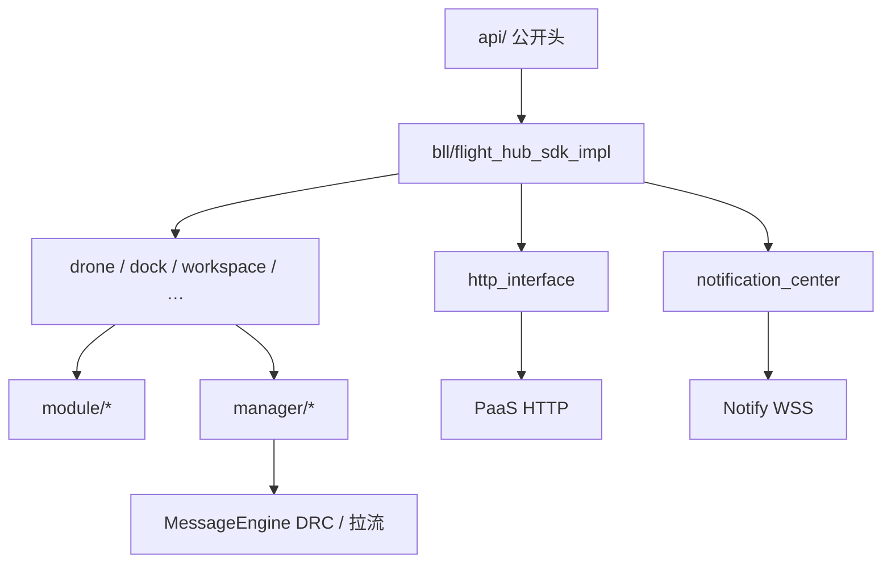

# Cloud API 2 核心源码

本目录是 SDK 的 C++ 实现。对外接口在 `api/`，实现在 `bll/`。Java 绑定由 SWIG 从 `api/` 生成，改这些头会同时影响 C++ 与 Java。

一般用法：`FlightHubSdk::initialize` → `setHttpHeaders` / `setWebSocketAuthHeaders` → `getDroneInstance` / `getDockInstance` 等取得设备对象，再调用其上的 module。

## 目录

1. [能做什么](#能做什么)
2. [原理](#原理)
3. [初始化](#初始化)
4. [主要模块](#主要模块)
5. [注意](#注意)
6. [目录结构](#目录结构)

## 能做什么

- 连 PaaS：HTTP 调用设备 / 机场 / 工作空间等接口
- 连 Notify：WebSocket 推送，按 topic 进各 module 的回调
- 设备对象：飞机、机场等，对外暴露直播、航线、远程控制等 module
- 直播拉流与 SEI 解析；DRC 数据通道（MQTT / WebRTC / DRTC）

鉴权头由调用方注入，SDK 不内置登录。Java 侧入口是 `FlightHubSDK`，走同一套 C++ 实现。

## 原理



- **`api/`**：公开类型与接口。字段名、类型进入 SWIG，会反映到 Java。
- **`bll/module/`**：每个公开 module 对应一组 HTTP 调用和/或 Notify `Listen*`。
- **`bll/manager/`**：跨 module 的流程，例如打开 DRC、负载控制权、能力查询。
- **`bll/http_interface/`**：对 PaaS 的 HTTP 路径、请求与响应结构。

## 初始化

`FlightHubSdk::initialize`（`bll/flight_hub_sdk_impl.cpp`）会：

1. 配置日志并启动执行器
2. 按环境变量决定是否启用主线程堵塞检测（见 `deps/thread_blocking_detector`）
3. 创建 HTTP 客户端，连接 Notify（`notification_center`）
4. 之后 `getXxxInstance` 再创建对应设备对象，并按需初始化 MessageEngine

## 主要模块

| 位置 | 职责 |
|------|------|
| `bll/http_interface/` | HTTP：路径、重试、请求头、STS 上传 |
| `bll/manager/drc_link_mgr/` | 打开 DRC 数据通道（MQTT / WebRTC / DRTC） |
| `bll/module/live_module/` | 开播、拉流、SEI 解析、token 续期 |
| `bll/notification_center/` | 封装 `deps/notification_center_sdk`：连接、重连，把 `BusinessManager` 交给各 module |

其余业务 module 通常是：组装请求、调用 HTTP 或订阅 Notify，再把结果回调给调用方。试飞、Terra、航线等是正式接口，不是示例桩。

## 注意

- 本构建默认不编火山 / 声网 native RTC。直播 `url_type=volc`，或 `agora` 且 URL 不含 `whep`，会失败；`agora` 且 URL 含 `whep` 走内置 WebRTC。DRC 的 `volc_rtc` 同样不支持，需要服务端改为 WebRTC / DRTC。
- 日志不要打印鉴权头和直播 token 原文。
- `api/message.h` 字段与 Notify / HTTP 对齐。不要随意把 `long` / `long long` 互改（SWIG 会生成不同的 Java 类型）。

## 目录结构

```
src/
├── api/                         # 公开头（SWIG 入口）
├── bll/
│   ├── flight_hub_sdk.cpp       # 静态入口转发到 Impl
│   ├── flight_hub_sdk_impl.*    # 初始化、销毁、取得设备实例
│   ├── http_interface/          # PaaS HTTP
│   ├── notification_center/     # Notify 连接
│   ├── cloud_storage_uploader/  # S3 / MinIO 上传
│   ├── drone/ dock/ …           # 设备对象，聚合 module
│   ├── module/                  # 业务 module 实现
│   ├── manager/                 # DRC、负载、固件等流程
│   └── blocking_detector_adapter.*  # 主执行器任务计数
├── CMakeLists.txt
└── README.md
```
